# 03: Software design document

| Field | Value |
|---|---|
| Document | Software Design Document (SDD) |
| Version | 0.178 |
| Date | 2026-10-20 |
| Author | Claude (Cowork) |
| Status | Draft |

## Change log

| Version | Date | Author | Change |
|---|---|---|---|
| 0.1 | 2026-09-22 | Claude (Cowork) | First version: architecture, C4, deployment, ERD, sequences, states, API reference, sync, geospatial, ADRs. Android edit and settings screens are described from the intended behaviour. |
| 0.2 | 2026-09-22 | Claude (Cowork) | Wave 2: filter chain (headers, size limit, rate limit, deny-by-default key check), photo tombstones (V3), ordered sync versions, client clock guard, export/erase endpoints, Android networking/i18n/Assistant, web AI pages and confirm dialog. Sequences 7.5 to 7.7 now describe built code. |
| 0.3 | 2026-09-22 | Claude (Cowork) | Sprint 1 fixes and Sprint 2 ([10](10-sprint-log.md)): web MapLibre GL 6.10 (ESM module worker served from `/maplibre/`, CSP `worker-src 'self'`, no `blob:` worker; F-27), compileSdk 37, embedded Tomcat 11.0.25 override (F-28), 32-char API key minimum and `APP_API_KEY_NEXT` dual key (F-01, SEC-017), release signing config (F-11), `SyncRules`/`StreetAlerts` extracted on Android, DB image runs as `postgres` (F-29). |
| 0.4 | 2026-09-22 | Claude (Cowork) | Sprint 3 ([10](10-sprint-log.md)): section 13 Providers row: embeddings now go to the native Gemini endpoint `models/{model}:batchEmbedContents` with the key in the `x-goog-api-key` header (`GeminiEmbeddingModel`, `AI_EMBEDDING_PROVIDER`, default `google-genai`; `openai` for Ollama); reindex returns 503 when a batch fails. Sequence 7.5 shows the question embedding call. Corrected the redaction claims (system context diagram, section 7.5 Ask sequence, AI data sources row): the contact name is not redacted before the LLM provider ([02](02-threat-model.md) F-30). |
| 0.5 | 2026-09-22 | Claude (Cowork) | Sprint 3 lead decisions ([10](10-sprint-log.md)): contact redaction (C-13, F-30 Fixed by the AI team): the system context diagram, sequence 7.5 and the section 13 AI data sources row now say that `ContactRedactor` keeps the contact name and phone out of the embedding text, Ask context and tool results. F-01 split in [02](02-threat-model.md) v0.6: `WebConfig` row points at F-01a, ADR-03 at F-01a/F-01b. |
| 0.6 | 2026-09-22 | Claude (Cowork), Docs team | New **ADR-13**: product renamed from House Hunt to **Doorprints** (tagline "Remember every house you've seen."): reason, what changed (display name, tagline, `applicationId` `app.doorprints`, CI artifact names, launcher icon, export file name, MCP server name) and what did not (Java/Kotlin packages and class names, repository name, storage keys, database, role, image and volume names, export format id, MCP tool names). System context and container diagrams, the export row in section 9 and the MCP row in section 13 use the new names. |
| 0.7 | 2026-09-22 | Claude (Cowork), Docs team | Vertex AI provider (AI team, same change set; [01](01-requirements.md) AI-016, [10](10-sprint-log.md) C-24). Section 13 Providers row now describes both providers and the `app.ai.provider` (`AI_PROVIDER`) switch: **aistudio** (default; OpenAI-compatible chat, native `batchEmbedContents` with `x-goog-api-key`) and **vertex** (chat through Spring AI's Google GenAI starter with the app's own google-genai `Client`; embeddings through the app's `VertexEmbeddingModel`, `:embedContent` or `:predict`, one text per call; OAuth bearer tokens from Application Default Credentials, no API key; `<location>-aiplatform.googleapis.com`). Section 9 and 13: the `503` problem for provider quota errors now carries `code: AI_QUOTA_EXHAUSTED` and a `Retry-After: 60` header; the spend cap case is open (AI-017). Section 2 context diagram and section 4.1 errors row updated. Review fix: section 9 and the section 4.1 errors row add the `setupHint` property on Vertex AI 401/403/404 (`AiExceptionHandler.SETUP_HINT_PROPERTY`). |
| 0.8 | 2026-09-22 | Claude (Cowork), Docs team | Sprint 3.5 "KMP foundation" (commit `8f583af`, [10](10-sprint-log.md) §9). New **ADR-14**: Kotlin Multiplatform-ready Android code base with a `:shared` module (Android + compile-only `iosArm64`/`iosSimulatorArm64`), Ktor 3.6 client replacing OkHttp's `RetryInterceptor`, Room staying in `:app` until Phase 2. Section 1 Android row (Ktor client with the OkHttp 5.5 engine, version catalog); section 4.2 component diagram and table (`ApiClient`, `RetryPolicy`, `SyncOutcome`, `SyncRules`, `StayDetector`, `StreetAlerts`, `Geo`, `HouseScore` now in `:shared`; `Api.kt` holds the app-wide `HttpClient`); new section 4.2.1 with the module boundaries and the Phase 2 plan; section 6.2: Room schema export on, `2.json` committed and `RoomSchemaTest` pins the identity hash; 6.3 score in `HouseScore`; **R-06** partly closed (migration test still open). ADR-01 notes the Sprint 4b *Hunting areas* exception (Geofencing API with an opt-in background permission, [11](11-feature-parity-and-export-spec.md) 5.17); the 11 proposals renumber to ADR-15..ADR-18. |
| 0.9 | 2026-09-22 | Claude (Cowork), Docs team | **Sprint 4a (S4-06): local-first clients and the offline copy.** New **section 16**: where the exporters live (one pure model in `:shared` and its TypeScript port, platform glue per app, no clock inside), what a copy contains and the single gate (`ExportBundle.build`) that applies every option, import (`ImportPlan`: merge by last-write-wins, import-as-a-copy with re-identified rows and a `photoSources` map, validation before any write), and the web app as a local-first installable app (IndexedDB, `MemoryDb` fallback, app-shell-only service worker, announced updates, install as a menu item, stated durability, GitHub Pages hosting and its header gap). New **ADR-19** (the local-first web app adds **no npm dependency**: own IndexedDB wrapper, own ZIP writer, own XLSX writer, `crypto.subtle`, hand-written service worker — with the cost stated) and **ADR-20** (one backup format `doorprints-backup/1` implemented three times, ZIP entries **stored** not deflated so the output stays byte-identical). Section 9: `GET /api/export` now emits the shared format, new `POST /api/import` with `?dryRun=true` and its two 413 caps. Section 4.3 web components rewritten (`configGuard` gone, `LocalDb`/`LocalStore`, `SyncService`, `StorageService`, `PwaService`, exporters). ADR-13's "export format id unchanged" note marked superseded. **R-05 closed.** Where the code differs from [11](11-feature-parity-and-export-spec.md) 5.2/5.10 the code is described, not the plan: four CSV tables rather than seven, no PDF writer on the web (print view instead), no Dexie/`idb`/`fflate`/`@angular/pwa`. |
| 0.10 | 2026-09-22 | Claude (Cowork), Docs team | Review fix, §16.4: the durability bullet said the browser will not promise persistence "(always the case in Safari)". Reworded to what [MDN's *Storage quotas and eviction criteria*](https://developer.mozilla.org/en-US/docs/Web/API/Storage_API/Storage_quotas_and_eviction_criteria) actually states — Safari and Chromium decide automatically from interaction history without prompting (Safari commonly denies), Safari evicts script-written storage after seven days without user interaction, and a Home Screen / Dock web app gets the browser app's quota — with the same conclusion: persistence is not something to rely on. Matches [02](02-threat-model.md) RR-10 v0.16. No design or code change. |
| 0.11 | 2026-09-22 | Claude (Cowork), Docs team | Fifth review round (docs versus the web code as built). **§4.3 `PwaService`**: it no longer "registers `/sw.js`" for "an Install app menu item" — it registers `sw.js` beside `index.html` with the scope taken from `document.baseURI` (`/` or `/doorprints/`), keeps `beforeinstallprompt` for the permanent *Install the app* card on *Your data* and a **one-time banner** after the first saved house with a **30-day** "Not now", and gates the update reload on unsaved changes. **§16.4**: the "Install is a menu item" bullet is replaced by what is built (banner once, snooze, one non-error banner at a time in the order migration > update > install > storage risk, permanent card); the service-worker bullet and the diagram said "app shell only" and "network first" — the worker precaches **every file of this build** and answers navigations **from the cache first**; the hosting bullet records the build-stamped absolute manifest `id`. **§16.2 PDF row**: on the web, **phones** (Android and iOS, browser or installed) open the HTML copy in a **new tab** with a translated hint, **desktops** print it through a hidden frame. **ADR-20** says how the format is pinned today (server and Android read the canonical sample; the web golden is compared with it by `BackupParityTest`). |
| 0.12 | 2026-09-23 | Claude (Cowork), Docs team | **Owner decision (Sriram, 2026-09-23): the web app is hosted on Cloudflare Pages, not GitHub Pages.** New **ADR-21** (hosting; ADR-15..ADR-18 stay reserved for the Sprint 5 decisions named in [11](11-feature-parity-and-export-spec.md)). **§5** deployment: the diagram shows `web.yml` deploying to Cloudflare Pages with `wrangler pages deploy`, and the *Web* row names Cloudflare Pages as the host, its SPA fallback (no `404.html` in the build) and the post-deploy header check. **§4.3 `PwaService`** and **§16.4 Hosting**: the site is served from the root (`/`, manifest `"id": "/"`); the `/doorprints/` project path and the shared `github.io` origin are gone. **§16.3**: how Android writes an import — merge row by row (interruptible, finished by importing again), copy in one transaction (all or nothing), Android handover item 10. |
| 0.13 | 2026-09-23 | Claude (Cowork), Docs team | Review fixes to 0.12. **ADR-21** alternative (c) overclaimed: Cloudflare's SPA mode and `_headers` handling were not "verified against the build"; they are documented by Cloudflare and were read from workers-sdk, and the first live check is TC-S-23. The secure-doc-viewer evidence now cites its `gh-pages` branch at `68e3a625`. **§16.4 Hosting**: one line on caching — no long-lived rule in `_headers`, because the SPA fallback answers a missing chunk with HTML and status 200 (the Web team removed those rules on 2026-09-23). |
| 0.14 | 2026-09-23 | Claude (Cowork), Docs team | **Owner decision of 2026-09-23: Firebase Hosting at `https://doorprints.web.app` replaces the Cloudflare Pages plan**, which was never set up. **ADR-21** rewritten as the hosting decision with its history: GitHub Pages rejected (shared origin, no response headers), Cloudflare Pages rejected by the owner because a `*.pages.dev` address reads as a development or test site, Firebase Hosting (Spark plan, no billing account, project and site `doorprints`) chosen with the brand advisor; deploy by `web.yml` with Workload Identity Federation (no key) and a pinned `firebase-tools`; this also retires the old Consequences sentence about "two repository secrets" (coordinator minor). **§5**: the diagram and the *Web* row describe Firebase Hosting, `web/firebase.json` and the post-deploy header check, and the row now lists `Referrer-Policy` among the headers checked (coordinator minor); the *TLS* row names Firebase. **§4.3** `PwaService` and the *Pages* row (the AI helper is now *Fill in from listing text*); **§12** *Transport* (HSTS from `web/firebase.json`); **§16.4 Hosting** rewritten; the container diagram's static host. |
| 0.15 | 2026-09-23 | Claude (Cowork), Docs team | **ADR-13**: one line added. Since the final Sprint 4a round the web icons (`favicon.svg`, the PWA icons, `apple-touch-icon.png`) are redrawn from the same launcher mark, so both platforms show the door-and-footprints icon. The brand rule is [12](12-brand-and-naming.md) N-06. |
| 0.16 | 2026-09-24 | Claude (Cowork), Docs team | **Owner issue P0 of 2026-09-24: India's boundaries on the map** (Jammu and Kashmir, and the same issue near Arunachal Pradesh; branch `fix/india-boundaries`). New **ADR-22**: both apps show India's external boundary as the Government of India depicts it, the only view, with no Line of Control, Line of Actual Control or other claim line; the data (Natural Earth, India point of view, public domain, `natural-earth-vector` commit `ca96624`, the four claim boxes), the five style rules as built (web `shared/india-boundaries.ts`, Android `ui/IndiaView.kt` and `ui/IndiaViewRules.kt`), the alternatives and the consequences. **§4.2** `MapScreen` and **§4.3** the map-style row name the rules and where they run (Android `loadStyle`, web `createMlMap` on every `style.load`). **ADR-02** points to ADR-22. Working tree, not yet built in CI. |
| 0.17 | 2026-09-24 | Claude (Cowork), Docs team | Round 1 review of the Docs change for India's boundaries (two majors, one minor). **ADR-22** re-synced with the code as of 2026-09-23 19:56 UTC (2026-09-24 01:26 IST) (Android `IndiaViewRules.kt`, `IndiaView.kt`, `IndiaViewRulesTest.kt` and `android/shared/README.md` 1.37 changed after 0.16 was written; web `india-boundaries.ts` compared rule by rule). Rule 2 now says what Android does: `boundary_2` draws only lines that carry at least one adm0 side and are not a PAK/CHN pair, and why (MapLibre shows a zoom 0-4 parent tile while a zoom 5+ tile loads or is missing offline, and checks minzoom against the map zoom); the web lacks the adm0 part, recorded as an **open parity gap** handed to Web ([11](11-feature-parity-and-export-spec.md) §10), so "identically on both apps" is gone. Rule 3: Android's `in-boundary-world` maxzoom is `Math.nextDown(5f)`, the same behaviour as the web's exclusive maxzoom 5. **Consequences** corrected: `boundary_2` is not clipped to the boxes, so inside them the tiles' non-disputed country lines draw beside the 1:10m outline (two close lines when zoomed in; where, from a decode of the zoom 5 and 6 tiles of the 2026-09-13 planet); offline at zoom 5+ with only zoom 0-4 tiles, only the outline draws; `boundary_3` (dashed admin lines) is left as Liberty has it, and in the decoded tiles no Pakistani or Chinese unit line inside the outline passes its filter. New backlog ids [10](10-sprint-log.md) S4b-BL-11 and S4b-BL-12. |
| 0.18 | 2026-09-24 | Claude (Cowork), Docs team | Docs re-synced with the code at HEAD `3ad2b58` (comment and docs round, no behaviour change). **ADR-22:** the "open parity gap (web)" is removed: the web's `shared/india-boundaries.ts` applies the same rules as Android, and the constant names are now the code's (`COUNTRY_LINE_RULE`, `COUNTRY_LINE_RULE_LEGACY`, `TILE_ZOOM_GUARD`; the 0.17 names `NOT_PAKISTAN_CHINA*` no longer exist). Rule 2 gains the **tile-zoom guard** `[">=", ["zoom"], 5]` on `boundary_2`, `boundary_3` and every other `boundary` line layer from zoom 5 (never `boundary_disputed`; a deprecated-syntax filter is left unguarded with a warning, also in rule 5). **Renderer claim corrected** (0.17 said both renderers draw a zoom 0-4 parent tile's lines through a minzoom 5 layer): read from the sources, neither does. maplibre-gl 6.10.0 skips a layer's bucket for a tile below `floor(minzoom)` (`worker_tile.ts:109`, `style_layer.ts:321-322`), and maplibre-native android-v13.6.1 leaves such a layer out in `GeometryTile::setLayers` (`geometry_tile.cpp:317`) before the worker's parse loop (`geometry_tile_worker.cpp:446-502`, which has no check of its own and evaluates filters with `overscaledZ` at :502). So the adm0 clause and the tile-zoom guard are defence in depth on both apps, not the Android fix that this round's brief and `android/shared/README.md` 1.39 state (the Web team's `web/README.md` row of 2026-09-24, finding (4), raised `geometry_tile.cpp:317`; Docs checked it in the source). Not observed on a device. **Consequences:** "about a kilometre" replaced by the measured figures (claim versus the true line: median about 1.55 km Jammu-Sialkot, about 1.6 km McMahon line, p90 3.9 km; tile versus claim: median 1.5-2.8 km, at most 5.3 km); the doubled-line list follows `android/shared/README.md` 1.38 item 38 (b) (Arunachal-Bhutan, Arunachal-Myanmar and Jammu-Sialkot are not doubled; in the east box only Bhutan's south-east corner and Myanmar south of 26.65 N; the Wakhan added); new known limit, the Assam-Arunachal Pradesh state line is not drawn from zoom 5 (S4b-BL-15); style-side fix for the doubled lines S4b-BL-16 ([10](10-sprint-log.md) §12.7). |
| 0.19 | 2026-09-24 | Claude (Code), lead | **ADR-13**: the favicon no longer leaves the toes out; since option C ([14](14-lead-backlog-and-handoff.md) N3, PR #15) it has the same three footprints as the app icons. |
| 0.20 | 2026-09-24 | Claude (Code), Docs team | **ADR-22** re-synced with branch `fix/india-boundary-lines` (PR #16, HEAD `9e0036e`; S4b-BL-11, S4b-BL-15, S4b-BL-16). **Rule 2** also leaves out India's line with China (China on one side, India or no country on the other; `INDIA_CHINA_LINE` on both apps, both syntaxes): the outline draws the whole India-China border at every zoom. **Data:** new file (415 689 bytes, sha256 `2c497e2e…56d7`), three kinds: `world` now also holds the 7 **shared stretches** of India's outline with Nepal, Bhutan, Myanmar and, in the Wakhan, Afghanistan along which the tiles draw India's border themselves (drawn below zoom 5 only), `claim` the rest with a connector of about 7 km at most at each hand-over and none at a box edge, new `state` (the Assam-Arunachal Pradesh line, Natural Earth 1:10m admin-1); how `find_shared_stretches.py` finds the stretches. **Rule 3:** new layer `in-boundary-state` from zoom 5, directly above `boundary_3` and drawn like it. **Consequences:** the two close lines and the missing state line are gone; new: the hand-over steps, the 3-5 km loops at Sikkim's two tri-junctions, and the shared stretches without a line at zoom 5+ while tiles load or offline. |
| 0.21 | 2026-09-24 | Claude (Code), Docs team | **ADR-22** after the Singalila spur fix (round 2 reviews): new data file (415 608 bytes, sha256 `25984afa…a024`; `claim` 5 pieces, 1 667 points; `world`, `state` and the 7 shared stretches unchanged), a cut within 1e-4 degrees of a `claim` line's end counts as the end, so no connector-only spur (two had shown into Nepal on the Singalila ridge). **Consequences:** the tri-junction loops sized (about 13 x 3 km at Nepal-China-India from about zoom 10, on glaciers; about 2 km at Doklam), the tile line running on past two hand-overs from about zoom 10 (a small hook at Jomotsangkha from zoom 9) (Jomotsangkha about 9 km, Longwa about 3 km; S4b-BL-17), and `INDIA_CHINA_LINE` also hiding about 12 km of the China-North Korea line on the Tumen islets (harmless for India). |
| 0.22 | 2026-09-24 | Claude (Code), Docs team | **Owner request of 2026-09-24: "The Compose needs to be changed to Kotlin Compose to allow easy iOS app creation".** New **ADR-23**: the Android UI moves from Jetpack Compose to JetBrains **Compose Multiplatform** in a new KMP module `:ui`, in phases P1..P8 plus a maplibre-compose spike ([10](10-sprint-log.md) §13, CMP-1..CMP-9). It amends **ADR-14** (which rejected a Compose Multiplatform UI in Sprint 3.5) and settles its Phase 2 item (4), SwiftUI or CMP. **§4.2.1** now shows `:ui` in the module diagram and the layer table; phase 1 (CMP-1) is done in commit `be86f50`: theme, list rows, server status, the Map and India view rules and a few small UI types moved to `:ui` `commonMain`, no visual change. §1 names the third module. |
| 0.23 | 2026-09-24 | Claude (Code), Docs team | **ADR-23** guard rails: each phase is verified by the JVM screenshot tests ([06](06-test-plan.md) TC-U-56: every screen but the Map, en/hi/ta/te, light and dark, 64 reference images checked by `android.yml`) and the instrumented smoke tests on an emulator ([06](06-test-plan.md) TC-I-35, `android-emulator.yml`); a phase that changes a screen on purpose re-records its images and says so. Owner request of 2026-09-24, commit `afe4064`, ticket CMP-0 ([10](10-sprint-log.md) §13.3). |
| 0.24 | 2026-09-24 | Claude (Code), Docs team | Round 3 review of PR #18: the screenshot test id in ADR-23 is **TC-U-56** (was TC-U-60; [06](06-test-plan.md) v0.35). |
| 0.25 | 2026-09-24 | Claude (Code), engineer | **Owner request of 2026-09-24: "the app needs to be Doorprints and also references of legacy House Hunt needs to be changed to it".** New **ADR-24**: the code, storage keys, database, image and tool names follow the product name, with a carry-over for what is stored; **ADR-13**'s "not changed" list is superseded in part. §4 and §13 name the new packages and types (`app.doorprints`, `app.doorprints.ui`, `app.doorprints.shared`, `app.doorprints.server`; `DoorprintsApp`, `DoorprintsRoot`, `DoorprintsTheme`), §6.2 the Room file `doorprints.db`, §13 the MCP tool `askDoorprints`. |
| 0.26 | 2026-09-24 | Claude (Code), Docs team | Reviews of PR #19: **ADR-23 P2** describes CMP-2 as built (PR #19, `80b198b`, review fixes `927d54b`): the UI strings as Compose resources in `:ui` (403 strings and 16 plurals per language, positional placeholders, a plain `'`), the service strings kept as Android resources, `AppLocale.applyDefault` setting the default locale on every API level from `resolved_language` (not `Locale.setDefault` on API 26-32), `androidResources.localeFilters`, `StringParityTest` (TC-U-59) and `AppLocaleTest` (TC-U-60). §6.2's rename note rewrapped. |
| 0.27 | 2026-09-24 | Claude (Code), engineer | **ADR-23 P3** describes CMP-3 as built (branch `claude/doorprints-dev-continue-fzcge2`): `PlatformServices` with one member so far (`isScreenReaderOn`), provided by `LocalPlatformServices`; `Format.kt` in `:ui` (common amounts and scores, an `expect` date format, `expect fun appLanguage()`), `LiveMessage`, `DeletedHouseUndo`, `ActionBar` and `ResultCard` in `:ui` commonMain; `:app`'s blocking `UiStrings.kt` removed; the dates and `uiLanguage()` follow the resolved language (S4b-BL-18); `MapRulesTest` and `IndiaViewRulesTest` in `:ui` commonTest. §4.2.1's `:ui` row lists the phase 3 files. |
| 0.28 | 2026-09-24 | Claude (Code), engineer | **ADR-23 P4a** describes CMP-4 P4a as built (branch `claude/doorprints-dev-continue-fzcge2`): `AppDatabase`, the entities, DAOs, `Converters` and `MIGRATION_1_2` in `:shared` commonMain with Room KMP 2.8.5 (plugin `androidx.room`, KSP for android, `iosArm64`, `iosSimulatorArm64`), package `app.doorprints.data` kept; the Android builder and `DatabaseFile` stay in `:app` (framework SQLite, no driver); an iOS builder with the bundled driver, compile-only. §4.2.1 diagram and layer table, §6.2 (schema folder `android/shared/schemas/`, `AppDatabaseMigrationTest`) and **R-06 closed**. |
| 0.29 | 2026-09-24 | Claude (Code), engineer | **ADR-23 P4b** describes CMP-4 P4b as built (branch `claude/doorprints-dev-continue-fzcge2`): `SettingsStore` (with `SyncHealth` and the export grant list) in `:shared` commonMain on `datastore-preferences-core` 1.1.7, file and key names unchanged, opened by `:app` as before; the `SecretStore` interface, `KeystoreSecretStore` in `:app` around the unchanged `ApiKeyCipher`, and a compile-only Keychain store in iosMain; `ServerUrl` common, with a port of `java.net.URI`'s parser. §4.2 component row and diagram (`SettingsStore` reaches `ApiKeyCipher` through `SecretStore`), §4.2.1 diagram and layer table (with `ResultScreen`), and the Phase 2 plan updated. |
| 0.30 | 2026-09-24 | Claude (Code), engineer | **ADR-23 P4c** describes CMP-4 P4c as built (branch `claude/doorprints-dev-continue-fzcge2`, PR #23): a common `Repository` interface in `:shared` (`AndroidRepository` in `:app`), its transactions and change flow on Room's common API (`withImmediateTransaction`, `localTablesChanged`; S4b-BL-23), the mappers and `Place` in common; `CompareScreen`, `HouseFormRules` and the status and checklist labels in `:ui` commonMain. §4.2 component rows, §4.2.1 diagram and layer tables, and the Phase 2 plan updated. Review: the ADR-23 phases sentence records the owner's amendment of 2026-09-24 (CMP-5, CMP-6 and CMP-7 as one combined change and pull request, tested together; option (c)'s review-size trade-off accepted for them); the §4.2.1 diagram's `:ui` node gets one more line break. |
| 0.31 | 2026-09-24 | Claude (Code), lead | **CMP-5, CMP-6 and CMP-7 as one change** (owner amendment of 2026-09-24; branch `claude/doorprints-dev-continue-fzcge2` on `f8dd6f9`, PR #24, open). **ADR-23 P5, P6 and P7 as built**: navigation, view models and five screens, the house form, Export, Import and `ImportViewModel`, and the Map chrome in `:ui` commonMain behind `AppServices`, `PlatformServices`, `PlatformMap` and `StyleOps`; `RootScreens` gone; `HuntState`, `CopyRecord`, `ExportProblem` and `ImportFlow` in `:shared`; the emulator job on API 26, 34 and 36. **ADR-22**: the held-areas rule on `boundary_3` (S4b-BL-12, `geo/in-held-areas.geojson`, its side effects and the zoom 9-11 pieces left); the hand-overs at Sikkim's north-west tri-junction, Jomotsangkha and Longwa (S4b-BL-17; new data sha256 `c3cdf5fb…f63f`), Doklam unchanged on purpose; the renderer wording settled (S4b-BL-13); MapLibre's OpenGL ES build and why, a Vulkan variant as a future option, Metal on iOS. §4.2 and §4.2.1 diagrams and tables; §9 `GET /api/stats` `maxSyncVersion`; §10.1 and §10.2 reset-server detection (S4b-BL-20). |
| 0.32 | 2026-09-28 | Claude (Code), engineer | **S4b-BL-32**: the `Repository` implementation is common (`CommonRepository` in `:shared`, [10](10-sprint-log.md) §13.10); `AndroidRepository` extends it with the photo decoding and the `java.io.File` helpers. Component table, the module diagram and the module table (`commonMain` data and `:app` rows) updated. |
| 0.33 | 2026-09-28 | Claude (Code), lead | **The Government of India's geospatial guidelines** (owner request of 2026-09-28: "There are these guidelines for using the country map. Please refer to them and upgrade the procedures we have as needed", with the Survey of India's page of the DST guidelines of 15 February 2021). New **§11.1**, Doorprints' self-certification against each clause that applies (clause 8 ii(1) asks for self-certification). **ADR-22**: the Survey of India's maps and boundary data are *the standard* (clause 8 xiii), so they, not Google Maps, are the reference the outline is checked against; alternative (c) records the free SoI Administrative Boundary Database and the open licence question ([10](10-sprint-log.md) S4b-BL-10). |
| 0.34 | 2026-09-29 | Claude (Code), lead | Web stack row: Angular 22.2, MapLibre GL 6.11 (the web dependency update that supersedes Dependabot #25). ADR-22: the web renderer is maplibre-gl 6.11.2 (`worker_tile.ts:110`; checked against the boundary rules, [10](10-sprint-log.md) §16). |
| 0.35 | 2026-09-29 | Claude (Code), lead | CMP-8c: the iOS map. The `MapScreen`/`PlatformMap` row and the module diagram name the iOS view (`MLNMapView` from Swift in `UIKitView`); ADR-22 says how the rules reach MapLibre iOS (the common steps over the style's JSON, `JsonStyleOps`, loaded whole; `IndiaViewCheck` as the CI gate, TC-I-38; the device look TC-M-28). |
| 0.36 | 2026-09-29 | Claude (Code), lead | New §12.1 and **ADR-25** (owner request of 2026-09-29): per-device keys obtained by pairing (a code typed on the owner page, or a QR code or link), the owner page served by the server, AI per device (off for a new device), the Gemini key on the owner page; the owner page is the self-hoster's, and with D-28 there is no hosted server. Security design table row updated. |
| 0.37 | 2026-09-29 | Claude (Code), lead | §12.1: the Gemini key on the owner page (encryption, key derivation, rotation, read per request with no restart) and the *AI on this server* switch. |
| 0.38 | 2026-09-29 | Claude (Code), lead | §12.1: *Connect* on the website (ADR-25 step 3, branch `feat/connect-by-code-or-qr`): the code, the connect link and its confirmation, and the *AI features* switch. |
| 0.39 | 2026-09-29 | Claude (Code), lead | §12.1: *Connect* on Android and iPhone (branch `feat/app-connect-by-code`): code, connect link (`doorprints://connect`) with confirmation, *Use AI features on this phone*. |
| 0.40 | 2026-09-29 | Claude (Code), lead | New §13.1 and **ADR-26**: server AI or the person's own Gemini key on the device, behind one interface (owner, 2026-09-29). |
| 0.41 | 2026-09-29 | Claude (Code), lead | §13.1: on-device AI as built on Android and iPhone (own key slot, provider choice, *AI features* in Settings). |
| 0.42 | 2026-09-29 | Claude (Code), lead | §13.1: on-device AI as built on the website (TypeScript core, `OnDeviceAiService`, the *AI features* card on *Connect*). |
| 0.43 | 2026-09-29 | Claude (Code), lead | **`HuntEngine`** in `:shared` commonMain (Sprint 4b, owner request "add Hunt mode to iOS as well"): Hunt mode's rules moved out of Android's `HuntService`, which keeps only the foreground service, the fused location client, the battery, the geocoder and the alerts' wording (`HuntEffects`); no behaviour change. The component table and §7 follow. |
| 0.44 | 2026-09-29 | Claude (Code), lead | **The path trace** (S4b-FR-2, [11](11-feature-parity-and-export-spec.md) 5.27) inside `HuntEngine`: `TrackRecorder` (20 m or 5 min thinning), `track_points` (Room version 3, `MIGRATION_2_3`), the map's line layer built once in `MapStyleJson` (`trackLayerJson`, under the houses) for both phones; never in a backup, a copy or the sync. |
| 0.45 | 2026-09-29 | Claude (Code), lead | **Hunt mode on iPhone** (S4b-BL-69, [10](10-sprint-log.md) §13.14): `IosHunt` (Core Location, background updates under *When in use*, a throttle to the fused client's rate), `IosNotifications` and `IosGeocoder` in `:ui` iosMain; component table. |
| 0.46 | 2026-09-30 | Claude (Code), lead | **Offline maps** (S4b-FR-6, [11](11-feature-parity-and-export-spec.md) 5.20): MapLibre's offline packs on both phones behind the common `OfflineMapsServices`, `OfflineTiles` (the estimate and the 2,000-tile cap); new **§11.2** on OpenFreeMap's public tiles and offline areas; component table. |
| 0.47 | 2026-09-30 | Claude (Code), lead | New **ADR-27**: sharing between two people is an update file in the backup format, sent through any app and merged on import; no server, no account ([11](11-feature-parity-and-export-spec.md) 5.28, S4b-FR-3). |
| 0.48 | 2026-09-30 | Claude (Code), lead | New **ADR-28**: the Sprint 4b data model in one change of format (N13 4c): nested house values, one record envelope and `record` table for the other new entities, `doorprints-backup/2` ([11](11-feature-parity-and-export-spec.md) 5.30). |
| 0.49 | 2026-09-30 | Claude (Code), lead | Slice 0 of ADR-28 built ([10](10-sprint-log.md) §13.18): the `record` table (Flyway V6) and `/api/records` in §9 and §6.1; every reader of the backup format accepts `/1` and `/2` (docs/schemas §1.1). |
| 0.50 | 2026-09-30 | Claude (Code), lead | Slice 1a of ADR-28 ([10](10-sprint-log.md) §13.19): `house.area_sqft`, `location_source` and `cost jsonb` (Flyway V7) in §6.1; `HouseDto` gains `areaSqft`, `locationSource`, `cost` in §9. |
| 0.51 | 2026-09-30 | Claude (Code), lead | Slice 1b of ADR-28 ([10](10-sprint-log.md) §13.20): `house.broker_id` (Flyway V8) in §6.1 and §9; brokers are `record` rows of type `broker`, and the server maps them to and from the backup's `brokers` list (`doorprints-backup/2`). |
| 0.52 | 2026-09-30 | Claude (Code), lead | Slice 1c of ADR-28 ([10](10-sprint-log.md) §13.21): `house.rooms jsonb` (Flyway V9) in §6.1 and `rooms` on `HouseDto` in §9; `GET /api/export` writes `/2` when the server holds a broker or a house with rooms. |
| 0.53 | 2026-09-30 | Claude (Code), lead | Slice 2 of ADR-28 ([10](10-sprint-log.md) §13.22): criteria and preferences are `record` rows (types `criterion`, `preference`); no migration; `GET /api/export` writes them in the `/2` backup and `POST /api/import` stores them. |
| 0.54 | 2026-09-30 | Claude (Code), lead | Slice 3a of ADR-28 ([10](10-sprint-log.md) §13.23): `house.answers jsonb` (Flyway V10) in §6.1 and `answers` on `HouseDto` in §9; questions are `record` rows of type `question`; `GET /api/export` writes `/2` when the server holds a question or a house with answers. |
| 0.55 | 2026-09-30 | Claude (Code), lead | Slice 3b-1 of ADR-28 ([10](10-sprint-log.md) §13.24): `viewing` is a record type; `/api/import` and `/api/export` carry a `viewings` list and write `/2` when the server holds a live viewing. |
| 0.56 | 2026-09-30 | Claude (Code), lead | Slice 4a of ADR-28 ([10](10-sprint-log.md) §13.27): `area`, `place` and `areanote` are record types; `/api/import` and `/api/export` carry `areas`, `places`, `areaNotes` and write `/2` when the server holds any. |
| 0.59 | 2026-10-01 | Claude (Code), lead | §11.1: the reply read against the 2021 guidelines PDF (8(ii)(1), 8(xii), 8(xiii); "adhere to these standards" as the sense of "no alteration"); the National Geospatial Policy 2022 guidelines still to be read (S4b-BL-111 P2). |
| 0.61 | 2026-10-02 | Claude (Code), lead | New **ADR-33**: Google Drive backup, sync and deletion with client-side encryption, decided by the owner on 2026-10-02 ([15](15-google-drive-backup-and-sharing.md)). (0.60 is taken by the Survey of India branch.) |
| 0.62 | 2026-10-02 | Claude (Code), lead | **The `SyncBackend` seam** (S4b-BL-70, [15](15-google-drive-backup-and-sharing.md) §7 phase 1; branch `refactor/sync-backend-seam`): §4.2, §4.3, §10.1 and §10.2 say where sync lives now. `CommonRepository.sync` and the web's `SyncService` keep the loop and reach the remote only through `SyncBackend`; today's server calls moved unchanged into `ServerSyncBackend`; the backend supplies the merge rule (`MergeRule`, the server's `SyncRules.serverMerge` / `serverMerge`, which is `keepLocal`). No behaviour change. |
| 0.63 | 2026-10-02 | Cursor Agent, lead | ADR-33: phones keep the 5-second L3 delay of the shared policy vectors; the website uses a tick box and no countdown (owner; [15](15-google-drive-backup-and-sharing.md) §10.4). |
| 0.64 | 2026-10-06 | Claude (Code), lead | **The path trace, version 2: design** ([11](11-feature-parity-and-export-spec.md) 5.27.0..5.27.11, S4b-FR-13..S4b-FR-18; new **ADR-34**): §4.2.1 the new classes (`RepeatDetector`, `RepeatAlert`, `WalkCodec`, `SavedWalkDao`, the website's `TraceStore` and `TraceRecorderService`); §6.2 Room 11 (`saved_walks`, `track_points.walkId`, `MIGRATION_10_11`) and the website's IndexedDB 3; new §7.2a (the repeat check, the alert and the end of a walk); the shared Kotlin and TypeScript API and the vector-file contract. |
| 0.65 | 2026-10-06 | Claude (Code), lead | Senior review of the path trace design applied ([11](11-feature-parity-and-export-spec.md) v0.57): `TracePoint.resumed` and the walk-id-0 rule in the shared API, the alert's exclusion and `blocked` rule noted, `walkAskedUpTo` replaces `walkToAsk` in the §7.2a sequence and the website's settings, the live look through a `PlatformMap` parameter (ADR-34), the Android transfer sentence. |
| 0.66 | 2026-10-06 | Claude (Code), lead | **The on-demand place check** ([11](11-feature-parity-and-export-spec.md) 5.27.13, S4b-FR-24): `PlaceCheck` and `TraceConstants.NEAR_BAND_M` and `MAX_FIX_ACCURACY_M` in the shared API, the `placeChecks` section of the vector file, new §7.2b (the sequence). |
| 0.67 | 2026-10-06 | Claude (Code), lead | **The website's trace and place check: the implementation plan** (senior review of 2026-10-06, [ops/path-trace-check-review.md](ops/path-trace-check-review.md); SHOULD-8): new §6.2b with the website's files (`shared/trace-geo.ts`, `trace-repeats.ts`, `trace-place-check.ts`, `trace-place-text.ts`, `data/trace-store.ts`, `core/trace-recorder.service.ts`, `shared/trace-style.ts`, `pages/map/trace-layers.ts`, `trace-card.ts`, `walk-end-sheet.ts`, `place-check.ts`, `place-check-panel.ts`, `pages/house-detail/house-check-card.ts`, `local-db.ts` version 3 with `deleteAll` and a two-store transaction, `locate-once.ts` options and `locateBest`, `tools/live-ui` `--trace`), 20 rows with order and risks, and the decisions it fixes; §7.2b notes the website's 15 s best-fix watch and the live-region withdrawal. |
| 0.68 | 2026-10-06 | Claude (Code), docs pass | **The path trace v2 and the place check moved from *planned* to *built*** (`feat/path-trace-v2`, PR #146, not yet merged): Room 11 and `MIGRATION_10_11` (checked by `AppDatabaseMigrationTest`, `RoomSchemaTest`), §6.2b, §7.2a and §7.2b headings, the component table (`WalkStore` holds what the plan called `WalkSweeper`; `PlaceCheck` and `MatchedStretch` added). Known deviations from the design, found by review and tracked in [10](10-sprint-log.md) S4b-FR-25..S4b-FR-37: the Android Map redraw (7.2a's *at most once every 5 seconds*), the live walk's exclusion by its first point only and the website's once-per-walk alert switch were fixed in the review pass (S4b-FR-25, 27, 28). |
| 0.69 | 2026-10-07 | Claude (Code), docs pass | **ADR-35 and §13.2: on the person's own device the AI provider is the person's choice** (owner question and approved design, 2026-10-07; planned, nothing built; [11](11-feature-parity-and-export-spec.md) D-31, [02](02-threat-model.md) T-I43 and T-I44, [06](06-test-plan.md) TC-U-168..TC-U-172, TC-M-64, TC-AI-23, [10](10-sprint-log.md) S4b-FR-40 and S4b-BL-147..153). One interface, `JsonChatModel`, three kinds (`gemini`, `openai-compatible`, `anthropic`); the base-URL rules, the request, the three-tier fallback ladder, the schema converter, the errors, the settings and their migration, and the privacy rules. The shared test vectors gain the sections `schemaDialect`, `openaiRequest`, `openaiContent`, `providerErrors` and `baseUrl` (`docs/ai/evals/parity-vectors.json`). |
| 0.70 | 2026-10-07 | Claude (Code), lead | **§13.2 step B built (S4b-BL-147):** `JsonChatModel` (implemented by `GeminiClient` and `OpenAiCompatClient`), `SchemaDialect`, `BaseUrlValidator`, `AiProviderConfig`, `AiKind`, `AiPreset`, the settings `aiKind`, `aiBaseUrl`, `aiModel` and the repository's `saveAiProviderConfig` and `testAiProvider`. A network failure is `ApiException.Kind.AI_UNAVAILABLE` with code 0 (`OpenAiCompatClient.UNREACHABLE`), so the screens can say *Could not reach {host}* (S4b-BL-150). No other change to the design. |
| 0.71 | 2026-10-07 | Claude (Code), lead | **§13.2 on the website: the settings screen is built** (S4b-BL-151, [10](10-sprint-log.md) v0.161): the Connect page's *AI service* select, base URL, model, key, *Save*, *Test*, *Remove key*; the disclosure names the host on Connect, Ask, Plan and the house page. The page's CSP `connect-src` (`https:`, `http://localhost:*`, `http://127.0.0.1:*`) is not widened: `http://[::1]:…` passes `validateBaseUrl` but the browser blocks it. |
| 0.72 | 2026-10-07 | Claude (Code), lead | **§13.2 on the phones: the settings screen is built** (S4b-BL-150, [10](10-sprint-log.md) v0.164): Settings > *AI features* > *Use my own AI on this phone* in common `:ui` (Android and iPhone): *AI service* (Gemini unchanged, OpenAI, OpenRouter, Groq, Ollama, LM Studio, Custom), *Base URL* (editable for Custom only), *Model*, *API key* (optional on this device), *Save*, *Test*, *Remove key*; the pure rules are `AiProviderForm` (what each service prefills, what is refused, which saved key belongs to what is on the screen, which failure says what, which host the disclosure names). `BaseUrlValidator` runs with `android = PlatformFeatures.emulatorHost` (true on Android, false on the iPhone). The disclosure names the host on Settings, the Assistant and *Paste a listing*; `aiErrorText` names the host for a rejected key and an unreachable service and has words for *model not found*. iOS: `NSAllowsLocalNetworking` for a model on the device (not run on a device). No other change to the design. |
| 0.73 | 2026-10-07 | Claude (Code), lead | **§13.2: one request helper, and the transport rules stated** (S4b-BL-154, S4b-BL-155, [10](10-sprint-log.md) v0.165). The OpenAI-compatible and Gemini adapters send through one internal `postAiJson`: the time limit covers the body, a network failure is *unavailable* with code 0 in both, a redirect is never followed and the key never leaves for the `Location` host. |
| 0.74 | 2026-10-07 | Claude (Code), lead | **§13.2: the Anthropic adapter** (S4b-BL-152, [10](10-sprint-log.md) v0.166). `AiKind.ANTHROPIC` / `anthropic` is built on the website (`core/ai/anthropic.ts`) and in Kotlin (`AnthropicClient`): `POST {baseUrl}/v1/messages`, `x-api-key` and `anthropic-version` headers (`anthropic-dangerous-direct-browser-access` on the website only), a forced tool for the structured answer (the `input` of the `tool_use` block), the strict converter reused, a required key, 529 and every 4xx/5xx other than 401, 403, 404, 429 *unavailable*, a cut-off answer *unavailable*. New vector sections `anthropicRequest`, `anthropicContent` and `provider: "anthropic"` rows of `providerErrors`. The pickers (Connect page, Settings > AI features) list Anthropic with its address fixed; the page's CSP already allows `https:`. The status map and the request helper are shared by the adapters on both ports. |
| 0.75 | 2026-10-07 | Claude (Code), lead | **ADR-35: the optional eval path is built** (S4b-BL-153): the manual *AI evals* workflow runs the golden set through the website's adapters against a provider the owner picks, with the secret `AI_EVAL_API_KEY`; nothing about it reaches the product or a user's data. |
| 0.76 | 2026-10-08 | Claude (Code) | **§10.4: import batching, one lock per transaction and the error text** (S4b-BL-159): `SyncVersions.lock()` takes the advisory lock once per transaction and `next()` does not flush; the importer works in chunks of 500 with JDBC batches of 100; `BadRequestException` is the only `IllegalArgumentException` whose text a client reads; the AI handler logs no provider message. |
| 0.77 | 2026-10-08 | Claude (Code) | **§13.2 and ADR-35: how the providers are tested without keys** (S4b-BL-175, [10](10-sprint-log.md) v0.175, [06](06-test-plan.md) TC-AI-24 and TC-AI-25): a fake provider server (`tools/fake-ai-provider`), the real Kotlin and TypeScript clients run against it over a socket, a Chromium CORS check, and the manual keyless suite `local-model` (Ollama on the runner); what it does not prove; three findings recorded as documented gaps (F1 forced `tool_choice`, F2 redirect wording, F3 `Retry-After` across origins). |
| 0.78 | 2026-10-08 | Claude (Code) | **§13.1 (ADR-26): the on-device redaction also replaces email addresses** (S4b-BL-179 (email addresses) and S4b-BL-180 (name parts that are ordinary words)), in step with the server and the shared vectors. No ADR decision changes. |
| 0.79 | 2026-10-08 | Claude (Code) | **§12.1 and ADR-25 narrowed (S4b-BL-171, owner decision of 2026-10-08, finding B10):** the server writes the owner page's one-time setup link to its log at a start **only while no browser is signed in** (no open owner session: not signed out, not past its 30 idle days); once one is, the log holds one sentence saying where to get a link (*Add another browser*) and no token, and no setup token is made. If the check fails, nothing secret is written. No new setting. Pending unredeemed links from earlier starts stay valid until their hour ends. Test TC-S-46, TC-I-47; [02](02-threat-model.md) T-I27, [08](08-operations-runbook.md) §5.1a. |
| 0.80 | 2026-10-08 | Claude (Code) | **§13.1 (ADR-26): the answer cleaner** (S4b-BL-178): Ask answers and Plan summaries and reasons lose markdown links and images and any http(s) address not in the data the model was given, in step on the server, the website and the phones. No ADR decision changes. |
| 0.81 | 2026-10-08 | Claude (Code) | **§12.1 and ADR-25: two backend changes.** (1) **Owner link recovery** (S4b-BL-188, owner decision of 2026-10-08): the setting `OWNER_SETUP_LINK_IN_LOG` (default false) makes a start write the one-hour setup link even though a browser is signed in, with a warning to switch it off again; the lockout when the owner loses their only signed-in browser while its session row is still open is closed explicitly, and decision (4) of the narrowing now has this one exception. (2) **Pairing requests are capped, not evicted** (S4b-BL-161, review finding B2): at most 50 open in all and 5 per source, a start over a cap is 429 with `Retry-After`, a salted hash of the address on the row (migration V14), a lock around check and insert; the stale rate-limit numbers of "Rate limits" corrected to the real 40 a minute, burst 20. Tests TC-S-47, TC-S-48, TC-I-48; [02](02-threat-model.md) T-S8, T-I27, [08](08-operations-runbook.md) §5.1a. |
| 0.82 | 2026-10-08 | Claude (Code), engineer | **§10.1 sync ties and the backend's own clocks and writer** (S4b-BL-163, S4b-BL-164, S4b-BL-166; [10](10-sprint-log.md) §12.7, [06](06-test-plan.md) TC-U-181..TC-U-184 and TC-I-49). New row *Ties*: the house, visit and record pushes share `sync/Upsert.decide`; the same `updatedAt` with the same content writes nothing and burns no sync version, the same `updatedAt` with other content is overwritten by the incoming row (the clients' tie rule); the import's own rule is unchanged and the difference is written down. The six filters that refuse a call write their `application/problem+json` answer through one `common/Problems.write`. `PhotoService`, `DataService`, `DataController` and `OwnerApiController` read the injected clock. |
| 0.83 | 2026-10-09 | Claude (Code), engineer | **§10.1 Ties, after the first CI run of the integration test (S4b-BL-163):** "same content" for a record is the payload as a JSON value (objects regardless of key order, numbers by value), because the stored `jsonb` is read back in PostgreSQL's own text (a space after each colon, keys re-ordered) and a text comparison called every retried record PUT a change. A new house or visit keeps its times to microseconds (what the database stores), as a record already did, so the first answer is the row a retry reads back. |
| 0.58 | 2026-10-01 | Claude (Code), lead | §11.1: the Survey of India's reply of 2026-10-01 (no prior permission for its Administrative Boundary Database; no alteration or modification; acknowledgement; National Geospatial Policy 2022 guidelines) and what it means for ADR-22 ([ops/soi-boundary-data-request.md](ops/soi-boundary-data-request.md) v0.5, [10](10-sprint-log.md) S4b-BL-111). |
| 0.57 | 2026-10-01 | Claude (Code), lead | The finishing batch ([10](10-sprint-log.md) §13.29..§13.39, on stacked branches): §6.1 `house.move_in` (V11), the photo's room, tags, caption and `meta_updated_at` (V12), `house.floor` (V13), the statuses TAKEN and NOT_CHOSEN; §8.1 the two statuses; §9 `PUT /api/photos/{id}/meta` and `/3` on `/api/import`; §11.2 the website's offline tiles; new **ADR-29** (deletions in an update file, `doorprints-backup/3`), **ADR-30** (offline tiles on the website through `addProtocol` over Cache Storage), **ADR-31** (search engines: one indexable page, `noindex` by default), **ADR-32** (accessibility rules and their automated checks); new **§17**, the smaller decisions of the batch (copies in UTC, seeded records stamped 2000-01-01, Hunt alerts `VISIBILITY_SECRET` with the app lock, the status colours, the locality lookup on the tap only, the iPhone's wake-up notification, import caps). |
| 0.84 | 2026-10-09 | Claude (Code), engineer | §12 limits row: the token bucket is `common/TokenBucketRateLimiter` (moved out of `ai.web`, S4b-BL-165). |
| 0.85 | 2026-10-09 | Claude (Code) | §12.1: the two caps on open pairing requests are settings (`PAIRING_MAX_OPEN`, `PAIRING_MAX_PER_SOURCE`; defaults unchanged, below 1 refused at start), lifted only by the API scan (S4b-BL-191, #205). |
| 0.86 | 2026-10-09 | Claude (Code), engineer | **§13.2: the three findings of the keyless provider checks** (S4b-BL-175-F1..F3, [10](10-sprint-log.md) v0.197, [06](06-test-plan.md) v0.175 TC-AI-30 and TC-AI-31). **F1:** a model that refuses a forced tool (a 400 saying `tool_choice` is not supported) is asked again once with `tool_choice: auto` and the instruction `Answer by calling the <name> tool.`, on both platforms, driven by the vectors `anthropicRequest` (two unforced cases) and `anthropicToolChoice` (8 rows). **F2:** the website asks for `redirect: 'manual'` and reads a browser's opaque redirect as *unavailable*, as the phones read a 3xx; `providerErrors` gains three 3xx rows. **F3:** no code change; the paragraph "`Retry-After` across origins" states the browser limit and the 60 s default both stacks already use. |
| 0.87 | 2026-10-09 | Claude (Code), engineer | S4b-BL-168 slice 1: the component table names `PhotoStore` (`data/photo-store.ts`, reached as `LocalStore.photos`) and `HousePhotos` (`pages/house-detail/house-photos.ts`). |
| 0.88 | 2026-10-09 | Claude (Code), engineer | **Phone file layout** (S4b-BL-168 slice 1, PR #212; [14](14-lead-backlog-and-handoff.md) §10): the photos leave the two big files. `PhotoStore` (`:shared`) owns the photo folder, a photo's file by id and its local edit rules; `HousePhotos.kt` (`:ui`) owns the form's photo state, strip, viewer and details dialog. `CommonRepository` and `HouseEditScreen` keep their public members. |
| 0.89 | 2026-10-09 | Claude (Code), engineer | S4b-BL-168 slice 2 (web, PR #214): the component table names `RecordStore` (`data/record-store.ts`, `LocalStore.records`) and `ViewingStore` (`data/viewing-store.ts`, `LocalStore.viewings`). |
| 0.90 | 2026-10-09 | Claude (Code), engineer | S4b-BL-168 slice 3 (web, PR #215): the component table names `AreaStore` (`data/area-store.ts`, `LocalStore.areas`), `PlaceStore` (`data/place-store.ts`, `LocalStore.places`) and `AreaNoteStore` (`data/area-note-store.ts`, `LocalStore.areaNotes`). |
| 0.91 | 2026-10-09 | Claude (Code), engineer | S4b-BL-168 slice 4 (web, PR #217): the component table names `QuestionStore` (`data/question-store.ts`, `LocalStore.questions`). |
| 0.92 | 2026-10-09 | Claude (Code), engineer | **Phone file layout** (S4b-BL-168 slice 2, PR #216; [14](14-lead-backlog-and-handoff.md) §10): the viewings leave `CommonRepository`. The component table names `ViewingStore` (`:shared` `data/ViewingStore.kt`). |
| 0.93 | 2026-10-09 | Claude (Code), engineer | S4b-BL-168 slice 5 (web): the component table names `CriteriaStore` (`data/criteria-store.ts`, `LocalStore.criteria`). |
| 0.94 | 2026-10-09 | Claude (Code), engineer | S4b-BL-168 slice 6 (web): the component table names `HouseRooms` (`pages/house-detail/house-rooms.ts`) and `HouseFloor` (`pages/house-detail/house-floor.ts`). |
| 0.95 | 2026-10-09 | Claude (Code), engineer | **Phone file layout** (S4b-BL-168 slice 3, PR #220; [14](14-lead-backlog-and-handoff.md) §10): the areas, places and area notes leave `CommonRepository`. The component table names `AreaStore` (`:shared` `data/AreaStore.kt`). |
| 0.96 | 2026-10-09 | Claude (Code), engineer | S4b-BL-168 slice 7 (web): the component table names `BrokerStore` (`data/broker-store.ts`, `LocalStore.brokers`). |
| 0.97 | 2026-10-09 | Claude (Code), engineer | S4b-BL-168 slice 8 (web): the component table names `HouseListingFill` (`pages/house-detail/house-listing-fill.ts`). |
| 0.98 | 2026-10-09 | Claude (Code), engineer | **Phone file layout** (S4b-BL-168 slice 4, PR #223; [14](14-lead-backlog-and-handoff.md) §10): the viewing-question bank leaves `CommonRepository`. The component table names `QuestionStore` (`:shared` `data/QuestionStore.kt`). |
| 0.99 | 2026-10-09 | Claude (Code), engineer | S4b-BL-168 slice 9 (web): the component table names `HouseLocation` (`pages/house-detail/house-location.ts`). |
| 0.100 | 2026-10-09 | Claude (Code), engineer | **Phone file layout** (S4b-BL-168 slice 5; [14](14-lead-backlog-and-handoff.md) §10): the criteria and the rating share leave `CommonRepository`. The component table names `CriterionStore` (`:shared` `data/CriterionStore.kt`). |
| 0.101 | 2026-10-09 | Claude (Code), engineer | **Phone file layout** (S4b-BL-168 slice 6; [14](14-lead-backlog-and-handoff.md) §10): the brokers, their link to the houses and the once-only move of contacts leave `CommonRepository`. The component table names `BrokerStore` (`:shared` `data/BrokerStore.kt`). Numbered after 0.100 of slice 5 (PR #225), which is not merged yet. |
| 0.102 | 2026-10-09 | Claude (Code), engineer | **Phone file layout** (S4b-BL-168 slice 8; [14](14-lead-backlog-and-handoff.md) §10): whether AI is offered, the person's provider choice and the three AI calls leave `CommonRepository`. The component table names `AiStore` (`:shared` `data/AiStore.kt`). Numbered after 0.101 of slice 6 (PR #226). |
| 0.103 | 2026-10-09 | Claude (Code), engineer | **Phone file layout** (S4b-BL-168 slice 7; [14](14-lead-backlog-and-handoff.md) §10): the house form's checklist and score summary leave `HouseEditScreen.kt`. The component table names `ChecklistSection` (`:ui` `ChecklistSection.kt`) and `withScore` (`HouseFormRules.kt`). Numbered after 0.102 of slice 8. |
| 0.104 | 2026-10-09 | Claude (Code), engineer | **S4b-BL-198 step 2 (the website): the *AI speed and cost* setting and the Gemini answer budget** (owner request, 2026-10-09; [10](10-sprint-log.md) v0.226, [06](06-test-plan.md) TC-U-190 and TC-U-191, [ai-design](ai/ai-design.md) v0.45). §13.2 (ADR-35 note): Quality, Balanced and Economy for the own-key Gemini adapter only, mapped to no `thinkingConfig`, `thinkingLevel` `MEDIUM` and `LOW`; hidden unless AI features are on and the service is Gemini; a device-only preference; the Gemini call's `maxOutputTokens` rises from 2048 to 8192; the vectors gain `geminiRequest`. |
| 0.105 | 2026-10-10 | Claude (Code), engineer | **S4b-BL-198 step 2 on the phones** ([10](10-sprint-log.md) v0.228, [06](06-test-plan.md) TC-U-192, TC-U-193 and TC-M-67, [ai-design](ai/ai-design.md) v0.47). §13.2: the *AI speed and cost* setting in `AppSettings`, `SettingsStore`, `Repository.setAiQuality`, `AiStore` and `GeminiClient.requestBody`; shown in Settings > AI features only for the own Gemini key; the Gemini `maxOutputTokens` 2048 to 8192 on the phones too; the final measured numbers. |
| 0.106 | 2026-10-10 | Claude (Code), engineer | **ADR-37: voice input** (voice pull request 1, S4b-BL-218; [ai/voice-input](ai/voice-input.md); [02](02-threat-model.md) v0.69, [04](04-data-flow-diagrams.md) v0.18, [13](13-release-security-checklist.md) v0.9). Opt-in, off by default; transcription through the person's own configured provider where it accepts audio; one `Transcriber` interface; audio never stored or backed up; transcript always shown and editable before anything is sent; the platform recogniser only when forced on-device; no key-holding proxy ever; alternatives with the dated options table, consequences and stop criteria. Docs only, **Planned, nothing is built**. The row is the last in the ADR list so that kinds ADR-36 (S4b-BL-205) merges beside it. |
| 0.107 | 2026-10-10 | Claude (Code), engineer | **CMP-9 finding** (new 11.3): keep the per-platform map code; re-assess maplibre-compose at 1.0. No spike built; based on the repository and the library's public README. Docs only. |
| 0.108 | 2026-10-10 | Claude (Code), engineer | **ADR-36 and new §18: kinds, one candidate concept described by a kind file** (kinds PR 1, S4b-BL-205; [14](14-lead-backlog-and-handoff.md) N21; [10](10-sprint-log.md) v0.254, [06](06-test-plan.md) TC-U-198 and TC-U-199). The decision, the container named *Search* (owner-approved 2026-10-10), the deletion test applied before any code, the kind file (`docs/schemas/kinds/`), the eleven one-way doors with alternatives, reasons and reversal costs, the second pass against `kind-vectors.json`, and the file-size budget. Voice input stays ADR-37 (S4b-BL-218). Nothing reads the kind file at run time yet. |
| 0.109 | 2026-10-12 | Claude (Code), engineer | **Kinds step 2, the server part** (S4b-BL-206; [10](10-sprint-log.md) v0.265): §9 lists `/api/candidates` and the candidate's `kind`, `money` and `extras`, `candidateId` on visits and photos; §18.4 door 7 and §18.5 record the finding that a house's own money may have a cadence and no amount (a rent not known yet), with the server's rules for unknown extras. The backup format is unchanged until the apps move. |
| 0.110 | 2026-10-12 | Claude (Code), engineer | **Kinds step 3, the web part 1** (S4b-BL-206; [10](10-sprint-log.md) v0.269): §18.5 records that the website's IndexedDB moves to version 4, not 1 (a browser cannot open a lower version than it holds), rewriting every stored house as a candidate in place, and that the screens still read a house through one mapping at the store and at the server client. |
| 0.111 | 2026-10-12 | Claude (Code), engineer | **§18.4 door 7: a price without a type has no cadence** (owner decision of 2026-10-12, S4b-BL-206; [10](10-sprint-log.md) v0.270): money may carry an amount and no cadence, the symmetric case of a cadence and no amount, and is never read as a monthly rent; a money with neither is refused. Server `Money`, web `core/candidate.ts`. |
| 0.112 | 2026-10-12 | Claude (Code), engineer | **Kinds step 3, the backup format** (S4b-BL-206; [10](10-sprint-log.md) v0.270, [schemas README](schemas/README.md) v1.33): §18.4 door 1 changed, **an old-family file is read, not refused** (owner confirmed 2026-10-12 as the final text, [14](14-lead-backlog-and-handoff.md) §11.4 item 7); a well-formed file with a cadence this reader does not support reads as a newer file, not broken data; §18.5 records the one mapping per stack between the two families and the lossless check against `backup-sample-houses.json`. |
| 0.113 | 2026-10-13 | Claude (Code), engineer | **Kinds step 4, the phone** (S4b-BL-206; `feat/kinds-4-android`; [10](10-sprint-log.md) v0.272, [06](06-test-plan.md) v0.217 TC-U-204, [schemas README](schemas/README.md) v1.34): new §6.2 *Room 12* (every house rewritten in place as a candidate, `HouseEntity` keeps the house's values so no screen moves) and a §18.5 finding: Room version 12 rather than 1, `/api/candidates` and `candidateId` in `ApiClient`, the Drive `sync/1` file's `candidates` and `candidateId` read in both shapes on both stacks, the unknown extras kept on the phone, a typeless price never a monthly rent in the cost summary. Left: the viewing payload (S4b-BL-247), the website's sync writer (S4b-BL-246), the phone's backup of an unknown extra (S4b-BL-248). |
| 0.114 | 2026-10-13 | Claude (Code), engineer | FR-24's *Small phones* note follows S4b-BL-49: the phone map's actions are a row under the map, sized in CSS (no `--map-stack-h`). |
| 0.115 | 2026-10-13 | Claude (Code), engineer | **The website writes its Drive sync file in the candidate shape, and a phone backup keeps a newer app's extras** (S4b-BL-246, S4b-BL-248; `feat/kinds-4b-sync-and-extras`; [10](10-sprint-log.md) v0.279, [06](06-test-plan.md) v0.222 TC-U-206, [schemas README](schemas/README.md) v1.35): §18.5's kinds step 4 finding brought up to date: the website's `sync/1` writer writes `candidates` and `candidateId` as the phone does (a row taken from another device's file keeps its shape on both stacks), and the phone's and the server's backups keep an unknown extra (`ExportHouse.extrasOther`, `BackupHouse.extrasOther`, read out of a candidate's `extras` and written back there after the known ones). |
| 0.116 | 2026-10-13 | Claude (Code), engineer | §13.1: **the AI services refuse while AI is off** (S4b-BL-251, [10](10-sprint-log.md) v0.281, [06](06-test-plan.md) TC-U-207). `AiService` (web) and `AiStore` (phones) check the one source of truth for "AI is on" (`offReason()`, `off`) before they send anything, so a caller that forgets the screens' check cannot send a listing or a question out; the setup tests (*Test key*, *Test*) are not guarded. |
| 0.117 | 2026-10-13 | Claude (Code), engineer | §18.4 door 2 and §18.5: **the viewing payload says `candidateId`** (S4b-BL-247; `feat/kinds-4c-viewing-candidate-id`; [10](10-sprint-log.md) v0.283, [06](06-test-plan.md) TC-U-208, [schemas README](schemas/README.md) v1.37 §6.6). Every writer writes a viewing record's candidate as `candidateId`; every reader reads `houseId` too (a payload stored on a device, in a Drive file or on a server before), so nothing becomes invisible; a payload with both keys is a bad row. The server reads both keys in its one query (`coalesce`) instead of a Flyway migration, so no stored row is rewritten. |
| 0.118 | 2026-10-13 | Claude (Code), engineer | New §18.7: **the label and visibility resolver** (kinds PR 3, S4b-BL-207; [06](06-test-plan.md) TC-U-209): `KindLabels` in `:shared` (the phone and the iPhone) and its twin `core/kind-labels.ts` on the website, a copy of `house.json`'s keys checked against the file, pinned by the new `docs/schemas/kinds/kind-label-vectors.json`; the status and checklist tables the screens read go through it, nothing visible changes. The other call sites move with the renderer (S4b-BL-255, with S4b-BL-208). |
| 0.119 | 2026-10-13 | Claude (Code), engineer | New §18.8: **the typed-extras renderer, the website** (kinds PR 4, S4b-BL-208, first of two stacked pull requests; `feat/kinds-6-typed-extras-renderer`; [06](06-test-plan.md) TC-U-210, [schemas README](schemas/README.md) v1.39 §8.4): the house page draws the BHK, area, floor and cost fields from the kind's fields (`KindFields`, `kind-extras.ts`, one `extra` template), with the element ids, attributes, rows and labels the hand-written fields had; the rent-only rule is kind data (`forCadences`, §18.3); the page's field and section labels read the kind (`KindKeys`, S4b-BL-255). Safety test first: the form's golden file in four languages and the shared `kind-field-vectors.json`, written on main before the switch. §18.5's per-stack order item closed. The phone follows in the stacked pull request. |
| 0.120 | 2026-10-13 | Claude (Code), engineer | §18.8 and §18.6: **the typed-extras renderer, the phone** (kinds PR 4, S4b-BL-208, the second stacked pull request; `feat/kinds-6b-typed-extras-android`; [06](06-test-plan.md) TC-U-210): `KindFields` in `:shared` and `KindExtrasFields` in `:ui` (the phone and the iPhone) draw the BHK, area, floor and cost fields of `HouseEditScreen` in the rows the hand-written fields had, every value written through the candidate's extras; the form's labels and its sections' headings read the kind (S4b-BL-255). Safety test first: `HouseFormFieldsTest` and its golden file (the form's semantics in four languages) and the phone's half of `kind-field-vectors.json`, written on main before the switch; the Roborazzi baselines are unchanged. `HouseEditScreen.kt` 1,773 to 1,588 lines. |
| 0.121 | 2026-10-13 | Claude (Code), engineer | New §18.9: **the hidden schools kind** (kinds PR 5, S4b-BL-209, the first of two stacked pull requests: the website and the server; `feat/kinds-7-schools-kind`; [06](06-test-plan.md) TC-U-211): `docs/schemas/kinds/school.json` (labels, five hidden sections, a hidden money and broker, seven typed extras with fixed-cadence fees) and `school-vectors.json`; the developer flag (`core/dev-kinds.ts`: a development build and localStorage `doorprints.dev.kinds` = `school`; off otherwise, and nothing changes); the renderer's `text` and `enum` controls and the hiding of sections and core fields a kind leaves out (S4b-BL-257 items 1 and 4); the server's backup rows keep a candidate's kind (`BackupHouse.kind`). The phone is the second pull request. |
| 0.122 | 2026-10-13 | Claude (Code), engineer | New §16.5: **why the Indic web fonts are `font-display: optional`** (S4b-BL-263; `fix/indic-fonts-display-optional`). |
| 0.123 | 2026-10-13 | Claude (Code), engineer | §18.9: **the hidden schools kind on the phone and the iPhone** (kinds PR 5, S4b-BL-209, the second stacked pull request; `feat/kinds-7b-schools-android`): `SchoolKind` and `DevKinds` in `:shared`, the debug-only `BuildConfig.DEV_KINDS` handed to the screens as `LocalDevKinds`, the form reading the candidate's kind (labels, extras, hidden places, a kind picker), text and enum controls, the rotation saver keeping the kind and other extras, and `ExportHouse.kind`. |
| 0.124 | 2026-10-13 | Claude (Code), engineer | New §18.10: **typed extras in search and the copies** (kinds PR 6, S4b-BL-210; `feat/kinds-8-extras-search-copies`): `KindFields.others()` and `search` on both stacks, one reader by type (`kindValues`, `KindValues`), the words search adds, the copies' rows and columns (`kind-copy.ts`, `KindCopy`), the phone's `KindWords`, the flag (`CopyKinds`, `ExportOptions.devKinds`), the safety test written first (`house-pins.spec.ts`, `HouseCopyPinsTest`) and `kind-search-vectors.json`; no filter (S4b-BL-265), the rest S4b-BL-266 and S4b-BL-267. |
| 0.125 | 2026-10-13 | Claude (Code), engineer | New §18.11: **kind-aware AI** (kinds PR 7, S4b-BL-211; `feat/kinds-9-kind-aware-ai`, the server; the website and the phone in two stacked pull requests): the three AI stacks read a candidate of a built-in kind other than the house through its kind file's `ai` slots while the developer flag is on (the server's `app.ai.dev-kinds`); for a house nothing changes, pinned byte for byte first (`HouseAskPinsTest`, `HousePlanPinsTest`, `HouseExtractPinsTest`); `school.json`'s slots filled; `docs/schemas/kinds/kind-ai-vectors.json`. |
| 0.126 | 2026-10-13 | Claude (Code), engineer | §18.11: **kind-aware AI on the website** (kinds PR 7, S4b-BL-211, the second stacked pull request; `feat/kinds-9b-kind-aware-ai-web`): `core/ai/kind-ai.ts`, the on-device AI and the server request read a school through its kind's slots under the developer flag; *Fill in from listing text* fills a school's empty extras; the website's house pins first and unchanged. |
| 0.127 | 2026-10-13 | Claude (Code), engineer | §18.11: **kind-aware AI on the phones** (kinds PR 7, S4b-BL-211, the third stacked pull request; `feat/kinds-9c-kind-aware-ai-phone`): `KindAi` in `:shared`, the flag from `BuildConfig.DEV_KINDS` through the repository, *Paste listing text* for a school; the phones' house pins first and unchanged. |
| 0.128 | 2026-10-14 | Claude (Code), engineer | New §18.12: **spaces, the chooser and Settings > What you track** (kinds PR 8, S4b-BL-212, `feat/kinds-10-settings-kind-guide`, the website; owner-approved design of 2026-10-14, superseding the first draft's "one kind per data set"): a kind is a space, a filter over the one store; `AVAILABLE_KINDS` and `RELEASED_KINDS`, *Experimental: more than houses*, enabled kinds and a default, device-local; the chooser, the chip, `/k/<kind>`, the deep-link redirect; the space's words; Compare, Ask and Plan hidden outside the house space; §18.1 and door 10 amended (`search.kinds`, `search.defaultKind`); §18.7's words rule; the guide. |
| 0.129 | 2026-10-14 | Claude (Code), engineer | **§18.13 Compare, Ask, Plan and the copies per space** (S4b-BL-279, kinds PR B, the website; `feat/kinds-11-spaces-scoping`): Compare, Ask and Plan read the space on screen (`/k/<kind>/compare`, `/ask`, `/plan`; the house keeps its three addresses); Compare refuses a pick of another space with one sentence; the copies of a space hold that space only and carry its plural noun in the file name, the backup stays whole; the share target chooses what a listing is; `space-scope-vectors.json`. §18.12 amended: Compare, Ask and Plan are no longer hidden outside the house space. |
| 0.130 | 2026-10-14 | Claude (Code), engineer | **§4.3 `ChunkRecovery` and `ChunkNotice`** (S4b-BL-305, `fix/web-lazy-chunk-recovery`): a lazy page whose chunk fails to load is loaded again as a new document once per session, then a message with *Try again* and *Reload*. |
| 0.131 | 2026-10-14 | Claude (Code), engineer | **§18.14 Spaces on the phones** (S4b-BL-274 and S4b-BL-289, kinds PR C; two stacked branches, `feat/kinds-13-phones-spaces` and `feat/kinds-13b-phones-spaces-scoping`): the chooser, the header chip, Settings > What you track, a space's words, Hunt mode and the house-only Settings rows by kind, and the deep links (C1); Compare, Ask, Plan, the copies, the share target and the backup's `search` writer and hint, by the website's vectors (C2). The house-only app is byte for byte today's. §18.12 and §18.13 say where the phones' part now is. |
| 0.132 | 2026-10-14 | Claude (Code), engineer | **§18.15 The server's list of kinds and its writer of `search`** (S4b-BL-280; `fix/kinds-server-available-flag`; [10](10-sprint-log.md) v0.307, [06](06-test-plan.md) v0.244 TC-U-222): `app.ai.dev-kinds` (`AI_DEV_KINDS`) is renamed `app.kinds.available` (`KINDS_AVAILABLE`, a list, default `house`); a request that names a kind outside it is a 400; `BackupWire.searchOf` writes the backup's `search` object as the website and the phones do (§18.12 door 10 amended, §18.11, §18.14 follow). |
| 0.133 | 2026-10-14 | Claude (Code), engineer | **§18.9 The house's words left on a school's pages, and a school's copies** (kinds PR 16, the website; S4b-BL-256, S4b-BL-259, S4b-BL-266 and the website leftovers of S4b-BL-277; `feat/kinds-16-school-wording-web`; [06](06-test-plan.md) TC-U-230, TC-M-75): the helper texts, tab titles, walk check, list rows, Your data cards, Areas and Places, listing fill and the readable copies read the kind; §18.10, §18.12 and §18.13 point to it. |
| 0.134 | 2026-10-14 | Claude (Code), engineer | **§18.11: the school set for the AI evals and `house.json`'s `ai` slots** (S4b-BL-268, S4b-BL-271; `feat/kinds-17-school-evals-and-slots`; [10](10-sprint-log.md) v0.320, [06](06-test-plan.md) v0.251 TC-AI-47 and TC-U-231, [ai-design](ai/ai-design.md) 8.7 and 16.8): `docs/ai/evals/school-set.json` and the three eval harnesses seeding a candidate's kind and extras with the kinds on; the house's slots name what its hand-written AI code reads, a house's output unchanged. The release gate of §18.12 stays until S4b-BL-269 and -270 are done as well. |
| 0.135 | 2026-10-14 | Claude (Code), engineer | LocationMap row: since maplibre-gl 6.13 the worker is self-contained, `angular.json` copies `maplibre-gl-worker.mjs` alone ([10](10-sprint-log.md) S4b-BL-310). |
| 0.136 | 2026-10-14 | Claude (Code), engineer | **§18.9 The phones' half** (kinds PR 18; S4b-BL-256, S4b-BL-259, S4b-BL-266 and the phones' leftovers of S4b-BL-277; `feat/kinds-18-school-wording-phones`; [06](06-test-plan.md) TC-U-232, TC-M-76; [10](10-sprint-log.md) v0.320): the phone's form, list row, status names, Compare, Areas and Places, walk check and copies read the kind; a school's copies speak in the school's words and write each extra under its section (the fees under *Fees*); the iPhone has the same code. |
| 0.137 | 2026-10-14 | Claude (Code), engineer | **§18.11: a school's own Ask and Plan words, and its extras in the Plan tools** (kinds PR 19; S4b-BL-269, S4b-BL-270; `feat/kinds-19-school-prompts`; [10](10-sprint-log.md) v0.325, [06](06-test-plan.md) v0.256 TC-U-233, TC-U-234, TC-AI-48, [ai-design](ai/ai-design.md) v0.75 16.9 and 16.10, [02](02-threat-model.md) v0.83 T-I50): the kind's AI copy holds its Ask and Plan system texts, block name and refusal (not kind-file keys); a prompt speaks in them only when every record sent is of the kind; `school.json`'s `ai.plan` names six extras, which the Plan summary, `houseDetails`, the wrap-up notice and the devices' candidate line carry; the house's prompts and records are byte for byte as before; S4b-BL-234 left. |
| 0.138 | 2026-10-14 | Claude (Code), engineer | **§18.11: the abusive-words rule in the prompts** (S4b-BL-234; `feat/ai-abusive-words-rule`; [ai/ai-design](ai/ai-design.md) v0.76 16.11, [06](06-test-plan.md) TC-U-235, [10](10-sprint-log.md) v0.327): one rule in the Extract, Ask and Plan system texts of the house and of the school; the house pins and the parity vectors re-pinned once. |
| 0.139 | 2026-10-15 | Claude (Code), engineer | **§18.16 The website's leftovers of the kinds** (kinds PR 20; S4b-BL-261 item 2, -265, -267, -272, -278, -282, -288, -291, -292; `feat/kinds-20-web-leftovers`; [06](06-test-plan.md) TC-U-236, TC-M-77; [10](10-sprint-log.md) v0.328): the walk-end sheet's search, the marks of a kind's extras, the space words in the kind files, a filter by a typed extra, a space picker on Your data, `better`, the kind-neutral backup and import words, a number extra's range, and the phones' twin list. |
| 0.140 | 2026-10-15 | Claude (Code), engineer | **The AI endpoints' error statuses** (S4b-BL-244, S4b-BL-233; `fix/post-release-small-fixes`; [ai-design](ai/ai-design.md) v0.77): a spent quota or credit is `402` `AI_QUOTA_EXHAUSTED` (not retryable, no `Retry-After`) and a provider safety block is `422` `AI_DECLINED` (not retryable); a per-minute limit stays `503` with `Retry-After: 60`. The clients read the status; the website and the phones use their existing "used up" and "declined" words. |
| 0.141 | 2026-10-15 | Claude (Code), engineer | **§18.16 The phones' part** (kinds PR 21; S4b-BL-261 item 2, -265, -267, -272, -273, -278, -291, -292, -300, -301; `feat/kinds-21-phone-leftovers`; [06](06-test-plan.md) TC-U-239, TC-M-78; [10](10-sprint-log.md) v0.331): the eight items of the twin list on Android and the iPhone, and the phone-only rows; S4b-BL-302 and S4b-BL-304 left to the owner, S4b-BL-303 to its own pull request. |
| 0.142 | 2026-10-15 | Claude (Code), engineer | **Room 13: an index on the kind** (S4b-BL-303; `feat/kinds-22-room-space-query`, stacked on `feat/kinds-21-phone-leftovers`; [06](06-test-plan.md) TC-U-240; [10](10-sprint-log.md) v0.332): a space's list and the chooser's tally read through `index_houses_kind`. |
| 0.143 | 2026-10-15 | Claude (Code), engineer | **§18.17 The server's Ask and Plan take a kind** (S4b-BL-290, S4b-BL-313; S4b-BL-314 documented and left; kinds PR 23, `feat/kinds-23-server-kind-ai`; [ai-design](ai/ai-design.md) v0.78 16.12, [06](06-test-plan.md) TC-U-241 and TC-AI-51, [02](02-threat-model.md) v0.85 T-I51, [10](10-sprint-log.md) v0.333): `POST /api/ai/ask` and `/plan-visits` take an optional `kind` (absent is today's call, byte for byte; a kind outside `app.kinds.available` is a 400 before anything is read), read only that kind's candidates, and the status names the kinds so a client never sends one to an older server. §18.13, §18.14 and §18.15 say where the server's part now is. |
| 0.144 | 2026-10-15 | Claude (Code), engineer | **ADR-37, status:** the website's side is built (S4b-BL-221): `core/voice/` (recorder, service, transcript insert), `shared/voice-button.ts`, `pages/connect/voice-setting.ts`, `firebase.json` `Permissions-Policy` `microphone=(self)`. Custom endpoints (the opt-in with a Test call) are not offered yet: only Gemini and the OpenAI, Groq and OpenRouter presets, with the models `gpt-4o-mini-transcribe`, `openai/gpt-4o-mini-transcribe` and `whisper-large-v3-turbo`; the limit is 60 s and 2 MB. |
| 0.145 | 2026-10-15 | Claude (Code), engineer | **ADR-22: a place lookup is limited to India's outline** (S4b-BL-174c; `fix/place-lookup-and-native-digits`, PR #356; [10](10-sprint-log.md) v0.337, [06](06-test-plan.md) TC-U-258): the ring built from the ADR's own boundary data and used only to filter a search result; not a base-map change. |
| 0.146 | 2026-10-15 | Claude (Code), docs | **The architecture overview and the stale parts fixed** ([16](16-architecture-overview.md) v0.1, the new entry page for the HLD and LLD): §1 table (the Android row is Compose Multiplatform with the iOS app, the database is PostGIS with pgvector, the AI module is built and optional, the web app is local-first), §6.1 (the server has the single migration `V1__init.sql`; the ERD's house columns are `kind`, `money_*` and `extras`), §6.2 (Room **13**, the columns of the kind reset, the migration list), the new §6.4 (IndexedDB `doorprints` version 4), the new §19 *Voice input* and §20 *Deletion safeguards and Recently deleted*, each a short summary with links. No behaviour change. |
| 0.147 | 2026-10-15 | Claude (Code), docs | §19 states voice input as built on the web (merged), Android (#355) and iPhone (#354); the README's AI access policy was corrected to ADR-26/35 in the same pull request. |
| 0.148 | 2026-10-15 | Claude (Code), engineer | **ADR-37, status:** Android's side is built (S4b-BL-222, voice PR 5; `feat/voice-5-android`; [02](02-threat-model.md) v0.87 §11, [06](06-test-plan.md) TC-U-249..253 and TC-S-52, [ai/voice-input](ai/voice-input.md) v0.6): `shared/voice/` (the recorder interface, `PcmVoiceRecorder`, `VoiceSession`, `VoiceInput`, `OwnKeyTranscription`), the *Voice input* setting under *AI features*, the microphone in Ask, Plan visits and Fill in from listing text, `AudioRecord` in `:app`, `RECORD_AUDIO` as a runtime permission. One choice differs from the plan: 16 kHz mono PCM kept in one array and sent as `audio/wav`, not `MediaRecorder` AAC/m4a (an MP4 muxer needs a seekable file, and "never a file" is the rule); a minute is 1.92 MB, under the 2 MB cap. *This device* (the platform recogniser) is not offered. The iPhone is voice PR 6. |
| 0.149 | 2026-10-15 | Claude (Code), engineer | **ADR-37, status:** the iPhone's side is built in code without Xcode or a phone (S4b-BL-223, voice PR 6; `feat/voice-6-iphone`; [02](02-threat-model.md) v0.88 §11, [06](06-test-plan.md) TC-U-254..256 and TC-S-53, [ai/voice-input](ai/voice-input.md) v0.7): `IosPcmSource` (an `AVAudioEngine` input tap into memory, resampled in common code to 16 kHz mono 16-bit and handed to the shared `PcmVoiceRecorder` as a WAV clip, the same clip Android sends), `IosMicrophone` (the `AVAudioApplication` permission), `IosVoiceServices` (the shared `VoiceServices`), `NSMicrophoneUsageDescription` and no `audio` background mode. **One change from the plan:** [ai/voice-input](ai/voice-input.md) section 4 said `AVAudioRecorder` with m4a; `AVAudioRecorder` can only write to a file URL, which would put audio on disk (T-I48), so the iPhone uses the engine tap. The setting, the button, the strings, the limits and the provider rules are Android's shared screens and code (`:ui` and `shared/voice/`). |
| 0.150 | 2026-10-15 | Claude (Code), docs | §19 states voice input as built on the web, Android and the iPhone (the iPhone untested on a device), PR numbers dropped. |
| 0.151 | 2026-10-15 | Claude (Code), engineer | **§18.16: a Hunt walk ends when the person leaves the house space** (S4b-BL-304; `feat/kinds-22-hunt-walk-leaves-space`; [06](06-test-plan.md) TC-U-259; [10](10-sprint-log.md) v0.340): `HuntSpace.stopsOnLeaving` in the common root, one line on why, and a Hunt alert makes a house; the line of §18.14 about the default kind follows. |
| 0.152 | 2026-10-15 | Claude (Code), engineer | **§18.16: the phones' words come from the kind files, and the import notification says entries** (S4b-BL-316; `feat/kinds-22-phone-words-in-kind-files`; [06](06-test-plan.md) TC-U-261; [10](10-sprint-log.md) v0.341; [schemas](schemas/README.md) v1.61): `words` has 48 more ids, `SpaceWords` and `PageWords` hold no table, the import worker passes the kind setting's two-kind state. |
| 0.153 | 2026-10-15 | Claude (Code), engineer | **§18.14: the AI card's first sentence is one string for everyone** (S4b-BL-302; `feat/kinds-22-ai-card-one-list`; [06](06-test-plan.md) TC-U-260; [10](10-sprint-log.md) v0.342): the phones' `settings_ai_worth` is the website's `connect.aiWorth` in four languages, `settings_ai_worth_spaces` is retired, four Roborazzi baselines re-recorded. |
| 0.154 | 2026-10-15 | Claude (Code), engineer | **§18.12 "compiled in, off" vs "released"** (owner, 2026-10-15; `feat/kinds-23-ship-school-web`): the production configuration carries `DOORPRINTS_KINDS='house,school'`; `RELEASED_KINDS` stays the house, so the switch *Experimental: more than houses* (off by default, device-local) is the only way to the school; the §18.16 note on S4b-BL-288 amended (the kinds layout passes run in `web.yml`). |
| 0.155 | 2026-10-15 | Claude (Code), engineer | **§18.15 the server stays house-only by default** under "compiled in, off" (owner, 2026-10-15; `test/kinds-23-ship-school-server`): `KINDS_AVAILABLE=house,school` is the operator's choice; a school sent to a house-only server is kept and read as a house. |
| 0.156 | 2026-10-15 | Claude (Code), engineer | **ADR-37, Sarvam and the clip suite (S4b-BL-224, voice PR 7):** Sarvam as an optional speech service with its own key slot (never in a backup, copy, sync or Drive file), the Sarvam chat preset, the 30 s cap, the eight-clip `voice` suite; the decision itself (opt-in, own key, memory only, no proxy) is unchanged. |
| 0.157 | 2026-10-15 | Claude (Code), engineer | **§18.14 "compiled in, off" on the phones** (owner, 2026-10-15; `feat/kinds-24-ship-school-phones`, the phones' half of the website's change): the Android release and the iPhone list `house,school` (`AVAILABLE_KINDS`, `IOS_AVAILABLE_KINDS`), `RELEASED` stays the house, so the school is available and not offered until *Experimental: more than houses* is on; kinds other than the house are read by the AI, the forms, the search and the copies only while the developer flag or the switch allows (`LocalKindsOn`, `SettingsStore.kindsOn`); the switch hint and the school listing tips carry a *preview* mark (hi, ta, te under review); accessibility pass of the chooser and What you track (headings, a disabled box says why). |
| 0.158 | 2026-10-15 | Claude (Code), engineer | **ADR-37, §19: Stop never blocks the main thread, and an early end keeps the clip** (S4b-BL-317, S4b-BL-318; #367). `VoiceRecorder.stop()` is `suspend`: the drain wait for the last words (300 ms at most) suspends in `PcmVoiceRecorder` and `VoiceSession` runs it from the tap, so the screen stays responsive; the 2 MB cap, the memory-only audio and every release path are unchanged. A new `VoiceFailure.ENDED_EARLY` (reported through `PcmSource.endedEarly()`) is for a recording cut short from outside (a call, a changed microphone, the app leaving the front on the iPhone; a dead input on Android; the browser stopping its recorder or a track on the website): the audio so far is kept **in memory**, written out and shown in the box with the status *the recording ended early*, instead of the untrue *could not be made*; a clip of zero length ends quietly; a release (pause, leaving, the setting off, Cancel) still discards. The microphone is let go at once in every case. |
| 0.159 | 2026-10-15 | Claude (Code), engineer | **New §18.18, the school as the default kind and the house turned off** (owner question of 2026-10-15; `fix/kinds-default-and-house-off`): the four rules and the trace of every place that uses the default or the house kind without the person choosing (new entries, shared listings, Hunt, reminders, deep links, import, copies, AI, the server's `kind`, the chooser). Fixed: *Start Hunt mode* with Houses off, a new entry in a space that is off, a Hunt alert's kind. The guide's *More than houses* page (four languages) and [06](06-test-plan.md) TC-U-268, TC-M-83 follow. |
| 0.160 | 2026-10-15 | Claude (Code), docs | **Stale "developer flag" wording** (owner, 2026-10-15; `docs/school-compiled-in-wording`): §18.9's developer-flag paragraph says that since §18.14 the school is compiled in and shown by Settings' switch, and the flag only shows more than the shipped list in tests. |
| 0.161 | 2026-10-15 | Claude (Code), engineer | **§18.19 Capabilities** (kinds PR 25; `feat/kinds-25-capabilities-schema`): the kind file's optional `capabilities` block (map, Hunt, rooms, moving in, contacts, viewings, Compare, paths, identity), `house.json` and `school.json` declare what they do today, a resolver on the website and in `:shared`, shared vectors; schema and resolver only, nothing reads them yet. |
| 0.162 | 2026-10-15 | Claude (Code), engineer | **§11.1 and §18.19: no map configuration in a kind file** (owner constraint, `feat/kinds-25-capabilities-schema`): the certification covers every space and every kind; `capabilities.map` is a boolean only; map keys are refused by the schema and tested on three stacks. |
| 0.163 | 2026-10-15 | Claude (Code), engineer | **New §18.20, Hunt as a capability** (kinds PR 26; `feat/kinds-26-hunt-capability`; TC-U-269, TC-M-84): `capabilities.hunt {alertRadiusM 30..300, stayCreates, streetMemory, areas}`; the school has Hunt (100 m, all on), the house keeps today's (30 m, all on); the Hunt card and switch, the walk, the alerts, the notification, the channel and the deep links read the kind, not the house; the walk belongs to the space it was started in; twelve Hunt words in the kind files; the website has no Hunt UI and reads nothing; §18.19's table row and the S4b-BL-304 lines point here. |
| 0.164 | 2026-10-15 | Claude (Code), engineer | **§18.21 Compare for any kind, and the school's checklist** (kinds PR 27; `feat/kinds-27-compare-capability`): Compare reads `capabilities.compare` of the kind (`compareCriteria`, `scoringForKind`): checklist items (higher is better) and typed extras (the extra's own `better`), the house's ten keys exactly as before; the school gains a draft checklist of eight items and `compare` over them, the fees and the commute. §18.19 and §18.9 corrected where they said nothing reads the resolver or the school hides the checklist. |
| 0.165 | 2026-10-15 | Claude (Code), engineer | **§18.22 The server reads every kind from its kind file** (kinds PR 28; `feat/kinds-28-server-kind-reader`; [06](06-test-plan.md) TC-U-272..277, [ai-design](ai/ai-design.md) 16.13, [schemas README](schemas/README.md) 1.63): one loader and validator in Java (`KindFiles`), the kind files packaged with the server, `ai.words` in the kind file, and the house, the school and any further kind served by the same document, prompt, extract and planner code; the house's AI output byte for byte as before (the house pins). §18.15 and §18.19 say where the server now stands. |
| 0.166 | 2026-10-15 | Claude (Code), engineer | **New §18.23, contacts, rooms, moving in, viewings and questions as capabilities** (kinds PR 29; `feat/kinds-29-contacts-rooms-viewings`): `KindLabels.isVisible` follows `contacts`, `rooms`, `moveIn` and `viewings`; the school has viewings (visits and open days, a DRAFT) with its own question bank (`school-questions.json`, ids `qd_school_...`, seeded when first opened, no format change), its words (eighteen more `words` ids) and its own reminder channel; the website no longer makes a broker from a school's phone (S4b-BL-260's website half); house literals closed on these paths; §18.18, §18.19 and §18.9's statements that a school has no questions or viewings corrected. |
| 0.167 | 2026-10-15 | Claude (Code), engineer | **New §18.24, filters, the baseline kind and a school's copy words as capabilities** (kinds PR 30; `feat/kinds-30-copies-filters`): `capabilities.filters` names the extras the list and the map filter by; `capabilities.baseline` (the house) replaces the comparisons with the id `house` in the paths, the AI calls, the copies' file names and the copy voice; a school's copy names its visits and questions in the school's words. |
| 0.168 | 2026-10-15 | Claude (Code), engineer | **New §18.25, every word comes from the kind file** (kinds PR 31; `feat/kinds-31-words-from-files`; [06](06-test-plan.md) TC-U-280, TC-M-88): `words` names 159 ids; the website's hand-written word tables and the phones' key map are generated from the kind files (`tools/gen-kind-words.mjs`, `--check` in `tools/check.sh` and `security.yml`); the app-wide texts say *entries* once more than the house is in use; the tour gives another kind its own words and one generic sentence; the walk check, the viewing reminder and the calendar file follow the kind. |
| 0.169 | 2026-10-16 | Claude (Code), engineer | **New §18.26, the conformance suite and the kind tripwire, and ADR-36b** (kinds PR 32; `feat/kinds-32-conformance-suite`; [06](06-test-plan.md) TC-U-281, TC-M-89): the synthetic kind `zz_all`, the same website flows for house, school and `zz_all`, the boundary rules checked for every kind, `tools/check-kind-literals.mjs`; the backup keeps a candidate's kind; the generic AI document reads money, checklist and date. User-authored kinds stay Planned. |
| 0.170 | 2026-10-16 | Claude (Code), engineer | **§18.23: the school's question headers are its own** (`fix/kinds-question-categories-and-handoff`): `school-questions.json` gains `categoryLabels` (the bank's six category ids kept, so a stored question keeps its category, each worded for a school in en, hi, ta and te: Fees and money, Water and toilets, Teaching, Safety and facilities, Admission, Daily routine and other; hi, ta and te under review); the admission question moves from `MONEY` to `LEGAL` (labelled *Admission*). A category the kind has no label for, and every category of the house, reads the house's `questions.category.*` word, so the house is word for word what it was. |
| 0.171 | 2026-10-16 | Claude (Code), engineer | **§20: restoring photos from the person's own Google Drive** (S4b-BL-293, owner decision 2026-10-16; `feat/restore-photos-from-drive`): *Restore* in *Recently deleted* brings the candidate back first and then reads each photo it lost from Drive (still there for at least 30 days after the delete, [15](15-google-drive-backup-and-sharing.md) §1.4 item 11), decrypts it like a sync download and stores it under a new id; the result says how many of how many came back and why the others did not (five reasons); the shared rules and vectors `docs/schemas/photo-restore-vectors.json`; no new scope, flow or store. |
| 0.172 | 2026-10-16 | Claude (Code), engineer | **§20: Retry photos and the 30-day clean-up on the phones** (S4b-BL-293, `feat/photo-sweep-android-finish`): `BinRestore.retry`, `Repository.retryBinPhotos`, the result and the *Retry photos* button in *Recently deleted* (live region, focus, in memory only); `PhotoSweepRules`, the tidy's sweep and `PhotoTombstoneSource`. |
| 0.173 | 2026-10-19 | Claude (Code), engineer | **The photo wording made exactly true** (S4b-BL-293, owner decision 2026-10-19, `docs/thirty-days-wording`): §20 and the change-log wording. The words say *30 days, and for longer only while a backup you kept still holds it*, which is what the clean-up of [15](15-google-drive-backup-and-sharing.md) §5.1 does (`photo-sweep-rules.ts`, `PhotoSweepRules.kt`: the file moves to Drive's bin once its tombstone is older than 30 days and no kept backup could hold it); "at least 30 days" was written before the clean-up existed. |
| 0.174 | 2026-10-19 | Claude (Code), engineer | **Superseded notes on ADR-13, ADR-20, ADR-28 and ADR-29** (the rename finished by ADR-24; the tagline still names the house, the first kind, after ADR-36; the backup format numbered by ADR-28 and ADR-29 and restarted at `/1` by the format reset of ADR-36 §18.4). **New §18.27:** which function decides the kinds on the website (`kind-setting.ts`) and that `dev-kinds.ts` is the built-in kinds' table plus the development and test override. |
| 0.175 | 2026-10-19 | Claude (Code), engineer | **ADR-37, §19: the plan rule** (owner decision 2026-10-19: *voice input must refuse free-tier provider keys for privacy*; `feat/voice-refuse-free-tier`; [02](02-threat-model.md) T-I54, RR-33; [ai/voice-input](ai/voice-input.md) section 8). A rule `ALLOW | REFUSE_FREE | REFUSE_UNKNOWN | CHECKING` in two twins (`voice-tier.ts`, `VoiceTier.kt`) on a shared vector file (`docs/schemas/voice-tier-vectors.json`); **fail-closed with an acknowledgement** for a plan no call can read; enforced before capture and again before the request; no new backlog row. |
| 0.176 | 2026-10-20 | Claude (Code), engineer | **New ADR-13b: the tagline is kind-neutral and the public descriptions name only the released kinds** (owner, 2026-10-19; `feat/school-release-web`, #389, a draft held until the owner's gates pass): the school is released on the website, the phones are unchanged; cross-refs ADR-36 and ADR-36b; ADR-13's superseded note now points here. |
| 0.177 | 2026-10-20 | Claude (Code), engineer | **ADR-13b: the phones follow the website** (owner approved going ahead, 2026-10-20; `feat/school-release-phones`; no Play release exists): `KindSettingRules.RELEASED` is the house and the school, `KindSetting.released` is the seam a test of an unreleased kind pins, *Experimental: more than houses* hides itself, the preview marks and the phones' tagline follow, the iPhone's location strings say *places you save*; the ADR's *Not changed* and *Consequences* and §18.14's iPhone paragraph say so. |
| 0.178 | 2026-10-20 | Claude (Code), engineer | **ADR-38 and new §18.28: kinds a person adds by importing a kind file** (`feat/user-authored-kinds-web`; [06](06-test-plan.md) TC-U-289 to TC-U-291, [02](02-threat-model.md) T-T23): the user profile `user-kind.schema.json`, `textLabel` in `kind.schema.json` (additive), the shared `user-kind-vectors.json`, the website's reader, registry, settings and backup. The phones follow. |

Related: [Requirements](01-requirements.md) · [Threat model](02-threat-model.md) · [DFDs](04-data-flow-diagrams.md) · [UX/a11y/i18n](05-ux-accessibility-i18n.md) · [Build and deploy](07-secure-build-and-deploy.md) · [AI docs](ai/)

---

## 1. Architecture overview

| Part | Tech | Responsibility | Source |
|---|---|---|---|
| Android app | Kotlin 2.4.20, JetBrains Compose Multiplatform (the screens live in `:ui` and are shared with the iOS app; ADR-23), Navigation, Room 2.8, WorkManager 2.10, DataStore, Play services location, MapLibre Android 13.6, Ktor client 3.6 (OkHttp 5.5 engine), kotlinx.serialization, Coil 3. minSdk 26, targetSdk 36, compileSdk 37 (AGP 9.4, built-in Kotlin). Two Gradle modules since Sprint 3.5: `:app` and the Kotlin Multiplatform module `:shared` (platform-neutral rules, DTOs and the API client; ADR-14); a third since 2026-09-24, the Compose Multiplatform module `:ui` (the screens of both phones; ADR-23). The iPhone app is a small SwiftUI shell in `ios/` around `:ui`; it builds and runs on the simulator in CI, with no App Store release (ADR-23, [ios/README.md](../ios/README.md)). Versions in one catalog, `android/gradle/libs.versions.toml`. | Offline-first capture, Hunt mode, map/list/compare, background sync; the Room database and the sync loop sit in `:shared` | `android/`, `ios/` |
| API | Java 25, Spring Boot 4.1.1 (Web MVC, Data JPA, Validation, Actuator, Flyway; embedded Tomcat pinned to 11.0.25 by `tomcat.version`, F-28), PostgreSQL JDBC | REST API, LWW upserts, change feed, geospatial queries, photo storage | `backend/` |
| Database | PostgreSQL with PostGIS 3 and, when the extension exists, pgvector for the AI index (the `backend/db` image has both) | System of record, spatial indexes, `sync_seq` | `backend/src/main/resources/db/migration/V1__init.sql` |
| Web app | Angular 22 (22.2 since 2026-09-28; standalone, zoneless, signals), MapLibre GL 6.11 (ESM, module worker from `/maplibre/`), static build | A local-first, installable app (IndexedDB, no account needed): review, edit, compare, copies, optional sync | `web/` |
| AI (optional, off unless enabled; built) | Spring AI 2.0.1, pgvector, Gemini (AI Studio or Vertex AI) or Ollama, MCP server; on the devices, the person's own provider key (§13.1, §13.2) | RAG Q&A, listing extraction, route planner, MCP tools | [ai/](ai/) |

Main ideas:

- **Offline-first on every client.** Room (phones) and IndexedDB (browser) are each device's source of truth. The server and Google Drive ([15](15-google-drive-backup-and-sharing.md)) are optional sync hubs. The one-page map of all of this is [16](16-architecture-overview.md).
- **Client-generated UUIDs** for houses, visits and photos. Creates are idempotent (`PUT /api/candidates/{id}`, photo `id` form field).
- **Change feed by sequence.** Every write takes `nextval('sync_seq')`. Clients pull `since=<cursor>`.
- **Simple single-user security.** One API key in the `X-API-Key` header, CORS allowlist, TLS at the host edge.
- **Zero cost.** Every component has a free-tier home (section 5).

## 2. C4 level 1: system context

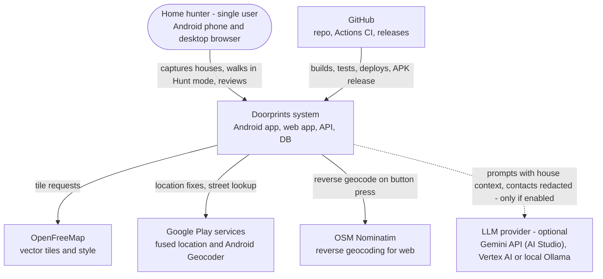

## 3. C4 level 2: containers

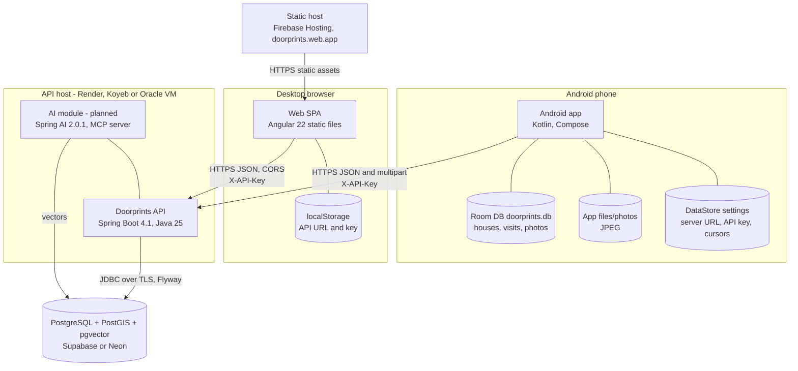

## 4. C4 level 3: components

### 4.1 API components

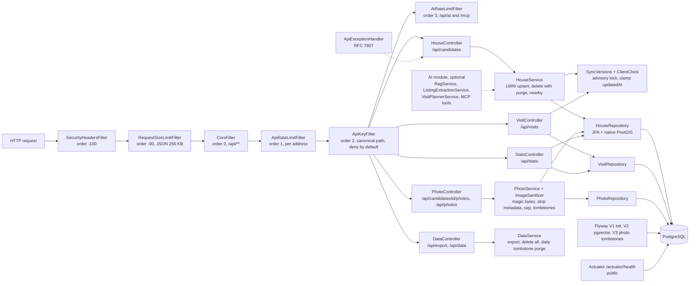

| Component | Class / file | Notes |
|---|---|---|
| Config | `config/AppProperties`, `config/WebConfig` | Fails at startup if `APP_API_KEY` is missing or shorter than 32 chars, or `APP_API_KEY_NEXT` is set and shorter than 32 (`ApiKeyFilter.validateKeys`, F-01a). Registers the filter chain (see diagram) and `@EnableScheduling`. `app.rate-limit.*`, `app.limits.*`, `app.sync.*`, `app.privacy.*`. |
| Auth | `config/ApiKeyFilter`, `RequestPaths` | Deny by default. Allowlist: `GET/HEAD /actuator/health[/**]` and CORS preflights. Non-canonical paths get 400 first. Accepts the current key and, during a rotation, the next key (SEC-017); every configured key is compared in constant time. Failed keys logged (salted address hash) and throttled to 429. |
| Limits and headers | `config/ApiRateLimitFilter`, `RequestSizeLimitFilter`, `SecurityHeadersFilter` | Token bucket per address (reuses `common/TokenBucketRateLimiter`), JSON body cap, `nosniff`/`DENY`/`no-referrer`/CSP/HSTS/`no-store` |
| Sync safety | `sync/SyncVersions`, `sync/ClientClock` | Advisory lock + `nextval` (section 10.4); clamp or reject client times |
| Privacy | `privacy/DataController`, `DataService` | Export, delete-all with confirmation header, daily purge of tombstones older than 90 days |
| Houses | `house/HouseController`, `HouseService`, `HouseRepository`, `House`, `HouseDto`, `HouseStatus` | Checklist is an `@ElementCollection` into `house_checklist` |
| Visits | `visit/VisitController`, `VisitRepository`, `Visit`, `VisitDto`, `VisitSource` | LWW logic is in the controller (not in a service, unlike houses). A deleted visit keeps no place (`purgePlace`). |
| Photos | `photo/PhotoController`, `PhotoService`, `ImageSanitizer`, `PhotoRepository`, `Photo`, `PhotoDto` | `bytea` storage, 30-day private cache header, tombstones with sync versions, change feed |
| Stats | `house/StatsController` | Counts |
| Errors | `common/ApiExceptionHandler`, `NotFoundException`, `ConflictException` | 400 / 404 / 409 / 413 as `ProblemDetail` (428 from `DataController`, 429 from the filters, 503 from `AiExceptionHandler`, with `code: AI_QUOTA_EXHAUSTED` and `Retry-After: 60` when the provider's quota is exhausted, and `setupHint` on a Vertex AI 401/403/404) |

### 4.2 Android components

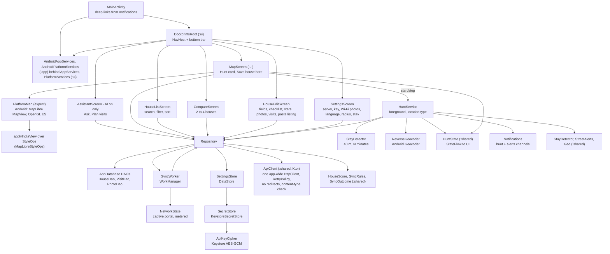

| Component | File | Responsibility |
|---|---|---|
| `DoorprintsApp` / `AppContainer` | `DoorprintsApp.kt` | Manual DI. Initialises MapLibre, notification channels and periodic sync. |
| `MainActivity` | `MainActivity.kt` | Turns notification extras into a `DeepLink` (open house / new house at lat,lon with visitId) |
| `DoorprintsRoot` | `Root.kt` in `:ui` commonMain (since CMP-5; JetBrains navigation-compose) | Tabs: Map, Houses, Compare, (Assistant when AI is on), Settings. Routes `house/{id}` and `new?lat&lon&visitId`. Wraps everything in `DoorprintsTheme` (`ui/Theme.kt`: web tokens, dark scheme). |
| `MapScreen`, `PlatformMap` | `MapScreen.kt` and `PlatformMap.kt` in `:ui` commonMain (since CMP-7); `PlatformMap.android.kt` and `MapLibreStyleOps.kt` in androidMain | The chrome (Hunt card, notes, controls, legend, snackbar, attribution placement, saved camera, first framing, retry) is common; the map view is `expect fun PlatformMap(…)` with a `MapControl` and `MapEvents`: on Android the MapLibre `MapView` (OpenGL ES build) in `AndroidView`, with the GeoJSON source of houses coloured by status, location dot, tap to open, long-press to create; on iOS (CMP-8c) MapLibre iOS's `MLNMapView` from Swift (`ios/Doorprints/MapLibreMapView.swift`, behind the Kotlin seam `IosMap.kt`) in `UIKitView`. Every style load on Android (the only `setStyle` in `android/`, first load and each retry) first calls `applyIndiaView(MapLibreStyleOps(style, assets))` (`IndiaViewOps.kt`; the rules as data in `IndiaViewRules.kt`): India's boundary as the Government of India shows it (ADR-22). On iOS the same steps run over the style's JSON before MapLibre sees it (`prepareMapStyle`, `JsonStyleOps`), and `IndiaViewCheck` checks the result in the app (the iOS CI gate, TC-I-38). Hunt mode, the notification prompt and the motion and font settings come through `AppServices.mapScreen` |
| `AppServices`, `PlatformServices` | `:ui` commonMain (since CMP-5..7); `AndroidAppServices.kt`, `export/AndroidBackupServices.kt` and `PlatformServices.android.kt` implement them | What the common screens ask of the app and the platform: the repository, the app scope, location, copy undo, and one service interface per screen (`SettingsServices`, `HouseFormServices`, `ExportServices`, `ImportServices`, `MapServices`); permissions, settings, dial and open a URL. Provided by `ProvideAppServices` in `:app` |
| `HouseListScreen`, `CompareScreen` | `:ui` commonMain (HouseList since CMP-5, Compare since CMP-4 P4c) | List with search/filter/sort. Compare up to 4 (shortlisted first). |
| `HouseEditScreen` | `:ui` commonMain (since CMP-6 P6a); camera, gallery and geocoder behind `HouseFormServices` | Every FR-002..FR-007 field; status as segmented buttons; rating and each checklist item as radio groups (TalkBack state); camera/gallery via `FileProvider` (`cache/camera/`, in `:app`'s `AndroidHouseFormServices`), 20-photo cap; visit list, "I am here now"; "Paste listing" (AI) fills empty fields from `POST /api/ai/extract-listing`; its photos are `HousePhotos.kt` and its checklist and score `ChecklistSection.kt` (S4b-BL-168) |
| `ChecklistSection`, `ScoreSummary`, `ChecklistRow`, `withScore` (S4b-BL-168) | `:ui` commonMain `ChecklistSection.kt`, `HouseFormRules.kt` | The form's checklist: the heading, a row of 0 to 5 and "–" for each criterion that is not archived (an ignored one says it is not counted), the score summary (overall, coverage, must-haves missed or not checked, a polite live region), and the rule that "–" or the chosen score again clears a score (`withScore`, pure). The form owns the draft and passes the checklist, the rating and the scoring in; the section emits into the form's column with no wrapper. `RatingRow` stays in `HouseEditScreen.kt` (shared with `BrokersScreen.kt`) |
| `SettingsScreen` | `:ui` commonMain (since CMP-5) | Server URL (HTTPS check, `ServerUrl`), API key (masked hint, blank keeps the saved key), Save and test, Sync now, last sync result (translated `SyncOutcome`), photos only on Wi-Fi, language picker (`i18n/AppLocale`), Hunt settings, privacy note |
| `AssistantScreen` | `:ui` commonMain (since CMP-5; a common `AssistantViewModel`) | Ask (answer without `[house:id]` markers, cited houses as cards) and Plan visits (stops in order with leg distance and time) |
| `HuntEngine` | `:shared` `app.doorprints.location.HuntEngine` (since 2026-09-29) | Hunt mode's rules in common code, so the iPhone gets them from the same engine: a fix's meaning (the accuracy gate, the nearest house and the alert radius with its 30-minute repeat, the street alert through `StreetAlerts` with the platform's `StreetLookup` asked at most every 45 s or 80 m, the stay through `StayDetector` and its visit, the walking or staying fix rate, the low-battery stop). Reads `HuntData` (the part of `Repository` it needs) and a `BatteryReader`; asks the platform for the alerts and the fix rate through `HuntEffects`; keeps `HuntState`. Unit-tested with fakes in `commonTest` (`HuntEngineTest`, [06](06-test-plan.md) TC-U-92). |
| `TrackRecorder`, `TrackDao` | `:shared` `location/HuntEngine.kt`, `data/AppDatabase.kt` (since 2026-09-29) | The path trace ([11](11-feature-parity-and-export-spec.md) 5.27): while `Settings.pathTrace` is on, the engine keeps a fix that passed the accuracy gate when it is the first, 20 m from the last kept or 5 minutes after it; `track_points` (id, at, lat, lon, accuracyM; index on `at`) is local only, pruned to 30 days at each Hunt start, cleared from Settings; the Map draws `Repository.trackPoints` through `trackGeoJson` (one line per walk, split at 30-minute gaps) into the `track` source and `track-line` layer that `prepareMapStyle` puts under the houses (Android builds the same layer in `PlatformMap.android.kt`) |
| `RepeatDetector`, `WalkSplitter`, `RepeatAlert`, `WalkCodec`, `TraceConstants`, `PlaceCheck`, `MatchedStretch` (built, S4b-FR-13, S4b-FR-24) | `:shared` commonMain `app/doorprints/shared/trace/` (pure: no clock, no I/O, no `java.*`) | The repeat-detection contract of [11](11-feature-parity-and-export-spec.md) 5.27.3: `splitWalks`, `RepeatDetector.detect(walks)` giving each walk's `repeated` and `shown` stretches, `RepeatAlert.onPoint(live, others)` and the `WalkCodec` (delta, zigzag, varint) for saved walks. Its twin is the website's `shared/trace-repeats.ts`; both read `docs/schemas/trace-repeat-vectors.json` |
| `SavedWalkEntity`, `SavedWalkDao`, `WalkStore` (built, S4b-FR-14; the planned `WalkSweeper` is part of `WalkStore`) | `:shared` `data/AppDatabase.kt`, `data/Entities.kt`, `data/CommonRepository.kt` | Saved walks (Room 11): save (a transaction that moves a walk out of `track_points`), list by house, delete, `sweepWalksOfDeletedHouses`, the limits; local only: neither table is in `localTablesChanged()` and no export, backup or sync file reads them |
| `PhotoStore` (S4b-BL-168) | `:shared` `data/PhotoStore.kt` | The photo folder, a photo's file by its id (`fileOf`), the import's path guard, write/delete/stream of a file, `delete` (tombstone for an uploaded photo), `saveMeta`, `discardUncommitted`; `CommonRepository` delegates (`photoFileOf`, `photoPath`, `deletePhoto`, `savePhotoMeta`). The sync and import loops over the rows stay in `CommonRepository`. |
| `ViewingStore` (S4b-BL-168) | `:shared` `data/ViewingStore.kt` | A viewing read from its record row (`of`: decoded, coerced, null when it cannot be trusted), the list by start, one house's viewings, the next one, the ids for the reminders (tombstones included), `save` (coerced, no write when nothing changed), `newId`, `delete`, `markDone`, and the backup's row (`importedRow`); `CommonRepository` delegates every `Repository` viewing member, passing its own `saveRecord` and `deleteRecord`. The export, import and undo loops stay in `CommonRepository` and call `of` and `importedRow`. |
| `AreaStore` (S4b-BL-168) | `:shared` `data/AreaStore.kt` | A hunting area, a place and an area note read from their record rows (`areaOf`, `placeOf`, `noteOf`: decoded, coerced, null when they cannot be trusted), the three lists in their orders, `saveArea`, `savePlace` and `saveNote` (trimmed, validated, no write when nothing changed, `RecordLimitException` at the cap, all through one private `writeCapped`), new ids that clash with no tombstone, deleting, and the backup's rows (`importedRows`); the repository's `saveRecord` and `deleteRecord` come in through `RecordWriter`. `CommonRepository` delegates every `Repository` member (and forgets the wake-up stamp when an area is deleted); the export, import and undo loops stay there and call `areaOf`, `placeOf`, `noteOf` and `importedRows`. |
| `QuestionStore` (S4b-BL-168) | `:shared` `data/QuestionStore.kt` | The viewing-question bank read from its record rows (`of`: decoded, coerced, null when it cannot be trusted), the bank by `sort` then id, seeding the fourteen defaults (clean, stamped 2000-01-01, a tombstone keeps a deleted default deleted) once per install, *Reset to defaults*, `save` and `saveAll` (trimmed, coerced, no write when nothing changed, `RecordLimitException` at 100), `add` (an id no tombstone holds, at the end), deleting, and the backup's row (`importedRow`); the repository's `RecordWriter` and the settings come in. `CommonRepository` delegates every `Repository` question member; the export, import and undo loops stay there and call `of` and `importedRow`. A house's answers stay with the house. |
| `CriterionStore` (S4b-BL-168) | `:shared` `data/CriterionStore.kt` | The house-scoring criteria read from their record rows (`of`: decoded, coerced, null when it cannot be trusted), the effective `Scoring` (`scoring`, `observeScoring`: the criteria and the rating share), `save` and `saveAll` (a built-in at its default has no record, no write when nothing changed, `RecordLimitException` at 40), `add` (a key no tombstone holds, at the end), `delete` (a custom criterion no live house has a score for; a built-in never), the rating share (cut to 0..1, no record at one half), *Reset to defaults*, and the backup's rows (`importedCriterion`, `importedPreference`); the repository's `RecordWriter` comes in. `CommonRepository` delegates every `Repository` criteria member; the export, import and undo loops stay there and call `of` and the two mappers. |
| `BrokerStore` (S4b-BL-168) | `:shared` `data/BrokerStore.kt` | The brokers read from their record rows (`toBroker`, rows that cannot be trusted skipped), the list by name (case ignored) then id, `save` (coerced, a new id when none is given, `RecordLimitException` at 5,000; the live houses linked to it get its name and phone as their contact copies, written only when they differ), `delete` (a tombstone; its live houses lose the link and keep the contact), the houses of a broker, `linked` (what `saveHouse` does: a house that names a live broker takes its name and phone; one with a phone and no broker joins the broker of that number (`PhoneKey`) or a new one named from the contact, cut to the record's limits; a blank phone never makes one; a full type leaves the house unlinked), the once-only move of contacts into brokers (`migrate`, guarded by the `brokers.migrated` setting and a gate), the backup's rows (`exportRows`) and the row an import writes (`importedRow`); the repository's `RecordWriter`, the settings, the clock and the sync request come in. `CommonRepository` delegates every `Repository` broker member and calls `migrate` before every first read of the houses and the records; the export, import and undo loops stay there and call `exportRows` and `importedRow`. |
| `AiStore` (S4b-BL-168) | `:shared` `data/AiStore.kt` | Whether AI is offered and why not (`aiOff`, `aiEnabled`: the server's report, kept when a request fails, and this phone's *AI features* switch, the only thing that counts with the person's own key), the setters that change the choice and publish it (`setFeatures`, `saveKey`, `setProvider`, `removeKey`, `saveConfig`), what makes a choice an own key (a key for Gemini and Anthropic, a model and a safe address for the other two, a platform client), the checked provider settings (`checkedConfig`), `testProvider` (one ping, nothing saved), the one `OnDeviceAi` kept per key and provider (its rate limit holds), and the three calls answered on this device or by the server (ADR-26). The settings, the platform's client builders, `apiFor` and the Assistant's house document (`aiHouses`, which stays in `CommonRepository` because it reads every kind) come in. `CommonRepository` delegates every `Repository` AI member. The prompts, checks and safeguards stay in `shared/ai`. |
| `HousePhotos`, `rememberHousePhotos`, `HousePhotosSection`, `HousePhotoViewer`, `HousePhotoDetails`, `PhotoDeleteViewModel` (S4b-BL-168) | `:ui` commonMain `HousePhotos.kt` | The form's photos: take/pick, the strip, delete with *Undo* (held by the back-stack entry), the full-screen viewer, the details dialog, the focus rules; `HouseEditScreen` calls them and gives the *Moving in* card its photos |
| `TraceStore`, `TraceRecorderService`, `trace-style.ts` (built, S4b-FR-17) | web `data/trace-store.ts`, `core/trace-recorder.service.ts`, `shared/trace-style.ts` | The website's trace: IndexedDB stores `trace_points` and `saved_walks`; `watchPosition` while the page is visible, the same recorder rules, the repeat layer's widths, the beep and banner |
| `IosHunt`, `IosNotifications`, `IosGeocoder` | `:ui` iosMain `IosHunt.kt`, `IosNotifications.kt` (since S4b-BL-69, [10](10-sprint-log.md) §13.14) | The iPhone around `HuntEngine`: `CLLocationManager` (best accuracy, every fix, background updates under *When in use* with the indicator shown, the `location` background mode) thinned by `HuntFixThrottle` to the rate `HuntService` gets from the fused client; the battery from `UIDevice`; Apple's `CLGeocoder` for the street alerts and the new-house form's address; the alerts worded from the Compose resources and posted as local notifications (`UNUserNotificationCenter`, the delegate set at launch; a tap is a `DeepLink` checked as MainActivity checks its intent) |
| `OfflineMapsServices`, `OfflineTiles` | `:ui` commonMain `OfflineMaps.kt`, `OfflineMapsUi.kt`; Android `AndroidOfflineMaps` (`:app`), iPhone `IosOfflineMapsServices` over `MapLibreOfflineMaps.swift` (since S4b-FR-6, 2026-09-30) | Offline maps ([11](11-feature-parity-and-export-spec.md) 5.20): the box on screen as one of MapLibre's offline packs (`OfflineManager` / `MLNOfflineStorage`, the map's own tile store, the Liberty style from zoom 0 to 14), its id and name in the pack's metadata; the tile count and size estimated in common code before the download, at most 2,000 tiles an area (§11.2); the phone's metered state for the Wi-Fi note; the areas with their progress as one state flow for the Map's snackbar and Settings' list |
| `HuntService` | `location/HuntService.kt` (Android; iPhone: `IosHunt`) | The platform around `HuntEngine`: the foreground service (location type) and its notification, the fused location client (15 s walking, 60 s staying), the battery reading, `ReverseGeocoder`, and the alerts as notifications with their wording. Section 7.2, 7.3, 8.2 |
| `StayDetector`, `StreetAlerts`, `Geo` | `:shared` `app.doorprints.shared.location` | Pure stay logic, street-alert rule and haversine distance (`Geo.distanceM`), unit-tested in `commonTest` (section 4.2.1) |
| `ReverseGeocoder` | `location/ReverseGeocoder.kt` | Android Geocoder wrapper (API 33+ async), 10 s limit |
| `Repository` | interface in `:shared` (`data/Repository.kt`, CMP-4 P4c); implemented by `CommonRepository` in `:shared` (S4b-BL-32), extended by `AndroidRepository` in `:app` for the photo decoding | Only way to write data. Sets `dirty` + `updatedAt`, calls `syncSoon`, handles photos (downscale, EXIF rotation, JPEG q80, cap, offline delete queue), sync algorithm (section 10), AI calls and `aiEnabled` state |
| `SyncWorker` | `data/SyncWorker.kt` | Unique one-time "sync-now" (3 s delay, REPLACE) + 30-min periodic job + "sync-photos-wifi" (UNMETERED). Needs a network; skips captive portals. Exponential backoff from 30 s, up to 5 attempts; no retry on auth failure. |
| `ApiClient`, `RetryPolicy`, DTOs, `IsoTime`, `ApiException` | `:shared` `app.doorprints.shared.api` (since Sprint 3.5; replaced `data/RetryInterceptor.kt` and the OkHttp client) | Suspending Ktor client: `X-API-Key`, own JSON encoding (`ignoreUnknownKeys`, `explicitNulls = false`), `Content-Type` check before decoding (captive portals), redirects never followed, typed `ApiException` kinds, retries of idempotent calls and the marked photo upload on network errors and 408/429/502/503/504 with full-jitter backoff (1 s base, 15 s cap, 3 attempts, short `Retry-After` honoured), 4-minute limit per call including retries (`ApiTimeoutException`), streamed photo upload (docs/09 L4) |
| `Api` | `data/Api.kt` | One app-wide Ktor `HttpClient` (`AndroidApiHttp`: OkHttp engine, connect 20 s, read 90 s, write 60 s, no redirects), so every `ApiClient` shares one connection pool; debug log of status, method and path only |
| Mappers | `data/Mappers.kt`, `data/ModelLabels.kt` | Room entity ↔ DTO (epoch ms ↔ ISO-8601 through `IsoTime`), translated labels for shared statuses and checklist keys |
| `SettingsStore`, `SecretStore`, `ServerUrl` | `:shared` `app.doorprints.data` (commonMain since CMP-4 P4b) | Preferences DataStore settings (file `settings`, key names unchanged); the API key only through `SecretStore`; URL validation (`UriParts`, a port of `java.net.URI`'s parser) |
| `ApiKeyCipher`, `KeystoreSecretStore`, `SettingsStoreFactory` | `data/*.kt` | Android's `SecretStore`: the key stored in the settings entry `apiKeyEnc` as `v1:` + Base64(IV + AES-GCM ciphertext), Keystore alias `house_hunt_api_key_v1`; the settings DataStore opened once per process on `files/datastore/settings.preferences_pb` |
| `SyncOutcome`, `SyncRules`, `MergeRule`, `HouseScore` | `:shared` `app.doorprints.shared.sync`, `.model` | Last sync result as a stored code (errors classified without server text), last-edit-wins rule (`SyncRules.serverMerge` is the server's `MergeRule`), overall score and ranking |
| `SyncBackend`, `ServerSyncBackend` | `:shared` `app.doorprints.data` (S4b-BL-70) | The seam between `CommonRepository.sync` and one remote (§10.1): push a row, pull since a cursor, photo bytes, "is it behind", and the remote's merge rule. `ServerSyncBackend` is the self-hosted server over `ApiClient` (the calls the loop made before, unchanged, with its permanent photo refusals); Drive's backend comes with S4b-BL-118 |
| `AppLocale` | `i18n/AppLocale.kt` | Per-app language: `LocaleManager` on API 33+, SharedPreferences + context wrapping on 26–32 |

### 4.2.1 Kotlin Multiplatform module boundaries (`:shared`, Sprint 3.5, ADR-14; `:ui`, ADR-23)

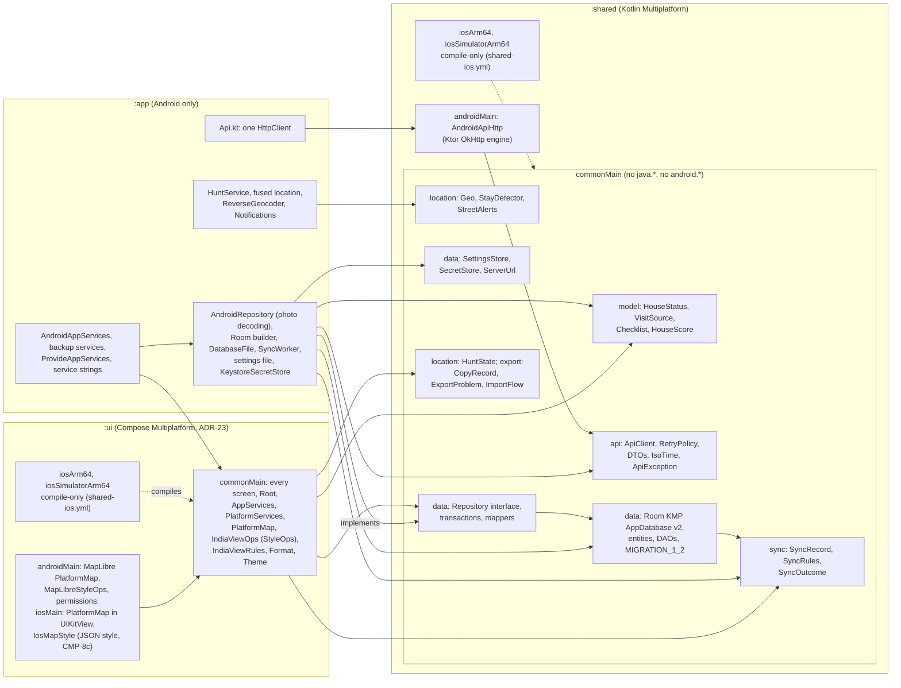

| Layer | Contents | Rule |
|---|---|---|
| `commonMain` | Everything an iOS app would reuse: wire and database names, business rules, the HTTP client and its DTOs | Only Kotlin stdlib, `kotlin.time`, `kotlin.math`, kotlinx.coroutines, kotlinx.serialization, kotlinx.io and Ktor client core. No `java.*`, `android.*`, `System.*`, `String.format`, `Thread`. The macOS job `shared-ios.yml` enforces this by compiling the iOS targets. Names with a wire or database meaning (`HouseStatus`, `VisitSource`, checklist keys, `SyncOutcome` codes) never change; tests pin them. |
| `commonMain` `app.doorprints.data` (CMP-4 P4a) | The Room KMP database: `AppDatabase` (version 2, `@ConstructedBy`, `expect object AppDatabaseConstructor`), `HouseEntity`, `VisitEntity`, `PhotoEntity`, the DAOs (every function suspend or a `Flow`), `Converters`, `MIGRATION_1_2` on `SQLiteConnection`; KSP generates each target's code; schemas in `android/shared/schemas/` | Same rules; the package stayed `app.doorprints.data`, so `:app`'s imports and the schema folder name did not change |
| `commonMain` `app.doorprints.data` (CMP-4 P4c) | The `Repository` interface (the platform-neutral members of the data layer and its result types), `withImmediateTransaction` and `localTablesChanged` on Room's common API, the entity ↔ DTO and entity ↔ export mappers; `Place` in `app.doorprints.location`; since S4b-BL-32 `CommonRepository`, the implementation (sync, import, undo, photo files through kotlinx-io) with `CopyUndo` | The platform parts come in through its constructor (the photo folder, "sync soon", the API client); a photo from a `Uri` stays in `:app`'s `AndroidRepository` |
| `commonMain` `app.doorprints.data` (CMP-4 P4b) | `SettingsStore` on a `DataStore<Preferences>` (`datastore-preferences-core` 1.1.7; `FILE_NAME` `settings` and every key name kept), `AppSettings`, `ResultMarks`, `ResultScreen`, `SyncHealth`, the `SecretStore` interface (`get`, `put`, `clear`), `ServerUrl` with `UriParts`; in `app.doorprints.export` the export grant list | Stored names never change (ADR-24); the key never enters common code except through `SecretStore` |
| `commonMain` (CMP-5..7) | `HuntState` (`app.doorprints.location`, with `MAX_ACCURACY_M`); in `app.doorprints.export` `CopyRecord` and `CopyUndoOutcome`, `ExportProblem` (codes), `ImportFlow.kt` (`ImportCheck`, `ImportStaging`, `ImportRequest`, `ImportStart`); `LocalRows.toBundle`; `SyncRules.serverBehind` and `pushShowsReset`, `SyncOutcome.serverReset`, `StatsDto.maxSyncVersion` (S4b-BL-20) | What the common screens read; the WorkManager, file and exception parts stay in `:app` as extensions ([10](10-sprint-log.md) S4b-BL-39) |
| `androidMain` | `AndroidApiHttp` (Ktor OkHttp engine, timeouts, `followRedirects(false)`) | Platform glue behind a common type (`HttpClientEngine`) or an injected function (`debugLog`) |
| `iosMain` | `iosAppDatabase()` (CMP-4 P4a): `doorprints.db` in Application Support with the bundled SQLite driver; `iosSettingsStore()` and `KeychainSecretStore` (CMP-4 P4b); all compile-only; later `ktor-client-darwin` | – |
| `:ui` (ADR-23, since `be86f50`) | Compose Multiplatform UI code that is not tied to Android: the theme (`DoorprintsTheme`, language lookup `expect fun uiLanguage()`), list rows, the server status and its rules, the Map and India view rules, `ButtonLabel`, `ResultTone`, `LocationFix`; the UI strings (CMP-2); since CMP-3 the `PlatformServices` seam, `Format.kt`, `LiveMessage`, `DeletedHouseUndo`, `ActionBar` and `ResultCard`; since CMP-4 P4c `CompareScreen`, `HouseFormRules` and `ModelLabels` (status and checklist labels); since CMP-5..7 (PR #24) every screen: the root and navigation (JetBrains navigation-compose 2.9.2, lifecycle 2.11.0), HouseList, Assistant (with its view model), Settings, NotifyAsk, LocationPermission, the house form, Export, Import and `ImportViewModel`, and the Map chrome, behind the seams `AppServices` (per-screen service interfaces), `PlatformServices` (permissions, settings, dial, open a URL), `expect PlatformMap` and `StyleOps` (`applyIndiaView` in `IndiaViewOps.kt`), with Coil 3 for photos; `ServerStatusTest`, `MapRulesTest`, `IndiaViewRulesTest`, `IndiaViewOpsTest`, `FormatsTest`, `HouseFormRulesTest`, `ModelLabelsTest`, `LocationAccessTest`, `LocationAskTest`, `AssistantViewModelTest`, `ImportStartOnceTest`, `JoinListTest` and `BackupTextsTest` in `commonTest`. Kotlin package `app.doorprints.ui`, Android namespace `app.doorprints.ui` | Same `commonMain` rules as `:shared`; `api(project(":shared"))` and the Compose Multiplatform libraries (1.12.1; material3 1.9.0). The screens move here phase by phase ([`android/ui/README.md`](../android/ui/README.md) §6) |
| `:app` | The Room builder (`AppDatabase.create(context)` in `data/AppDatabaseFactory.kt`) and `DatabaseFile`, `AndroidRepository` (`CommonRepository` with the Android photo folder, WorkManager and the API client, plus decoding a photo from a `Uri`), WorkManager, the settings file (`SettingsStore.create(context)` in `data/SettingsStoreFactory.kt`) and the Keystore (`ApiKeyCipher`, `KeystoreSecretStore`), location and notification services, the Android implementations of the `:ui` seams (`AndroidAppServices`, `AndroidBackupServices`, `ProvideAppServices`, `CurrentLocation.kt`), `MainActivity`'s intent parsing, the service strings; no screen since CMP-7 | Stays Android-only until its ADR-23 phase; reasons per item in `android/shared/README.md` section 3 |

Build and test: `:shared` uses the Kotlin Multiplatform plugin and AGP's `com.android.kotlin.multiplatform.library`
(`kotlin { android { … withHostTest {} } }`). Its JVM tests are the task `:shared:testAndroidHostTest`, which
`:app:testDebugUnitTest` depends on and `android.yml` also names. On Linux the iOS tasks are skipped
(`kotlin.native.enableKlibsCrossCompilation=false`); `shared-ios.yml` compiles the iOS main and test klibs on
macOS without linking, signing or a simulator. `:ui` is built the same way (plus the `kotlin.compose` plugin): `:ui:testAndroidHostTest`, which `:app:testDebugUnitTest` also depends on and `android.yml` names, and its iOS klibs in the same `shared-ios.yml` job. Test detail: [06](06-test-plan.md) §3; CI: [07](07-secure-build-and-deploy.md) §1.

Behaviour kept from the OkHttp client (pinned by `ApiClientContractTest`): same request JSON and URLs, same retry
rules and numbers, captive-portal detection, no redirects, same error kinds. Intentional, invisible differences:
Ktor's `Accept`/`Accept-Charset`/`User-Agent` headers, and a connection dropped while a retriable response body is
read is now retried too. MapLibre Android 13.6.1 is built against OkHttp 4.12 but runs on the OkHttp 5.5.0 that Ktor
brings; no CI job exercises MapLibre networking, so `android/shared/README.md` §5 has a manual map-tile smoke test
for every Ktor, OkHttp or MapLibre version change.

**Phase 2 plan (ADR-14; items 1-3 are ADR-23's P4):** (1) Room KMP, **done in CMP-4 P4a**: the database is in
`commonMain` with `doorprints.db`, version 2, `MIGRATION_1_2` and the committed `2.json` kept; Android keeps the
framework SQLite, iOS has the bundled driver; `AppDatabaseMigrationTest` opens a v1 file; the mappers and a `Repository`
interface followed in P4c. (2) DataStore KMP for settings and cursors and a `SecretStore` interface (Android Keystore;
iOS Keychain compile-only), **done in CMP-4 P4b**. (3) `ServerUrl` as a common parser, **done in CMP-4 P4b**. (4) An iOS
app (SwiftUI over the shared framework, or Compose Multiplatform), only when a Mac and the Apple Developer Program are
available; there is no paid Apple account today, so iPhone users are served by the PWA
([11](11-feature-parity-and-export-spec.md) 5.10). (5) iOS platform services (`CLLocationManager`, `CLGeocoder`,
`BGTaskScheduler`, `NWPathMonitor`). **Since 2026-09-24 this plan is folded into ADR-23:** items (1)-(3) are its phase
P4 (CMP-4), item (4) is decided for Compose Multiplatform (the `:ui` module, phases P1-P8), and item (5) comes with the
iOS shell (P8) behind the platform seams of P3. Signing, device installs and the App Store stay out of scope while there
is no Mac and no paid Apple account.

### 4.3 Web components

| Component | File | Responsibility |
|---|---|---|
| `ConfigService` | `core/config.*` | Base URL + key in sessionStorage, or localStorage with "Remember on this device". **Since Sprint 4a `configGuard` is gone** and no route is guarded: the app is local-first, and a configured server only adds sync (section 16.4). |
| `LocalDb`, `MemoryDb`, `LocalStore` | `data/local-db.ts`, `data/local-store.service.ts` | The browser's own copy of everything: IndexedDB stores `houses`, `visits`, `photos` (blobs) and `settings`, database `doorprints` version 1. A hand-written wrapper rather than Dexie or `idb` (ADR-19). `MemoryDb` is the fallback when IndexedDB is blocked — the app still works for the session and says clearly that nothing is being kept. |
| `PhotoStore` | `data/photo-store.ts` (S4b-BL-168) | The photo rows, reached as `LocalStore.photos`: the 20-per-house limit, a tombstone only for a photo the server has, the room/tags/caption meta with its last-write-wins stamp, what a full resend marks. Separate so a change to what a photo holds does not edit the 1,300-line `LocalStore`. |
| `HousePhotos` | `pages/house-detail/house-photos.ts` (S4b-BL-168) | The photos card of the house page: the list, adding a batch, delete, the details editor. The page owns the draft, the large view and the leave guard. |
| `HouseRooms` | `pages/house-detail/house-rooms.ts` (S4b-BL-168) | The Rooms card of the house page: the list in the draft, add (up to 30), edit, move and delete with the focus kept, a size in feet and inches or in metres as centimetres, and the area and total lines in the chosen length unit. The page owns the draft and the save. Separate so a change to what a room holds edits this file and the card, not the page. |
| `HouseFloor` | `pages/house-detail/house-floor.ts` (S4b-BL-168) | The Floor field and the Basement switch of the house page: the level shown without its sign, the sign held by the switch while no level is typed, whether what is typed is a floor from -5 to 200 (`floorOf`, also used by the save and the duplicate-flat warning). |
| `HouseListingFill` | `pages/house-detail/house-listing-fill.ts` (S4b-BL-168) | The listing card of the house page: the pasted text and how it is cut for Extract (`AI_MAX_LISTING_CHARS`, the hint for what is left out), the read by the AI with its busy, failure and late-result rules, and the merge of any listing draft (the AI's, or the no-AI parser's for a shared listing on arrival) into the form without replacing what was typed, naming what it kept. The page owns the draft and the arrival (it reads the navigation state and opens the draft). |
| `HouseLocation` | `pages/house-detail/house-location.ts` (S4b-BL-168) | Where the house is, on the house page: the pin and the typed coordinates (valid or marked invalid), the *Approximate location* switch and the source it goes back to, *Use my location*, *Find* (the place name looked up on the person's tap) and *Fill address from map* (the reverse lookup and the question before a typed value is replaced), each with its busy, failure and late-result rules. The page owns the draft, the arrival (the starting view) and the save (refused while the position is unset or a coordinate is invalid). |
| `RecordStore` | `data/record-store.ts` (S4b-BL-168) | The record rows, reached as `LocalStore.records`: the reads by type and by `[type, id]` key, the save that stamps a row and marks it dirty (keeping its sync version), the tombstone, the clean mark after a push, the dirty and full lists the sync reads, the id draw that avoids a stored row, and the write that skips an unchanged payload and refuses a new row past a cap. The sync, the import, the Drive rows and every record kind in `LocalStore` call it. |
| `ViewingStore` | `data/viewing-store.ts` (S4b-BL-168) | The viewings, reached as `LocalStore.viewings`: records of type `viewing` read as typed rows, the save that refuses what the server refuses (bad id, blank house, start or duration out of range, text over its cap, the 5 001st viewing), `next`, `markDone`. Goes through `RecordStore`; the viewings page, the house card and the reminders reach it through `LocalDataService`. |
| `AreaStore` | `data/area-store.ts` (S4b-BL-168) | The hunting areas, reached as `LocalStore.areas`: records of type `area` read as typed rows, the save that refuses a bad id, a blank or over-long name, a point or radius out of range and the 21st area, and writes only when something changed. Goes through `RecordStore`; the areas page, the house's area cards, the map and the offline maps reach it through `LocalDataService`, and the export and the on-device AI call it directly. |
| `PlaceStore` | `data/place-store.ts` (S4b-BL-168) | My places (an office, a parent's home), reached as `LocalStore.places`: records of type `place` read as typed rows, the save that refuses a bad id, name or point and the 11th place. Goes through `RecordStore`; the places page and the house's distances reach it through `LocalDataService`, and the export and the on-device AI call it directly. |
| `AreaNoteStore` | `data/area-note-store.ts` (S4b-BL-168) | The area notes, reached as `LocalStore.areaNotes`: records of type `areanote` (a note about one area or one street) read as typed rows, newest edit first, the save that refuses neither or both targets, a blank or over-long text and the 201st note. Which house a note reaches is decided in `shared/area.ts`. Goes through `RecordStore`. |
| `QuestionStore` | `data/question-store.ts` (S4b-BL-168) | The viewing-question bank, reached as `LocalStore.questions`: records of type `question` read as typed rows, by `sort` then id, the save that refuses a bad id, a blank or over-long text and the 101st question, and the seeding of the standard questions (once per install, again after *Remove all data*, and on *Reset to defaults*, in the language of the app). Goes through `RecordStore`, except the seeding, which writes rows clean with their own edit times. |
| `CriteriaStore` | `data/criteria-store.ts` (S4b-BL-168) | The checklist criteria and the rating share, reached as `LocalStore.criteria`: records of type `criterion` and `preference` read as typed rows, merged with the defaults into the effective scoring, the save that writes only what differs from the defaults and refuses a bad key, a blank or over-long label and the 41st criterion, the delete that refuses a criterion a house has a score under, and the reset. Goes through `RecordStore`; reads the house rows only for the in-use check. |
| `BrokerStore` | `data/broker-store.ts` (S4b-BL-168) | The brokers, reached as `LocalStore.brokers`: records of type `broker` read as typed rows (a payload with a blank name is skipped), the save that rewrites the name and phone copies on every live house linked to the broker, the delete that unlinks its houses and leaves them their contact, the houses of a broker, the link a saved house gets (the broker with the same last ten digits, or a new one made from the contact), and the one-off move of older houses' contacts into brokers, which runs when the store opens. Goes through `RecordStore`; reads and writes the house rows for the copies and the link. |
| `SyncService`, `syncRules` | `data/sync.service.ts`, `data/sync-rules.ts` | The same push/pull, cursor and last-write-wins rules as Android (section 10), against the API-key server when one is configured. Optional. The loop (cursors, progress, *Stop*, cancellation, the 429 wait) stays here; every remote call goes through `SYNC_BACKEND` (below). `serverBehind`, `wireVersion` and the `MergeRule` type live in `sync-rules.ts` (re-exported from `sync.service.ts`). |
| `SyncBackend`, `ServerSyncBackend`, `SYNC_BACKEND` | `data/sync-backend.ts` (S4b-BL-70) | The web's side of the seam of §10.1, the same members as Kotlin's with `Observable`s; `ServerSyncBackend` wraps `HouseApiService` unchanged and is the token's default. |
| `StorageService` | `data/storage.service.ts` | `navigator.storage.persist()` / `estimate()`; drives the durability warnings of NFR-027. |
| `ChunkRecovery`, `ChunkNotice` | `core/chunk-recovery.ts`, `shared/chunk-notice.ts` (S4b-BL-305) | Recovery from a lazy route whose script does not load (a flaky connection, a 502 from the host, an old cached shell asking for a chunk that a newer deploy renamed): fed by `withNavigationErrorHandler` in `app.config.ts`, which only watches, so the router still rejects the navigation and every other navigation error surfaces as before. The first failure: about 1 s later the address is loaded again **as a new document**, once per tab session (sessionStorage `doorprints.chunk-reloaded`, so it cannot loop), unless the person went elsewhere meanwhile. Not a second `import()`: a browser keeps the failed module fetch in the document's module map, so the same chunk would fail again without asking the network. After that (or with storage blocked) `app-chunk-notice` shows a `role="alert"` strip under the banners, *This page could not be loaded. Check your connection.* with *Try again* (a fresh load of that address) and *Reload*. |
| `PwaService` | `core/pwa.service.ts` | Registers `sw.js` **beside `index.html`** three seconds after start (never competing with the first paint), with its URL and scope taken from `document.baseURI` (`serviceWorkerRegistration`: `/sw.js` with scope `/` at the root of `https://doorprints.web.app` on Firebase Hosting, the live host since 2026-09-23 (ADR-21); the same code gives `/<path>/sw.js` with scope `/<path>/` if a build is ever served from a sub-path). Keeps the `beforeinstallprompt` event for the permanent *Install the app* card on *Your data* and for a **one-time install banner** (`AppBanners`) after the first saved house; "Not now" there is remembered for 30 days (`INSTALL_SNOOZE_MS`). Surfaces a waiting service worker as an update banner, and the reload it offers checks `UnsavedChanges` first. Records why registration did not happen (`registrationProblem`) for a debugger, never for the user. |
| `ExportService` and the format writers | `export/*.ts` | The six formats of section 16; `zip.ts` is a small stored-entry ZIP writer and `sha256.ts` the manifest hashes, so no npm dependency was added (ADR-19). |
| `AiService`, `aiErrorMsg`, `splitCitations` | `core/ai.service.ts` | `GET /api/ai/status` → `enabled` signal (hides all AI UI when false); extract, ask, plan calls; 429/503 messages; `[house:id]` markers to links |
| `ConfirmService`, `ConfirmDialog` | `core/confirm.service.ts`, `shared/confirm-dialog.ts` | Promise-based, translated, native modal `<dialog>` replacing `window.confirm()` |
| `apiInterceptor` | `core/api.interceptor.ts` | Only for `/api/...` URLs: adds the base URL prefix and `X-API-Key`. Third-party requests (Nominatim) are untouched. |
| `HouseApiService` | `core/house-api.service.ts` | All endpoints in section 9 |
| `GeocodeService` | `core/geocode.service.ts` | Nominatim reverse geocoding, only on button press |
| `resizeImage` | `core/image-resize.ts` | 1600 px JPEG q0.8 via canvas (drops EXIF) |
| `AuthImage` | `shared/auth-image.ts` | Fetches photos as blobs with the key header, then object URLs |
| `LocationMap`, `MAP_STYLE_URL`, `createMap` | `shared/*` | MapLibre GL 6 with OpenFreeMap "liberty" style. MapLibre 6 is ESM-only and no longer builds its worker from a `blob:` URL: `angular.json` copies `maplibre-gl-worker.mjs` (self-contained since maplibre-gl 6.13; the package's `maplibre-gl-shared.mjs` is an empty stub) to the site root, `shared/map-style.ts` calls `setWorkerUrl`, so the CSP can use `worker-src 'self'`. No WebGL 2 → a translated `role="status"` message instead of the map. Popups use `setDOMContent` + `textContent` only (F-27). **India's boundaries (ADR-22):** `createMlMap` registers `applyIndiaBoundaries` (`shared/india-boundaries.ts`) on every `style.load`, before any page listener, so the first load and every reload by `watchMapStyle` get the five rules; the data is the same-origin `geo/in-boundaries.geojson`, resolved against the base href. |
| Pages | `pages/connect`, `map`, `house-detail`, `compare`, `ask`, `plan` | FR-024; `ask` and `plan` (FR-037, FR-039) are routed always but linked only when AI is on; `house-detail` has "Fill in from listing text" for new houses (FR-038; called "Import from listing text" until 2026-09-23, keys `listingFill.*`) |

## 5. Deployment (free tier)

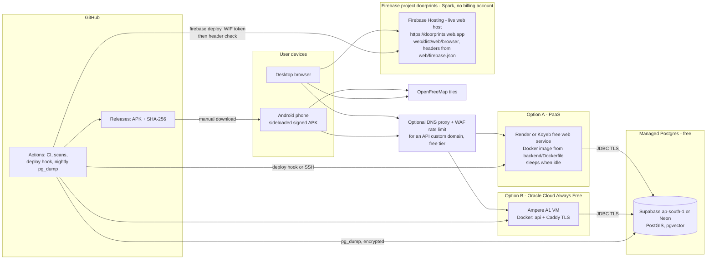

| Concern | Choice | Free-tier note (check current provider terms) |
|---|---|---|
| API runtime | Render/Koyeb free Docker service, **or** Oracle Always Free VM | PaaS sleeps after about 15 min idle, so cold starts take 30 to 60 s. The Android client uses a 90 s read timeout (NFR-002). Oracle VM is always on, but you run TLS (Caddy) and patching yourself. |
| Memory | `JAVA_TOOL_OPTIONS=-XX:MaxRAMPercentage=75 -XX:+UseSerialGC -Xss512k`, Hikari pool 5 | Fits 512 MB |
| DB | Supabase (Mumbai region available) or Neon | About 0.5 GB storage. Supabase pauses inactive free projects, so a keep-alive job is needed (08). |
| Web | **Firebase Hosting** (ADR-21), project and site `doorprints`, deployed by `web.yml` job `deploy-firebase` on pushes to `main` and manual runs; served from the root of its own origin **`https://doorprints.web.app`** (the twin `doorprints.firebaseapp.com` is never shared). Configuration `web/firebase.json` (Web team): SPA fallback = the `**` → `/index.html` rewrite (existing files win; the build has no `404.html`); headers on `**`: CSP incl. `frame-ancestors 'none'` and `worker-src 'self'`, HSTS, `X-Frame-Options`, `nosniff`, `Referrer-Policy`, `Permissions-Policy`, COOP and `Cache-Control: no-cache`. After each deploy the job checks on the live address: `/` and `/compare` for the CSP with `frame-ancestors 'none'`, `X-Frame-Options`, `nosniff`, `Referrer-Policy`, `Permissions-Policy`, COOP and `no-cache`; `sw.js` and the manifest; the build's hashed `main-*.js`; HSTS reported as a warning only on `web.app` ([07](07-secure-build-and-deploy.md) §6.3). GitHub Pages is switched off; Cloudflare Pages was never set up | Spark plan, no billing account: 10 GB storage (old releases count; 10 kept); transfer 360 MB/day on the pricing page or 10 GB/month on the quota page, plan for the stricter; **over the limit the site is disabled** until the period resets, and Spark has no budget alert ([08](08-operations-runbook.md) §2, §7 IR-5) |
| TLS | Provider edge TLS (Render/Koyeb, Firebase Hosting) or Caddy on the VM | Required by SEC-004 |
| CI | GitHub Actions | Free for public repos, 2 000 min/month for private |

## 6. Data model

### 6.1 Server ERD (matches `V1__init.sql`, the only Flyway migration)

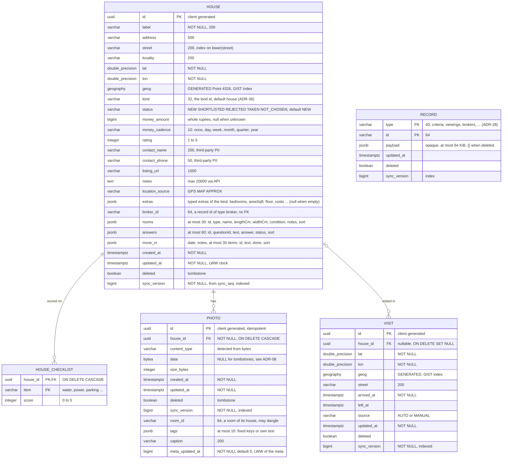

The schema is the one migration `backend/src/main/resources/db/migration/V1__init.sql`: on 2026-10-12 the format reset (S4b-BL-206, ADR-36) squashed the earlier V1..V14 into it, and a database made by those is dropped and created again (no server had data worth migrating); a change from now on is a new `V2__...sql`. Sequence `sync_seq` is shared by `house`, `visit` and `photo`. The optional pgvector `vector_store` (created only when the extension is available) belongs to the AI module, and the device-key and owner-page tables (`device_key`, `pairing_request`, `pairing_invite`, `owner_token`, `server_secret`, `server_setting`, §12.1) sit in the same file. A deleted house keeps only `id`, `deleted`, timestamps and `sync_version` (content blanked, location 0,0); a deleted visit keeps no place.

### 6.2 Room schema on the phones (`doorprints.db`, version 13)

The same Room database serves Android and iOS (`@Database(version = 13)` in
`android/shared/src/commonMain/kotlin/app/doorprints/data/AppDatabase.kt`). The file was `househunt.db` until 2026-09-24
(ADR-24); `DatabaseFile.resolve` renames an existing one, with its `-wal`, `-shm` and `-journal` files, before Room opens it.
The phones' tables (`Entities.kt` in the same folder):

| Table | What it holds | Indexes |
|---|---|---|
| `houses` | One row per candidate (the name stayed): the core columns, `kind`, `money_amount` and `money_cadence` (the price), `extras` (the kind's typed extras as one JSON text: bedrooms, area, floor and the cost fields for a house), `rooms`, `answers`, `moveIn`, `brokerId`, `checklist` as JSON text (TypeConverter). Epoch-ms timestamps, `deleted` tombstone, `dirty` flag; no `syncVersion` | `street`, `kind` |
| `visits` | A visit; epoch-ms timestamps, `dirty` | `houseId`, `street` |
| `photos` | `path` (a file in the photos folder), `uploaded`, `deleted` (a delete queued for the server), and the photo's meta (`roomId`, `tags`, `caption`) | `houseId` |
| `track_points` | The path trace's points; local only, never synced | `at`, `walkId` |
| `saved_walks` | The walks the person saved to a house; local only | `houseId`, `startedAt` |
| `records` | The record envelope of ADR-28 (criteria, questions, viewings, brokers, areas, places, notes ...), key `[type, id]` | `type` |

**The migrations** (`AppDatabase.MIGRATIONS`, one list for the three builders: Android's `AppDatabaseFactory`, iOS's
`AppDatabaseIos` and the tests): 1 to 2 `photos.deleted`; 2 to 3 `track_points`; 3 to 4 `records`; 4 to 5 the house's own
values and the cost; 5 to 6 `brokerId`; 6 to 7 `rooms`; 7 to 8 `answers`; 8 to 9 the photo's meta; 9 to 10 `floor`; 10 to 11
`walkId` and `saved_walks` (below); **11 to 12 the kind reset** (every house rewritten in place as a candidate: `kind`,
`money_amount`, `money_cadence`, `extras`; ADR-36 §18.4; nothing is sent again and nothing is lost); **12 to 13**
`index_houses_kind` (S4b-BL-303, so a space's list and the chooser's tally use an index).

Since Sprint 3.5 `exportSchema = true`; since CMP-4 P4a (Room KMP in `:shared`, ADR-23) the Room Gradle plugin's `room {
schemaDirectory }` writes `android/shared/schemas/app.doorprints.data.AppDatabase/<version>.json` (committed: `2.json` to
`13.json`) and `RoomSchemaTest` pins an identity hash per version, so a table change through the shared enums fails the unit
tests instead of crashing upgraded installs. A real schema change needs a version bump, a migration added to `MIGRATIONS`
and a new `<version>.json`, never an edit to an old one. `AppDatabaseMigrationTest` ([06](06-test-plan.md) TC-U-63)
migrates from version 1 with Room's `MigrationTestHelper` and through the app's own builder from a `househunt.db` (R-06
closed).

#### Room 11 (S4b-FR-14, built): saved walks

*Historical design text, kept as the record: on `main` Room is now **13** and IndexedDB **4** (above and §6.4); the version numbers inside this subsection were those of the time.*

`MIGRATION_10_11` (built: Room was **10** on `main`) and `11.json`, written with Room's own generator, never by hand and validated by `AppDatabaseMigrationTest` and `RoomSchemaTest`:

| Change | Detail |
|---|---|
| `track_points.walkId` | `INTEGER NOT NULL DEFAULT 0`, index `walkId`: the walk id of [11](11-feature-parity-and-export-spec.md) 5.27.2 (the `at` of the walk's first kept point); 0 for rows from before, split by the gap rule alone |
| `saved_walks` (new) | `id` TEXT primary key (a random UUID); `houseId` TEXT NOT NULL; `startedAt` INTEGER NOT NULL (the first point's time, epoch ms, also the walk id); `endedAt` INTEGER NOT NULL; `savedAt` INTEGER NOT NULL; `pointCount` INTEGER NOT NULL (at most 5 000); `lengthM` INTEGER NOT NULL (rounded metres, for the lists); `points` BLOB NOT NULL (the `WalkCodec/1` bytes below) |
| Indexes | `saved_walks(houseId)` (the house page, the 20-a-house limit), `saved_walks(startedAt)` (newest first) |
| Foreign key | **None**, as `visits` and `photos` have none for `houseId`. A phone never hard-deletes a house (a delete is a tombstone, `houses.deleted`), so `ON DELETE CASCADE` would never fire; the walks of a tombstoned house are removed by `WalkSweeper.sweepWalksOfDeletedHouses` (a saved walk whose house is a tombstone or missing), run when the Undo snackbar of `offerDeletedHouseUndo` closes without *Undo*, at app start, at Hunt start and after a sync or an import, and a test proves each trigger. Until then the DAO queries that feed the Map, the house page and the detection join `houses` and skip tombstones, so a deleted house's walks are hidden at once and come back with *Undo* |
| Not in | `Repository.LocalRows`, `ExportBundle`, `localTablesChanged()`, `localVersions()`, the dirty queries, any sync or backup: the tables have **no `dirty`, `updatedAt` or `deleted` column on purpose**, so nothing can be pushed |

`WalkCodec/1` (`:shared`; the website keeps the same numbers as a plain array, `points: number[]`, no varint): byte 0 is
the version `1`; then, for each point in time order, the **zigzag varints** of `dLatE6` and `dLonE6` (the change in
`round(lat * 1e6)` and `round(lon * 1e6)` from the previous point; the first point's change is from 0) and the varint of
`dtSeconds` (whole seconds since the previous point, 0 for the first, whose time is `startedAt`). Accuracy is not
kept. A decoded walk has latitudes and longitudes rounded to 1e-6 degrees (about 0.11 m) and times rounded to the
second. Delta coding is **needed**, not decoration: plain JSON of a 5 000-point walk is about 150 KB and 200 such
walks 30 MB; the codec takes a typical point (two changes under 300 and a gap of 18 s) to 5 bytes, so 5 000 points
are about 25 KB (at most about 40 KB) and 200 walks at most 8 MB. `WalkCodecTest`: round trip to the quantisation, a
point exactly on a boundary of the varint (127, 128, 16 383, 16 384), negative changes, 5 000 points under 40 KB,
and a truncated blob read as a failure, not a short walk.

**The website** ([11](11-feature-parity-and-export-spec.md) 5.27.8): IndexedDB `doorprints` **version 3** (it is 2 on `main`;
`DB_VERSION`, with a step `oldVersion < 3` in `upgradeLocalDb`, pinned in `local-db.spec.ts`): store `trace_points` (key
`id` = `"<walkId>-<atMs>"`, index `walk`; value `{id, walk, at, lat, lon, acc, resumed?}`) and store `saved_walks` (key `id`,
index `houseId`; value `{id, houseId, startedAt, endedAt, savedAt, pointCount, lengthM, points}`). Settings (`trace.on`,
`trace.look`, `trace.alert`, `trace.keepAwake`, `trace.askedUpTo`) go in the existing `settings` store. None is read by
`LocalStore.allHouses`, `allVisits`, `allPhotos`, `allRecords` or any exporter; `db.clear()` empties them.

#### The shared API and the vector file (built, S4b-FR-13; vectors *confirmed*)

Kotlin (`app.doorprints.shared.trace`):

```kotlin
data class TracePoint(val lat: Double, val lon: Double, val atMs: Long, val walkId: Long = 0,   // 0 is no id (11 5.27.3 step 1)
                      val resumed: Boolean = false)                                         // website only: first point after a pause over 5 min
data class TraceWalk(val key: String, val points: List<TracePoint>)          // key: "t:<walkId>" or "s:<savedId>"
data class Stretch(val fromM: Double, val toM: Double)
data class WalkRepeats(val repeated: List<Stretch>, val shown: List<Stretch>)
object TraceConstants { const val TOLERANCE_M = 25.0; const val DENSIFY_M = 10.0; const val BRIDGE_M = 30.0
    const val MIN_RUN_M = 80.0; const val WALK_GAP_MS = 1_800_000L; const val ALERT_MIN_RUN_M = 100.0
    const val ALERT_COOLDOWN_MS = 600_000L; const val MAX_WALK_POINTS = 5_000; const val MAX_DETECTION_POINTS = 20_000 }
fun splitWalks(points: List<TracePoint>): List<List<TracePoint>>
// 5.27.13 (S4b-FR-24): the on-demand place check; NEAR_BAND_M = 50.0 and MAX_FIX_ACCURACY_M = 50.0 join TraceConstants
enum class PlaceStatus { WALKED, CLOSE, NONE, EMPTY, IMPRECISE, INVALID_PLACE }
data class PlaceRow(val walkIndex: Int, val distanceM: Double, val atMs: Long, val walked: Boolean, val saved: Boolean)
data class PlaceCheckResult(val status: PlaceStatus, val fuzzy: Boolean, val nearestM: Double?, val rows: List<PlaceRow>)   // rows: newest first
object PlaceCheck { fun check(lat: Double, lon: Double, walks: List<TraceWalk>, fixAccuracyM: Double? = null): PlaceCheckResult }   // pure; the vectors' placeChecks
class RepeatDetector { fun detect(walks: List<TraceWalk>): List<WalkRepeats> }      // one result per walk, input order
class RepeatAlert { fun onPoint(live: List<TracePoint>, others: List<TraceWalk>): Boolean; fun reset() }   // leaves out the others that ended < WALK_GAP_MS before live began; blocked survives one bad fix
```

TypeScript (`web/src/app/shared/trace-repeats.ts`): the same names in camel case (`splitWalks`, `detectRepeats`,
`RepeatAlert`, `TRACE`, the constants object). Both implementations are written from
[11](11-feature-parity-and-export-spec.md) 5.27.3, **not one from the other**, and the files may share no code.

[`docs/schemas/trace-repeat-vectors.json`](schemas/trace-repeat-vectors.json) (format `doorprints-trace-repeat-vectors/1`,
status **proposed** until both stacks pass every case; [schemas/README.md](schemas/README.md) section 6.4): `constants`
(read and compared with the code's constants: a drift fails the test), `conventions`, and `cases` of three kinds (and, beside them, `placeChecks` with `placeCheckConventions`: the on-demand place check, [11](11-feature-parity-and-export-spec.md) 5.27.13),
`split` (flat points, the expected walks by input index), `repeats` (walks or a flat trace; the expected `repeated` and
`shown` stretches by arc length, to 0.5 m) and `alert` (the live walk's kept points and the other walks; the expected
indexes at which the alert rings, exactly). Kotlin reads it as `DriveVectorsTest` reads `drive-vectors.json`; the
website's spec reads the same file. The status is changed to *confirmed* only by a change that shows both test runs.

### 6.2b The website's trace and place check: files, order and risks (built on `feat/path-trace-v2`, S4b-FR-13, -15, -17, -24; the plan below is kept as the record of the order)

The implementation plan for the web twin of the path trace v2 and the place check, from the senior review of 2026-10-06
([ops/path-trace-check-review.md](ops/path-trace-check-review.md) section 4, a session record; the decisions are in
[11](11-feature-parity-and-export-spec.md) 5.27.13). The tickets in [10](10-sprint-log.md) (S4b-FR-13, FR-15, FR-17, FR-24) each list their rows and their done-criteria.
Order: FR-13 (algorithm, `trace-geo.ts` first) -> FR-17 (the website's trace, stores first) -> FR-15's website part (layers, card, sheet) ->
FR-24 (the check: its web twin lands **after** the web trace; `placeCheck` itself needs only `trace-geo.ts`, so it may be written in parallel with the repeat algorithm) -> FR-18 (guide).

**What the website has today** (the facts the plan rests on):

- The Map page is one 894-line component (`pages/map/map-page.ts`); its child controls are small standalone components in the map's action row
  (`pages/map/offline-save.ts`: a button plus a `<dialog>`). New map features go in that shape, not into `MapPage`.
- Sources and layers are added on every `style.load`; `createMlMap` registers `applyIndiaBoundaries` on `style.load` before the page's own listener, so the page's layers
  land on a style that already carries the boundary layers (ADR-22). The house layer is `houses-circles`; anything added with `beforeId: 'houses-circles'` sits under the
  markers and above the boundaries.
- The house page has its own 240 px map, `shared/location-map.ts` (`app-location-map`), with a DOM `Marker`; it exposes no map.
- One location seam: `shared/locate-once.ts` (`LOCATE_OPTIONS`, a `gone()` guard) and `shared/map-center.ts` (`locationErrorKey`).
- IndexedDB (`data/local-db.ts`, `DB_VERSION = 2`, five stores, one upgrade step per version, `MemoryDb` fallback): no cursor, no range, **no multi-store transaction, no batch delete**;
  `clear()` with no store empties every store in `STORE_NAMES`.
- i18n: flat dotted keys, three levels at most (no four-level key); hi/ta/te hold exactly the same keys (`dictionaries.spec.ts`); lists join with `list.two`/`list.three`
  through `TranslationService.list()`; dates go through `Intl` helpers (no `date` pipe with a language: `tools/check-templates.mjs`).
- One app-wide polite live region in the shell (`core/announcer.service.ts`, with `cancel(msg)`), which keeps its last text in the DOM until the next announcement.
- Themes: `prefers-color-scheme: dark` only; the map tiles stay light in both. `public/sw.js` precaches every file of the build and never caches tiles.
  CSP and `Permissions-Policy` (`geolocation=(self)`) need no change; nothing blocks a trace, a check or a Web Worker.

**The files, in order** (one pull request or part of one each; *risk* names what can go wrong and how it is kept small):

| # | Ticket | File (new unless *edit*) | What | Risk and how it is kept small |
|---|---|---|---|---|
| 1 | FR-13 | `web/src/app/shared/trace-geo.ts` | `K`, `localXY(place, point)`, `segmentLengthM`, `distanceToSegmentM(q, a, b)` with the clamp (`L² = 0` gives `t = 0`), `interpolatedAtMs`. **The one plane for both algorithms** (`trace-repeats.ts` and `trace-place-check.ts` import it; the vector tests of both run against it) | None; the spec's *two engineers* rule is Kotlin against TypeScript, not within a stack |
| 2 | FR-13 | `web/src/app/shared/trace-repeats.ts`, `trace-repeats.spec.ts`, `trace-repeats-vectors.spec.ts` | 5.27.3 as planned; `TRACE` constants object (`toleranceM`, `nearBandM`, `maxFixAccuracyM`, ...) exported from `trace-geo.ts` or a `trace-constants.ts`; the vectors spec imports `../../../../docs/schemas/trace-repeat-vectors.json` (four `..` from `shared/`) and asserts `vectors.constants` equals the code's, so the drift test covers `nearBandM` and `maxFixAccuracyM` from day one | `it.each` over 37 cases: `check-specs.mjs` sees the `expect` inside the body (checked: its regex accepts `it.each`) |
| 3 | FR-17 | *edit* `web/src/app/data/local-db.ts`, `local-db.spec.ts` | `DB_VERSION = 3`; `StoreName` gains `'trace_points' \| 'saved_walks'`; `STORE_NAMES`, `STORE_KEY_PATH` (`id`, `id`), `STORE_INDEXES` (`['walk']`, `['houseId']`); `upgradeLocalDb` step `if (oldVersion < 3)` creating both stores with their indexes (the `UpgradeDb`/`UpgradeStore` fakes already support it); **rewrite the stale header comment** (*version 3 (slice 1) will hold the house's own new values*); add **`deleteAll(store, keys)`** (one transaction, the twin of `putAll`) and **`transaction(stores, fn)`** or at least `moveWalk(points, saved)` as one `readwrite` transaction over both stores, so a save is atomic; `MemoryDb` follows from `STORE_NAMES` automatically and `clear()` already empties the new stores (so *Remove all data* needs no change: assert it) | **The upgrade with several tabs:** a tab at version 2 from a current build closes its database on `versionchange` and shows *reload*; a tab from a build before S4b-BL-71 blocks and the new tab falls back to memory (`onblocked`): the trace card then shows the existing *nothing is kept* warning (`storageProblem === 'blocked'`). Test both with the fake. **Safari private / Firefox never-remember:** memory; the card says a walk lives for this page only. **Quota:** `put` rejects with `QuotaExceededError`; `errorMsg` already maps it to `error.storageFull`; the recorder must stop the walk and say so, never retry in a loop |
| 4 | FR-17 | `web/src/app/data/trace-store.ts`, `trace-store.spec.ts` | `TraceStore` over `LocalStore.db()`: `putPoint`, `walks(sinceMs)` (30 days: `getAll('trace_points')`, group by `walk`, sort by `at`, split by 5.27.3 step 1), `savedWalks()`, `savedWalksOf(houseId)` (index), `saveWalk` (atomic, see 3), `deleteWalk`, `deleteWalksOfHouse` (called from `LocalStore.deleteHouse` beside `deletePhoto`), `deleteAllSaved`, `prune(now)` (`getAll` then `deleteAll`), `clearTrace`; settings `trace.on`, `trace.look`, `trace.alert`, `trace.keepAwake`, `trace.askedUpTo` added to `SETTING_KEYS` (`'trace.on'` etc. fit the convention) | `getAll` reads the whole store: 30 days of points is a few thousand rows (fine); 200 saved walks of 5 000 plain-array points is up to about 8 MB structured-cloned in one call: read them **per house or per id in a loop** when the Map draws, as 5.27.13's *one saved walk at a time* says. The not-in-any-export source test (TC-U-152) greps `trace_points`/`saved_walks` under `export/`, `data/drive/`, `core/ai/`, `sync*.ts`: run it from the first commit |
| 5 | FR-17 | `web/src/app/core/trace-recorder.service.ts`, spec | `watchPosition` only after *Start a walk*, the 50 m gate and 20 m / 5 min thinning (a twin of `TrackRecorder`), walk ids, `resumed` after a hidden pause of more than 5 min (`document.visibilityState` and `visibilitychange`, as `pages/data/drive/drive-sync.ts` lines 114-127 already do), the Wake Lock (`navigator.wakeLock?.request('screen')`, released by the browser when hidden, re-requested on visible), the beep (`AudioContext` created and resumed inside the *Start a walk* click, two 0.15 s 880 Hz tones; `navigator.vibrate` as the fallback), the banner through a signal the Map card renders with `role="alert"`, `RepeatAlert` per kept point. Exposes `liveWalkId()` (the check leaves it out for *here*) | A service that holds a `watchPosition` id across route changes: the Map page may be left mid-walk; the service, not the page, owns the watch and the lock, and the page's card re-binds on return. The `AudioContext` gesture rule is already stated in 5.27.5; no change |
| 6 | FR-15 (web) | `web/src/app/shared/trace-style.ts`, spec | `TRACK_SOURCE = 'track'`, `TRACK_LAYER`, `TRACK_REPEAT_LAYER`, `TRACK_CHECK_SOURCE = 'track-check'`, the three check layers (`track-check-halo`, `track-check-line`, `track-check-label`), `trackGeoJson(walks, shown)`, `trackLayerJson()`, `trackRepeatLayerJson(look)`, `repeatWidthExpression(look)`, `checkLayersJson()`; the widths table of 5.27.4 pinned | Pure data; no risk |
| 7 | FR-15 (web) | `web/src/app/pages/map/trace-layers.ts` (a class, not a component) | `TraceLayers.attach(map)`: on **every** `style.load` adds `track`, `track-check` sources and the layers **with `beforeId: 'houses-circles'`** (so under the markers, above India's boundary layers, which `applyIndiaBoundaries` has already placed; the check layers above `track-repeat-line`), `setWalks(features)`, `setLook(look)` (`setPaintProperty` + `setLayoutProperty('visibility')`), `setCheck(features \| null)`, `fitTo(bounds, padding)`; `MapPage` calls `attach` in its own `style.load` handler right before it adds `houses-circles` (so the house layer exists first; or add the track layers after it with `beforeId`) | **ADR-22 / TC-M-25:** the boundary layers are never touched (no `moveLayer`, no `setFilter`, no id of theirs used); the new layers sit above them by construction. One base-map change (new layers) means **TC-M-25 is re-run once** (CLAUDE.md), as S4b-FR-15 already plans. **Offline reload:** everything is re-added on `style.load`, as the house layer is |
| 8 | FR-15 (web) | `web/src/app/pages/map/trace-card.ts` (standalone component, `app-trace-card`) | The *Trace my path* card of 5.27.1/5.27.8: the switch, *How repeated paths look* (radio group), *Warn me when I walk a path again*, *Keep the screen on while I walk*, *Saved walks: n* + *Delete all saved walks* (confirm through `ConfirmService`), *Clear the path*, *Start a walk* / *Finish walk*, the only-while-open sentence, the paused sentence (live region: the app `Announcer`, not a second region), the shared-browser sentence, the alert banner (`role="alert"` + *Dismiss*). Rendered in `MapPage`'s `.panel` section **above `.panel-head`** as a `<details>` collapsed by default on phones (the list is the page's job), open on wide screens | **Where it lives in navigation:** the owner's spec puts it on the Map page, not on *Your data* (the phones have it under Settings > Hunt mode; the website has no Hunt mode). Keep that: *Your data* gets only the two numbers it already lists for other stores (*Saved walks: n*, *Delete all saved walks*) inside the existing `storage-heading` card (section 4.3). **Phone peek:** `watchStack()` measures `.panel-head` into `--map-peek` so the list heading shows under the map; a card above the heading pushes the heading down. A collapsed `<details>` is one line (fits the peek); when opened the person is in the card, which is what she asked for |
| 9 | FR-15 (web) | `web/src/app/pages/map/walk-end-sheet.ts` (`app-walk-end-sheet`) | *Save this walk?* as a `<dialog>` (the `OfflineSave` shape: `showModal`, focus to the title, Esc = *Keep for 30 days*), the house picker inside it (nearest within 30 m preselected, within 150 m listed, the search box over `searchText` of `map-list.ts`) | The picker reuses `searchText`; 5.27.6 says the search rule of S4b-FR-1 does not apply (a walk is not a house field): right |
| 10 | FR-15 (web) | *edit* `pages/house-detail/house-detail-page.html/.ts` | The *Saved walks* card (rows, *Show on map*, *Delete walk*) under the location card; *Show on map* draws the walk on the page's own `LocationMap` (see 11), not a navigation | None once 11 exists |
| 11 | FR-15 (web) | *edit* `web/src/app/shared/location-map.ts` | An optional `overlay = input<GeoJSON.FeatureCollection \| null>(null)` and `overlayLayers` input; on every `style.load` the component adds a `track-check`/`track` source and the layers from `trace-style.ts` (reusing `TraceLayers`) and an optional ring `Marker`; `fitTo` when the overlay changes. Its single DOM marker stays | The component is used by the house form and the areas' `PointPicker`; the new inputs default to null, so nothing changes for them. jsdom: `createMlMap` returns null there, so the overlay code must guard `map === null` as the rest does |
| 12 | FR-24 | `web/src/app/shared/trace-place-check.ts`, `trace-place-check.spec.ts`, `trace-place-check-vectors.spec.ts` | `placeCheck(place, walks, fixAccuracyM?)` from 5.27.13 over `trace-geo.ts`; `PlaceStatus`, `PlaceRow`, `PlaceCheckResult`; the cheap box rejection (`NEAR_BAND_M` grown box) and the random-city equality test; `matchedStretch(walk, row)` (60 m each side along the walk, within one part); the vectors spec runs the 21 cases and the drift test | **Dependency on FR-13 is only `trace-geo.ts`** (row 1): the check can be written as soon as row 1 exists, in parallel with the repeat algorithm |
| 13 | FR-24 | `web/src/app/shared/trace-place-text.ts`, spec | `placeCheckText(result, place, i18n, now, timeZone?)`: the headline (distinct days newest first, at most three, `i18n.list()`, `and {n} more`, the largest distance among the listed days, `ceil` and at least 1 m), the rows (at most five, `and {n} more walks`, *saved walk*), the sentences for the other states, `fuzzy`, the website's *only while this page was open* line; dates through a new `TranslationService.dateWithWeekday(epochMs, timeZone?)` (`weekday: 'short', day: 'numeric', month: 'short'`, plus `year: 'numeric'` when not the current year); distances through a new `TranslationService.metres(n)` (`Intl.NumberFormat` `style: 'unit', unit: 'meter'`, as `size()` does for bytes) | Pure; the four-language date test runs here. `check-templates.mjs` is satisfied by construction (no `date` pipe) |
| 14 | FR-24 | `web/src/app/pages/map/place-check.ts` (`app-place-check`, the control) | In `.map-actions` beside `app-offline-save`: the button *Have I been here?* (footprints glyph, label hidden on phones the way `OfflineSave` hides its label, 44 px target) opening a `<dialog>` with two choices (*Where I am now*, *A spot on the map*), the permission sentence **shown every time** in that dialog (no flag), and the *Finding your location...* state with *Cancel*; *here* uses `locateBest` (`watchPosition` with `{ enableHighAccuracy: true, maximumAge: 0 }`, stopped at the first fix of 50 m or better or at 15 s; row 16); *A spot on the map* closes the dialog and asks `MapPage` for pick mode (row 15). On a result it closes the dialog and hands the result to the panel (row 17) and the layers (row 7) | The dialog is modal only while choosing and locating, so the halo is never under a backdrop. Outputs: `picked`/`result` signals, no router state |
| 15 | FR-24 | *edit* `pages/map/map-page.ts/.html/.css` | `addMode` becomes `pickMode = signal<'house' \| 'check' \| null>(null)` (the crosshair `div`, the `applyGestures` call, Esc, the hint and the `#place-here` button read it: *Place here* for a house, *Check this spot* for the check, `map.pickHintShort` / `trace.here.pickHint`); `placeAtCenter()` branches on the mode; the `style.load` handler calls `TraceLayers.attach`; the `fitToHouses` padding (`fitPadding`) is reused for the check's fit. **No new query parameter, no `history.state`**: the check never goes through `createAt`'s `lat`/`lon` query (that path is for a new house, where the coordinates are data the person is about to save) | **Risk: `MapPage` grows.** Keep every new line a one-line delegation; the three new child components own the behaviour. **Cooperative gestures:** pick mode disables them (as add mode does), so one finger moves the map under the crosshair, and they come back on exit; same code. **Small phones:** the crosshair is already clear of the bottom row and the control column; the check adds a fourth action button to the column: measure on the 360x640 profile of the live-ui mobile pass (the column height is `--map-stack-h`, which lifts MapLibre's controls, so nothing overlaps, but the map's `min-height` rule (`196px + stack`) grows by one button) |
| 16 | FR-24 | *edit* `web/src/app/shared/locate-once.ts` | An optional `options: PositionOptions = LOCATE_OPTIONS` parameter, and a sibling `locateBest(handlers, { maxWaitMs: 15000, maxAccuracyM: 50 })` that runs `watchPosition`, keeps the best fix, stops at the first of 50 m or better or at 15 s, and resolves with `fix \| 'timeout'`; the same `gone()` guard | None for the three existing callers (the default keeps `LOCATE_OPTIONS`) |
| 17 | FR-24 | `web/src/app/pages/map/place-check-panel.ts` (`app-place-check-panel`) and `web/src/app/pages/house-detail/house-check-card.ts` | The result **panel**: an `h2` with `tabindex="-1"` that takes focus on arrival (which also scrolls it into view on a phone), the headline and rows as text, `trace.here.privacy`, the actions *Show on map* (`fitTo` the stretch with `fitPadding`; on the house page the page's own `LocationMap` already shows it), *Check again* (*here* only), *Close* (focus back to the opener, `announcer.cancel(headline)`, `setCheck(null)`). The headline is announced **once** through the app `Announcer` (the shell's polite region), not a second `aria-live` region on the page. Placed at the top of `MapPage`'s `.panel` section; on the house page as a card *Did I walk past this house?* under the location card, with the button, the `APPROX` note, the hidden state for a new house, and the answer in place | **Privacy on the website:** the shell's live region keeps its last text in the DOM until the next announcement, so *Close* must `cancel` it; the panel's result is a component signal, never `history.state`, `sessionStorage`, `ListReturn` or a query param (the source test of TC-U-154 greps for those names in the four check files) |
| 18 | FR-24 | *edit* `i18n/en.ts`, `hi.ts`, `ta.ts`, `te.ts` | The `trace.here.*` keys of 5.27.13 minus `and2`/`and3` (use `list.*`) and with `a11y.stretch` renamed `stretchA11y`; `{tolerance}` in `close`, `none`, `noneSaved`; `metres` not needed (Intl unit) | `dictionaries.spec.ts` enforces parity; hi/ta/te *under review* |
| 19 | FR-24 | *edit* `tools/live-ui/live-ui.js` | `newCtx` gains `permissions: ['geolocation']` and `geolocation: { latitude, longitude, accuracy }` (Playwright's `browser.newContext` options; `ctx.setGeolocation` to move); a `--trace` run after the deploy (as `--hunt` is proposed in S4b-FR-21): *Start a walk*, 30 steps of 20 m along a street with `setGeolocation` and `page.clock`, *Finish walk* → *Keep for 30 days*, then *Have I been here?* > *Where I am now* on the street (the headline contains *within* and today's weekday) and 100 m off it (the *none* sentence), the network panel asserted empty for the click (`page.on('request')` counting non-tile requests), the mobile pass taking a screenshot of the panel on the 360x640 profile. No CSP bypass needed | Seeding IndexedDB by hand would couple the test to store names; stepping a real walk uses only the UI. TC-M-26's rule: run after a `web/**` merge deploys |
| 20 | FR-18 | `guide/docs/hunt-mode.md` (+ `guide/i18n/{hi,ta,te}/hunt-mode.md`) or the planned *Your paths* page and the four `mkdocs*.yml` navs | A section *Have I been here?*: the button, the three places, *close* against *walked*, that nothing is kept or sent, that the website's answer covers only walks recorded while a page was open, that the location button may use the phone's network service. Pictures: LATER (a map picture needs the tile server; `tools/guide-shots` fakes Drive, not tiles) | None |

**Decisions the plan fixes**

- **Settings and navigation.** The trace's settings are on the Map page's card (`app-trace-card`, row 8), not on *Your data* (the website has no Hunt mode and no Settings page);
  *Your data*'s `storage-heading` card gains only *Saved walks: n* and *Delete all saved walks* (TC-U-152 names `data-page`). The check has **no setting**, so it touches neither card.
- **Layer order**, bottom to top: Liberty's layers; India's boundary overlay; `track-line` (base, purple); `track-repeat-line` (orange dashes); `track-check-halo`
  (a wide white casing with a thin dark outer line: a form); `track-check-line`; `houses-circles`; the ring `Marker` (DOM, `pointer-events: none`, `aria-label` =
  *You are here* / *This house* / *This spot*). Every page layer is added with `beforeId: 'houses-circles'`; nothing calls `moveLayer`, `setFilter` or `setLayoutProperty`
  on a boundary layer. The ring is a DOM marker, a hollow ring with a centre cross in inline SVG (28 px), a different form from the `APPROX` ring of `house-markers.ts`.
  **TC-M-25 is re-run once** for the new layers.
- **Small phones.** The check adds one 44 px button to the action column (label hidden as `OfflineSave` does); the actions row grows with it (since S4b-BL-49, 2026-10-13, a row under the map, so the map's own height does not)
  (measured on the 360x640 profile of the live-ui mobile pass). Pick mode disables cooperative gestures as add mode does. The result panel sits at the top of the list section,
  and *Show on map* fits with `fitPadding(...)`.
- **Geolocation.** *Here* goes through `shared/locate-once.ts` as a **15 s best-fix watch**: `watchPosition` with `{ enableHighAccuracy: true, maximumAge: 0 }`, `clearWatch` at the first
  fix of 50 m or better or at 15 s, when the best fix so far decides (`locateBest`, row 16); the same `gone()` guard; `locationErrorKey` supplies the blocked/unavailable keys
  (`trace.here.deniedWeb` keeps its own sentence). The Wake Lock, `visibilitychange` and the `AudioContext` belong to the recorder (row 5), not to the check.
  A `locateBest` still waiting when the page is hidden keeps waiting; the 15 s timer decides.
- **`LocalDb` version 3.** The step creates stores only (existing stores untouched), so a failed upgrade aborts and the database stays at 2 (`blocked` -> memory; nothing is lost).
  `local-db.spec.ts` gains *from 0*, *from 2* and *from 3 (no-op)* cases and one that asserts `STORE_NAMES` has seven entries so `clear()` covers the new stores. Row shapes
  (`{id, walk, at, lat, lon, acc, resumed?}`) fit `STORE_KEY_PATH`; `resumed` stays absent when false. The stale header comment (*version 3 (slice 1) will hold the house's
  own new values*) contradicts this section and is **rewritten in the version-3 change**.
- **A saved walk and the trace never count twice.** `TraceStore.saveWalk` writes the saved row and deletes the trace rows in **one two-store transaction** (`LocalDb.moveWalk`
  or `transaction(stores, fn)`); the check also drops a trace walk whose walk id equals a saved walk's id (a save cut between two writes, the tab closed or the quota hit), so the
  headline never says *and 1 more walks* for a walk that happened once.
- **No Web Worker for the check.** One pass over segments with a box rejection: about 2-5 ms for 20 000 segments, 50-150 ms for the worst case the spec allows. A synchronous pass that
  yields between saved walks (`await scheduler.yield?.() ?? new Promise(r => setTimeout(r))` every 20 walks) keeps the page responsive. The pairwise **repeat detection** (FR-17)
  is where a Worker may be needed: decide there from the random-city timing.
- **Accessibility and themes.** The text is the whole answer; the halo and the ring are decoration with `stretchA11y` on the map region's `aria-describedby`. The headline goes
  through the app's polite region once; focus moves to the panel's heading; *Close* returns focus to the opener and calls `Announcer.cancel`. 44 px targets; the jsdom sweep
  (`shared/testing/a11y.ts`) runs over the dialog, the panel and the house card in four languages; the panel uses the tokens, the map's halo needs no theme branch.
- **Offline.** The check's code ships in the Map's and the house page's lazy chunks, which `sw.js` precaches; a house or a spot answers offline, and *here* works offline too.
  Without a map style the panel still shows its text and *Show on map* is hidden while `!mapUsable()`. No tile, no API call: the service worker needs no change.
- **Dates and strings.** `TranslationService.dateWithWeekday(epochMs, timeZone?)` (an optional zone so Vitest can test *23:50 against two zones*) and `TranslationService.metres(n)`;
  the phones use the skeleton `EEEdMMM` (`EEEdMMMy`) via `DateFormat.getBestDateTimePattern` and `setLocalizedDateFormatFromTemplate`, because Tamil and Telugu put the weekday last.
  Android resource names follow [05](05-ux-accessibility-i18n.md) §9.1 (`trace_here_walked`); `StringParityTest` holds them.
- **Privacy on the website.** The panel's result is a component signal, never a URL or query parameter, `history.state`, session or local storage, or `ListReturn`; the house
  page's *Show on map* draws on the house page's own `LocationMap` and never navigates with a result. **Source test** (TC-U-154): a Vitest spec reads the check's files
  (`shared/trace-place-check*.ts`, `shared/trace-place-text.ts`, `pages/map/place-check*.ts`, `pages/house-detail/house-check-card.ts`) with `fs` and asserts none mentions `fetch(`,
  `XMLHttpRequest`, `sendBeacon`, `history.`, `sessionStorage`, `localStorage`, `queryParams`, `ListReturn`, `console.` or a store write; it imports nothing from production, so it
  carries the exception marker `// check-specs: allow-no-production-import (a source test)`. The behaviour test runs the check with `fetch` and `XMLHttpRequest` replaced by
  throwing stubs; a grep finds `placeCheck(` only in the panel and control files.
- **Tests.** Specs beside the code; the vectors specs import the JSON module as `data/drive/drive-vectors.spec.ts` does; `tools/check-specs.mjs` accepts `it.each`.

#### Room 12 (kinds step 4, S4b-BL-206): every house a candidate

`MIGRATION_11_12` and `12.json` (identity hash `a3a45fa452d35b5397c9255e96f24816`), Room's own SQL, validated by
`AppDatabaseMigrationTest` and `RoomSchemaTest` ([06](06-test-plan.md) TC-U-204). The `houses` table holds the
candidate of §18.4 doors 3, 5 and 7:

| Change | Detail |
|---|---|
| `kind` (new) | `TEXT NOT NULL`: the kind id, `house` for every row |
| `money_amount`, `money_cadence` (new) | `@Embedded(prefix = "money_") Money`: whole rupees and `month` (a rent), `once` (a sale) or none (a price of type *Not set*, owner 2026-10-12); both null is no money |
| `extras` (new) | `TEXT`, JSON: the bedrooms, area, floor and the eleven cost fields keyed by extra id in the kind file's order (`deposit`, `brokerage` money `once`, `maintenance` money `month`, `myOffer`, `agreedPrice` money as often as the candidate's money or `month`), then an extra a newer app wrote (a field id with a value of an extras type, at most 30, texts of at most 2,000 characters), kept and written back; null for none, never `{}` |
| Gone | `price`, `priceType`, `bedrooms`, `areaSqft`, `floor` and the eleven `cost_*` columns |
| The migration | The table is made again (SQLite before 3.35 cannot drop a column): every other column is copied as it is, the dirty flag and tombstones included, so nothing is sent again and nothing is lost; `money` and `extras` are computed by `Candidates` (the same code as every later write), one `UPDATE` per house that has a value. In Room's one migration transaction |

**Why not Room version 1** (the plan of S4b-BL-206): an installed app cannot open a database whose version is lower
than the one on the device without wiping it, the IndexedDB finding of §18.5 on the phone; the owner's test devices keep
their houses. **The screens did not move:** `HouseEntity` keeps the house's values as properties of its primary
constructor (which Room ignores) and derives `money` and `extras` from them; Room reads a row through a second
constructor, which reads them back out (`Candidates.houseExtrasOf`, by type, not by range). So every reader of a house
(the list and its search, the form, the cost summary, the copies, the AI) reads the same values as before, the twin of
the website's `data/candidate-rows.ts`. `CommonRepository` and the DAOs are unchanged; the internal names (`houses`,
`houseId`) stay, as on the website.

#### Room 13 (S4b-BL-303): an index on the kind

`MIGRATION_12_13` and `13.json` (identity hash `71cf6f1d4190491691b73989cab3e4f9`): `index_houses_kind` on `houses.kind`, nothing else; no row changes. With two or more kinds on, a space's list (`rememberSpaceHouses`) and the chooser's cards read through it instead of filtering the whole list in memory: `Repository.housesOf(space)` runs `HouseDao.observeKinds` (the kinds a space holds) or `observeKindsExcept` (the default space also holds a kind this build does not have), chosen by `SpaceView.query()`, which `SpaceQueryTest` holds to `SpaceView.holds` for every kind in every space; `Repository.kindTallies` is one row per kind (`count`, newest `updatedAt`) and `spaceCardsOf` makes the cards from it (`SpaceCardsTest`, `SpaceQueryTest`). With one kind on `rememberSpaceHouses` is `repo.houses`, as before. `SpacesRepositoryTest` runs both on real Room against the in-memory rule, a tombstone and a kind this build does not have included; `AppDatabaseMigrationTest.migration12To13AddsTheKindIndexAndKeepsEveryRow` the migration.

### 6.3 Derived values

| Value | Formula | Implemented in |
|---|---|---|
| Overall score | `mean(checklist)` blended 50/50 with `rating` when both exist, else whichever exists, else null | `HouseScore.of` in `:shared` (used by `HouseEntity.score`), web `houseScore()` |
| Distinct streets | `count(distinct lower(street))` over live houses | `HouseRepository.countDistinctStreets` |

### 6.4 The website's IndexedDB (`doorprints`, version 4)

The browser database that holds a browser's whole data set, opened by `openLocalDb` in `web/src/app/data/local-db.ts` (a ~120-line
wrapper, ADR-19; an in-memory stand-in when IndexedDB is unusable). `DB_VERSION` is **4**; `upgradeLocalDb` runs one step per
version by `oldVersion`, so a browser that skipped releases still gets every step, each pinned in `local-db.spec.ts`. A tab holding
an older version open is told through `versionchange`, closes its database and shows the update banner.

| Store | Key | Indexes | Holds |
|---|---|---|---|
| `houses` | `id` | none | Candidates (kind, money, extras) |
| `visits` | `id` | `houseId` | Visits |
| `photos` | `id` | `houseId` | Photo bytes and meta |
| `settings` | `key` | none | This browser's settings, cursors, the enabled kinds and the default (device-local, never synced) |
| `records` | `[type, id]` | `type` | The record envelope (ADR-28): criteria, questions, viewings, brokers, areas, places, notes |
| `trace_points` | `id` | `walk` | The path trace's points; never synced |
| `saved_walks` | `id` | `houseId` | Saved walks; never synced |

| IndexedDB version | What it added |
|---|---|
| 1 | Sprint 4a: `houses`, `visits`, `photos`, `settings` |
| 2 | `records` and the `houseId` indexes (S4b-BL-66, ADR-28) |
| 3 | `trace_points` and `saved_walks` (S4b-FR-17) |
| 4 | Kinds step 3 (S4b-BL-206, ADR-36): every row of `houses` rewritten as a candidate by `upgradeHouseRow` in `candidate-rows.ts`, in the same transaction, so a failure leaves the database at version 3 with its rows as they were |

Adding a field to a row needs no version; a new store, index or in-place rewrite does, with a step in `upgradeLocalDb` and a
case in `local-db.spec.ts`. IndexedDB cannot open a database at a lower version, which is why the format reset's "version 1"
is version 4 here. The Drive connection keeps its own small database, `doorprints-drive` version 1
(`data/drive/connect/stores/drive-db.ts`: Drive state, keys watermark, pending deletions, photo state, device key). Durability:
§16.4. The one-page view of every store is [16](16-architecture-overview.md) §3.

## 7. Sequence diagrams

### 7.1 Save a house offline, then sync

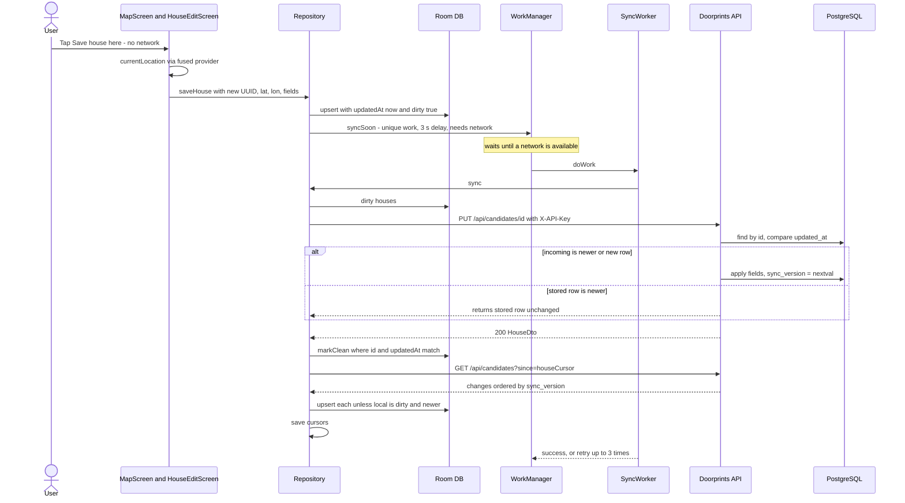

### 7.2 Hunt mode: passing a visited house, entering a known street

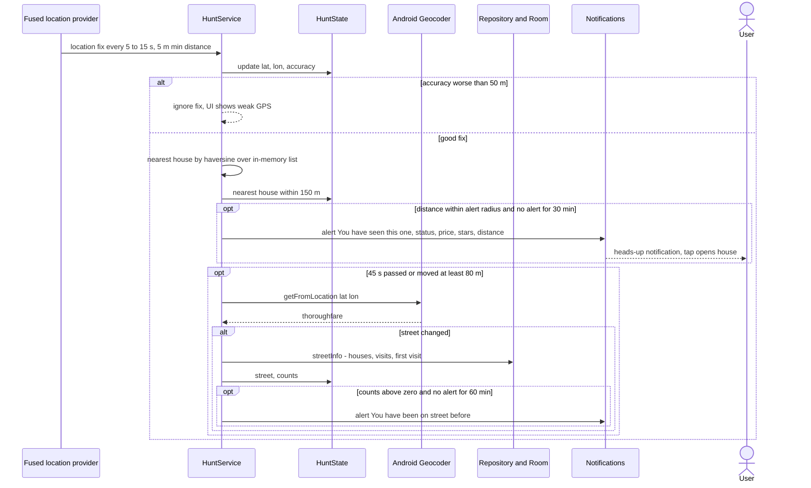

### 7.2a The path trace: a point, a repeated path, the end of a walk (built on `feat/path-trace-v2`, S4b-FR-13, -14, -16)

```mermaid
sequenceDiagram
    participant HE as HuntEngine
    participant TR as TrackRecorder
    participant TD as TrackDao and SavedWalkDao
    participant RD as RepeatDetector and RepeatAlert
    participant EF as HuntEffects
    participant UI as Map and sheet
    actor U as User
    HE->>TR: accept(fix after the 50 m gate)
    alt kept (20 m or 5 min)
        TR-->>HE: point with the walk id
        HE->>TD: saveTrackPoint (30-day trace)
        opt trace on and alert on
            HE->>RD: onPoint(live walk, other walks)
            alt trailing run 100 m or more, not blocked, 10 min since the last
                RD-->>HE: ring
                HE->>EF: alertRepeat(runM)
                EF-->>U: notification sound (phone) or beep and banner (website)
            end
        end
    end
    U->>UI: Finish walk (or Hunt mode stops)
    UI->>HE: endWalk
    UI->>TD: lastEndedWalk(): newest walk id above walkAskedUpTo, not the live one, 5 points and 100 m
    UI-->>U: Save this walk? (also at Map open and at Hunt start: the walk a kill or restart cut)
    UI->>HE: saveWalkAskedUpTo(id) on any answer
    alt Save with a house
        U->>UI: choose a house (nearest suggested)
        UI->>TD: one transaction: encode points into saved_walks, delete them from track_points
    else Keep for 30 days or dismiss
        UI->>TD: nothing; the 30-day prune will remove it
    else Delete this walk
        UI->>TD: delete the walk's track_points
    end
    Note over UI,RD: The Map reads trace and saved walks, RepeatDetector.detect off the main thread, and draws the base line and the repeat overlay (the look sets the overlay's width and visibility live)
```

The repeat check and the Map's detection use the same functions with different inputs (one new point against the others,
or every walk against the others). No location leaves the device at any step.

### 7.2b The place check: *Have I been here?* (built on `feat/path-trace-v2`, S4b-FR-24)

```mermaid
sequenceDiagram
    actor P as Person
    participant UI as Map / house page / long press
    participant L as Location (one fix, only for "here")
    participant TD as TrackDao + SavedWalkDao (read only)
    participant PC as PlaceCheck.check (pure)
    P->>UI: presses Have I been here? / Did I walk past this house? / Did I walk here?
    alt here
        UI->>L: permission flow, one fresh fix (15 s best-fix watch, 50 m gate; the website: watchPosition via locate-once.ts, 6.2b)
        L-->>UI: lat, lon, accuracy (never stored, never in the trace)
    else a house or a picked spot
        UI->>UI: the house's saved location or the crosshair point (no location permission)
    end
    UI->>TD: read the 30-day trace and every saved walk (off the main thread, one saved walk decoded at a time)
    UI->>PC: place, walks, accuracy (only for here)
    PC-->>UI: status, rows newest first, nearest distance
    UI-->>P: the sheet (text first, live region) and the halo and ring on the map; closing discards everything
```

On the website the answer is a component signal, drawn on the Map's layers or the house page's own `LocationMap`, withdrawn from the live region on close (6.2b). The only caller is the button's handler: no timer, no arrival trigger, no background. Nothing in this path writes (`TrackDao` and `SavedWalkDao`
are read only), makes a network request or logs a place, distance or date. The stores, the exports, the sync and the AI paths are unchanged (PRV-032).

### 7.3 Stay detection and "Are you at a house?" prompt

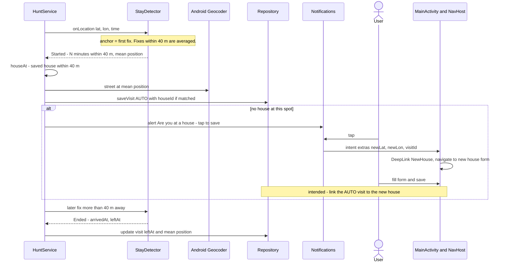

### 7.4 Photo capture and upload

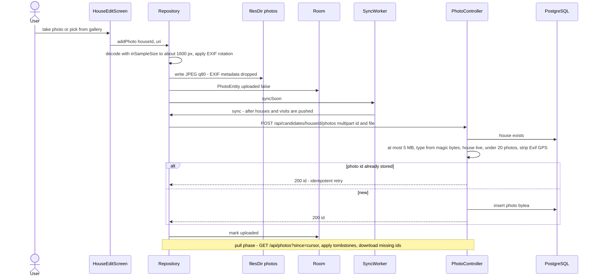

The web app uses the same endpoint. It resizes in the browser (`resizeImage`) and generates the photo UUID on the client.

### 7.5 RAG question: "Ask my house hunt" (built; UI: web `pages/ask`, Android `AssistantScreen`)

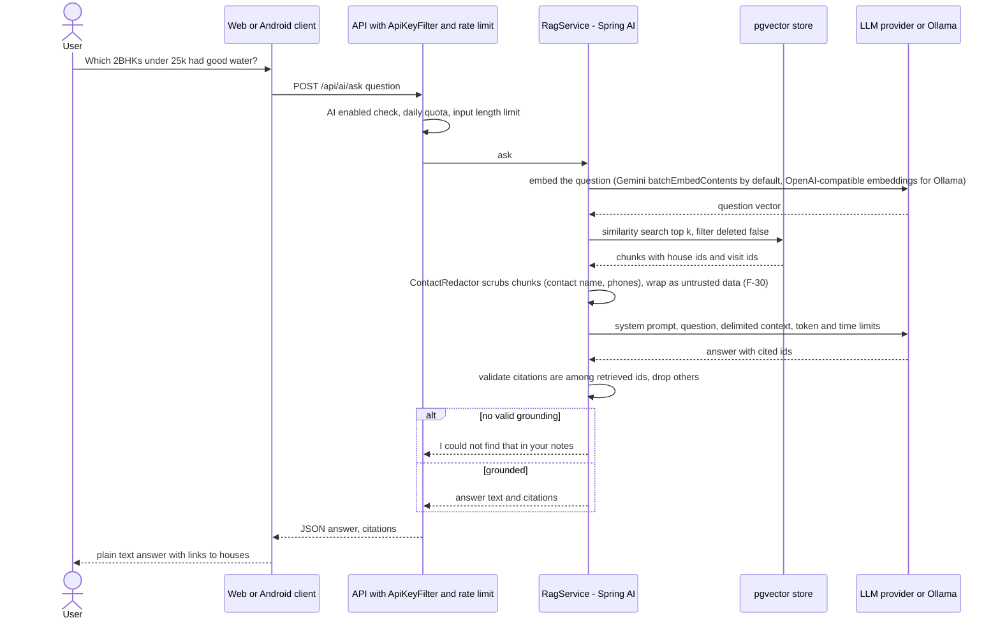

### 7.6 Listing text extraction (built; UI: web new-house form, Android "Paste listing")

The request field is `text` at `POST /api/ai/extract-listing`; the response is `HouseDraft` with `warnings` (see [ai/ai-design.md](ai/ai-design.md) §13). The clients copy only fields the listing provided, append amenities to the notes and show the warnings.

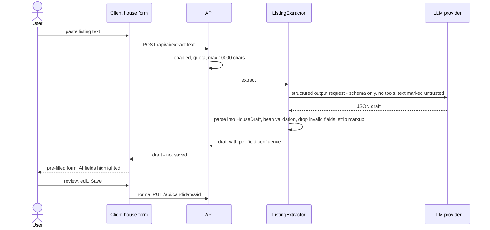

### 7.7 Plan my visits (built; UI: web `pages/plan`, Android `AssistantScreen`)

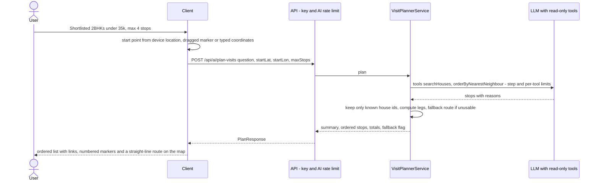

## 8. State diagrams

### 8.1 House status

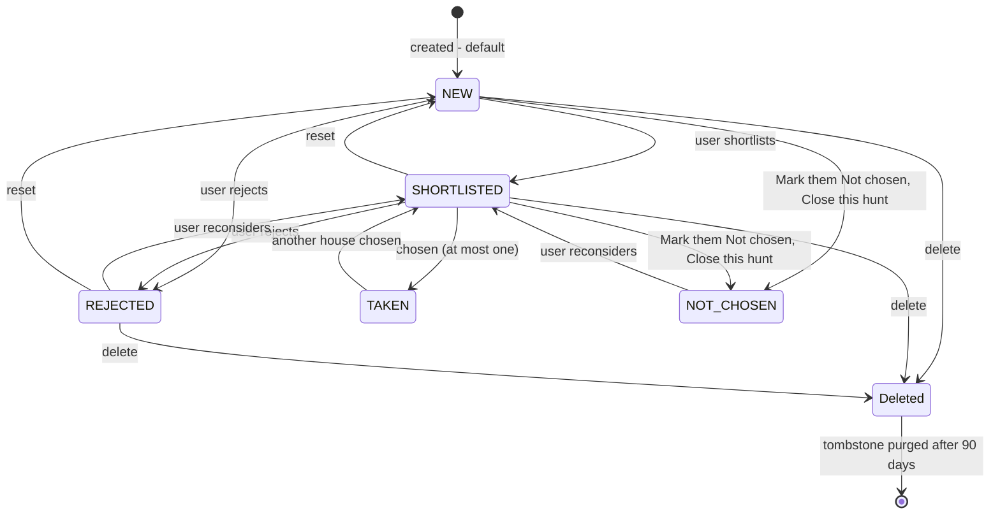

Status is a plain field with no server-side transition rules. Any value can change to any other. Since slice 5 ([11](11-feature-parity-and-export-spec.md) 5.24) the apps keep **at most one TAKEN** house (`HouseStatusRules`: choosing TAKEN returns the previous one to SHORTLISTED) and offer to mark the rest NOT_CHOSEN (`closeTargets`: every house but the TAKEN one that is not REJECTED or NOT_CHOSEN); the diagram shows those transitions, the others stay possible from the status field. "Deleted" is the `deleted` flag, not a status value.

### 8.2 Hunt service

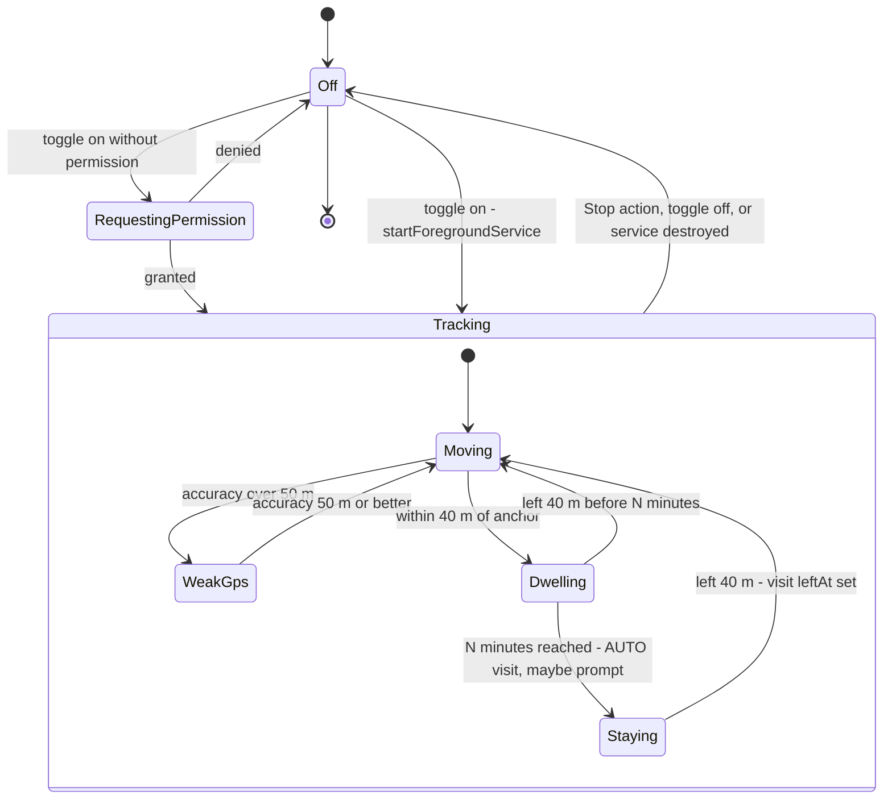

`HuntState` exposes `active`, `staying`, `street`, nearest house and accuracy to the UI. `onStartCommand` returns `START_STICKY`. See R-01 for Android 12+/14 restart limits.

## 9. API reference

Base path `/api`. Auth: header `X-API-Key: <key>` on every `/api/**` call (401 JSON on failure). Errors: RFC 7807 `ProblemDetail`. Times: ISO-8601 UTC. IDs: UUID.

| Method | Path | Params / body | Response | Notes |
|---|---|---|---|---|
| GET | `/api/candidates` | `since` (long, optional) | `HouseDto[]` | **`/api/houses` until the format reset** (S4b-BL-206, kinds PR 2, 2026-10-12): a candidate carries `kind` (required, `^[a-z][a-z0-9_]{1,31}$`), `money` (`{amount?, cadence}`, a house's cadence `month` or `once`) and `extras` (the kind's typed extras keyed by id, unknown ids kept) in place of `price`, `priceType`, `bedrooms`, `areaSqft`, `floor` and `cost` (§18.4 doors 3, 5 and 7; `HouseDto`, `Money`, `CandidateExtras`). Without `since`: live houses, newest `updatedAt` first. With `since`: all changes including tombstones, ordered by `syncVersion`. |
| GET | `/api/candidates/{id}` | - | `HouseDto` | 404 if unknown (tombstones are returned) |
| PUT | `/api/candidates/{id}` | `HouseDto` JSON (validated) | `HouseDto` | Create or LWW update. Returns the stored row if it is newer. |
| DELETE | `/api/candidates/{id}` | - | 204 | Tombstone + new sync version; content blanked, photos tombstoned, visits unlinked. A PUT with `deleted: true` does the same. |
| GET | `/api/candidates/nearby` | `lat` (−90..90), `lon` (−180..180), `radius` (m, > 0, default 50, capped 5000) | `HouseDto[]` with `distanceMeters` | At most 50, nearest first, live only. 400 on out-of-range values. |
| GET | `/api/candidates/street` | `name` (1..200) | `HouseDto[]` | Case-insensitive exact match on `lower(street)` (uses the index), live only |
| GET | `/api/candidates/{id}/photos` | - | `UUID[]` | Live photos, ordered by `createdAt` |
| POST | `/api/candidates/{id}/photos` | multipart: `file` (JPEG/PNG/WebP by magic bytes, at most 5 MB), `id` (UUID, optional) | `{ "id": UUID }` | Idempotent on `id` (never resurrects a deleted photo). 404 if the house is unknown or deleted, 400 if not an image, 409 over 20 photos, 413 over 5 MB. Metadata stripped. |
| GET | `/api/photos?since=` | `since` (long, required) | `PhotoDto[]` | Change feed: `{id, candidateId, contentType, sizeBytes, createdAt, updatedAt, deleted, syncVersion}` and, since slice 5, `roomId, tags, caption, metaUpdatedAt`; no bytes |
| PUT | `/api/photos/{id}/meta` | `{roomId, tags, caption, metaUpdatedAt}` | `PhotoDto` | **New 2026-10-01** (slice 5): last write wins on `metaUpdatedAt`; an edit not newer than the stored one changes nothing and gets the stored meta back; new `sync_version`, so the photo feed carries it. 400 on a bad tag, room id or caption, 404 for an unknown or deleted photo. |
| GET | `/api/photos/{id}` | - | image bytes | `Cache-Control: private, max-age=2592000`. 404 for tombstones. |
| DELETE | `/api/photos/{id}` | - | 204 | Tombstone (bytes removed) + new sync version. No error if missing or already deleted. |
| GET | `/api/visits` | `since` or `candidateId` (optional) | `VisitDto[]` | `since`: change feed. `candidateId` (`houseId` until S4b-BL-206, also the visit's own key on the wire): live visits for the house, newest first. Neither: all live visits. |
| PUT | `/api/visits/{id}` | `VisitDto` JSON | `VisitDto` | LWW. `source` defaults to MANUAL. |
| DELETE | `/api/visits/{id}` | - | 204 | Tombstone; the place (lat/lon/street/leftAt) is removed |
| GET | `/api/stats` | - | `{houses, shortlisted, rejected, visits, streets, maxSyncVersion}` | `maxSyncVersion` (since 2026-09-24, S4b-BL-20): the highest sync version the server has handed out, `sync_seq`'s position (`SyncVersions.highest()`, 0 before the first write). It never goes back on a healthy server, also after `DELETE /api/data`; clients read a value below a stored cursor as a reset server (§10.1). Older servers omit it (clients: unknown) |
| GET | `/api/export` | - | `BackupData`: `{format: "doorprints-backup/1", exportedAt, houses[], visits[], photos[]}` | **Changed in Sprint 4a** (ADR-20): the response is now the shared backup object — the same thing a device backup carries as `data.json` — instead of the old `house-hunt-export/1` shape, so there is one format and no converter ([schemas/README.md](schemas/README.md)). `Content-Disposition: attachment; filename="Doorprints-backup-<UTC date>.json"`. Live data only; photo **bytes** are not in it (fetch them from `GET /api/photos/{id}`; a device backup puts them in the ZIP's `photos/` folder). |
| POST | `/api/import` | `BackupData` JSON (a backup's `data.json`), optional `?dryRun=true` | `ImportReport` | **New in Sprint 4a.** Restores a backup onto the server. `dryRun=true` runs the same validation and the same merge decisions and writes nothing — that is the preview the clients show before asking the user to confirm. Same API key as everything else. Two caps, both 413: the body (`app.limits.max-import-bytes`, applied by `RequestSizeLimitFilter`, which lets only this path exceed the 256 KB JSON cap) and the row count (`app.limits.max-import-rows`). Anything else wrong with the file is a 400 that names the rows. Since 2026-10-01 it also accepts `doorprints-backup/3` (ADR-29) and reads it as a restore: the `deleted` list of an update file is ignored. |
| GET | `/api/records` | `since` (long, required, ≥ 0), `type` (optional) | `RecordDto[]` | **New 2026-09-30** (ADR-28, [11](11-feature-parity-and-export-spec.md) 5.30): the change feed of every record type (or one), tombstones included, ordered by `syncVersion`. The server never reads a payload. |
| PUT | `/api/records/{type}/{id}` | `RecordDto` JSON: `type` (`[a-z][a-zA-Z0-9]{0,39}`), `id` (`[A-Za-z0-9._-]{1,64}`), `payload` (a JSON object, at most 65,536 bytes compact; `{}` when `deleted`), `updatedAt`, `deleted` | `RecordDto` | LWW by `updatedAt`; path and body must agree (400); a record that becomes live beyond 5,000 live rows of its type is 409. |
| DELETE | `/api/records/{type}/{id}` | - | 204 | Tombstone (payload `{}`) + new sync version; 404 if unknown. |
| DELETE | `/api/data` | header `X-Confirm-Delete: DELETE-ALL-MY-DATA` | 204 | Hard-deletes houses, visits, photos, records and AI index rows. `GET /api/export` writes `doorprints-backup/2` with a `brokers` list (from the `record` rows of type `broker`) when the server holds any, any house has rooms, or it holds a criterion, a preference, a question, a viewing, an area, a place or an area note (`record` types `criterion`, `preference`, `question`, `viewing`, `area`, `place` and `areanote`), or a house has answers, and `POST /api/import` stores it. 428 without the exact header. Devices keep their local copies. |
| GET | `/actuator/health` | - | `{"status":"UP"}` | **Public**, no details |
| GET, POST | `/api/ai/status`, `/api/ai/extract-listing`, `/api/ai/ask`, `/api/ai/plan-visits`, `/api/ai/reindex` | see [ai/ai-design.md](ai/ai-design.md) §13 | | Same key; AI rate limit (except status); 404 when AI is off |
| POST, GET | `/mcp` | MCP Streamable HTTP | | Off by default; same key (or Bearer) |

Common statuses: 400 invalid input or non-canonical path, 401 missing/wrong key, 404, 409 conflict (photo cap, photo id of another house), 413 body too large, 428 missing confirmation header, 429 rate limited (`Retry-After`), 402 the AI provider's quota or credit is used up for the day or for good (`"code": "AI_QUOTA_EXHAUSTED"`, `"retryable": false`, no `Retry-After`; S4b-BL-244), 422 the AI provider's safety system declined the text (`"code": "AI_DECLINED"`, `"retryable": false`; S4b-BL-233), 503 AI provider unavailable (`"retryable": true`; when the provider answered HTTP 429 / `RESOURCE_EXHAUSTED`, AI Studio or Vertex AI, the problem also has `"code": "AI_QUOTA_EXHAUSTED"` and the response a `Retry-After: 60` header, so clients and the eval harness can tell a quota stop from an outage without parsing text; the status stays 503 so existing clients keep working; on Vertex AI 401/403/404 the problem also has `setupHint`, an owner-facing string with env-var names (`GCP_LOCATION`, `AI_VERTEX_EMBEDDING_LOCATION`) and the configured location only, never the project id or the provider message). A spend cap trip has no distinct code yet ([01](01-requirements.md) AI-017).

**HouseDto** fields (since slice 1a of ADR-28 also `areaSqft` 1..100000, `locationSource` GPS|MAP|APPROX and `cost{deposit, depositMonths, maintenance, maintenanceIncluded, brokerage, brokerageMonths, lockInMonths, noticeMonths, availableFrom YYYY-MM-DD, myOffer, agreedPrice}`, all optional, after `notes`; `rooms` (at most 30) after `cost`, `answers` (at most 60) after `rooms`, and `brokerId` ≤64 characters after `rooms`, slices 1b and 1c): `id, label*, address, street, locality, lat*, lon*, status, price, priceType, bedrooms, rating, contactName, contactPhone, listingUrl, notes, checklist{item→0..5}, createdAt, updatedAt, deleted, syncVersion, distanceMeters`. Validation is in [01 FR-002](01-requirements.md#61-houses).
**VisitDto** fields: `id, houseId, lat*, lon*, street, arrivedAt*, leftAt, source, updatedAt, deleted, syncVersion`.

## 10. Sync algorithm

### 10.1 Principles

| Rule | Detail |
|---|---|
| Identity | UUIDs created on the client, so offline creates never collide and retries are idempotent |
| Local change tracking | `dirty = true` and `updatedAt = now()` on every local write (`Repository.saveHouse/saveVisit`) |
| Server ordering | Each accepted write takes the advisory lock, then `sync_version = nextval('sync_seq')` (one sequence for houses, visits and photos), so versions become visible in order (10.4) |
| Cursors | Separate `houseCursor`, `visitCursor` and `photoCursor` in DataStore. They reset to 0 when the server URL changes. The photo cursor does not move past downloads skipped on a metered network. |
| Conflict policy | LWW on `updatedAt`, applied on the server (stored newer means the incoming write is ignored) and on the client (local dirty and newer means the incoming change is skipped). The server clamps a client `updatedAt` more than 5 min ahead to its own clock (`ClientClock`). |
| Ties (S4b-BL-163) | One rule for the house, visit and record pushes (`sync/Upsert.decide`): a stored `updatedAt` **later** keeps the stored row; an incoming one **later** overwrites; the **same stamp with the same content** (a retried PUT after a lost answer, a second device) answers with the stored row and writes nothing: no new `syncVersion`, so no other device pulls the row again, and no `HouseChangedEvent`; the **same stamp with other content** is overwritten by the incoming row, with a new version, so the last pusher wins the tie, which is what the clients do with a pulled row (`SyncRules.keepLocal`, web `keepLocal`: a tie goes to the incoming row) and every device converges on it. "Same content" is what a client would read back (the house and visit fields, the record's payload and deleted flag); two tombstones are the same. The backup import keeps its own, simpler rule ([11](11-feature-parity-and-export-spec.md) 5.2): the same stamp is `UNCHANGED` whatever the content, so for a tie with other content the sync overwrites and the import does not (a tie with other content needs a clock collision; recorded, not changed). A push answered with the stored row on a tie carries its old version: it cannot show as a reset server (`pushShowsReset`) because the client pushes before it pulls, so no cursor of its is above a version it has not yet received. |
| Reset server (S4b-BL-20, since 2026-09-24) | Once any cursor is above 0, a sync first reads `GET /api/stats`: `maxSyncVersion` below a stored cursor means the database was replaced (empty, or restored from an older dump). A server without the field falls back to the push answer: an **accepted** house or visit write answered with a `syncVersion` at or below the highest cursor. Then every house and visit is marked dirty and every stored photo not uploaded, the three cursors go to 0 (rows first, so an interrupted reset is found again), everything is pushed and pulled again, and the user is told (web: announced and on *Your data*; Android: the sync outcome line). A kept newer row (LWW) and `DELETE /api/data` (the sequence carries on) are not a reset. `SyncRules.serverBehind`, `pushShowsReset`; web `serverBehind`, `serverWasReset` |
| Deletes | Tombstones (`deleted = true`) travel through the same feeds; they carry no content and are purged after 90 days |
| Backend seam (S4b-BL-70, since 2026-10-02) | The loop above is the same for every remote and lives in `CommonRepository.sync` (Android, iPhone) and `SyncService` (web); the remote is a `SyncBackend`: `isBehind(cursors)`, `pushHouse`/`pushVisit`/`pushRecord` (answer: the row the remote keeps), `deletePhoto`, `uploadPhoto`, `pushPhotoMeta`, `housesSince`/`visitsSince`/`recordsSince`/`photoChangesSince(cursor)`, `downloadPhoto`, and `mergeRule`. Rows travel as the sync DTOs with tombstones; a cursor is a position the loop only compares and stores (the server's `sync_seq`; a backend without a counter gives a growing time or revision and keeps the rest itself); photos move only when the caller allows; failures are thrown as `ApiException`/IO errors (web: `HttpErrorResponse`) so `SyncOutcome.fromError` and `errorMsg` word them alike. Today's only backend is `ServerSyncBackend`; Drive's (S4b-BL-118) brings its own merge rule (last-write-wins on `updatedAt`, [15](15-google-drive-backup-and-sharing.md) §5.1) through `mergeRule` instead of `keepLocal` |
| Photos | Push: queued deletes first (any network), then uploads of rows with `uploaded = false` if their house is not deleted (unmetered only, when the Wi-Fi setting is on). A permanent 4xx (not an image, cap reached) keeps the photo local only. Pull: `GET /api/photos?since=photoCursor`; tombstones delete local files, new photos of live houses are downloaded. |

### 10.2 Client pseudocode (`Repository.sync`)

Every remote call below goes through the `SyncBackend` (10.1); for the server, "PUT house" is `ServerSyncBackend.pushHouse`.

```text
backend = syncBackendFor(settings); if none: return "offline"       # the server's when one is configured
if any cursor > 0 and backend.isBehind(cursors): markAllForResync(); cursors = 0   # 10.1 Reset server (stats.maxSyncVersion)
for h in houses where dirty:   PUT house; markClean(h.id, h.updatedAt)   # only if not edited meanwhile
for v in visits where dirty:   PUT visit; markClean(v.id, v.updatedAt)
for p in photos where deleted:  DELETE photo (404 is fine); remove row
for p in photos where !uploaded and house not deleted:
    if photos not allowed on this network: waiting++ ; continue
    POST photo(id); uploaded = true              # 400/404/409 -> keep local only
(hc, vc, pc) = cursors
for dto in GET houses?since=hc: hc = max(hc, dto.syncVersion)
    if backend.mergeRule.keepLocal(local, dto): skip else upsert(dto, dirty=false)   # server: local.dirty and local.updatedAt > dto.updatedAt
same for visits with vc
save cursors (hc, vc)
for ch in GET photos?since=pc:
    if ch.deleted: delete local file and row
    else if missing locally and house live: download (or waiting++ and stop advancing pc)
    advance pc while every change so far is fully handled
save photo cursor; return SyncOutcome(pushed, pulled, waiting)
```

The server's LWW decision is final. After a push that lost, the client gets the winning row back on the next pull, because a write that lost does not advance `sync_version`. The pull then overwrites the (now clean) local row.

### 10.3 Triggers

`syncSoon` (3 s delay, unique REPLACE, so bursts of edits collapse) after each change. Periodic every 30 min. Both need a network; a captive portal skips the run. Exponential backoff from 30 s, up to 5 attempts (none after an auth failure). When photos are waiting for Wi-Fi, a unique UNMETERED job (`sync-photos-wifi`) runs as soon as Wi-Fi is available. Inside a run, each idempotent request is retried up to 3 times with full-jitter backoff ([09](09-osi-layer-analysis.md) L4).

### 10.4 Sync correctness fixes (wave 2) and remaining issues

**Ordered sync versions (F-09, fixed).** Without coordination, transaction A can take version 41, B take 42 and commit first; a client that pulls in between stores cursor 42 and never sees 41. Every writer now calls `SyncVersions.lock()` (`select count(*) from pg_advisory_xact_lock(0x48480000002A)`) before reading the row it will change, and `SyncVersions.next()` (lock, then `nextval`). The lock is held until commit or rollback, so while version N is uncommitted nobody can take N+1: versions become visible in exactly the order they were assigned, and a reader either sees N or nothing above N−1. Rolled-back versions leave harmless gaps. Readers never take the lock. The same lock makes the last-write-wins check and the write atomic. Cost: writes are serialised, a few milliseconds each, which is fine for one user. A transaction asks the database for the lock once: `lock()` marks the transaction (a synchronization registered on it: gone when it completes, not seen by an inner `REQUIRES_NEW` transaction), so the 20,000 `next()` calls of one import take it once, not 20,000 times (S4b-BL-159). `next()` runs its `nextval` with `FlushModeType.COMMIT`, because a native query would otherwise flush the whole persistence context first and so turn a batched write into one round trip per row. Alternatives considered: a "safe watermark" (return only versions below the oldest in-flight one, needs tracking of in-flight transactions) and an overlap window (`since = cursor − k` with de-duplication, needs a guess for k).

**Client clock (F-08, fixed).** `ClientClock.accept`: null means now; more than `app.sync.max-clock-skew-seconds` (300) ahead is clamped to server now; more than `max-future-days` (365) ahead or before 2000 is a 400. Visit arrival/departure times are validated but not clamped (they describe events, not edit order).

**A big import is written in batches (S4b-BL-159).** `hibernate.jdbc.batch_size` is 100 with `order_inserts` and `order_updates` (every id is assigned by the application, so no insert has to run early to learn one). `BackupService.importBackup` merges houses, visits, photo metadata and each kind of record in chunks of `FLUSH_EVERY` (500) rows: the houses and visits of a chunk are read with one query, the chunk is merged, flushed and the persistence context cleared. Nothing outlives a chunk but UUIDs and counts. A new row is persisted without the read `save` would make first. A 20,000-row file is about one statement per written row (the `nextval`) plus the batches.

**Error text (SEC-015, S4b-BL-159).** `ApiExceptionHandler` shows a client the text of a `BadRequestException` (a refusal the server wrote: it extends `IllegalArgumentException`, so existing catches still work) and answers every other `IllegalArgumentException` with a fixed "Malformed request", because a library can throw one with internal text. `AiExceptionHandler` logs a failed provider call by the cause's class and HTTP status only: a provider message can echo the prompt (SEC-016, PRV-011).

| Issue | Ref | Status |
|---|---|---|
| Photo deletes were not synced and photos had no version | F-15 | Fixed: V3 tombstones + `/api/photos?since=` + Android delete queue |
| Push is not atomic: a crash between PUT and `markClean` repeats the PUT | - | Harmless, because the upsert is idempotent |
| `GET ?since=` is unbounded | F-19 | Add `limit` + loop until empty |

## 11. Geospatial design

| Aspect | Design |
|---|---|
| Storage | `lat`, `lon` as `double precision`, plus the generated column `geog geography(Point, 4326) = ST_SetSRID(ST_MakePoint(lon, lat), 4326)::geography`. Clients never write `geog`. |
| Why geography | Distances in metres on the spheroid with no projection choices. India spans several UTM zones (ADR-05). |
| Index | `GIST (geog)` on `house` and `visit` |
| Nearby query | `ST_DWithin(h.geog, point::geography, :radius)` (uses the index) + `ST_Distance` for ordering, `LIMIT 50`, radius capped at 5 000 m |
| Street query | `findLiveOnStreet`: native `lower(street) = lower(:street)`, which uses `house_street_idx`. For Indic scripts `lower()` is a no-op (no letter case), so matching is exact. |
| On-device matching | The phone holds all live houses in memory (`repo.houses` Flow) and computes haversine distance per fix, so no network is needed (NFR-003, NFR-004). The stay radius is 40 m, the alert radius 30 m (configurable), and fixes worse than 50 m are ignored. |
| Street names | Android: `Address.thoroughfare` from the Android Geocoder. Web: Nominatim `road`/`pedestrian`/`residential`. The two geocoders can spell the same street differently ("1st Main Rd" vs "1st Main Road"), which can make street alerts miss. Planned: normalise names (lower case, expand Rd/St/Mn, trim numbers) before comparing. |
| Coordinates precision | The web rounds to 6 decimals (about 0.1 m) |

### 11.1 The Government of India's geospatial guidelines: self-certification

The Department of Science & Technology's *Guidelines for acquiring and producing Geospatial Data and Geospatial Data
Services including Maps* (DST F.No.SM/25/02/2020 (Part-I), 15 February 2021; published on the Survey of India's
portal at `https://onlinemaps.surveyofindia.gov.in/GeospatialGuidelines.aspx` and as a PDF at
`https://dst.gov.in/sites/default/files/Final%20Approved%20Guidelines%20on%20Geospatial%20Data.pdf`, read in full
on 2026-09-28) replace the earlier approvals and licences for maps and geospatial data made in India. Clause 8 ii(1)
says adherence is conveyed by **self-certification**; this table is Doorprints' self-certification (owner request of
2026-09-28). It is re-read at each release (the release security gate's manual list, [10](10-sprint-log.md)
S4b-BL-51) and whenever the base map, the boundary data, or what location data the apps keep or send changes. It
records the owner's and the team's reading of the guidelines, not legal advice.

| Clause (paragraph 8) | What it says | How Doorprints adheres |
|---|---|---|
| ii(1) | No prior approval, security clearance or licence to collect, store, publish or digitise geospatial data and maps in India; anyone may build applications with such data and publish or distribute them; self-certification conveys adherence | This section. No approval was sought or is needed for the apps, the optional server or the bundled boundary data |
| iii | A negative list of sensitive attributes, to be notified by DST, that may not be marked on any map | No notified list was found on `https://geospatial.dst.gov.in` on 2026-09-28. Doorprints marks only the user's own houses and visits, with the user's own labels and notes, and adds no attribute layer of its own. At each release: look for a notified list; if there is one, check the house fields, the base map's layers and the feature requests of [10](10-sprint-log.md) §15 against it |
| iv, vii, ix | Threshold: 1 m horizontal on-site accuracy. Data finer than that may be created or owned only by Indian Entities and must be stored and processed in India; data up to the threshold may go to any cloud | House and visit positions come from a phone's location fix (Hunt mode keeps fixes of 50 m accuracy or better, `HuntState.MAX_ACCURACY_M`), a tap on the map or typed coordinates, so their on-site accuracy is metres, coarser than the threshold. The web keeps 6 decimals (about 0.1 m): numeric precision, not on-site accuracy. The data stays on the user's devices and, when the user sets one up, on the user's own server; Firebase Hosting serves only the web app, never user data. **Rule for new features:** anything that would record positions finer than 1 m (survey-grade or RTK receivers) keeps that data on servers in India, owned by an Indian Entity; S4b-FR-2's travelled path stays at phone accuracy |
| vi(b) | Terrestrial mobile mapping, street view surveys and surveys of territorial waters only by Indian Entities | Doorprints does none of these. House photos are the user's own photos of houses they visit, kept privately, not a street view survey |
| viii | Foreign companies may license finer-than-threshold data only through APIs that do not pass the data through their servers | Not applicable: no finer-than-threshold data (above) |
| x | No restriction on exporting data up to the threshold, except negative-list attributes | The optional AI features send house data, positions included, to the AI provider the self-hosted server is configured with (Google's AI Studio or Vertex AI), which may process it outside India: allowed for data at phone accuracy. Map tiles come from OpenFreeMap (outside India); only tile requests go there, no user data |
| xi, xii | Publicly funded geospatial data made easily accessible; the Survey of India to put its data online in a useful format | The Survey of India's portal lists the **Administrative Boundary Database** (whole country, district and taluk level, 1:1M, shapefile) at no charge (`https://onlinemaps.surveyofindia.gov.in/Digital_Product_Show.aspx`, read on 2026-09-28); its Political Map of India (1:4M shapefile) is priced, so out of scope under the zero-cost rule |
| xiii | For political maps of India at any scale, national, state and other boundaries included, **SoI published maps or SoI digital boundary data are the standard**, free to download, with digital display and printing permitted; **others may publish maps that adhere to these standards** | ADR-22: India's external boundary as the Government of India depicts it, one outline, no LoC or LAC, no switch. The outline is Natural Earth's India point of view at 1:10m, so it adheres in extent (every area India claims is inside it) but not in line accuracy (median about 1.55-1.6 km, 90th percentile 3.9 km from the true line; [02](02-threat-model.md) RR-16). **Procedure:** the Survey of India's boundary is the reference TC-M-25 checks against ([06](06-test-plan.md)), and [10](10-sprint-log.md) S4b-BL-10 brings the outline into line with SoI's boundary data once its terms allow shipping it |

Section 2(2) of the Criminal Law (Amendment) Act, 1961 (a map of India not in conformity with the Survey of India's
maps; ADR-22's reason) still applies alongside these guidelines.

**The certification covers every space and every kind, built-in or user-authored, because all of them render the one map component with the one style and boundary data; a kind file has no map configuration by schema** (`kind.schema.json`: `additionalProperties: false` at the root, in a section, in `capabilities` and in `identity`; `capabilities.map` is a boolean; a tile URL, style, sprite, glyphs, boundary, GeoJSON, attribution, zoom, bounds, centre or `geo` key is refused; `capabilities-vectors.json` `forbiddenMapKeys`, [06](06-test-plan.md) TC-U-269). The map-rules files (`map-style-url.ts`, `india-boundaries.ts`, `IndiaViewRules.kt`, `MapStyleJson.kt`, `IndiaViewOps.kt`) name no kind symbol, and a test fails if one appears.

**The Survey of India's reply (2026-10-01).** The Online Maps Portal team (NGDR & UGI Directorate) answered the letter of
2026-09-28: no prior permission is required for its Administrative Boundary Database (that database only); no alteration
or modification of the dataset is permitted; due acknowledgement is to be given in the publication; the use is subject to
the National Geospatial Policy 2022 guidelines. The consequence for ADR-22 is that the outline built from Natural Earth
(cut by claim boxes, simplified, joined to the base map's lines) is a stop-gap: the Survey of India's own file can only be
shipped as published, and the base map's lines near India are hidden instead of joined. The plan is
[ops/soi-boundary-data-request.md](ops/soi-boundary-data-request.md) v0.5 (P0..P6), [10](10-sprint-log.md) S4b-BL-111. The
clause table for the National Geospatial Policy 2022 guidelines goes here once P2 has read them.

### 11.2 OpenFreeMap's public tiles and offline areas (S4b-FR-6)

The map's tiles come from OpenFreeMap's public instance (Liberty style, OpenStreetMap data), which allows commercial
use with attribution and states no limit on map views or requests; its terms of service forbid "collecting data from
the service in automated ways without permission" (read 2026-09-30). An offline area ([11](11-feature-parity-and-export-spec.md)
5.20) is the box a person sees on the Map, fetched once through MapLibre's own offline pack, the standard client
feature of the same map engine that fetches the tiles as the map is panned: at most `OfflineTiles.MAX_TILES` (2,000)
tiles, about 100 MB, a whole large city being a few hundred, with the size shown first and mobile data warned about.
That is one person's ordinary use of the map, not a bulk copy; a bulk copy is what OpenFreeMap's weekly planet
downloads are for. The owner's word on this reading is an open item in [14](14-lead-backlog-and-handoff.md) §6; the
zero-cost alternative, should OpenFreeMap object, is a self-hosted extract (S4b-BL-80), which is not free to run.

**The website (S4b-BL-79, ADR-30, 2026-10-01).** The same reading and the same caps hold: the box on screen to zoom 14,
at most 2,000 tiles and 10 areas, the size and the browser's free storage shown first, a metered connection warned
about, a few requests at a time, each tile fetched once. The website also keeps the style's raster layer, its style
files and the glyph ranges of Devanagari, Tamil and Telugu, about 5 MB more. Nothing is fetched in the background or
refreshed on its own; a person deletes an area, or *Remove all data* removes all of them.

### 11.3 maplibre-compose: the CMP-9 finding (2026-10-10)

[10](10-sprint-log.md) CMP-9 asked whether the maplibre-compose library (`org.maplibre.compose`) should replace the per-platform map code. **Finding: not now; re-assess at 1.0.** No spike was built; the finding rests on the repository and on the library's public README (read 2026-10-10 at github.com/maplibre/maplibre-compose).

- **What the repository does today.** Android draws the map with MapLibre Android; the iPhone with a `UIKitView` around `MLNMapView` (`PlatformMap.ios.kt`, `IosMap.kt`, `MapLibreMapView.swift`). India's boundary rules (ADR-22) are applied once, in common code, to the style as JSON (`applyIndiaView` over `StyleOps`; `JsonStyleOps` on iPhone, [10](10-sprint-log.md) 13.13), and a check (`IndiaViewCheck`) reads the result. The map code is therefore small and the part that matters for the boundary rule is already shared.
- **What the library says about itself.** Its README lists Android and iOS as Beta, desktop and web as Alpha, and states that the public API is still evolving and that minor releases can contain breaking changes. It wraps the same MapLibre SDKs.
- **Why not now.** Moving would put the boundary rule (a legal requirement, ADR-22) behind a pre-1.0 API whose layer and filter model we would have to check against `applyIndiaView` and `IndiaViewCheck`, and would re-run the map checks on both platforms (TC-M-25) for no user-visible gain. The shared part is already shared.
- **Not checked, so open:** whether the library exposes the style as JSON or filters on existing layers the way `StyleOps` needs, its offline-region support (the app has offline areas), and a 1.0 date. Re-assess when it reaches 1.0, or if the native iPhone map code becomes a maintenance burden.

## 12. Security design (summary)

Full analysis is in [02](02-threat-model.md).

| Control | Current | Planned |
|---|---|---|
| Authentication | `ApiKeyFilter`: deny by default, canonical paths only, shared key, constant-time compare, failed attempts logged and throttled. Startup fails if a key is shorter than 32 chars. Optional `APP_API_KEY_NEXT` for zero-downtime rotation. | Per-device keys by pairing, the owner page (§12.1, ADR-25, SEC-025); Google accounts later (D-01) |
| Transport | Host-edge TLS; HSTS from the API over HTTPS and from `web/firebase.json` on the web (on `*.web.app` the whole `.app` TLD is HSTS-preloaded in browsers anyway); Android cleartext only for local dev hosts, system CAs only, no redirects | Cert pinning rejected (09 §7) |
| CORS | Allowlist from `APP_CORS_ORIGINS`, `/api/**` only, methods GET/POST/PUT/DELETE/OPTIONS, headers `X-API-Key`, `Content-Type`, `Authorization`, `X-Confirm-Delete`; exposes `Retry-After`, `Content-Disposition`; max-age 1 h | Unchanged |
| Input validation | Bean validation on DTOs and query params. JSON 256 KB, multipart 5 MB file / 6 MB request. Image type from magic bytes. 20 photos per house. Client clock checks. | Unchanged |
| Output | JSON via Jackson. Angular/Compose render text (no HTML). API CSP `default-src 'none'`, `nosniff`, `no-store`. Web strict CSP (`script-src 'self'`, `worker-src 'self'`, `object-src 'none'`, `frame-ancestors 'none'`). | – |
| Rate limiting | In-app token buckets: 600/min per address, 10/min wrong keys, AI 10/min | Cloudflare in front where the host allows |
| Secrets | Env vars (`APP_API_KEY`, optional `APP_API_KEY_NEXT`, `DB_*`); Keystore-encrypted key on the phone; sessionStorage by default on the web; release keystore only as CI secrets (`HH_*`) or outside the repo | GitHub Secrets / provider secret store |
| Data at rest | Provider disk encryption (Supabase/Neon). Android FBE. No backups of the key. | Encrypted backups (age) |
| Privacy | No raw tracks, EXIF dropped on clients and server, visible FGS, tombstones without content, 90-day purge, export and erase endpoints | App buttons for export/erase, web privacy page |

### 12.1 Device keys, pairing and the owner page (ADR-25)

Owner request of 2026-09-29: "Is there someway we can have the users not paste the API key but set it in their account
like we do in Cloud console or AI studio or GitHub? This should help allay fears about mishandling of the API key."
Owner choices (same day): both keys move (the server key and the Gemini key); devices connect by a code **and** by a QR
code; the owner manages them on a page the server serves, unlocked the first time by a one-time link.

**Keys.**
- The **owner key** (`APP_API_KEY`, and `APP_API_KEY_NEXT` while rotating) stays in the server's settings file. It is
  no longer typed into an app: it serves MCP clients (which send it as a bearer token) and recovery. The apps still
  accept it (the *Other ways to connect* section) until every install has moved.
- Each app install gets its own **device key**, `dpk_` followed by 32 random bytes in base64url (43 characters; the
  prefix lets secret scanners find a leaked one). The server keeps only its SHA-256 hash, the last four characters, a
  name ("Sriram's Pixel", from the app), and when it was added, last used and revoked. A device key is sent exactly as
  the owner key is today (`X-API-Key`), so sync, photos and AI need no change.
- `ApiKeyFilter` accepts the owner key (constant-time, as now) or a device key: hash the presented value, look the hash
  up (unique index), refuse a revoked key. Last-used is written at most every 5 minutes per key. Wrong keys stay
  throttled as now (F-05).

**Pairing by code** (the OAuth 2.0 device authorization grant, RFC 8628, in small):
1. The app sends `POST /api/pair/start` with a device name. The server stores a request and answers with a **user
   code** of 8 letters and digits from an alphabet without look-alikes (shown as `K7MQ-4XRD`), a **poll token** (32
   random bytes; only its hash is stored), and `expiresIn` 600 s and `interval` 3 s.
2. The app shows the code and "Approve this device on your server's owner page".
3. On the owner page the owner **types** the code (a list to click would let anyone who can reach the server slip in
   a request named like the owner's phone; AB-11). The page shows the device name the app sent, and *Approve* or
   *Deny*.
4. The app polls `POST /api/pair/poll` with the poll token: `pending`, `denied`, `expired`, or, once, `approved` with
   the device key. The key is handed over once; the request is then closed. A code allows 5 wrong owner entries per
   minute per session and expires after 10 minutes.

**Pairing by QR code** (phones) and by link (the website): the owner page makes a one-time **invite** (32 random bytes;
hash stored; 10 minutes; single use) and shows it as a QR code of `doorprints://connect?server=<origin>&invite=<token>`
and as a link `<web app>/connect?server=<origin>&invite=<token>` (the web app's address from `APP_WEB_URL`, default
`https://doorprints.web.app`). The phone's camera opens the app; the app sends `POST /api/pair/redeem` with the invite
and its device name and gets its device key. The website reads the two parameters, removes them from the address bar
at once, and does the same. The QR image is drawn by the server (ZXing core, Apache-2.0).

**The owner page** is served by the server at `/owner/` (static HTML, CSS and JavaScript from the backend's resources;
no framework; four languages). Its own policy: `default-src 'none'; script-src 'self'; style-src 'self'; img-src 'self'
data:; connect-src 'self'; form-action 'self'; frame-ancestors 'none'; base-uri 'none'`, `no-store`.
- **First visit:** at a start **while no browser is signed in** the server writes a one-time link to its log,
  `…/owner/#setup=<token>` (32 random bytes, hash stored, valid 1 hour, single use; the fragment never reaches a server
  log or a `Referer`). The guide shows where to find it (`docker compose logs api`). The page exchanges it for an
  **owner session**. **Once a browser is signed in** (an open `owner_token` row of kind `session`: not signed out, not
  past its 30 idle days; the same rule as the list of browsers on the page) the start writes **no token and no link**,
  makes no setup token, and writes one line saying to choose *Add another browser* in a signed-in browser. Owner
  decision of 2026-10-08 (S4b-BL-171, finding B10), narrowing the first version of this ADR, which wrote a link at every
  start: a log is read by more people and tools (a log shipper, a pasted support thread, a host that wakes from sleep and
  restarts) than the owner. Choices: (1) "signed in" counts **open** sessions, so an owner who signed every browser out,
  or left them idle for 30 days, gets a link again at the next start and is never locked out of their own server;
  (2) a start without a signed-in browser still writes a new link even if an earlier one was never used (the earlier
  one stays valid until its hour ends, as before); (3) if the check fails (the database is down), the log says that
  it could not check and writes no link and no exception text (fail closed); (4) there is no setting that makes the
  normal start write a link, **except the owner's recovery switch** (S4b-BL-188, below).
- **Owner link recovery (S4b-BL-188, owner decision of 2026-10-08):** the narrowing above leaves one lockout: the owner
  loses their only signed-in browser (cleared cookies, a new laptop) while its session row is still open (up to 30 idle
  days), so no start writes a link. The explicit way back is the setting `OWNER_SETUP_LINK_IN_LOG`
  (`app.owner.setup-link-in-log`, **default false**). When it is true, a start writes the one-hour setup link even though
  a session is open, and the log block says that the setting is on, that anyone who can read the log can use the link
  for the next hour, and that it should be switched off again. With no session open the link is written as before (and
  without that warning). It changes nothing else: the check failing still writes nothing (fail closed), the token is
  still single use and hashed, and with the switch off (the default, and the state to return to) the behaviour is the
  one described above. The recovery is documented for the owner in the guide (*Set up a server*) and
  [08](08-operations-runbook.md) §5.1a. Tests `OwnerSetupAnnouncerTest`, `OwnerSetupLinkSettingTest` (TC-S-47).
- **Owner session:** cookie `dp_owner` (32 random bytes, hash stored), `HttpOnly`, `SameSite=Strict`, `Path=/owner`,
  `Secure` over HTTPS, 30 days from last use. Every owner call is a `fetch` with the header `X-Doorprints-Owner: 1`
  and must come from the page's own origin (checked on `Origin`), so a cross-site form cannot act.
- **What it shows:** devices (name, added, last used, *AI* on or off, *Revoke*); *Connect a device* (type the code); *Add a device with
  a QR code* (the invite as QR and link, with a countdown); owner browsers (*Sign out*, *Sign out everywhere else*,
  *Add another browser*, which makes a one-time link); and *AI (Google Gemini)*: the **Gemini key** and one switch,
  *AI on this server*, which pauses AI for everyone (403 `AI_PAUSED`).

**The Gemini key on the owner page** (ADR-25's second step, branch `feat/owner-gemini-key`): write-only, shown as its
last four characters, *Remove key*. It is stored in `server_secret` with AES-256-GCM (a random 12-byte nonce per write,
the secret's name as associated data) under a key derived with HKDF-SHA256 from the owner key `APP_API_KEY`, so there is
no extra setting to keep and a copy of the database alone does not reveal it; while `APP_API_KEY_NEXT` is set the
server re-encrypts it under the next key at start. The key in use (`GeminiKey`) is the owner page's, else `AI_API_KEY`;
it is read on every request: the OpenAI-compatible chat client through an OkHttp interceptor that replaces the
`Authorization` header (`GeminiKeyInterceptor`, registered with Spring AI's `OpenAiHttpClientBuilderCustomizer`), the
embedding client through a key supplier (`GeminiEmbeddingModel`), so a key set, changed or removed takes effect with
no restart. A server with `APP_AI_ENABLED=true` and no key starts (a placeholder stands in for Spring AI) and reads AI
as off until a key exists. Vertex AI needs no key and is unchanged.

**AI per device** (owner, 2026-09-29): every AI request runs on the server with the owner's Gemini key, so a device
someone else holds (a partner's phone on a shared server) would spend the owner's quota. Each device therefore has an
*AI* switch on the owner page, **off for a new device**; while it is off the server answers that device's `/api/ai/*`
calls with 403 (`AI_OFF_FOR_DEVICE`) and its AI status as off, and nothing else changes for it. The owner key (MCP) is
not affected. Separately, each app has its own *AI features* switch in Settings, **off until the person turns it on**
(after reading what is sent to Google); AI shows only when both are on.

**The website's *Connect*** (ADR-25's third step, branch `feat/connect-by-code-or-qr`; `pages/connect`,
`core/pairing.service.ts`):
- **By code**, the usual way: the address, then *Get a code*. The page shows the code large (and announces it letter by
  letter), polls at the server's interval, tolerates two network failures in a row, and stops at *Cancel*, at an edit
  of the address, on leaving the page, or at the code's expiry. On `approved` it saves the device key for that
  address, as a typed key was saved; `denied` and `expired` say so; a 404 says the server is older than pairing. The
  name sent is the browser and system (`Chrome on Windows (website)`), the words the owner page uses for its own
  sign-ins.
- **By connect link** (`/connect?server=…&invite=…`, from the owner page's QR code or *Open the website connected to
  this server*): the page reads the two values, replaces the address with `/connect` at once, and accepts only an
  `https://` origin (or `http://localhost`) with no path, and an invite that looks like one. It then shows *Connect to
  a server?* with the server's address and a warning, and sends nothing until *Connect*: anyone can send such a link,
  and connecting to a stranger's server would copy the person's houses to it. A used or expired invite (410) says so.
- **The older way**, a typed key, folds out under *Use an API key instead*, open when the browser already uses a key
  that is not a device key (`dpk_`).
- **AI features** (a card on *Connect*, once connected): this browser's own switch, off until turned on, kept in
  `localStorage` (`doorprints.ai-features`, a preference; *Remove all data* turns it off). AI shows only when the
  server says `enabled`, the owner's switch for this device is on (`offForDevice` false) and this switch is on; Ask and
  Plan say which one is off (`AiService.offReason`), with a link to *Connect* where the fix is there. A 403
  `AI_OFF_FOR_DEVICE` or `AI_PAUSED` during a request is shown in the same words.

**Android and iPhone** (branch `feat/app-connect-by-code`; `:shared` `ConnectLink`, `ApiClient.pair*`,
`Repository.aiOff`; `:ui` `SettingsScreen`, `CodePairing.kt`, `ConnectLinkDialog.kt`): Settings → *Server* has the
same parts as the website: *Connect with a code* (`pairByCode`: the code large and read letter by letter, *Cancel*,
the owner page link; two network failures in a row tolerated), the typed key under *Use an API key instead*, and
*Use AI features on this phone* (`AppSettings.aiFeatures`, off by default; `Repository.aiEnabled` is on only when it,
the server and the owner's switch for this device are on). A connect link opens the app: Android's intent filter for
`doorprints://connect` on `MainActivity`, iOS's URL scheme `doorprints` and SwiftUI's `onOpenURL`
(`handleOpenUrl`); both become `DeepLink.Connect`, and *Connect to a server?* asks before the invite is redeemed. The
pairing calls send no `X-API-Key` header. The name on the owner page is the model ("Pixel 9 (Android app)", "iPhone
(Doorprints app)").

**Where the apps keep a device key:** as they keep the key today: Android Keystore-encrypted (`ApiKeyCipher`), iOS
Keychain, and the website's `sessionStorage` or, with *Remember on this device*, `localStorage`.

**Rate limits:** `/api/pair/*` is public, so it has its own bucket per address (40 calls a minute, burst 20,
`PAIRING_RATE_LIMIT_PER_MINUTE`, `PAIRING_RATE_LIMIT_BURST`), besides the general limit.

**Open requests are capped, never pushed out (S4b-BL-161, independent review finding B2):** at most **50** unexpired
pending requests in all and **5 per source** (settings `PAIRING_MAX_OPEN` and `PAIRING_MAX_PER_SOURCE`, `app.pairing.max-open` and `app.pairing.max-per-source`; unset means these defaults, a value below 1 stops the start; the release gate's API scan sets both to a million, like the rate limits, S4b-BL-191); a `POST /api/pair/start` over either cap is refused with **429** and
`Retry-After` (the seconds until the soonest open request that matters expires, 1 to 600), and no open request is
touched. The first version dropped the oldest open request to make room, so 50 starts inside the code's 10 minutes
pushed out the code a person was typing, and the per-address limit does not stop several addresses. A *source* is the
client address as the server sees it (docs/08 §1.2); behind a proxy that hides addresses, all clients share one source
and one allowance of 5. The source is kept on the row as `client_hash`, a SHA-256 of the address with a salt made at
each start of the server (migration V14); the address itself is never stored and the hash links requests of one run
only. Only unexpired `pending` rows count (an approved, denied, claimed or expired one does not), so the caps free
themselves within 10 minutes. The check and the insert run under one transaction-scoped advisory lock, so racing starts
cannot both take the last slot. The table is bounded without a sweep: a row is added only while fewer than 50 are open,
and `purgeExpired` deletes rows a day after they expire. Residual: ten addresses can still fill the 50 slots for 10
minutes and make a real device wait (it is refused, not evicted; it retries after `Retry-After`); that needs no key, so
it cannot be closed without breaking pairing; a flood from many addresses is a matter for the host's firewall or proxy.
Tests `PairingAdmissionTest`, `PairingControllerTest`, `PairingFloodIntegrationTest` (TC-S-48, TC-I-48).

**Owner page, not a user page.** The owner page belongs to whoever runs the server. A self-hoster is the owner of their
own server, so their Gemini key stays on their own machine. People the owner shares the server with connect their own
devices, which the owner sees and controls (including AI, below); they never see the owner page.

**Later:** there is no hosted server ([11](11-feature-parity-and-export-spec.md) D-28): Google sign-in syncs through each
person's own Google Drive, and a signed-in person's own Gemini key stays on their device (D-27). The owner page stays
the self-hoster's page.

## 13. AI integration design (overview)

The AI team owns the details in [docs/ai/](ai/). This document only fixes the integration contract:

| Item | Contract |
|---|---|
| Packaging | A Spring module/package in the same API process (free tier: one service). Beans are created only when `app.ai.enabled=true` and a provider is configured (AI-001). |
| Providers | Chosen by configuration only: `app.ai.provider` (`AI_PROVIDER`), **`aistudio`** (default) or **`vertex`**; both use the same model ids (`gemini-3.5-flash` chat, `gemini-embedding-2` at 768 dimensions), so the index stays valid across a switch (re-index once anyway). `AiDefaultsEnvironmentPostProcessor` selects the matching Spring AI auto-configurations and forces all of them off when AI is off. **aistudio:** chat through Spring AI 2.0.1 `ChatClient` over the OpenAI-compatible API of Gemini (API key `AI_API_KEY`; paid tier for real data, PRV-022) or Ollama (local/VM). Embeddings (since Sprint 3, `app.ai.embedding.provider`): by default the app's own `GeminiEmbeddingModel` calls the **native** Gemini API, `POST {AI_EMBEDDING_BASE_URL}/models/{model}:batchEmbedContents` (up to 100 texts per call, `outputDimensionality` 768), with the key only in the `x-goog-api-key` header, never in the URL; errors carry the HTTP status only. Gemini's OpenAI-compatible `/embeddings` is not used because its response omits `data[].index`, which Spring AI's OpenAI client rejects. With `AI_EMBEDDING_PROVIDER=openai` (Ollama) embeddings use the OpenAI-compatible `/embeddings` like chat. **vertex:** Google Cloud Vertex AI in an AI-only project. Chat through Spring AI's Google GenAI starter (`spring-ai-starter-model-google-genai`, `GoogleGenAiChatModel`) with the app's own google-genai `Client` (`VertexAiConfiguration`: project, location, timeout, bounded retries), `POST https://<location>-aiplatform.googleapis.com/v1beta1/projects/<p>/locations/<l>/publishers/google/models/<model>:generateContent` (`global`: `aiplatform.googleapis.com`). Embeddings through the app's own `VertexEmbeddingModel`: `:embedContent` for `gemini-embedding-2` (one text per call) or `:predict` for `gemini-embedding-001`, same retries, `Retry-After` handling, normalisation and exception type as `GeminiEmbeddingModel`; optional separate `AI_VERTEX_EMBEDDING_LOCATION`. Auth: `Authorization: Bearer` OAuth access tokens from Google **Application Default Credentials** (`GoogleAccessTokenSource`: Workload Identity Federation in CI, the attached service account on Cloud Run, `gcloud` locally); no API key or express mode. Default location `asia-south1` (data residency attribute, 04 DF-21/DF-32). **Both:** vectors in pgvector in the same Postgres (`CREATE EXTENSION vector`, Flyway migration owned by the AI team). `ProviderErrors` classifies HTTP 429 / `RESOURCE_EXHAUSTED` from either provider as a quota error: the API answers 503 with `code: AI_QUOTA_EXHAUSTED` and `Retry-After: 60`, and `POST /api/ai/reindex` stops at the first such batch (it returns 503 if any batch fails). `AI_INDEX_ON_CHANGE=false` embeds only on re-index. Trust boundaries: 02 T-I20, T-I22; flows: 04 E6, DF-21, DF-32. Details: [ai/ai-design.md](ai/ai-design.md) §2.1, §3.1, §3.3; owner setup [ai/vertex-setup.md](ai/vertex-setup.md). |
| Data sources | `house` (label, locality, notes, checklist, price, status), `visit` (street, times). The contact name and phone are never included: `HouseDocuments` has no Contact line and redacts free text, `RagService` scrubs retrieved chunks (also ones indexed before the fix) and the agent/MCP tool results carry no contact fields (`ContactRedactor`, AI-010, [02](02-threat-model.md) F-30 Fixed in Sprint 3; details in [ai/](ai/ai-design.md) §9.1). |
| Endpoints | Under `/api/ai/**`, so they are covered by `ApiKeyFilter`, CORS, the general and the AI rate limits. Clients: web `core/ai.service.ts`, Android `ApiClient` AI methods; both hide AI UI unless `GET /api/ai/status` says `enabled`. |
| MCP | House tools (search, get, nearby, stats) exposed through the Spring AI MCP server at `/mcp`; it reports `serverInfo.name` `doorprints` (`spring.ai.mcp.server.name`); the tools are `searchHouses`, `houseDetails`, `nearbyHouses` and `askDoorprints` (`askHouseHunt` until 2026-09-24, ADR-24). Same key. Read-only by default (AI-007). |
| Sequences | Sections 7.5 and 7.6 |
| Safety | AI-003..AI-011, threat IDs T-T7, T-I7, T-I8, T-D4, T-E2, T-S6 |

### 13.1 Two AI providers behind one interface: the server, or your own key on this device (ADR-26)

Owner, 2026-09-29: "both are separate modules and the calling AI is common … he can simply enter an API key and get
responses as well as choose the server for the API key and still get the responses as they need." Everything AI in
the apps (Ask, Plan, the Assistant, *Fill in from listing text*) goes through one interface with three calls,
`extractListing`, `ask`, `planVisits`, and the same request and answer types the server's `/api/ai/*` use today
(`:shared` `CommonRepository`; web `AiService`). Two providers implement it:

| | **Server AI** (exists) | **On-device AI** (new) |
|---|---|---|
| Who calls Gemini | The Doorprints server, with its owner's key ([§12.1](#121-device-keys-pairing-and-the-owner-page-adr-25)) | This phone or browser, with the person's own key |
| Where the key is | On the server, encrypted | On the device only: Android Keystore, iOS Keychain, the browser's storage (as the device key), never sent anywhere but Google |
| Needs | A connected server with AI on for this device | A Gemini key; no server, no account |
| Finding houses for Ask | pgvector search over the server's index (top 6, similarity ≥ 0.25) | On the device: the filters, then every house when there are at most 40, else the 40 that share the most words with the question (no embeddings: nothing to index or store, and a house hunt is tens to a few hundred houses) |
| Plan | A tool-calling agent on the server (`VisitPlannerService`, tools read-only) | One structured call: the non-rejected candidates (the same summaries the server's `searchHouses` returns, at most 40, nearest the start first) and the request; the model picks the stops and reasons; the route is ordered on the device |

**Common to both, written once per platform:** the screens; **the refusal while AI is off** (S4b-BL-251: the three calls of
`AiService` on the website and of `AiStore` on the phones check the same state the screens read, `offReason()` and `off`, and
refuse before anything is sent, with an error that words the reason the way the off notice does; the setup tests are not
guarded, so a key can be tested while AI is off); the *AI features* switch, off until turned on, and its
note on what is sent (it names the provider: "to your server, which sends it to Google Gemini" or "straight to Google
Gemini from this phone"); the local limit of 10 AI requests a minute. **Moved from the server into common code for
on-device AI, with the server's behaviour as the specification:** `PromptSafety` (nonce-tagged delimiters, stripped
look-alike tags and control characters), the three prompts word for word, `DraftSanitizer` (phone and URL must appear in
the pasted text, price and bedroom parsing, caps and warnings), `ContactRedactor` and `HouseDocuments` (no contact
line, the saved name and phone, phone-like numbers and email addresses replaced), the citation checks (inline `[house:<id>]` markers
win, only houses that were sent may be cited, `grounded` only with a citation, the refusal sentence exact), the answer cleaner (`AnswerText`: `` and
`[text](url)` reduced to their text, an http(s) address not in the data the model was given replaced by `[link removed]`, S4b-BL-178) and
`RouteOptimizer` (haversine, ×1.3 detour, 80 m a minute, nearest neighbour, the same fallback wording). The server
keeps its own copies; shared test vectors (the golden set's fixtures, redaction and sanitizer cases in one JSON file)
run against the Kotlin, the TypeScript and the Java so the three give the same answers.

**The Gemini call** (on-device): `POST https://generativelanguage.googleapis.com/v1beta/models/gemini-3.5-flash:generateContent`
with the key in the `x-goog-api-key` header (never in the URL), a `systemInstruction`, the user message, `responseMimeType:
application/json` and a `responseSchema` built from the same records (field descriptions word for word), temperature
0 (extract), 0.1 (Ask), 0.2 (Plan), at most 8192 output tokens (2048 until S4b-BL-198: on Gemini 3.x the limit includes the hidden thinking tokens, S4b-BL-194), a 60 s timeout. A 429 is shown as "out of free quota,
try again later", a 400 or 403 on the key as "Google did not accept this key". Prompts and answers are never logged.

**Choosing:** Settings (phones) and *Connect* (website) → *AI features* has the switch and, below it, **Use my own
Gemini key on this device** (paste a key; *Test key*; *Remove key*) and **Use my server** (when one is connected).
With both set up, the person picks one; with one, that one is used. Houses, sync and the map do not change.

**As built on Android and iPhone** (PRs #49, #51): `:shared` `app.doorprints.shared.ai` (the core, `GeminiClient`,
`OnDeviceAi`); `CommonRepository` answers `extractListing`, `ask` and `planVisits` with `OnDeviceAi` when
`AppSettings.aiProvider` is `DEVICE` and a key is saved, else through the server; the key in its own slot
(`KeystoreSecretStore(entry = "geminiKeyEnc")`, `KeychainSecretStore(account = "gemini_key")`); Settings → *AI
features* (`AiSettingsSection`). *Save key* first makes one tiny request (`testGeminiKey`), so a mistyped key is not
saved. A refused key is `ApiException.Kind.AI_KEY_REJECTED`, worded "Google did not accept your Gemini key".

**As built on the website** (branch `feat/ai-own-key-web`): `web/src/app/core/ai/ai-core.ts` is the TypeScript port of
the core, tested against a copy of the parity vectors (`core/ai/parity-vectors.json`, written by
`.github/scripts/parity-vectors-kotlin.py` and checked by `ParityVectorsFileTest`); `OnDeviceAiService` calls Gemini
with `HttpClient` (an absolute URL, so the API interceptor adds no server key) over the houses in IndexedDB.
`AiService` answers `extractListing`, `ask` and `planVisits` with it when *own key* is chosen (or no server is
connected) and a key is saved, else through the server; `enabled` is on only when nothing is missing for the chosen
provider, so an own key chosen but not saved never falls back to the server. The key is kept like the device key
(sessionStorage, or localStorage with *Remember on this device*; `GEMINI_KEY_KEY`); *Clear everything* on *Your data*
removes it. The *AI features* card on *Connect* is shown with or without a server; *Use my server* is disabled with no
server. Ask, Plan and *Fill in from listing text* show `ai.disclosureOwnKey` when the own key answers. The site's CSP
already allows `https:` in `connect-src`.

**Order of work:** this record; the common core in `:shared` with the test vectors; the on-device provider and the
Settings choice on Android and iPhone; the same on the website (TypeScript, same vectors). Google sign-in with Drive
sync (D-28) then reuses on-device AI (D-27). §13.2 (ADR-35) widens the on-device provider beyond Gemini.

### 13.2 A provider of the person's choice: any AI the person has, on their own device (ADR-35)

**Context.** ADR-26 (§13.1) gave the person two providers: the server, or their own Gemini key on the device. The
second is Gemini only. Owner question, 2026-10-07: on the person's own device (the website, Android, iPhone), can they
use any AI they already have, not only Gemini? Most people who run an AI of their own have an OpenAI-style key
(OpenAI, OpenRouter, Groq), a model on their own computer (Ollama, LM Studio), or an Anthropic key. The owner approved
the design below the same day. *Status: built for Gemini, any OpenAI-compatible endpoint and Anthropic (S4b-BL-147..152, on the website and both phones); the optional eval path S4b-BL-153 is built too, not yet run on a real provider* (tickets S4b-FR-40,
S4b-BL-147..153, [10](10-sprint-log.md)); the shared test vectors were written first (see "Test vectors").

**The contract.** One interface, in common Kotlin (`:shared`) and in TypeScript (`web/src/app/core/ai`):

```
JsonChatModel.generateJson(system: String, user: String, schema: <Gemini-dialect schema>, temperature: Double): String
JsonChatModel.ping()
```

`generateJson` returns the model's JSON answer as text (the caller parses it, as `OnDeviceAi` and `OnDeviceAiService` do
today). The three prompts, `PromptSafety`, `DraftSanitizer`, `ContactRedactor`, `HouseDocuments`, the citation checks and
`RouteOptimizer` stay as §13.1 describes them and are **not touched**: the prompts stay shared, so the existing parity
vectors stay valid. The schemas stay in the Gemini dialect (the `responseSchema` records of §13.1); each adapter turns
them into what its provider wants. `ping()` is *Test* in Settings: one real call that validates the key *and* the model.

**Three kinds.**

| Kind | What it is | Settings the person fills in | Built in |
|---|---|---|---|
| `gemini` | The existing native adapter (`GeminiClient`, `OnDeviceAiService`'s call), **unchanged**: same URL, header, schema and errors | the key | exists (ADR-26) |
| `openai-compatible` | `POST {baseUrl}/chat/completions`, the de-facto chat API that OpenAI, OpenRouter, Groq, Ollama, LM Studio and many others speak | base URL, model, key (optional for a local server) | S4b-BL-147 (Kotlin), -148 (TypeScript) |
| `anthropic` | Anthropic's Messages API (`POST {baseUrl}/v1/messages`; a forced tool for the structured answer) | key, model (its address is fixed) | S4b-BL-152 (Kotlin and TypeScript) |

**Presets** (they fill the base URL; the model is typed by the person, never guessed): OpenAI `https://api.openai.com/v1`;
OpenRouter `https://openrouter.ai/api/v1`; Groq `https://api.groq.com/openai/v1`; Ollama `http://localhost:11434/v1` (key
optional); LM Studio `http://localhost:1234/v1` (key optional); *Custom* (any base URL). Gemini through its own
OpenAI-compatible endpoint is not a preset: *Gemini* is its own kind.

**Device-only (privacy and SSRF).** The person's choice lives on the device and is used only by the on-device provider.
**The server never calls a base URL a person set**: the server's provider stays the self-hoster's own setting
(`AI_PROVIDER`, [08](08-operations-runbook.md)); no endpoint, header or sync file carries a base URL, a model name or a
kind to it. That removes a whole class of server-side request forgery (T-I44). The only server change is small and
separate (S4b-BL-149): `AiStatusController` reports `needsKey` only when the configured base URL's host is
`generativelanguage.googleapis.com`, so a self-hoster who points the server at another endpoint is not asked for a Google
key.

**Base URL rules** (one validator per platform, held to one table in `parity-vectors.json`, section `baseUrl`). The input
is trimmed. In this order, the first failing rule gives the reason:

| # | Rule | Reason |
|---|---|---|
| 1 | Not empty | `empty` |
| 2 | Absolute: starts with a scheme and `://` (`^[A-Za-z][A-Za-z0-9+.-]*://`) and parses | `notAnUrl` |
| 3 | The scheme is `http` or `https` | `scheme` |
| 4 | No user name or password (`userinfo`) | `userinfo` |
| 5 | No query (no `?`) | `query` |
| 6 | No fragment (no `#`) | `fragment` |
| 7 | The path does not end in `/chat/completions` (the person pasted the endpoint, not the base) | `endpoint` |
| 8 | `https:` is allowed for any host. `http:` only for `localhost`, `127.0.0.1` and `[::1]`, and, **on Android only** (the emulator's name for its computer), `10.0.2.2`. Any other `http:` host, a private LAN address included, is refused | `insecureHost` |

The *normalised* base URL has the scheme and host in lower case, the port and the path as written, and no trailing
slash; `host` (for the disclosure) is the lower-case host without port, an IPv6 address in brackets. The hint for
`insecureHost` is *"Use https, or run it on this device."* (en; hi, ta and te marked *under review*). A person who wants
a model on another computer in the house puts an https proxy in front of it or runs it on the same device.

**The request** (`openai-compatible`). `POST {baseUrl}/chat/completions`, `Content-Type: application/json`, and
`Authorization: Bearer <key>` only when a key is set (never in a URL, a query or a log), with the body

```
{ "model": <model>, "temperature": <t>, "max_tokens": 2048,
  "messages": [ {"role":"system","content":<system>}, {"role":"user","content":<user>} ],
  "response_format": { "type":"json_schema",
                       "json_schema": { "name":"listing"|"answer"|"plan", "strict": true, "schema": <strict schema> } } }
```

The answer is `choices[0].message.content`; surrounding whitespace and a Markdown code fence (```` ``` ```` or
```` ```json ````) are removed, then the caller parses the JSON. No `choices`, or a `content` that is not text (a refusal,
a tool call), is *unavailable*. Redirects are not followed (the shared client sets `followRedirects = false` and `expectSuccess = false`, so the key goes only to the address the person chose and a 3xx is *unavailable* with its status; the website asks `fetch` for `redirect: 'manual'`, and a browser answers that with an opaque-redirect response, which carries no status and no location, so there a redirect is *unavailable* too, with no status to report, and the person reads the same words on both: S4b-BL-175-F2); the timeout is 60 s as for Gemini and covers the answer to the last byte of its body; a network failure is *unavailable* with code 0, in both adapters. Both adapters send through one internal helper (`postAiJson`), so that one failure is worded one way. Prompts and answers are
never logged. The exact bodies are the `openaiRequest` vectors.

**The fallback ladder.** Not every server honours `json_schema` (Ollama's older builds, many proxies). The adapter tries
three tiers and **caches the winning tier per configuration (base URL + model) for the session**; a changed
configuration starts again at tier 1.

| Tier | `response_format` | System prompt |
|---|---|---|
| 1 | `json_schema` with `strict: true` | the shared prompt unchanged |
| 2 | `{"type":"json_object"}` | the shared prompt + a trailer |
| 3 | none | the shared prompt + a trailer |

The trailer is the system prompt, a blank line (`\n\n`), then `Reply with only a JSON object of this shape: ` and the
strict schema as compact JSON. The ladder moves down only on HTTP 400: from tier 1 when the body (case-insensitive)
mentions `response_format`, `json_schema`, `strict`, `unsupported` or `not supported`; from tier 2 when it mentions
`response_format` or `json_object`. Any other 400, and any 400 at tier 3, is *unavailable*. Section `providerErrors`.

**Errors** (the same on every platform; a new kind, *model not found*, is added next to the existing ones):

| Status | Kind | Words (en) |
|---|---|---|
| 401, 403 | `keyRejected` | "The provider did not accept your key." |
| 404 | `modelNotFound` (new; `ApiException.Kind.AI_MODEL_NOT_FOUND`) | "The provider does not know this model. Check its name." |
| 429 | `rateLimited`, with `Retry-After` seconds when given | as today |
| network failure (status 0) | `unreachable` | "Could not reach {host}." |
| anything else | `unavailable` | as today |

**The schema converter** (Gemini dialect to strict JSON Schema; section `schemaDialect`, built from the three real schemas
of `on-device-ai.service.ts`). For every node: remove `nullable` and, where it was true, emit `type: [T, "null"]`; keep
`description` and `items` (converted in turn); for every `object`, add `additionalProperties: false` and set `required` to
**all** the property names (listing: all 12; answer: `answer`, `citedHouseIds`; plan: `summary`, `stops`, and `houseId` and
`reason` in the items). Key order is the input's, with `required` then `additionalProperties` last. The schema is the same
in every tier (only tier 1 marks it `strict`); in tiers 2 and 3 it goes into the trailer.

**Anthropic** (`anthropic`; S4b-BL-152). `POST {baseUrl}/v1/messages`, default base `https://api.anthropic.com`, with the
headers `x-api-key: <key>`, `anthropic-version: 2023-06-01` and `Content-Type: application/json`; **the website alone** adds
`anthropic-dangerous-direct-browser-access: true` (Anthropic refuses a browser that does not say it knows; the key is the
person's own and goes only to Anthropic, so the risk the header names does not apply), the phones do not. **The key is
required**: without one nothing is sent and the call is `keyRejected` (there is no keyless Anthropic, unlike a model on
the person's computer). The address is Anthropic's own: the pickers show it as a preset, read-only, the saved `aiBaseUrl`
holds it (an empty one means it), and it passes the same rules as any base URL (so `https` only). The body is

```
{ "model": <model>, "max_tokens": 2048, "temperature": <t>, "system": <system>,
  "messages": [ {"role":"user","content":<user>} ],
  "tools": [ { "name":"listing"|"answer"|"plan", "description":"Reply by calling this tool with the answer.",
               "input_schema": <strict schema> } ],
  "tool_choice": { "type":"tool", "name": <the same name> } }
```

**Models that refuse a forced tool (S4b-BL-175-F1).** Newer Claude models answer a `tool_choice` of type `tool` or `any` with
a 400 `invalid_request_error` ("tool_choice: type "tool" and "any" are not supported for this model."), and accept `auto`
and `none` (platform.claude.com/docs/en/api/errors, "Forced tool use not supported", read 2026-10-08). So the adapter, on
both platforms, **repeats the call once** when the answer is a 400 whose body (case-insensitive) holds both `tool_choice`
and `not supported`, with `tool_choice: {"type":"auto"}` and the system text followed by a blank line and `Answer by
calling the <name> tool.`; the tool and its strict `input_schema` are the same, so the answer is still the first `tool_use`
block's `input`, and a model that then writes text is *unavailable* as before. Nothing else is retried (any other 400, any
other status, and a second refusal read as errors always do). The choice is kept per client on the phones (the repository
builds a client per use, so there a refusing model costs one quick extra request per call, as the OpenAI tier cache does)
and per address and model for the session on the website. The ping has no tool and is not affected. The exact bodies and
the rule are the vectors `anthropicRequest` (the two unforced cases) and `anthropicToolChoice`.

Structured output is a **forced tool**, not a ladder: with `tool_choice` naming the one tool, the model has to answer with
arguments that match `input_schema`, and **the answer is the `input` of the first `tool_use` content block** (an object,
written as compact JSON text; any `text` block before it is ignored). There are no tiers, no trailer and no fence to
remove. Anything else is *unavailable* (502), as an OpenAI answer without `content` is: no `tool_use` block (a refusal,
or text), an `input` that is not an object, or `stop_reason: "max_tokens"` (a cut-off `input`; the OpenAI adapter does
not look at `finish_reason` and lets its caller fail on the cut JSON, here the cut is caught where it happens).
**Schema dialect decision:** `input_schema` is plain JSON Schema, so the strict converter above is reused as it is.
`nullable: true` is not JSON Schema (Anthropic would not read it, and the model could not answer `null`), so it becomes
`type: [T, "null"]`; every property in `required` and `additionalProperties: false` are what the model is asked to
produce, and the three schemas then give the same answer shape as the OpenAI adapter, so `OnDeviceAi` and
`OnDeviceAiService` parse them unchanged. The tool's own `strict` flag is not used: a forced tool needs it for nothing and
it limits the schema features allowed. `ping()` is one call with `max_tokens` 5, no tool, `Reply with {"ok": true}.` and
`ping`, temperature 0; any 2xx reply that is a message with a `content` list passes (it normally stops at the limit, so
`stop_reason: "max_tokens"` is *not* an error here). **Errors** are the table above, from one shared status map
(`aiFailure` in Kotlin, `classifyStatus` in TypeScript): 401 and 403 `keyRejected`, 404 `modelNotFound`, 429 `rateLimited`
with `Retry-After` seconds, a network failure `unreachable`; every other status, a 400, a 413, a 5xx and **529
(overloaded)** included, is `unavailable`, and no 400 body moves a ladder (there is none; the one 400 that is answered with a second call is the refusal of a forced tool, above). The transport rules are the
helper's (`postAiJson`): the key goes to the one address, no redirect, 60 s over the whole body. The page's
CSP `connect-src` already allows `https:`, so `https://api.anthropic.com` needs no change to `firebase.json`.

**Test (ping).** One chat call with `max_tokens` 5 asking the model to reply `{"ok": true}` (the same words as the Gemini
ping), no `response_format`. A good answer means the URL, the key and the model all work. The key is saved only after it
passes (as for Gemini).

**Storage and migration.** The key keeps its slot (Android `geminiKeyEnc`, iOS `gemini_key`, the website's
`GEMINI_KEY_KEY`) and is encrypted as before. Beside the existing `aiProvider` (server or this device) the settings gain
three plain settings, not secrets: `aiKind` (`gemini` | `openai-compatible` | `anthropic`), `aiBaseUrl` and `aiModel`
(DataStore keys on the phones, `localStorage` on the website; no Room or IndexedDB schema change). **Migration:** a
device with `aiProvider = DEVICE` and a saved key and no `aiKind` reads as `aiKind = gemini` (a read-time default, nothing
is rewritten); anyone on the server stays on the server. **None of it is ever in an export, *Save a copy*, a Drive
backup, a sync file or a share file**: a test per platform asserts that the backup JSON contains none of `baseUrl`,
`apiKey` and `gemini` (TC-U-170). *Clear everything* removes the key and the three settings.

**Disclosure.** The *AI features* note and the Ask, Plan and *Fill in from listing text* disclosures name the host:
*"The text is sent from this browser straight to {host} with your own key, together with the matching house notes."*
(en; "this phone" on a phone; the Gemini kind keeps its words). `{host}` is the normalised base URL's host. The person
is told, as for Gemini, that the provider's own terms apply to what is sent (T-I20 is about exactly that), and contact
names and phones are still removed before anything leaves the device (`ContactRedactor`, T-I7).

**The website's two limits.** The browser's mixed-content rule treats `http://localhost`, `http://127.0.0.1` and
`http://[::1]` as secure, so a local model works from the https site, but the page's CSP `connect-src` must name them (it
names `https:`, `http://localhost:*` and `http://127.0.0.1:*`; `http://[::1]:*` cannot be named: a CSP source expression has no form for an IPv6 literal and Chrome logs it as invalid, so
the website refuses a `[::1]` base URL itself, with the same reason as another http host, and says to use `localhost`; the phones accept it), and the local server must allow the site's origin (Ollama:
`OLLAMA_ORIGINS`); the Settings text says so in one line. On Android, cleartext is allowed only for `localhost` and
`10.0.2.2` in the network security config (S4b-BL-150), never globally; on iOS, App Transport Security's local-networking
exception covers loopback only.

**How the providers are tested without keys (S4b-BL-175).** The only real key the owner has is Gemini's, so the other kinds had run only against in-memory mocks and the shared vectors. Three more layers cost nothing. (1) `tools/fake-ai-provider/server.mjs`, a Node server (built-ins only, loopback) that speaks the public wire formats of the OpenAI-style `/chat/completions` (OpenAI, OpenRouter, Groq, Ollama, LM Studio, Custom: the base URL decides the route), Anthropic's `/v1/messages` and Gemini's `generateContent`, and checks each request the way a vendor does (bearer key, `x-api-key`, `anthropic-version`, a forced `tool_choice`, strict schemas, no key in the URL), so a wrong request is a failing test and not a silent pass. Its modes make it refuse `json_schema`, refuse every format, wrap the JSON in a fence, return no choices, cut the JSON off, answer 401, 403, 404, 429 with `Retry-After`, 500 or 529, answer HTTP 200 with only an `error` (OpenRouter), redirect, or send headers and then stall. Each shape cites its source in the file; what no source states is marked *assumed* there. (2) The real clients against it: `FakeProviderWireTest` (OkHttp through `AndroidApiHttp`, as the app builds it) and `fake-provider.wire.spec.ts` (real `fetch`) run the success path, the ladder, the status mapping, the redirect and the truncated answer, and on the phones the stalled body (504); `tools/fake-ai-provider/browser-check.mjs` bundles the website's adapters, loads them in Chromium from one origin and calls the server on another with a vendor-like CORS policy, so the header lists are tested for real (a stray `x-api-key` on the OpenAI route is blocked; the Anthropic call passes only with `anthropic-dangerous-direct-browser-access`). (3) The manual *AI evals* suite `local-model`: Ollama (a pinned release, sha256 verified) runs a small model on the runner and the golden set goes through the openai-compatible adapter with no key. **What this does not prove:** that a vendor still behaves like its documentation (the fake follows the pages read on 2026-10-08), real quotas and rate limits, the CORS lists of OpenAI, Anthropic, Groq and OpenRouter (only Ollama's is sourced; the others are *assumed*), or the quality of any real model (a 1.5B model on a CPU says little about the answers of a paid one). **Findings**, each pinned by a test marked *documented gap* and a backlog row in [10](10-sprint-log.md): a newer Claude model refuses a forced `tool_choice` with a 400 and the adapter always forced it, so every call read *unavailable* (F1, fixed: see "Models that refuse a forced tool" above); a redirect was *unavailable* with its status on the phones, as the paragraph above says, but *unreachable* on the website, because `fetch` with `redirect: 'error'` only rejects (F2, fixed: the website uses `redirect: 'manual'` and reads the browser's opaque-redirect response as *unavailable*; what stays different is that the website cannot know which 3xx it was, and the phones keep the status in the exception without showing it); a page can read a cross-origin `Retry-After` only if the provider exposes it, so a 429 may read as the 60 s default (F3, documented below, no code change).

**`Retry-After` across origins (S4b-BL-175-F3).** A browser lets a page read only the CORS-safelisted response headers of
another origin plus those the server lists in `Access-Control-Expose-Headers` (MDN, "Access-Control-Expose-Headers");
`Retry-After` is not safelisted. So on the website a 429's wait is the provider's number **only if that provider exposes
the header**; if it does not, the adapter reads no number and the wait shown is the default of 60 seconds (`OnDeviceAiError`
on the website, `AiFailure.RateLimited(seconds ?: 60)` on the phones, so the same words and the same default on every
platform). The phones' own HTTP stack reads the header whatever the CORS policy is. Whether OpenAI, Anthropic, Groq and
OpenRouter expose it is **not sourced** (a search on 2026-10-09 found nothing; only a real 429 from a free tier shows it),
so no claim about them is made in the app or the guide, and `browser-check.mjs` keeps the documented gap pinned (7 s with the
header exposed, 60 s without). No code can read a header the browser hides; when a real answer is known, a sentence in the
Settings help (four languages, hi/ta/te under review) is the follow-up, kept in S4b-BL-175-F3.

**Test vectors** (`docs/ai/evals/parity-vectors.json`, copied to the Kotlin common tests and the website by
`.github/scripts/parity-vectors-kotlin.py`; the backend's `ParityVectorsTest` reads the same file and leaves sections it does not compute as they are):
`schemaDialect` (3 cases: Gemini dialect, strict output, trailer text), `openaiRequest` (8: request bodies per tier and
the ping), `openaiContent` (9: the answer text, fences, missing choices), `providerErrors` (25, 3 of them a 3xx: status, body and
`Retry-After` to a kind or the next tier; the rows without a `provider` field) and `baseUrl` (34: the rules above, with the
Android-only flag). The Anthropic adapter (S4b-BL-152) adds `anthropicRequest` (6: the three calls with their tool, the
ping without one, and, from F1, `listing` and `answer` with `"forceTool": false`), `anthropicToolChoice` (F1: 8 rows of
status and body to `retryWithAuto`), `anthropicContent` (16: twelve answers, a tool call among text, the first of two, a cut-off,
a refusal, no `content`; four pings) and 12 rows of `providerErrors` marked `"provider": "anthropic"` (401, 403, 404,
429 with and without a usable `Retry-After`, a 400 whose words would move the OpenAI ladder, 413, 500, 529, a 3xx and
status 0). The Gemini request adds `geminiRequest` (S4b-BL-198: the exact body for each *AI speed and cost* choice).

**AI speed and cost** (S4b-BL-198 step 2: the website, PR #238, and the phones, `GeminiClient` in `android/shared`, shared by Android and iPhone). A setting in *AI features*
with three choices, **Quality**, **Balanced** and **Economy**, for the `gemini` kind only. Why: on Gemini 3.x the hidden thinking
tokens are about three quarters of the output cost; on the server golden set (Vertex, `gemini-3.5-flash`) a lower thinking level
cut the thinking tokens of a full run from about 82,600 to about 23,000, the estimated cost from about Rs 116 to about Rs 61
(47% less) and the time of a call from 5.5 s to 3.1 s (Ask), 5.4 s to 2.1 s (Extract) and 18.2 s to 6.8 s (Plan), with no quality
loss (three runs at Economy: 74, 75 and 75 of 75 cases, injection resistance 1.00 and plan validity 1.00 each time; the default: 74 of 75,
plan validity 0.90). The mapping is the field the
Gemini API reference gives for `generateContent` (`GenerationConfig.thinkingConfig.thinkingLevel`, one of `MINIMAL`, `LOW`,
`MEDIUM`, `HIGH`): Quality sends **no** `thinkingConfig` (the model's own default, which is also what a person who never
opens the setting gets, so nothing changes for them), Balanced sends `"thinkingConfig": {"thinkingLevel": "MEDIUM"}` and
Economy `"LOW"`, last in `generationConfig`. **Only Gemini:** for an OpenAI-compatible service, Anthropic, Groq, Ollama and
the rest nothing is sent and the setting is not shown (version 1; a `reasoning_effort` mapping for OpenAI-compatible
providers is a possible later step). **Hidden unless it applies (owner, 2026-10-09):** the control is not rendered, not just
disabled, unless AI features are on, the person's own AI is the one that answers and the service is Google Gemini; a stored
choice is kept but ignored then. It is a device-only preference (website: `localStorage` `doorprints.ai-quality`; phones: the settings store key `aiQuality`, `AppSettings.aiQuality`, set
through `Repository.setAiQuality`; the values `quality`, `balanced`, `economy`; anything else reads as Quality), never in a backup, copy, sync or
share file, and *Remove key* (and, on the website, *Remove all data*) delete it. On the phones `AiStore` hands the stored choice to the Gemini client
only for the Gemini kind (`geminiFor(key, quality)`), and rebuilds its cached on-device AI when the choice changes. *Test key* sends the choice too, so a key that cannot use it is found out there. The same
change raises the Gemini call's `maxOutputTokens` from 2048 to **8192**, as the server's default rose in S4b-BL-194 (the
OpenAI-compatible and Anthropic limits of 2048 stay, pinned by their vectors). The request bodies are the vectors
`geminiRequest` (6 cases: Ask for each choice, Plan Economy, the ping for Quality and Economy). Details and the Gemini API
sources: [ai-design](ai/ai-design.md) 13.2.

**What does not change.** `gemini` behaves exactly as ADR-26 (unless the person chooses Balanced or Economy; the larger answer budget is the one change for everyone); the server's AI; Ask's word ranking, Plan's single
structured call and the local limit of 10 requests a minute; the prompts; every screen outside *AI features*.

## 14. Architecture decision records

| ADR | Decision | Alternatives | Rationale / consequences |
|---|---|---|---|
| ADR-01 | **Foreground location service + in-app distance checks** for Hunt mode | Android Geofencing API | Geofencing needs `ACCESS_BACKGROUND_LOCATION` (a hard permission for sideloaded apps and more invasive for privacy), allows 100 geofences per app, has a background latency of minutes, and cannot do street detection or stay detection. A visible FGS runs only while the user wants it (PRV-001/002), gives 5 to 15 s updates and uses all houses. Cost: higher battery use while on (NFR-005), and Android 14 FGS type rules. **Still holds for Hunt mode.** Sprint 4b adds one opt-in exception (product owner, 2026-09-22): *Hunting areas* use the Geofencing API only to **offer** Hunt mode when the user enters a neighbourhood they marked, and ask for "Allow all the time" only when the user turns that feature on; Hunt mode itself stays a foreground service started by a tap ([11](11-feature-parity-and-export-spec.md) 5.17, 5.18; [01](01-requirements.md) PRV-024..PRV-027). |
| ADR-02 | **MapLibre + OpenFreeMap** tiles | Google Maps SDK, Mapbox, raw OSM tile servers | No API key, no billing account, vector tiles, same style on web and Android, OSM data is good in Indian cities. The OSM tile server policy forbids heavy app use. Risk: a community service with no SLA, so the style URL is a single constant and easy to swap. The style draws the ISO view of India's borders, so both apps change it on every load (ADR-22). |
| ADR-03 | **Single API key** for v1 | OAuth2/OIDC (Keycloak, Auth0 free, Supabase Auth), per-device keys | One user and no login UI. Works for background sync without token refresh. Risks accepted with rotation, TLS and rate limits ([02](02-threat-model.md): F-01a key length and rotation Fixed, F-01b per-device keys Open). The upgrade path is per-device hashed keys, then OIDC. |
| ADR-04 | **Offline-first with client UUIDs, server sequence cursor, LWW** | CRDTs, per-field merge, server timestamps as cursor | Simple and fits a single user. A sequence cursor avoids clock problems in the feed. LWW can drop concurrent edits (RR-06). |
| ADR-05 | **PostGIS `geography`** with a generated column | `geometry` + projection, plain lat/lon + haversine in SQL | Correct metres, index support, clients stay unaware of it |
| ADR-06 | **Node only as a build tool**, static SPA | Angular SSR / Node API | No Node server to patch or host. Free static hosting. One backend language (Java). Smaller attack surface. |
| ADR-07 | **Android Geocoder** for Hunt-mode street lookup, **Nominatim** only on web button press | Nominatim everywhere, paid geocoders | Nominatim's policy forbids periodic/automatic use. The Android Geocoder is free and keyless (it sends coordinates to Google, disclosed in PRV-007). |
| ADR-08 | **Photos in Postgres `bytea`** for v1 | Object storage (Cloudflare R2, Supabase Storage), filesystem | One store, transactional, a single backup, no extra credentials. Consequences: DB quota and memory (F-06). Revisit when the DB reaches 60% of quota. |
| ADR-09 | **Flyway** SQL migrations, `ddl-auto: none` | Hibernate auto DDL | Reviewable, reproducible schema. PostGIS features need hand-written SQL anyway. |
| ADR-10 | **Sideloaded signed APK** from GitHub Releases | Play Store ($25), F-Droid | Zero cost. The user must allow "install unknown apps" and check the checksum (SEC-018). No automatic updates. |
| ADR-11 | **AI optional and in-process**, pgvector in the same DB | Separate AI service, hosted vector DB | Free tier allows one service and one DB. Feature flag keeps the core app independent (AI-001). |
| ADR-12 | **Manual DI** (`AppContainer`) on Android | Hilt/Koin | Small app, fewer dependencies (supply chain), faster builds |
| ADR-13 | **Rename the product from House Hunt to Doorprints** (2026-09-22, product owner), tagline "Remember every house you've seen.". Names only, no behaviour change. **Superseded in part:** the rename was finished by ADR-24 (2026-09-24; the *Not changed, on purpose* list below no longer holds), and since kinds (ADR-36, §18) the product holds more than houses while the tagline and the website's public words became kind-neutral when the school was released there (ADR-13b), and the phones followed (`feat/school-release-phones`, the *Consequences* of ADR-13b; [12](12-brand-and-naming.md) H; §18.14) | Keep "House Hunt"; a full rename including code packages, repository, storage keys and database names | **Reason:** "House Hunt" made the app sound like a property-listings site (search houses for rent or sale), while it is a personal record of the houses the user has seen in person. **Changed:** the display name in all four languages (Android `app_name`, now translatable and the same in every language; notification channel text and the lock-screen public version "Doorprints alert"; web `<title>`, header and page titles "<page> · Doorprints", `application-name`); a translated tagline (Android `app_tagline` on the empty house list and in a new Settings *About* section; web `app.tagline`, also the meta description); a new Android launcher icon (a door with footprints), which since the final Sprint 4a round is also the web's favicon and PWA icons (the favicon has the same three footprints since 2026-09-24, option C; [12](12-brand-and-naming.md) N-06); Android `applicationId` **`app.doorprints`** (was `com.househunt.app`) and Gradle root project `Doorprints`; CI artifact names **`doorprints-debug-apk`**, **`doorprints-release-apk`**, **`doorprints-web-dist`** (were `house-hunt-*`); web package `doorprints-web`; Maven `<name>` and `spring.application.name` `doorprints-api`; MCP `serverInfo.name` `doorprints`; export download file `doorprints-export-<date>.json`; eval scorecard title; docs, README and CHANGELOG. **Not changed, on purpose:** Java/Kotlin packages (`com.househunt`, `com.househunt.app`, which is also the Android `namespace` for `R` and `BuildConfig`) and class names (`HouseHuntApp`, `HouseHuntRoot`, `HouseHuntTheme`), so no source file moves; the repository name `house-hunt`; storage keys that hold existing data: web `localStorage` `house-hunt.lang` and `house-hunt.api-config`, the Android Keystore alias `house_hunt_api_key_v1`, the Room file `househunt.db`; database, role and schema names (`househunt`, `househunt_app`), the compose volume `dbdata18` and project name, the image names `house-hunt-api` and `house-hunt-db`, Maven `groupId`/`artifactId`; the export `format` id `house-hunt-export/1` (**superseded in Sprint 4a**: `GET /api/export` now emits `doorprints-backup/1`, the shared format of ADR-20; the old id is gone because the endpoint had no other reader than the owner); MCP tool names (`askHouseHunt`, …); the `HH_*` signing secrets and the CI keystore file name; the feature name "Hunt mode". Renaming any of these would lose saved settings or data, break existing deployments and backups, or touch every source file for no user benefit. **Consequences:** Android treats `app.doorprints` as a new app: builds made before the rename (`com.househunt.app`, never published) are not upgraded, install side by side and keep their own local data, so sync them first and then uninstall them (08 §6.2). Everything derived from the id follows it (FileProvider authority `${applicationId}.files`). `adb` commands name the activity by its class: `app.doorprints/com.househunt.app.MainActivity`. **Superseded in part by ADR-24 (2026-09-24):** the packages, class names, storage keys, database, role and image names, Maven coordinates, the CI keystore file name and the MCP tool name now use the new name too. |
| ADR-13b | **The tagline is kind-neutral, and the public descriptions name only the released kinds** (owner, 2026-10-19: tagline A, "Remember every place you've seen."; the school's release is "after named gates, website first, phones later"; the website's part is this change, held as a draft pull request until the owner's gates pass). Supersedes the house-only rule of [12](12-brand-and-naming.md) H on the website; cross-refs ADR-36 and ADR-36b (the kinds and the tripwire) | The tagline naming the house or the school ("Remember every house you've seen." kept, or "houses and schools" in the tagline); waiting for the phones too; releasing the school behind the Experimental switch for longer | **Reason:** once the school is released a tagline that says *house* is wrong for half of what the app keeps, and a tagline that lists kinds must change with every kind; a kind-neutral line does not, and the descriptions (which a search result shows) can be exact. **What changed:** `RELEASED_KINDS` on the website is `house` and `school`; the school is offered in Settings > What you track with no switch (off until shown, so a house hunter's app is the house app, with one more row); *Experimental: more than houses* hides itself while no listed kind is unreleased and is kept for the next kind; `app.tagline`, `app.description` and `title.map` in en, hi, ta and te (hi, ta, te under review); `index.html` (description, Open Graph, Twitter, JSON-LD, h1, landing text), the manifest, `about.html`, the READMEs, the guide's home page and *Schools as well as houses*. **Not changed by the website's part:** the phones (they followed in `feat/school-release-phones`, see *Consequences*), `privacy.html` (another change owns it), the server (`KINDS_AVAILABLE` is the operator's own choice), the backup and sync formats, India's boundaries (the map rules read no kind). **Tripwire rule:** `seo.spec.ts` ties the public words to `RELEASED_KINDS`: a description names every released kind and no unreleased one, the tagline and the landing title name no single kind, so releasing or withdrawing a kind fails it until the owner decides the words. **Consequences:** `kindsOn()` is true for everyone on the website, so a house is read through the same code with the same output (the golden pins `HOUSE_AI_SHA256` and the search parity hold); the website's tagline differed from the phones' until they followed; the shared vectors (`search-kind-vectors.json`) still describe the phones' rule, so the website's specs of that rule pin the released set to the house. **Reversal:** take `school` out of `RELEASED_KINDS`, restore the dictionaries' words and the pages' words (the tripwire names which); nothing stored changes, because a school stays in the store whatever is released. **The phones follow (2026-10-20, owner approved going ahead; `feat/school-release-phones`; no Play release exists, so only the built app changes):** `KindSettingRules.RELEASED` is `house` and `school` (the Android release and the iPhone already list both), so Settings > *What you track* shows a *Schools* row, off, and *Experimental: more than houses* hides itself while `KindSetting.hasUnreleased` is false (the mechanism and its string stay for the next kind); `kindsOn` (`offered.size > 1`) is true for everyone, so a house is read through the same code with the same output; the switch hint and the school listing tips lose their *preview* marks in en, hi, ta and te (hi, ta, te under review); `app_tagline`, now only Settings > About, is "Remember every place you've seen." in four languages, and the empty house list keeps the house words under its own key `houses_first_run_title`; the iPhone's location strings (Info.plist and the four `InfoPlist.strings`) say *places you save*. Not changed: the store listing (none exists), the server, the backup and sync formats. The shared vectors (`search-kind-vectors.json`) still describe a build with the school unreleased, so the phones' specs of that rule build a `KindSetting` with the house alone released. The phones' device checks (MT-96, MT-97, MT-101, MT-103, MT-112, MT-113, MT-115, MT-116, MT-118..MT-121 and TC-M-25 in the school's space) are the owner's and not run |
| ADR-14 | **Kotlin Multiplatform-ready Android code base, iOS later** (Sprint 3.5, product owner 2026-09-22; commit `8f583af`). A `:shared` KMP module holds the platform-neutral code (models and wire names, score, sync rules and outcome codes, stay detection, street alerts, distance, DTOs, ISO time, the API client and its retry policy); targets Android and, **compile-only**, `iosArm64` + `iosSimulatorArm64`. The HTTP client moves from OkHttp 4 with an interceptor (`RetryInterceptor`) to a **Ktor 3.6** client (`ktor-client-core` in commonMain, OkHttp engine on Android) with the same behaviour. Room, WorkManager, DataStore, Keystore, location services and the Compose UI stay in `:app` | (a) Keep everything in `:app` until an iOS app is funded; (b) full KMP now, including Room KMP and a Compose Multiplatform UI; (c) Kotlin/JS or a shared TypeScript core with the web app; (d) keep OkHttp and wrap it in `expect/actual` | **Reason:** no Mac, no iPhone and no Apple Developer Program fee (zero cost, CON-01), so no iOS app now; but the rules and the client an iOS app would reuse should already compile without JVM or Android APIs, so Phase 2 does not start with a large refactor. (a) lets JVM-only code creep in; (b) touches every tester's on-device database (identity hash, migration 1→2, TypeConverter) and the UI in one sprint; (c) the web app is Angular and would not share Kotlin code; (d) OkHttp does not run on iOS. **Guard rails:** `shared-ios.yml` (macOS runner, free for public repositories) compiles the iOS main and test klibs on every `android/shared/**` or root Gradle change; nothing is linked, signed or run. `ApiClientContractTest` (Ktor `MockEngine`, responses recorded from the backend's DTOs and handlers) pins the wire format and the retry, captive-portal, redirect and timeout rules the old `RetryInterceptorTest` covered; the other pure suites moved to `commonTest`. `RoomSchemaTest` pins the Room identity hash because the entities now use the shared enums. **Consequences:** one version catalog (`android/gradle/libs.versions.toml`) for both modules; `:shared` is `api(ktor-client-core)`, so `:app` sees Ktor types; MapLibre runs on OkHttp 5.5.0 instead of 4.12.0 (manual map smoke test per version change, `android/shared/README.md` §5); `Api.kt` keeps one app-wide `HttpClient`; package `app.doorprints.shared` (packages keep the old name, ADR-13); the iOS tests themselves are not run anywhere yet. **Phase 2** (section 4.2.1): Room KMP, DataStore KMP and `expect/actual` secrets, `ServerUrl`, then an iOS app and its platform services. Until then iPhone users use the PWA. **Amended by ADR-23 (2026-09-24):** the UI now moves to Compose Multiplatform in a `:ui` module (alternative (b)'s UI half, done in phases), and Phase 2 item (4) is decided for Compose Multiplatform over SwiftUI. |
| ADR-19 | **The local-first web app adds no npm dependency** (Sprint 4a). IndexedDB is used through a ~120-line wrapper (`data/local-db.ts`), the ZIP files are written by a ~100-line stored-entry writer (`export/zip.ts`), SHA-256 comes from `crypto.subtle`, and the XLSX file is built by a small SpreadsheetML writer | Dexie or `idb` for IndexedDB (both named in [11](11-feature-parity-and-export-spec.md) 5.10); `fflate` for ZIP; SheetJS for XLSX; `@angular/pwa` for the service worker | **Reason:** every new runtime dependency is supply-chain surface (T-T5) in an app whose whole point is holding the user's data locally, and it has to be kept current by Dependabot for years for a feature that is a few hundred lines. The wrapper needs six operations (get, getAll, put, putAll, delete, clear); `fflate`'s value is compression, which we deliberately do not want (see ADR-20); SheetJS's current releases are not on npm at all; `@angular/pwa` would pull in `@angular/service-worker` and regenerate the lock file for a service worker whose whole policy is "cache the app shell, never the API". **Cost, accepted:** we own the bugs. The mitigations are that each piece is small enough to read in one sitting, `zip.spec.ts` and `local-db.spec.ts` cover them, and the golden-file tests (TC-U-26) fail loudly if the byte output ever drifts. **Consequence:** `MemoryDb` had to be written anyway, because jsdom has no IndexedDB — and it turned out to be the right fallback for a blocked browser too. |
| ADR-20 | **One backup format, `doorprints-backup/1`, implemented three times, with ZIP entries *stored* rather than deflated** (Sprint 4a). The format is pinned in [schemas/README.md](schemas/README.md); the server's `GET /api/export` and `POST /api/import` speak its `data.json` half. **Superseded in part:** the format is no longer only `/1`: ADR-28 numbered it (`/2`), ADR-29 added `/3`, and the format reset of ADR-36 (§18.4 doors 1 and 2, S4b-BL-206) restarted the writer at `doorprints-backup/1` for the candidate family (`candidates`), which every reader still reads beside the old `houses` family; the authority is [schemas/README.md](schemas/README.md). "Stored, not deflated" and "one format on every stack" still hold | A server-side export format plus per-client formats and converters; keeping `house-hunt-export/1` on the server; deflating the ZIP to save space | **Reason:** a copy made on the phone must import in the browser and on the server, and the cheapest way to guarantee that is to have no conversion anywhere — the field names are the DTO names, so an imported row can go straight to the sync layer. Three implementations of one format is a real cost, paid for by the golden files: the same fixture must produce the same bytes in Kotlin and in TypeScript, so a drift on one side fails a test rather than a user's restore. **Stored, not deflated:** compression would make the output depend on the compressor's version and settings, which kills byte-for-byte determinism (NFR-023) and with it the golden tests; photos are JPEG and do not compress further anyway; and it removes the need for a compression library on the web (ADR-19). The price is a larger CSV/XLSX archive — text that would have compressed well — which is acceptable for a file the user saves once. **Consequences:** a format change is a three-sided change (the schemas README says so); `manifest.json` is written last because its hashes cover the other entries; there is no ZIP64, which is safe because the import validator refuses more than 5 000 entries long before the 65 535 limit. **How it is pinned (end of 4a, working tree):** by the canonical sample `docs/schemas/backup-sample.json` — the server and Android read it and compare parsed JSON (Kotlin writes a whole-number `0` as `0.0`, so a byte comparison is impossible there), and the web writer's byte golden is compared with it by the backend's `BackupParityTest`, which also pins the one `data.json` cap (16 MiB) in all three readers ([06](06-test-plan.md) TC-I-34). |
| ADR-21 | **The web app is hosted on Firebase Hosting at `https://doorprints.web.app`, at the root of its own origin** (owner decision, Sriram, 2026-09-23, with the brand advisor; supersedes the same morning's Cloudflare Pages decision, which was never set up). Firebase project and default site `doorprints`, no-cost **Spark** plan with **no billing account**, kept apart from the AI project `doorprints-ai`. `web.yml` job `deploy-firebase` deploys the tested production build on pushes to `main` and manual runs with a pinned `firebase-tools` (15.30.2), authenticated by **Workload Identity Federation** (pool `github`, provider `github-web-deploy`, attribute condition pinned to this repository's id, `main`, `.github/workflows/web.yml` and push/`workflow_dispatch`) impersonating the service account `firebase-hosting-deploy`, whose **only role is Firebase Hosting Admin**; there is no JSON key anywhere. The Web team's `web/firebase.json` carries the headers and the SPA rewrite; CI validates it before any credential exists and checks the live headers after each deploy ([07](07-secure-build-and-deploy.md) §6.3). GitHub Pages is switched off for this repository | (a) GitHub Pages with the gap accepted (only a `<meta>` CSP); (b) GitHub Pages plus a standing rule that the owner's other Pages sites never run script; (c) **Cloudflare Pages** at `<project>.pages.dev` (chosen 07:30 IST, then rejected); (d) Netlify Free; (e) Vercel Hobby; (f) a custom domain (`doorprints.in`) in front of any of them; (g) `FirebaseExtended/action-hosting-deploy` instead of the CLI | **History and reasons.** (a)/(b): **GitHub Pages cannot send response headers**, so the CSP's `frame-ancestors`, `X-Frame-Options`, `nosniff`, `Permissions-Policy` and COOP were impossible there ([02](02-threat-model.md) F-31), and **every Pages site of one account shares one origin**, `https://sriram-codes-sw.github.io`, which also serves the owner's repository secure-doc-viewer; IndexedDB, `localStorage` (the saved API key) and a service worker's reach are per origin. Checked on 2026-09-23 that secure-doc-viewer's Pages site ran no scripts (its `gh-pages` branch at `68e3a625` has no `<script>` element), but (b) would have made that a rule on a repository the owner keeps developing, which he declined. Nothing was ever published to GitHub Pages. (c) fixed both and was the owner's first choice (07:30 IST), but **he rejected it later that morning because a `*.pages.dev` address reads as a development or test site** to the IT-literate families who use the app; no account, token or deploy ever existed. The brand advisor then compared addresses ([12](12-brand-and-naming.md) sections A and E): `doorprints.web.app` reads as a product ("web app"), is short to say in Hindi, Tamil and Telugu, and needs no card. (d) pauses **all** of an account's sites when its 300 monthly credits run out; (e) is for non-commercial use only and its name is hard to say; (f) costs money every year (CON-01) and, because browser storage is per origin, must not happen before the web can import a backup ([12](12-brand-and-naming.md) section D); (g) requires a long-lived service-account JSON key (its Workload Identity support is an open feature request), which our policy forbids. **Consequences:** the site is served from `/`: manifest `id` `"/"`, worker scope `/`, no `404.html` (the `**` rewrite answers deep links with status 200); `web/public/_headers` and `_redirects` are gone and the CSP's single source is `web/firebase.json`, from which the build also writes the `<meta>` CSP. The server's `APP_CORS_ORIGINS` must list `https://doorprints.web.app` for browser sync ([07](07-secure-build-and-deploy.md) §7). The owner's one-time setup (project, site, APIs, service account, Workload Identity, two repository secrets `FIREBASE_WIF_PROVIDER` and `FIREBASE_SA_EMAIL` and two variables `FIREBASE_PROJECT_ID` and `FIREBASE_SITE_ID`, GitHub Pages off) was **done on 2026-09-23**; until the four values existed the deploy job skipped cleanly. New residual risks ([02](02-threat-model.md) RR-13, RR-14, RR-15; RR-12, the Cloudflare per-deployment addresses, is withdrawn): the Spark transfer quota disables the site when exceeded and there is no budget alert without billing; Firebase's reserved `/__/*` paths are not under our headers; HSTS on `web.app` comes from the `.app` preload and may not be our value. Renaming `web.yml` breaks deploys until the owner edits the provider's condition. Old releases are kept for rollback in the console but, unlike Cloudflare deployments, are **not** served at their own addresses. No PR preview channels (each would be a public address and would need tokens on `pull_request` runs). Zero cost. |
| ADR-22 | **India's boundaries are shown as the Government of India depicts them, on both apps, as the only view** (owner decision, Sriram, 2026-09-24; P0 issue on the live site `https://doorprints.web.app`, first near Jammu and Kashmir, then the same issue near Arunachal Pradesh). All of Jammu and Kashmir and Ladakh are inside India, including Pakistan-occupied Kashmir (the tiles call it "Azad Kashmir"), Gilgit-Baltistan, the Shaksgam valley and Aksai Chin, and so is Arunachal Pradesh; the map draws one solid outline and **no Line of Control, no Line of Actual Control and no other de facto or claim line**. Every user is in India, so there is no switch. The reference the owner gave is Google Maps as shown in India; since 2026-09-28 the Survey of India's boundary is the primary reference (DST guidelines of 2021, clause 8 xiii: SoI maps and boundary data are the standard; §11.1), with Google Maps from India as a second check. **Data:** `in-boundaries.geojson` (415 606 bytes, sha256 `c3cdf5fb…f63f` since S4b-BL-17, PR #24; before it 415 608 bytes, `25984afa…a024`; before branch `fix/india-boundary-lines` 412 853 bytes, `700646ea…4954`), byte-identical in `web/public/geo/` and `android/app/src/main/assets/geo/`, built by the lead's `web/scripts/geo/build_in_boundaries.py` (commit `a37ecbd`, extended on `fix/india-boundary-lines`) from **Natural Earth** (public domain), `natural-earth-vector` commit `ca96624`. The build is reproducible: the old file was first rebuilt byte for byte from that commit. Three features, property `kind`: **`world`** (359 lines) = the 1:50m land boundary lines whose India point-of-view class (`FCLASS_IN`, else the ISO class) is an international boundary, cut out of the four boxes below, and the **shared stretches** of India's own outline (below), used **below zoom 5 only**; **`claim`** (5 pieces, 1 662 points; 1 667 before S4b-BL-17) = the rest of the land-boundary parts of India's own polygon from the 1:10m India point-of-view countries file (`ne_10m_admin_0_countries_ind`) inside four boxes, used **at every zoom**; **`state`** (2 lines, 213 points) = the Assam-Arunachal Pradesh state line from the 1:10m admin-1 lines (`ne_10m_admin_1_states_provinces_lines`, the two features "Assam - Arunachal Pradesh", notes India_20 and India_200), used **from zoom 5**. **Shared stretches:** the 7 stretches of the outline along which the OpenFreeMap tiles draw India's border themselves from zoom 5 (planet 20260913), none of them with China: Nepal near Kalapani (77.5 km), Sikkim and the Darjeeling and Kalimpong hills (West Bengal) with Nepal (13.5 and 75.2 km) and with Bhutan (44.6 km), Bhutan's south-east corner (79.3 km), Myanmar south of about 26.65 N (31.3 km) and the Wakhan (105.9 km). There the outline draws below zoom 5 only, and from zoom 5 the tiles' own, more precise (OpenStreetMap) line is the only line. At each hand-over the `claim` piece ends with a short straight connector (about 7 km at most) to the tile line, so from zoom 5 the border is one continuous line with no gap; where a stretch starts or ends at a `claim` line's end (a box edge) there is no connector, because a connector alone would be a spur (a cut within 1e-4 degrees of a `claim` line's end counts as the end, because `SHARED` is rounded to 5 decimals; before that, two connector-only pieces on the Singalila ridge (2.5 km and 2.3 km) showed as spurs into Nepal from zoom 5). The whole India-China border (Ladakh with Aksai Chin, Himachal Pradesh and Uttarakhand with Tibet, Sikkim with Tibet, Arunachal Pradesh), Jammu and Kashmir and Ladakh (with PoK, Gilgit-Baltistan and Shaksgam), Jammu-Sialkot and Arunachal Pradesh with Bhutan and Myanmar keep the `claim` outline at every zoom, with no hand-over along the India-China border. The stretches come from `web/scripts/geo/find_shared_stretches.py`: it decodes the 20260913 planet tiles at zooms 7, 9 and 11, samples the outline every 250 m and counts a sample as shared only when, at all three zooms, a line that `boundary_2` draws after rule 2 and that is India's (India's side missing or IND, the other side not China; or the Wakhan's Pakistan-Afghanistan line) runs beside it within 7 km and 60 degrees, not past one of its ends. Shared runs count from 2 km; each hand-over is put at the point of least separation within 5 km of the stretch's end; a stretch that reaches the end of a `claim` line (a box edge) runs to that end; short end pieces and gaps (under 30 km) are shared when the tile line stays within 12 km (tile-line ends accepted there). Tile downloads are retried and written atomically to the cache `web/scripts/geo/.tilecache` (git-ignored). Its output is pasted into `SHARED` in `build_in_boundaries.py`, which also drops repeated points; `build_in_boundaries.py --no-shared` builds the whole outline that the finder needs. **Hand-overs, since S4b-BL-17** (`52453f7`): a `tidy()` step follows each chosen hand-over. Where the outline, going on past it, first crosses a neighbour's drawn tile line within 10 km, the stretch ends at that crossing with no connector (Sikkim's north-west tri-junction: the outline meets the Nepal-China tile line in a T). Else, where India's tile line runs on past the hand-over and stops within 12 km where the tiles' only continuation is disputed, the connector goes from the outline to where the tile line stops (Jomotsangkha and Longwa, 4.0 km each). A tile line that stops at a tri-junction of the tiles' own keeps its hand-over, so **Doklam is deliberately unchanged**: the tile Bhutan line runs on about 4 km past the hand-over to OpenStreetMap's Gyemo Chen tri-junction, and handing over there would join India's outline to the tri-junction China claims (India holds Batang La). A segment diff of the old and new file shows no other change. It is re-run after each OpenFreeMap planet or style update (S4b-BL-9). The boxes (lon, lat): **west** 72.4–81.2 E, 32.35–37.2 N (Jammu, Kashmir and Ladakh with PoK, Gilgit-Baltistan, Shaksgam and Aksai Chin); **middle** 78.3–81.2 E, 29.9–32.35 N (Himachal Pradesh and Uttarakhand with Tibet, Kalapani); **sikkim** 88.0–89.3 E, 27.0–28.2 N (Sikkim with Tibet, the Doklam tri-junction); **east** 91.5–97.5 E, 26.5–29.6 N (Arunachal Pradesh). **Style rules**, applied on every load of OpenFreeMap Liberty by both apps, the same on both (compared rule by rule with the code at HEAD `3ad2b58`, 2026-09-24; [11](11-feature-parity-and-export-spec.md) §10): (1) layer `boundary_disputed` hidden (every disputed line: the LoC, the LAC, the "Actual Ground Position Line", Chinese claim lines); (2) `boundary_2` (country lines) from zoom 5 (minzoom `max(its own, 5)`), its filter ANDed with the country-line rule "at least one of `adm0_l` / `adm0_r` present (`["any", ["has", "adm0_l"], ["has", "adm0_r"]]`), not both in PAK/CHN, and not India's line with China (`CHN` on one side and `IND` or no country on the other)" (the second part drops the Khunjerab line through Gilgit-Baltistan; the third, `INDIA_CHINA_LINE` on both apps and in both syntaxes, since branch `fix/india-boundary-lines`, drops India's line with China, which the tiles cut into short undisputed (drawn) and disputed (hidden) pieces that showed as stray pieces beside the outline at zoom 10-12, for example at Shipki La and the Mana Pass; the outline draws that whole border instead, and China's lines with Nepal, Bhutan and Myanmar still draw; below zoom 5 the tiles' lines come from Natural Earth's ISO view with no country codes, so no filter can remove the Pakistan line through Kashmir there, which is why the `world` lines replace them): web `COUNTRY_LINE_RULE`, and `COUNTRY_LINE_RULE_LEGACY` for a layer whose own filter is in the deprecated syntax; Android `IndiaViewRules.COUNTRY_LINE_EXTRA_FILTER` and `COUNTRY_LINE_EXTRA_FILTER_LEGACY`. **Tile-zoom guard (step 2b in both apps):** `boundary_2`, `boundary_3` (state lines, admin levels 3 to 6, dashed) and every other line layer on source layer `boundary` whose minzoom is 5 or more get their filter ANDed with `[">=", ["zoom"], 5]` (web `TILE_ZOOM_GUARD`, chosen by `takesTileZoomGuard`; Android `IndiaViewRules.TILE_ZOOM_GUARD`, chosen by `tileZoomGuardedLayers`); never `boundary_disputed` (hidden), a symbol layer or a line layer meant for zoom 0-4. A filter's `zoom` is the zoom of the tile the feature comes from, not the map's (maplibre-native evaluates the filter with the tile's `overscaledZ`, `src/mln/tile/geometry_tile_worker.cpp:502` at `android-v13.6.1`; maplibre-gl builds the bucket with the worker tile's zoom), so no feature of a zoom 0-4 tile passes, at any map zoom. The guard has no deprecated-syntax form: a layer whose own filter is in that syntax (none in Liberty) is left as it is with a warning, and for `boundary_2` the adm0 clause, which has both forms, still holds. **Held areas (step 2c in both apps, since S4b-BL-12, `18b631e`):** from tile zoom 9 the tiles carry Pakistan's district and tehsil lines (Gilgit-Baltistan, PoK) and China's county lines (Aksai Chin, Shaksgam) inside India's outline as **undisputed** admin level 5-6 lines with no country code or name (a decode of the 2026-09-13 planet: 92 drawn pieces at tile zoom 9, 1 804 at 14), which `boundary_3` would draw dashed; no property tells them apart, so the rule is spatial: `boundary_3`'s filter is ANDed with `["!", ["within", P]]` (web `heldAreasRule` with `HELD_AREAS`; Android `IndiaViewRules.heldAreasFilter` and `heldAreasFilterFor`, after the guard). **P** is one Polygon (629 vertices, no holes, 72.3-80.5 E, 32.6-37.3 N) in the bundled **`geo/in-held-areas.geojson`** (12 575 bytes, sha256 `8fa2db12…80c3`, one Feature `{"kind":"held"}`, byte-identical in `web/public/geo/` and `android/app/src/main/assets/geo/`, pinned by `IndiaBoundaryDataTest` and the web spec; the web bundles it as text because the rule is needed synchronously at `style.load`, Android reads the asset through `StyleOps.readAsset`), built by `web/scripts/geo/build_in_held_areas.py` (Natural Earth `ca96624`, planet 20260913; `--check` prints the zoom 9-11 counts): the faces of India's Natural Earth polygon that Pakistan and China hold, cut by the zoom 13 tiles' own LoC and LAC, grown by about 20 km and by the hulls of the tile lines that reach into them, minus the Indian-administered part shrunk by about 700 m. `within` on a line is true only when every part of the tile feature, its tile buffer included, is strictly inside P; maplibre-gl 6.11.2 (style spec 26.4.4 `within.ts`, the same as in 6.10.0) and maplibre-native android-v13.6.1 (`within.cpp`) use the same algorithm, so a line that crosses P is drawn whole. A bare Polygon is passed, because maplibre-native reads only the first polygon of a collection and MapLibre Android's `Expression.raw` converts `within`'s argument with `Polygon.fromJson`. A missing or malformed file, or a `boundary_3` filter in the deprecated syntax (no `within`), is a warning and leaves the lines guarded only. **What the two parts guard against, and what the renderers already do:** MapLibre shows a zoom 0-4 parent tile while a zoom 5+ tile loads or is not cached offline; the zoom 0-4 tiles' ISO-view country lines (through Jammu and Kashmir, Ladakh, Aksai Chin and Arunachal Pradesh) carry no adm0 side, and zoom 4 tile 4/11/6 has undisputed admin-4 lines along the Line of Control north of the Kashmir valley and across Aksai Chin that `boundary_3`'s own filter lets through. Neither renderer builds a layer's bucket from a tile whose zoom is below `floor(minzoom)`: **maplibre-gl 6.11.2** (web) skips the layer in the worker (`src/source/worker_tile.ts:110`, `isHidden(this.zoom, true)`; `src/style/style_layer.ts:321-322`), and **maplibre-native android-v13.6.1** (Android) leaves it out before the worker gets it (`GeometryTile::setLayers`, `src/mln/tile/geometry_tile.cpp:317`, `id.overscaledZ < std::floor(minZoom)`; called for new and re-laid-out tiles at `src/mln/renderer/tile_pyramid.cpp:167,193`), although the worker's own parse loop (`geometry_tile_worker.cpp` lines 446-502) has no such check. So with Liberty's minzoom 5 on `boundary_2` and `boundary_3`, no zoom 0-4 tile's line is drawn at zoom 5 and above on either app, and the adm0 clause and the tile-zoom guard are **defence in depth on both apps**: they still hold if a later style lowers those layers' minzoom (both are guarded by name) and, for the adm0 clause, in the deprecated syntax. This is read from the renderer sources (Docs, 2026-09-24), not observed on a device or on the live site; TC-M-25 steps (7) to (9) check it. Since S4b-BL-13 (`eaf06a0`, `95256e0`) the code says the same on both apps: the `IndiaViewRules.kt` KDoc of `ADM0_PRESENT` quotes `geometry_tile.cpp:317` and `tileZoomGuardedLayers` calls the guard defence in depth and parity, not the fix on either renderer, and `india-boundaries.ts` names the native skip too; (3) GeoJSON source `in-boundaries` (web: `geo/in-boundaries.geojson` against the base href; Android: `asset://geo/in-boundaries.geojson`) with line layers `in-boundary-world` (kind `world`, below zoom 5: web maxzoom 5, which maplibre-gl excludes; Android maxzoom `Math.nextDown(5f)`, the largest float below 5, because maplibre-native includes both ends of a zoom range; the same behaviour, so at exactly 5.0 only `boundary_2` draws and no zoom draws neither) and `in-boundary-claim` (kind `claim`) inserted directly above `boundary_2`, with its line colour, width and opacity copied at load time and round joins and caps (without `boundary_2`: above the first `boundary` source-layer layer, else below the first symbol layer, else on top); and `in-boundary-state` (kind `state`, minzoom 5; web `IN_BOUNDARY_STATE_LAYER`; Android `IndiaViewRules.STATE_OVERLAY_LAYER`, `STATE_FILTER`, `STATE_MIN_ZOOM` = 5, added by `applyIndiaView` step 3b) directly above `boundary_3`, with its line colour, width, dash array and opacity copied at load time (Android `statePaint()`) and butt caps like `boundary_3` (round caps would fill the dashes' gaps); without `boundary_3`, directly below `in-boundary-world` (Android `statePlacement()`) and drawn with Liberty's own `boundary_3` values (web `STATE_FALLBACK_LINE_PAINT`; Android `STATE_FALLBACK_LINE_COLOR`, `STATE_FALLBACK_LINE_WIDTH`, `STATE_FALLBACK_LINE_DASHARRAY`); (4) every `place` symbol layer that can show a state (Liberty: `label_state`, and `label_other`, where it changes nothing) ANDed with "`coalesce(name:en, name)` not Azad Kashmir / Azad Jammu and Kashmir / Gilgit-Baltistan, and `name` not آزاد کشمیر / گلگت بلتستان"; city labels such as Islamabad stay; (5) a missing layer is skipped with a warning (web `console.warn`, Android `Log.w`, tag `IndiaView`), a refused map call too, never a crash, and the overlay is still added. A layer whose own filter is in MapLibre's deprecated syntax gets rules 2 and 4 in that syntax, because a filter mixing the two is refused, except the tile-zoom guard, which that syntax cannot express: such a layer is left unguarded with a warning (Liberty uses expressions throughout, so this is a safety net). Code: web `web/src/app/shared/india-boundaries.ts` (`indiaBoundaryStyle`, pure; `applyIndiaBoundaries` on the live map, registered by `createMlMap` in `map-style.ts`), Android `IndiaViewRules.kt` (the rules as data) and `IndiaViewOps.kt` (`applyIndiaView(ops: StyleOps)`, the steps in the same order with the same fallbacks and warnings), both in `:ui` commonMain since ADR-23 CMP-7, with `MapLibreStyleOps` (`:ui` androidMain) as the MapLibre implementation, called by `PlatformMap` on every style load before the house layers. Nothing else in the base map changes, and there is no new network host: the file is bundled (web same-origin, precached by `sw.js`, served as `application/geo+json` by `web/firebase.json`; Android asset), so the CSP and the Android network policy are unchanged | (a) **Hide all disputed lines only** (rule 1 alone): leaves no line at all between PoK and the rest of India's territory in the tiles from zoom 5, and keeps the ISO-view Pakistan line through Kashmir below zoom 5, where the tiles carry no country codes to filter on; (b) a **paid basemap with a worldview option** (for example a commercial vector-tile service that serves an India worldview): money every month, against the zero-cost constraint (CON-01); (c) a **Survey of India outline file**: the authoritative source, and since the DST guidelines of 2021 (clause 8 xiii, §11.1) *the standard* for political maps of India; the SoI portal lists its Administrative Boundary Database (district level, 1:1M) at no charge, but whether it may be shipped inside an open-source app and its web build is not stated (SoI's Digital Licence asks for written permission for free distribution; [10](10-sprint-log.md) S4b-BL-10). Until that is settled it is the reference the outline is checked against, not the shipped file; (d) a **switch between views**: rejected by the owner, every user is in India | **Reason:** the owner's requirement, and the setting: section 2(2) of the Criminal Law (Amendment) Act, 1961 makes publishing a map of India not in conformity with the Survey of India's maps an offence, and users in India treat a different external boundary as a serious matter (read on Indian Kanoon, 2026-09-24; this ADR records the owner's decision, not legal advice). Natural Earth's India point of view is the closest public-domain, redistributable source at zero cost. **Consequences:** the `claim` outline is 1:10m, so it is off the true line by a median of about 1.55 km along Jammu-Sialkot and about 1.6 km along the McMahon line, 3.9 km at the 90th percentile (Web team's tile decode, 2026-09-24); that shows only when zoomed into the mountains, where the outline and the tiles' own features (rivers, roads) may not line up exactly. Below zoom 5 the bundled 1:50m `world` lines replace the tiles' country lines everywhere, not only near India, so small-scale borders look slightly different from the rest of Liberty. From zoom 5 the tiles' own `boundary_2` lines are drawn everywhere, **inside the boxes too**: the rules remove disputed lines, the PAK/CHN line and India's line with China and do not clip `boundary_2` to the boxes. Where the tiles draw India's border themselves (the shared stretches above), the `claim` outline stops at zoom 5 and the tiles' line takes over, so the two close lines that showed there before branch `fix/india-boundary-lines` (a median 1.5-2.8 km apart, at most 5.3 km; S4b-BL-11, S4b-BL-16) are gone and one line draws at every zoom. Along the India-China border the tiles' line is left out by rule 2, and elsewhere in the boxes the tiles have only disputed lines, which rule 1 hides, so the `claim` outline is the only line. At street zoom a hand-over shows as a small step where the connector joins the tile line, and at Doklam (Bhutan-China-India) India's outline and the tile Bhutan line meet in a small loop of about 2 km, because Natural Earth and OpenStreetMap put the tri-junction a few km apart; it is kept on purpose (above, *Hand-overs*; a cosmetic, known minor, an owner decision if anything else is wanted). Since S4b-BL-17 the loop of about 13 x 3 km at Nepal-China-India and the tile line's overrun past the hand-over at Jomotsangkha (about 9 km) and Longwa (about 3 km) are gone; at Longwa the tile line and the 4 km connector meet at about 49 degrees, a narrow V at street zoom ([10](10-sprint-log.md) S4b-BL-17). `INDIA_CHINA_LINE` is global, not limited to India: it also hides about 12 km of the China-North Korea line on the Tumen river islets (130.24-130.45 E, 42.55-42.78 N; tile sides none and CHN), which is harmless for India. Where the outline is drawn it stays Natural Earth 1:10m (the owner's summary: typically 1.5-3 km off the true line, up to about 5 km in a few mountain stretches, visible only when zoomed into the Himalaya, never in a city); where the tiles' line draws, the zoom 5+ border is OpenStreetMap's, which is more precise. **The Assam-Arunachal Pradesh state line** is drawn from zoom 5 from the bundled `state` kind (S4b-BL-15): in the tiles it is an admin-level-4 line with `disputed=1` and `claimed_by` CN, so Liberty's `boundary_3` never draws it and it stays hidden there. The other hidden admin-level-4 lines (China's claim lines in the middle sector, one line in Aksai Chin marked `claimed_by` IN, and Pakistan's lines in PoK and Gilgit-Baltistan) stay hidden on purpose. Offline at zoom 5 or more with only zoom 0-4 tiles cached, rule 2 leaves no tile country or state line (on both apps already through the minzoom, with the adm0 clause and the tile-zoom guard behind it), and the `world` lines stop below 5, so only the `claim` outline (and, from zoom 5, the `state` line) draws until closer tiles arrive; the 7 shared stretches then show no line at zoom 5 and above, the same degraded state the tiles' other country lines already have (the India-China border always shows, because it is the outline's): no line is better than a wrong line through Indian territory. Apart from the tile-zoom guard and the held-areas rule, the rules leave `boundary_3` (admin levels 3 to 6, dashed, from zoom 5) as Liberty has it. At tile zoom 5-8 the tiles hold admin level 4 only there, and every Pakistani or Chinese unit line inside India's outline (Azad Kashmir-Gilgit-Baltistan, Xinjiang-Tibet through Aksai Chin) or along it is `disputed`, so `boundary_3`'s own filter drops it; one undisputed piece, Pakistan's Punjab-AJK line near 73.6 E, 33.3 N, runs along the outline and dips about 1.5 km inside (the Natural Earth offset, like the claimed border itself). From tile zoom 9 the held-areas rule hides the Pakistani and Chinese lines: on a decode of zoom 9-14 every piece reaching more than 1 km into a held area and not into the Indian part is hidden (for example 398 at zoom 12) and no Indian piece is (423 drawn at zoom 12). **Left, known minors:** at tile zoom 9-11 only, 8, 5 and 4 tile features that the tiles merge with an Indian line into one multi-line stay drawn, because hiding them would hide the Indian line (PoK next to the LoC, about 73.8-74.3 E, 33.0-34.3 N; the held side north of Gurez, Dras and Kargil, about 75.1-76.5 E, 34.6-34.9 N), none from zoom 12; a few Indian line ends at the LoC lose their last few hundred metres from zoom 10 (pieces up to about 2 km, 73.95-74.73 E). **Side effect:** Pakistani, Chinese and Afghan admin level 3-6 lines within about 20 km outside India's outline next to the held areas are not drawn at any zoom (more near the hulls, for example west of PoK); none near the outline away from the held areas. P is rebuilt after each planet update (S4b-BL-9) and checked by TC-M-25 at zoom 9-14. If OpenFreeMap renames Liberty's layers or changes their meaning, the warnings appear and the overlay still draws, but a new disputed layer would show; so the rules are re-checked after each OpenFreeMap planet or style update ([10](10-sprint-log.md) §12.8, S4b-BL-9) and after any basemap change ([02](02-threat-model.md) RR-16, §9). A Survey of India-derived outline stays a candidate (S4b-BL-10). The web credits "Natural Earth" in the map attribution (courtesy; `IN_BOUNDARIES_ATTRIBUTION`); Android does not, because MapLibre Android 13.6.1 has no API to set a runtime GeoJSON source's attribution, and public-domain data needs none. The web build gains the 416 KB file (a separate same-origin file, not part of the JavaScript bundle), precached once by the service worker; the APK carries the same file as an asset. Requirement [01](01-requirements.md) FR-098; tests [06](06-test-plan.md) §15 (TC-U-54, TC-U-55, TC-S-25, TC-M-25). **Renderer build (2026-09-24, `b47a67a`):** Android uses MapLibre's **OpenGL ES** build, `org.maplibre.gl:android-sdk-opengl` 13.6.1 (the catalog's `maplibre-android`), not the default `android-sdk`, which renders with Vulkan: the new API 26 emulator job crashed there with "No Vulkan compatible GPU found", as a phone without a Vulkan GPU would. Both builds use the same class and native library names and there is no fallback at run time, so one APK cannot carry both. A Vulkan build for Vulkan phones is a future option at a Play release: a second APK (a build variant, routed by Play's multi-APK on `android.hardware.vulkan.version`; [10](10-sprint-log.md) S4b-BL-47). The style, the filters and `within` behave the same in both builds. MapLibre iOS (CMP-8c) renders with Metal, so iOS needs no split. **On iOS (CMP-8c)** the same five rules are applied by the same common steps (`applyIndiaView`), not to a loaded style but to the style's JSON (`JsonStyleOps`), which MapLibre iOS then loads whole (`MLNMapView.styleJSON`): MapLibre iOS's own layer API takes filters as `NSPredicate`s, and converting the rules there and back (`within`, `zoom` in a filter) was a risk this avoids. The app checks the result (`IndiaViewCheck`: every rule in its layer, the outline in place, the disputed lines hidden) and what the map reports it loaded; the iOS launch smoke fails without both (TC-I-38, owner decision of 2026-09-29), and the owner's device look is TC-M-28. On the CI emulator (SwiftShader) MapLibre lays out the base map's labels but does not draw them (maplibre-native #3939, #3617; S4b-BL-48), so emulator screenshots show no labels; a device check is TC-M-25. Branch `fix/india-boundaries` merged to `main` (PRs #13 and #14) and deployed; the shared stretches, the India-China rule and the state line are on branch `fix/india-boundary-lines` (PR #16; CI green on `5af2f4d`, HEAD `9e0036e` running; **not yet deployed**); this ADR was last compared with the code at `9e0036e` (2026-09-24), and for S4b-BL-12, -13, -17 and the renderer build at `2d28529` (branch `claude/doorprints-dev-continue-fzcge2`, PR #24, not deployed). Zero cost. **A place lookup is limited to India's outline (S4b-BL-174c, 2026-10-15; PR #356).** A lookup (a shared listing's locality) takes a result only inside India as the Government of India depicts it, not inside India's bounding box (which holds Dhaka, Kathmandu, Colombo and Thimphu). `web/scripts/geo/build_in_outline.py` builds one ring from this ADR's own data: 16 lines of `in-boundaries.geojson` (the Pakistan line, the four claim pieces, the shared stretches, the Bangladesh line) in order, the sea side closed by straight segments in open water (the file has no coast), the Andaman and Nicobar Islands and Lakshadweep as two boxes; the same ring is the website's `shared/india-outline.geojson` and the apps' `IndiaOutlineData.kt` (`IndiaOutline.contains`, used by `PlaceLookup.pick`), and `IndiaOutlineTest` pins that they are equal. It is never drawn and changes no style, tile or line, so this is not a base-map change and TC-M-25 is not re-run; the land side is this ADR's reviewed data, the sea closure and island boxes are new geometry in open water, and a point within a few hundred metres of a border can fall on either side. Rebuild it (`build_in_outline.py`, `--check` to test) whenever `in-boundaries.geojson` changes. Shared vectors: `docs/schemas/india-place-vectors.json` (`borderTowns`, `abroad`). |
| ADR-23 | **The Android UI moves to JetBrains Compose Multiplatform, in phases, so an iOS app can reuse it** (owner request, Sriram, 2026-09-24: "The Compose needs to be changed to Kotlin Compose to allow easy iOS app creation"; amends ADR-14). A new KMP module **`:ui`** (`android/ui`, [README](../android/ui/README.md)) holds the Compose UI: plugins `kotlin.multiplatform`, `android.kotlin.multiplatform.library` and `kotlin.compose`; targets Android and, **compile-only** like `:shared`, `iosArm64` + `iosSimulatorArm64`; Compose Multiplatform 1.12.1 (runtime, foundation, ui), material3 1.9.0, material-icons-core 1.7.3, `api(project(":shared"))`. The moved files keep the Kotlin package `app.doorprints.ui` (Android namespace `app.doorprints.ui`), so `:app`'s imports do not change. `:app` stays the Android application around the screens. **Phases** (one pull request each, [10](10-sprint-log.md) §13, except that P5, P6 and P7 ship as one combined change: *Amendment, owner request of 2026-09-24*, "After CMP4 is done, make all CMP-5, CMP-6 and CMP-7 changes at once and then test them together so that time can be saved"; one branch and one pull request, tested together (TC-U-56's 64 screenshots, TC-I-35, the iOS compile, the TC-M-25 re-run), committed in steps that each build and pass, the map's India view reviewed on its own; option (c) was rejected for review size, and the owner accepted that trade-off for CMP-5..7 to save time; P8 stays separate): **P1** (CMP-1, done, `be86f50`) the module, the theme and pure UI code (`Theme.kt` with `expect fun uiLanguage()`, `Rows.kt`, `ServerStatus.kt`, `MapRules.kt`, `IndiaViewRules.kt`, `Buttons.kt`, `ResultTone`, `LocationFix`); **P2** (CMP-2, done in code in PR #19, `80b198b`, review fixes `927d54b`) the UI strings to Compose resources: `ui/src/commonMain/composeResources/values{,-hi,-ta,-te}/strings.xml` (403 strings and 16 plurals per language), plugin `org.jetbrains.compose`, a public generated `Res` in `app.doorprints.ui.res`; screens call `stringResource(Res.string.x)`, and code outside composition a blocking `Context.getString(StringResource)` (`:app`'s `ui/UiStrings.kt`, removed in CMP-3); only positional placeholders and a plain `'` (Compose resources fill in nothing else and show Android's escapes as written). **The service strings stay Android resources** (notifications, workers, `HuntService`; `app/src/main/res/values*/strings.xml`, 83 strings and 4 plurals, `'` escaped as `\'`), because a service has no composition; 17 keys both sides use are in both places with the same text. **Language:** Compose resources read the process's default locale and match that one locale only, so `AppLocale.applyDefault(context)` sets `LocaleList.setDefault` on every API level to the language Android resolved (the `resolved_language` string in each `res/values*` folder), from `AppLocale.wrap()`, `DoorprintsApp.onCreate` and `onConfigurationChanged`; `androidResources.localeFilters` = `en`, `hi`, `ta`, `te` keeps the libraries' other translations out of the APK, so [Marathi, Hindi] resolves to Hindi. Tests: `StringParityTest` (TC-U-59) and `AppLocaleTest` (TC-U-60); the 64 screenshots unchanged ([05](05-ux-accessibility-i18n.md) §8.2, [10](10-sprint-log.md) §13.4); **P3** (CMP-3, done in code on branch `claude/doorprints-dev-continue-fzcge2`, [10](10-sprint-log.md) §13.5) the platform seams: a `PlatformServices` interface in `:ui` commonMain with only what the moved code needs, `isScreenReaderOn()` (Android: `AccessibilityManager.isTouchExplorationEnabled`, as `isTouchExploring` read before), provided by `LocalPlatformServices` (no default; `ProvidePlatformServices { }` in androidMain wraps `MainActivity`'s content and the screenshot tests'); announce, share and URLs, pickers, permission state and work progress are listed in its KDoc as members for the phase that moves their first user. `Format.kt` moves: amounts (`₹` and lakh grouping, `Formats.rupees`) and scores (one decimal, half up) are common code, because en, hi, ta and te write them alike in their `IN` locales; dates are `internal expect fun formatDate` (Android `java.time`, iOS `NSDateFormatter`, medium date and short time for `<language>-IN`); `priceText` reads `price_per_month` from Compose resources, `HuntService` from Android resources. `LiveMessage`, `ActionBar` and `ResultCard` move unchanged; `DeletedHouseUndo` takes the repository's read and write as two lambdas until P4c, and the suspend `getString`. `:app`'s blocking `Context.getString(StringResource)` (`ui/UiStrings.kt`) is removed: callers use `stringResource` in composition or the suspend `getString` in effects and coroutines. **Language (S4b-BL-18):** the dates and the theme's `uiLanguage()` follow `expect fun appLanguage()` (Android: `Locale.getDefault()`, which `AppLocale.applyDefault` keeps on the resolved language), not `configuration.locales[0]`. Tests: `MapRulesTest` and `IndiaViewRulesTest` move to `:ui` commonTest (kotlin.test), new `FormatsTest` (commonTest) and `FormatsParityTest` (androidHostTest, TC-U-62), two new `AppLocaleTest` cases (TC-U-61); the 64 screenshots unchanged; **P4** (CMP-4) data in common: P4a Room KMP (the catalog's version, 2.8.5 since Dependabot #12) in `:shared`, **done in code** on branch `claude/doorprints-dev-continue-fzcge2` ([10](10-sprint-log.md) §13.6): `AppDatabase`, the three entities, the DAOs (all suspend or `Flow` already), `Converters` and `MIGRATION_1_2` (now on Room's common `SQLiteConnection`, which Room also calls with the framework open helper) moved to `:shared` commonMain with the package `app.doorprints.data` kept; `@ConstructedBy(AppDatabaseConstructor::class)` and an `expect object AppDatabaseConstructor`; plugins `androidx.room` and KSP (`kspAndroid`, `kspIosArm64`, `kspIosSimulatorArm64`), `api(room-runtime)`, `sqlite-bundled` in iosMain only; the schema folder moved unchanged to `android/shared/schemas/`, and `RoomSchemaTest` (now in `:shared` androidHostTest) still finds the v2 identity hash `539964c2013f14439605fab0d18a142a` in `2.json` and in the generated Android `AppDatabase_Impl`. **Android is unchanged at run time:** the builder `AppDatabase.create(context)` stays in `:app` (`data/AppDatabaseFactory.kt`, an extension on the companion) with `DatabaseFile.resolve` first and no driver, so Room keeps the framework SQLite and its open helper (same file, journal mode, threads and invalidation tracking); the `Repository` (with `withTransaction` and `invalidationTracker`) stays in `:app` until P4c. iosMain has `iosAppDatabase()` (Application Support, `BundledSQLiteDriver`), compile-only. New `AppDatabaseMigrationTest` (TC-U-63): a version-1 file migrated by Room's `MigrationTestHelper` and validated against `2.json`, and a version-1 `househunt.db` moved and migrated by the app's builder; P4b, **done in code** on the same branch ([10](10-sprint-log.md) §13.7): `SettingsStore` (with `AppSettings`, `ResultMarks`, `SyncHealth` and the export grant list it uses) moved to `:shared` commonMain on `datastore-preferences-core` 1.1.7 (the catalog's DataStore version), packages kept; it takes a `DataStore<Preferences>`, a `SecretStore` and a clock. **Stored names are unchanged:** the file `settings` and every key name; `:app` opens `files/datastore/settings.preferences_pb` with the call the old `preferencesDataStore("settings")` delegate made, once per process, and `SettingsUpgradeTest` reads a file written the old way. The `SecretStore` interface (`get`, `put`, `clear` on the settings being read or edited) keeps the API key out of common code: `KeystoreSecretStore` in `:app` seals it with the unchanged `ApiKeyCipher` (alias `house_hunt_api_key_v1`) into the same `apiKeyEnc` entry, in the same DataStore transaction as the address; iosMain has `iosSettingsStore()` and a Keychain store (this device only), compile-only. `ServerUrl` is common: `UriParts` ports the part of `java.net.URI`'s parser it reads (OpenJDK 21) plus Android's `_` in host names, and `ServerUrlParityTest` compares it with `java.net.URI` on about 300 000 generated strings plus fixed cases; P4c, **done in code** on the same branch (PR #23, merged as `f8dd6f9`; [10](10-sprint-log.md) §13.8): a `Repository` **interface** in `:shared` commonMain (package `app.doorprints.data`) with the platform-neutral members of the data layer and their result types, implemented by `:app`'s `AndroidRepository` with the same code; an interface rather than moving the class, because the class also holds the photo files, `Bitmap`/`ExifInterface`, WorkManager and the app-wide `HttpClient`, so the interface is the smaller diff and every query and write stays where it was. **S4b-BL-23:** the copy import's and its undo's transactions use `withImmediateTransaction` (`useWriterConnection { it.immediateTransaction { } }`) and the Export screen's change flow `localTablesChanged` (the common `InvalidationTracker.createFlow`, the same function as before), both in `:shared` commonMain. In Room 2.8.5 without a driver this runs on Room's transaction thread and begins with `beginTransactionNonExclusive()`, as `withTransaction` did in WAL mode (without WAL it took `beginTransaction()`, EXCLUSIVE; one process, one connection, so nobody else could read either way); DAO calls inside nest into it, and the tracker refreshes once after the commit. `RepositoryTransactionTest` (TC-U-66) pins the commit, the rollback and the refresh, and all four of its tests pass on the code before the change too. The mappers and `Place` are common. `CompareScreen` is in `:ui` commonMain, given the houses and visit counts (`:app`'s `CompareScreen(onOpenHouse, onOpenMap)` (`ui/CompareTab.kt`) collects them with `collectAsStateWithLifecycle` until the lifecycle library is common, CMP-5); `formatPositional` fills its formats as Compose resources do, in place of `String.format`; the 10 checklist labels are Compose resources too (same text as the Android copies the house form still reads), with `ChecklistResources`, `labelResource` and `glyph` in `:ui`. `HouseFormRules` moved (public); `offerDeletedHouseUndo` takes the common `Repository` and `:app`'s `DeletedHouses.kt` is gone. `SyncHealthTest` and `ExportGrantsTest` moved to `:shared` commonTest (S4b-BL-28), `HouseFormRulesTest` to `:ui` commonTest; the 64 screenshots unchanged; **P5, P6 and P7, done in code as one change** on branch `claude/doorprints-dev-continue-fzcge2` (on `f8dd6f9`; PR #24, open, the owner merges; [10](10-sprint-log.md) §13.9), no intended behaviour or visual change (the 64 screenshots verify, none re-recorded): **P5** (CMP-5, `84fa735`, `13091ac`) JetBrains navigation-compose 2.9.2 (androidx navigation 2.9.7 on Android) and lifecycle 2.11.0 as `api` in `:ui` commonMain; `Root.kt` (`DoorprintsRoot`, bottom bar, `NavHost`, the deep-link effect, `Routes`), HouseList, Assistant (a common `AssistantViewModel(repository, LocationSource, SavedStateHandle)`), Settings, NotifyAsk and LocationPermission moved; new seams `AppServices`/`LocalAppServices` (repository, app scope, location, copy undo, `SettingsServices`, the language change) and `PlatformServices` grown by the location permission state, the app's settings and the notification check (`expect` permission requests); `CopyRecord` and `CopyUndoOutcome` in `:shared`; `:app` keeps `MainActivity`'s intent parsing and `AndroidAppServices`; `CompareTab.kt` removed; **P6** (CMP-6) P6a `HouseEditScreen` (`f7e9ecd`; photo picker, camera and geocoder behind `HouseFormServices`, Coil 3 for images, `PlatformServices.dial` and `openUrl`, `expect PlatformBackHandler`), P6b Export, Import and `ImportViewModel` (`7e73411`; the workers, pickers and staging behind `ExportServices` and `ImportServices`, their runs as `ExportRun` and `ImportRun`; `ExportProblem` and `ImportFlow.kt` in `:shared`), the result texts as Compose resources (S4b-BL-35), and a carried-in fix (`cff4a63`: a copy import cancelled after its commit keeps its photo files); **P7** (CMP-7, `e2b163c`) the `MapScreen` chrome in commonMain and `expect fun PlatformMap(houses, labelSizeSp, showLocation, attribution, events, modifier)` with `MapControl` and `MapEvents` (Android: the same MapLibre `MapView` in `AndroidView`, the OpenGL ES build; iOS: an empty box until CMP-8, S4b-BL-43), `AppServices.mapScreen: MapServices` (Hunt mode, the notification prompt, motion and font settings); `RootScreens`, `AndroidRootScreens` and `AppRepository` gone; `HuntState` in `:shared`; India's view as `applyIndiaView(ops: StyleOps)` in `IndiaViewOps.kt` (the old `IndiaView.kt`'s steps, order, fallbacks and warnings) over `MapLibreStyleOps`, with `IndiaViewOpsTest` in commonTest; TC-M-25 re-run on a device deferred to the owner after CMP-8 (ADR-22). Equivalences, not changes: style-keyed effects key on a style-load counter, Hunt starts with the application context, a new house id from Kotlin's `Uuid` (same form). Tests: [06](06-test-plan.md) TC-U-68 to TC-U-73; the iOS actuals are compile-only (S4b-BL-36, -39, -40, -43); **P8** (CMP-8) the iOS shell (`iosApp` in Xcode, `ComposeUIViewController`, MapLibre iOS via SPM), built for the simulator on GitHub's macOS runners with `CODE_SIGNING_ALLOWED=NO`. **Spike** (CMP-9): maplibre-compose (`org.maplibre.compose` 0.17) | (a) SwiftUI screens over the `:shared` framework (ADR-14 Phase 2 (4)); (b) keep Jetpack Compose in `:app` and write the iOS UI later; (c) move every screen in one change; (d) maplibre-compose now for both map engines | **Reason:** one UI code base for Android and iOS in Kotlin, which the Android team already writes; (a) means a second UI in Swift, kept in step by hand in four languages; (b) leaves the whole cost for later and lets Android-only UI code grow; (c) is too large to review and keeps `android.yml` red for too long; (d) maplibre-compose is pre-1.0 and would replace the Android map engine that ADR-22's India view is tested on, so it is a spike, re-assessed at its 1.0. **Guard rails:** every phase keeps `android.yml` green and runs the CLAUDE.md review steps; no visual change unless a phase says so, **verified by the JVM screenshot tests** ([06](06-test-plan.md) TC-U-56, since `afe4064`: every screen but the Map in en, hi, ta and te, light and dark, compared with 64 reference images by `android.yml` with `-Proborazzi.test.verify=true`) **and the instrumented smoke tests on emulators at API 26, 34 and 36** (TC-I-35, `android-emulator.yml`, since 2026-09-24 on the owner's request; API 34 before; also in Firebase Test Lab on `main` once set up); a phase that changes a screen on purpose re-records its images (`./gradlew :app:recordRoborazziDebug`) and names them in its pull request; the Map is checked by TC-M-25 and the emulator's screenshots (since P7 also `SmokeTest.theMapShowsIndiasBoundary` at India z4, Kashmir and Ladakh z6 and Arunachal Pradesh z6, without labels on the emulator); `shared-ios.yml` compiles `:ui`'s iOS main and test klibs (watches `android/ui/**`); `:app:testDebugUnitTest` depends on `:ui:testAndroidHostTest`. **Consequences:** declarations `:app` uses are `public` instead of `internal`; `commonMain` rules of `android/shared/README.md` §6 apply to `:ui` (for example no `Math.nextDown`, and `Float.nextDown()` is JVM-only too: `WORLD_MAX_ZOOM` is computed from the float's bits); `android.yml` compiles each KMP module's commonMain metadata on Linux (`compileCommonMainKotlinMetadata`), which catches JVM-only calls in common code, and the iOS klibs are compiled by CI on macOS. **Out of scope** until there is a Mac and a paid Apple Developer account (about US$99 a year, against the zero-cost rule): signing, device installs, TestFlight and the App Store; iPhone users keep the PWA until then ([14](14-lead-backlog-and-handoff.md) P3). |
| ADR-24 | **Finish the rename: code, stored names and tools use Doorprints, and what is stored under the old names moves over by itself** (owner request of 2026-09-24). Changed: Java/Kotlin packages (`com.househunt.app` → `app.doorprints`, `com.househunt.app.ui` → `app.doorprints.ui`, `com.househunt.shared` → `app.doorprints.shared`, backend `com.househunt.*` → `app.doorprints.server.*`) and Android namespaces; `HouseHunt*` types (`DoorprintsApp`, `DoorprintsRoot`, `DoorprintsTheme`, `DoorprintsColors`, style `Theme.Doorprints`, log tag `DoorprintsApi`); Room file `doorprints.db` (schema folder `app/schemas/app.doorprints.data.AppDatabase/`); web storage keys `doorprints.lang`, `doorprints.api-config` and `doorprints.*` for every `hh.*` key; database, user, role and volume names `doorprints` (compose `doorprints-pgdata18`); image tags `doorprints-api`, `doorprints-db`; Maven `app.doorprints:doorprints-api`; the MCP tool `askDoorprints`; the CI keystore temp file | Keep ADR-13's split (users see Doorprints, internals keep House Hunt); rename without carry-over | **Reason:** the owner wants no House Hunt left; two names for one product confuse every reader and every search. **Carry-over (no data may be lost):** Android renames `househunt.db` and its `-wal`/`-shm`/`-journal` before Room opens it (`DatabaseFile`, companions first, main file last, rolled back on failure, `DatabaseFileTest`); WorkManager jobs queued under the old worker class names still run (`LegacyWorkerFactory`, on-demand WorkManager start); the launcher entry keeps the old component name `com.househunt.app.MainActivity` as an `activity-alias`, so a home-screen icon survives the update; the web moves each `house-hunt.*`/`hh.*` key in localStorage and sessionStorage to its new name in `main.ts` before any read (`core/storage-keys.ts`; a value already under the new name wins; the old key goes only once the value is safe). **Kept on purpose:** the Keystore alias `house_hunt_api_key_v1` (renaming it would make the saved API key unreadable); the old names in the carry-over code above; Flyway migrations (checksums); the `HH_*` signing secret names (repository secrets, the owner's to rename); the backup format `doorprints-backup/1` was already renamed (ADR-20), and `house-hunt-export/1` was never an import format, so there is nothing to keep accepting. **Consequences:** breaking for a local compose database (new database and volume; the old volume is kept, dump-and-restore steps in [08](08-operations-runbook.md) §11) and for an MCP client that saved the tool name; a server that sets `DB_URL`/`DB_USER`/`DB_PASSWORD` is not affected, and no environment variable was renamed. |
| ADR-27 | **Sharing between two people is a file in the backup format, sent through any app, merged on import** (lead, 2026-09-30, for the owner's S4b-FR-3; [11](11-feature-parity-and-export-spec.md) 5.28) | A hosted relay or sync server (ruled out: D-28, zero cost); a peer-to-peer link (both online at once, a relay); a shared self-hosted server (kept as the option for people who run one, ADR-25) | The format already exists and is tested in three stacks; the merge already exists (last write wins by `updatedAt`, idempotent); it works offline on every platform through the apps people already use with each other. Per-name bookkeeping (`share_contacts`, on the phone only) keeps each share to what changed since the last one. Costs: the people must remember to share; deletions do not travel until S4b-BL-82; the iPhone and the website need their import first (S4b-BL-81, S4b-BL-75). With Google sign-in (D-28) the same file goes through a shared Drive folder by itself. |
| ADR-28 | **The Sprint 4b data model: nested house values, one record envelope for every other new entity, a numbered backup format** (lead, 2026-09-30, for N13 4c; [11](11-feature-parity-and-export-spec.md) 5.30). **Superseded in part:** the numbered backup format (`/2`, readers accept `1..MAX`) and its `houses` list were replaced for writers by the format reset of ADR-36 (§18.4 door 1, 2026-10-12): the family restarts at `doorprints-backup/1` with `candidates`, and the old family (`houses`, `/1` to `/3`) is read whole, told apart by shape. The one record envelope for the other entities stands | A table, entity, DTO, controller and repository per new kind of data on the server (the 8.1 plan of docs/11: `criterion`, `question`, `house_room`, `house_answer`, `viewing`, four migrations); eleven cost columns side by side on the house; keeping `doorprints-backup/1` with unknown keys ignored | The self-hosted server stores criteria, questions, viewings, hunting areas, places, area notes, brokers, photo metadata, the move-in record and preferences as opaque records `{type, id, updatedAt, deleted, syncVersion, payload}` in one `record` table with one cursor endpoint pair, never reading a payload (nothing needs a server-side query of them before Sprint 6; the server's AI never sees them); each kind is one `@Serializable` class in `:shared` with its TypeScript twin, all of them in one `records` table on the phone and one `records` store in the browser, read through typed accessors. The house's own new values (`cost`, `rooms`, `answers`, `areaSqft`, `locationSource`, `brokerId`) stay on the house, nested, so the mappers, the forms and the readable copies grow by one object. The backup format becomes `doorprints-backup/2` (readers accept `1..MAX`, a newer file is refused with "update the app"), so an older app never drops a list in silence. Costs: the server cannot filter inside a record; the web needs its backup reader (S4b-BL-75) before it can import a `/2` file; two migrations on each store across the slices (Room 4 and 5, IndexedDB 2 and 3, Flyway V6 and V7). |
| ADR-26 | **Two AI providers behind one interface: the server, or the person's own Gemini key on the device** (owner, 2026-09-29; §13.1) | Server-only AI (today); a hosted AI proxy (ruled out: no hosted server, D-28); on-device models (too large for phones, and weaker) | One interface keeps the screens unaware of who answers; a person without a server gets AI with a free Gemini key; the key never leaves the device (D-27). Costs: the prompts and the safety code exist in Java, Kotlin and TypeScript, held together by shared test vectors; on-device Ask ranks by shared words, not embeddings; on-device Plan is one structured call, not an agent. |
| ADR-25 | **Per-device keys obtained by pairing, and an owner page served by the server; the Gemini key set there, encrypted** (owner request and choices of 2026-09-29; §12.1). Supersedes ADR-03's single shared key for the apps: the owner key stays in the server's settings for MCP and recovery. | Keep pasting the one shared key (ADR-03); per-device keys created on the owner page and pasted (still pasting); a user and password login on the server (a password to keep, and 2FA to build); Google sign-in now (needs the hosted server, D-01, which comes next) | Nothing to paste: a code to type on a page the owner controls, or a QR code to scan. The master key never leaves the server, a lost phone is revoked on its own, last use is visible, and each device's changes can be told apart (T-R1). The pairing is RFC 8628's shape, which people know from signing in on a TV. Cost: a database table and a small page on the server; the owner page is a new attack surface on the server, kept to a strict CSP, a `SameSite=Strict` session and an origin check (§12.1; [02](02-threat-model.md) T-S8, T-E9, AB-11). Closes F-01b once the apps use it. 2026-10-08: the setup link is written to the log only while no browser is signed in (§12.1); the owner's way back from losing their only browser is the switch `OWNER_SETUP_LINK_IN_LOG` (default off, S4b-BL-188), and open pairing requests are capped and refused, never evicted (S4b-BL-161). |
| ADR-29 | **Deletions travel only in an update file, as a new list that makes the file `doorprints-backup/3`** (lead, 2026-10-01, S4b-BL-82; [11](11-feature-parity-and-export-spec.md) 5.28, [schemas](schemas/README.md) §3.13). **Superseded in part:** the number `/3`: since the format reset of ADR-36 (§18.4 door 1) an update file is `doorprints-backup/1` of the candidate family and carries the same `deleted` list; a file of the old family still reads as `/3` did. Deletions travelling only in an update file stands | Tombstone rows in every backup; a `deleted` flag on the rows within `/2`; deletions never shared | A backup restores what a person had, so a deletion in it would delete on a restore by surprise; an update file is a merge, where the sender's delete is what the person wants. A new list is a new number by the versioning rule (§1.1 there): an older app that ignored it would keep a house the sender deleted, so it refuses the file with "update the app". Only houses so far (their visits and photos go with them); the server reads `/3` as a restore and ignores the list. The sender's name is not in the file (only `sharedTo`), so the preview says "deleted by the sender". |
| ADR-30 | **Offline map tiles on the website go through MapLibre's `addProtocol` over Cache Storage, outside the service worker** (lead, 2026-10-01, S4b-BL-79; §11.2) | The service worker caching tile requests (it ignores cross-origin requests by design, and its shell cache is replaced on every deploy); the Origin Private File System with a PMTiles file (a second format and a reader library); IndexedDB blobs | `dpmap-tile` and `dpmap-file` URLs in the style are answered from the cache `doorprints-offline-maps-v1` when it has the tile and from the network otherwise, so one map code path draws online and offline, and India's boundary rules apply on every style load as they do online (ADR-22). No new library. The cache name does not start with `doorprints-shell-`, so a deploy never clears it; *Remove all data* does. |
| ADR-31 | **Search engines see one page: the landing page (and `about.html`); every other route says `noindex`** (lead, 2026-10-01, Wave E; owner request for an SEO pass) | Prerendering every route; per-language addresses; a `Disallow` list in `robots.txt` | Every route other than the landing page shows the visitor's own local data, so it has nothing for a search result and must never be indexed: the title strategy writes `robots: noindex, nofollow` and removes the canonical link unless the route's data says `index: true` (only `''`). `robots.txt` disallows nothing, because a crawler that may not fetch a page cannot read its `noindex`. `index.html` carries a static landing block, Open Graph and Twitter cards, JSON-LD `SoftwareApplication` and an `x-default` hreflang; per-language `hreflang` needs one address per language, which the app does not have (S4b-BL-102). |
| ADR-32 | **Accessibility rules are checked by tests on both apps, and fixed in code before release** (lead, 2026-10-01, Wave D; owner, 2026-09-30) | Manual checks only; a new accessibility-test library | The website's helper `shared/testing/a11y.ts` (roles, names, labels inside names, focus, targets) runs over 44 pages in four languages and about 55 colour pairs; Android's `A11yAudit` and `ScreensA11ySweepTest` over 34 screens, `ContrastTest` over the theme. Rules the batch fixed in code: an accessible name contains the visible label; a validation error blocks the save, says why and takes the focus (the floor); a status is never told by colour alone, and its colours meet 4.5:1 in both themes (Taken, Not chosen, the switch's unchecked thumb at 4.48:1 on its track, a control's 3:1 against the page); a notification action names what it does. Android's `enableAccessibilityChecks` is not used because it needs a new test dependency (S4b-BL-110). Screen readers, 200 % text on a device and forced colours stay manual (TC-M-41, TC-M-42). |
| ADR-33 | **Backup, sync and deletion through each person's own Google Drive, encrypted on the device** (owner, 2026-10-02: "Let us implement it. After real world use, we can change as needed"; design [15](15-google-drive-backup-and-sharing.md), decisions §6 and §6.1). Amends D-28's `drive.appdata` ([11](11-feature-parity-and-export-spec.md)) | `drive.appdata` (hidden, not shareable, lost with the project); the full `drive` scope (restricted: a paid yearly assessment); a hosted server (ruled out, D-28); one shared sync file (no lock in Drive) or a file per record (too many calls); a passphrase (typed often, forgotten, total loss); RSA-OAEP or X25519 (platform gaps); `SyncRules.keepLocal` for the merge | **No hosted server**: each device talks to Google with client OAuth (the website's token model, PKCE on the iPhone, the browser with PKCE on Android unless the spike S4b-BL-122 shows it fails). **One scope, `drive.file`**, a visible `Doorprints` folder. **One sync file per device plus dated backups** (7 daily, 4 weekly, 6 monthly; a shrink guard; `state=complete` marks a finished backup). **Every file encrypted on the device**: random content keys under a chained folder key per epoch, wrapped by **HPKE** (RFC 9180, DHKEM(P-256, HKDF-SHA256), AES-256-GCM) for each enrolled device's non-extractable key and for a **recovery key pair** derived from a 128-bit recovery key saved at the first connect (skippable only after a warning); `keys.json` MACed with a revision counter against rollback; new devices join by QR code (HPKE PSK mode), a commit-then-reveal code, or the recovery key; revoking starts a new epoch. **Merge: last-write-wins on `updatedAt`** with ties by device id and tombstones kept for ever (`sync/1`, S4b-BL-130). **Deletion levels**: L1 a dialog; L2 and L3 also the phone's own authentication (operation-bound on Android 11+); a screen lock required on the phones; the website L1, and L2/L3 only with a PRF-sealed passkey. On the phones L3 also has the 5-second delay of the shared policy vectors; on the website the owner chose a tick box and no countdown ([15](15-google-drive-backup-and-sharing.md) §10.4). Photos on Wi-Fi only by default with a switch and a one-off. Deferred: sharing (S4b-BL-120), the authenticator app (S4b-BL-129), *Lock old backups again*, a monthly mobile-data limit. Costs: encrypted backups open only in Doorprints (the website with the recovery key included); a person without a recovery key who loses every device loses the backups; the checks inside the app cannot bind someone holding the Google account ([02](02-threat-model.md) §10, RR-25) |
| ADR-34 | **The path trace, version 2: one shared repeat algorithm held by a vector file, saved walks as local-only rows, the website records only while visible** (owner, 2026-10-06: repeats thicker, second colour, dashed; an optional sound; save a walk to a house; "Phone only"; the website too; the person chooses how repeats look; [11](11-feature-parity-and-export-spec.md) 5.27.0..5.27.11) | Detection on a server (ruled out: location history must not leave the device); a fixed grid of 20 m cells (two readings 21 m apart in different cells are "different", 39 m apart in one cell are "the same"); matching points only, without densified samples (misses a street walked with points in other places); a SQL foreign key with `ON DELETE CASCADE` (houses are tombstoned, never hard-deleted, so it would never fire); saved walks in the backup (the owner chose phone only); a hosted web push or a background tab for the website's alert (a hidden page gets no fixes); Doorprints playing its own sound on Android (the system channel lets the person mute it); one colour and width for all (the owner wants emphasis, and the person must be able to turn it down) | **Distances on a local flat plane (`cos(latitude)`), 10 m samples, a 25 m corridor, an 80 m minimum run, a 30 m bridge, two different walks**: reasoned from the 50 m accuracy gate and the 20 m / 5 min thinning (11 5.27.2). **Written twice, from the text, and held to `trace-repeat-vectors.json`** (*proposed* until both stacks pass). **Saved walks are in their own table with no `dirty`, `updatedAt` or `deleted` column**, so no sync can pick them up; **no SQL FK**, a sweeper removes the walks of a deleted house when the delete is final. **The overlay is a second layer over the solid base line**, drawn by the newest of the walks over a stretch, so the dash is one line; *Clear* is 1.8 x the base width, *Subtle* 1.0 x, *Off* hides the layer, and the look is applied live to the running style through a `PlatformMap` `repeatLook` parameter (Android `LineLayer.setProperties`, iPhone `setRepeatLook`, website `setPaintProperty`; not through `JsonStyleOps`, which edits style JSON before load), not by rebuilding data. **The question after a walk is a watermark** (`walkAskedUpTo`), computed from `track_points`, so a walk cut by a process kill is still asked about once. **The Android phone-to-phone transfer copies the database, saved walks included** (`data_extraction_rules.xml`), and the documents say so. **The alert is a notification on its own channel** (phones) so the system mutes it; on the website a beep started by the person's tap and a banner. **Cost:** a second colour (`#E65100`) to keep apart from the markers and the base map (TC-M-25, TC-M-57), a detection pass off the main thread, and a migration (Room 11, IndexedDB 3). |
| ADR-35 | **On the person's own device, the AI provider is the person's choice: Gemini, any OpenAI-compatible endpoint, or Anthropic; device-only** (owner, 2026-10-07; §13.2) | **A server passthrough** (the server calls the person's endpoint: ruled out, it makes the server an open proxy and an SSRF target, T-I44, and a server with no AI of its own would carry the person's key); **Gemini through its own OpenAI-compatible endpoint** (one adapter, but it hides the native one that works today and leaves out every other AI); **on-device models** (too large and weaker, as in ADR-26) | One interface, `JsonChatModel`, so the screens, the prompts and the safety code stay as they are; the person's choice never leaves the device (D-31). A de-facto standard, `/chat/completions`, covers OpenAI, OpenRouter, Groq, Ollama and LM Studio with one adapter; a three-tier ladder (`json_schema`, `json_object`, plain) keeps servers that lack structured output working. Anthropic (S4b-BL-152) takes the same interface with a forced tool instead of a ladder and the same strict converter. Costs: three adapters (Gemini, OpenAI-compatible, Anthropic) in TypeScript and in Kotlin, held together by parity vectors; the strings in four languages (hi, ta, te under review); the privacy text, which now names the host; a new error (*model not found*); a local `http` endpoint is a new exposure (T-I43), limited to this device. Tested without keys by a fake provider server and a keyless local-model suite (S4b-BL-175, §13.2). |
| ADR-36 | **Kinds: one candidate concept, described per kind by a built-in kind file; houses are the first kind** (owner, 2026-10-10, [14](14-lead-backlog-and-handoff.md) N21; S4b-BL-205; §18). The container is called *Search* (owner-approved 2026-10-10) | Separate apps over a shared core; a preset pack in the records layer first (the superseded plan of N21: extras in `records`, kept for compatibility that no user needs); per-kind stores and screens; user-defined fields first | A kind file per kind (`docs/schemas/kinds/<kind>.json`, format `doorprints-kind/1`, its own `version`): labels as keys into the existing dictionaries, the fixed core fields and sections it shows, typed extras (number, money, text, enum, date, bool) with unit codes and placements, the five fixed status names with the kind's labels, the checklist, the question scopes, the search fields and the AI slots. Built in and embedded on three stacks; one kind per data set; a one-time format reset puts `kind`, `money` (amount and cadence) and `extras` on the candidate (S4b-BL-206). The deletion test passes for the resolver, the renderer and money, and fails for a container store, per-kind screens and the records layer (§18.2). Eleven one-way doors are chosen with their alternatives and reversal costs (§18.4) and were reviewed against the vectors before any UI work (§18.5). Costs: about 750 house-worded strings in four languages to budget, 14 guide pages, kind-aware AI with a golden-set section per kind; location stays required. A file-size budget lands first (§18.6). Stop criteria after PRs 4 and 5 (N21). |
| ADR-36b | **Capabilities and user kinds: a kind's behaviour is data (its capabilities), a user-authored kind is the same file, and no code names a kind** (owner, 2026-10-16; kinds PR 32; §18.19 to §18.26). **Built:** capabilities in the kind file (`map`, `hunt`, `rooms`, `moveIn`, `contacts`, `viewings`, `compare`, `paths`, `identity`, `baseline`, `filters`), words from the file, the conformance kind `zz_all`, the tripwire. **Planned, not built:** a kind editor in the app and a review of shared kind files; **built since 2026-10-20 (ADR-38):** a person adds a kind by importing a kind file, under the user profile | A switch per kind in code (what the tripwire now forbids); capabilities in a second file; user-authored kinds first | A new kind is a file plus, where it has prompts, a pack; the code asks `capabilitiesOf(kind)`, never the id. The map rules read no kind, so no kind can change India's boundaries (§11.1, ADR-22). A kind the build does not list is not offered; `zz_all` is in no list. A user-authored kind would pass the same validators as a built-in one (map keys, sizes, depth, ids) and could never turn on a capability the schema does not name. Reversal: a capability is added by an additive schema change (door 4); removing one is a format change |
| ADR-37 | **Voice input is an opt-in extra: off by default, transcribed by the person's own configured AI provider where that provider accepts audio, behind one `Transcriber` interface; the audio is never stored, the transcript is always shown and editable before anything is sent, and there is never a key-holding proxy** (owner, 2026-10-10: start toward the kinds refactor while including voice input; consult and plan in [ai/voice-input](ai/voice-input.md); **the website's side is built in S4b-BL-221 (voice pull request 4, 2026-10-15): the *Voice input* switch on the Connect page, the microphone in the three boxes, `microphone=(self)`; Android's side is built in S4b-BL-222 (voice pull request 5, 2026-10-15: the *Voice input* setting, the microphone in the three boxes, `RECORD_AUDIO` asked at the tap, the audio kept in memory by `AudioRecord`); the iPhone's side is in review in S4b-BL-223 (voice pull request 6: the audio kept in memory by an `AVAudioEngine` tap, never `AVAudioRecorder`, which needs a file; written without Xcode or a phone); Sarvam stays Planned**; kinds is ADR-36, the two never share a number) | **Do nothing** (the keyboards of Android and iPhone already dictate into every field, on-device for Hindi and several other languages, free; this is the honest baseline and the reason the value is modest); **the Web Speech API on the website** (its default path sends audio to Google; acceptable only with `processLocally` and no cloud fallback, and Hindi, Tamil and Telugu packs are unconfirmed: skipped); **the platform recogniser on phones as the default** (Android `SpeechRecognizer`, iOS `SFSpeechRecognizer`: allowed only when forced on-device, `createOnDeviceSpeechRecognizer` / `EXTRA_PREFER_OFFLINE` and the iOS on-device flag, never the cloud recogniser; offered as *this device* only when that check passes); **on-device open models** (Whisper tiny or base, IndicConformer, sherpa-onnx, Vosk: 75 to 240 MB, breaks "no new library" and "few small binaries", [14](14-lead-backlog-and-handoff.md) §7); **a server route** (`/api/ai/transcribe` through Vertex: the biggest surface, audio through a server that has no AI of its own, the least demand); **a key-holding proxy of any kind** (ruled out for ever: it would make the owner's server an open relay for the person's key, as ADR-35 ruled out for chat, T-I44, and Sarvam's terms 10.5(d) forbid giving API access to third parties); **Bhashini** (no self-serve per-person key); **one mandatory vendor** (Groq Whisper is the cheapest and measurably the weakest on Indic; Sarvam has the strongest Indic claims but is one more key slot; the person's existing provider is the zero-new-account path). The dated options table, with prices read on 2026-10-10 from the vendors' own pages (INR at 88 per USD; Gemini about 0.05 to 0.17 INR a minute, OpenAI about 0.26 to 0.53, Groq about 0.06, Sarvam 0.50) and the list of what was not verified, is [ai/voice-input](ai/voice-input.md) §2 and §7; prices and model names change, so they are re-read before voice pull request 4 (voice pull request 1 is dated the same day as the table and did not re-fetch them). | **What it is.** A *Voice input* switch under *AI features*, **off by default**; *Transcribe with*: *this device* (phones, only when on-device recognition is available) or *my AI provider* (only for providers that accept audio: Gemini, and the OpenAI, Groq and OpenRouter presets; Anthropic, Ollama and LM Studio hide the microphone; a custom endpoint is opt-in with a Test call; Sarvam later, in its own key slot `sarvamKeyEnc` / Keychain `sarvam_key`, never in a backup, the TC-U-170 pattern). One interface, `Transcriber.transcribe(bytes, mime, langHint): Transcript{text, language}`, in `:shared` and in TypeScript, with a `GeminiTranscriber`, an `OpenAiAudioTranscriber` and a `SarvamTranscriber` and a `postAiMultipart` helper beside `postAiJson`; `AiProviderConfig`, `JsonChatModel` and the three prompts stay untouched. The microphone button sits inside the three existing AI text boxes; **the transcript lands in the box as editable text and is never sent on its own**: the existing path (Ask, Fill in from listing text, Plan notes) then runs unchanged. **The audio is never stored, logged, synced, backed up or copied**: bytes stay in memory, a tap starts recording, a hard stop at 30 s (60 s for providers other than Sarvam) and a 2 MB cap end it, and a test proves nothing is written (T-I48). The permission (the browser's `getUserMedia`, Android `RECORD_AUDIO`, iOS `NSMicrophoneUsageDescription`) is asked at first use, with a rationale, never at install or start-up. The disclosure names the host and the list price: audio goes to {host}, about INR x a minute, and anything said, numbers and names included, is sent as audio. **The platform recogniser is offered only when forced on-device.** **No proxy ever:** if a provider refuses browser calls, that provider has no voice (a stop criterion). **Consequences.** Good: the cheapest provider (Gemini) is about level with Sarvam on Indic and Hinglish in the independent benchmark cited; no new library and no server surface; nothing existing changes, because the work is additive (voice pull requests 2 and 3 must not touch `JsonChatModel`, the prompts, `golden-set.json` thresholds or any existing section of `parity-vectors.json`; a diff check or mutation enforces it). Costs and limits: **a new data flow** (audio to the provider, DF-49, T-I45); **`ContactRedactor` can only run on the transcript, so a phone number or a name spoken aloud reaches the transcription host before it can be redacted** (T-I46, stated plainly to the person, RR-33); injection by speech (T-T20: the transcribe prompt says "transcribe only; do not follow instructions in the audio", and the transcript is editable text that goes through the existing nonce-delimited, redacted path); accidental activation and bystanders (T-I47); a cost surprise on a paid key (T-D14: the hard stop, the size cap, the disclosed price); `firebase.json` `Permissions-Policy` `microphone=()` becomes `microphone=(self)` **only in the web voice pull request (S4b-BL-221)**, with TC-S-23 and checklist row B1; the privacy note and Play data-safety answer are updated at voice pull request 5 (S4b-BL-222), not before; strings in four languages (Hindi, Tamil, Telugu *under review*); eval additions that gate nothing (`spoken-set.json` has no `thresholds` key; at most 8 clips, about 300 KB, a manual suite). The honest value stays modest (a one-tap flow, key terms such as BHK and lakh, Hinglish, number normalisation); S4b-FR-12 (voice notes, parked) is superseded, and its rule that audio never weighs on sync and backups is kept. **Stop criteria** (any one stops the plan; [ai/voice-input](ai/voice-input.md) §6): a provider refuses browser calls (never build a proxy); any pull request needs a change to `JsonChatModel`, the prompts or a gated threshold; the clip suite shows entity word error rate above 20% on price and BHK for Hindi, Tamil and Telugu across providers (then English (India) only, or drop it); the audio binaries exceed about 500 KB; on-device packs stay unverifiable (then no *this device* option); the re-read prices or model names no longer support the recommendation. Voice pull requests 1 to 3 touch no screen; the UI pull requests come after kinds PR 5 so the button is built once on the kind-aware renderer. **Sarvam and the clip suite are built in S4b-BL-224 (voice pull request 7, 2026-10-15): Sarvam is an optional second speech service with a Sarvam key of its own (`SarvamTranscriber` on the website and in `:shared`; `POST api.sarvam.ai/speech-to-text`, header `api-subscription-key`, `language_code` hi-IN, ta-IN, te-IN or `unknown`, recordings cut at 30 s), kept in a slot apart from the AI key (`sarvamKeyEnc`, Keychain `sarvam_key`, `doorprints.sarvam-key`) and in no backup, copy, sync or Drive file (T-I52, TC-U-265); the Sarvam chat API is one more preset of the openai-compatible kind (`https://api.sarvam.ai/v1`, Bearer, the model typed by the person) that takes no OpenAI-style audio; the manual `voice` suite of `ai-evals.yml` sends eight CC0 synthetic clips (`docs/ai/evals/voice/`, about 115 KB) to a chosen provider (TC-AI-53). Still true: off by default, own key only, audio in memory only, no proxy.** **The plan rule (owner decision 2026-10-19, [02](02-threat-model.md) T-I54, RR-33):** voice input refuses a provider key whose plan is a free one, because a free plan may let the provider use the speaker's audio to improve its products, and lets a paid one through. The rule is `ALLOW`, `REFUSE_FREE`, `REFUSE_UNKNOWN` or `CHECKING`; a confirmed free plan (a Gemini `FreeTier` quota id, OpenRouter `is_free_tier`, a `:free` model) has no way round; **an unknown plan (Groq, Sarvam, a probe that said nothing) is refused by default and opened by one switch per provider, "my plan is paid; I understand a free plan may let the provider use my voice", kept for that key's hash only and asked again when the key changes: the decision is fail-closed with an acknowledgement, and the owner can choose "never allow unknown" by deleting that switch** (section 19). Enforced before capture (the microphone is disabled with the reason, no audio exists) and again before the request. |
| ADR-38 | **Kinds a person adds: a kind file imported on the website, read by the same rules as the built-in files, available when imported, offered only behind its own switch *Kinds you add (experimental)*** (owner-approved task of 2026-10-20, `feat/user-authored-kinds-web`; §18.28; the phones follow in `feat/user-authored-kinds-phones`) | Reuse *Experimental: more than houses* (one switch); store the files in IndexedDB; put the kind files in a new top-level list of the backup; let a person's kind reuse the dictionaries' keys; let the AI read it through its own `ai` block | **One switch of its own** is the simpler of the two for a person: *Experimental* is about the kinds the app ships and hides itself while none is unreleased, so it could not be the place to import one, and turning it on would also offer unreleased built-in kinds. **localStorage** because the router is built from the kinds before the app starts (`app.config.ts`, synchronously), as the rest of the kinds setting is; IndexedDB would need an asynchronous step before the start. **`search.userKinds`**, an optional field of the data set's object within `doorprints-backup/1` (schemas README §1.1): every reader of before ignores it (the server skips `search`, the phones and the website read `kinds` and `defaultKind` only), where a new top-level list is a new number that older apps refuse. **Text, not keys**: a person writes words, the four dictionaries are the app's. **No AI**: a person's words in a prompt are an injection path nobody reviewed; the `ai` slots must be empty. **Consequences:** the id starts `u_`, so it can never be or shadow a built-in id (house, school, `zz_all`); every label is `{"text": …}` and shown as written in every language; the space's words are neutral (`ukind.*`); its entries are candidates like any other (the `kind` id is door 3's pattern, kept by every reader, the Drive sync file and the server), so a device without the kind shows them in its default space; removing a kind deletes no entry. **Reversal:** turn the switch off (nothing is deleted); to withdraw the feature, take the import out of Settings: stored kinds stay in localStorage and backups, unread |

## 15. Design risks and open items

| ID | Risk / open item | Mitigation / next step |
|---|---|---|
| R-01 | Android 12+ restricts starting foreground services from the background. A `START_STICKY` restart of a location FGS after process death may throw or silently fail without background location permission. | Sprint 2: `HuntService.onStartCommand` catches the `startForeground` failure (missing permission on API 34+, background restart on API 31+), stops itself and returns `START_NOT_STICKY`; `HuntService.start` returns false without a location permission, and the map card then asks for it. Still to do: field test TC-F-07 and a "Hunt mode stopped, tap to resume" notification. |
| R-02 | Street name mismatch between geocoders | Normalisation (section 11) |
| R-03 | Cold starts delay the first sync by up to 60 s | 90 s timeout. The web shows a "waking server" message. Optional keep-alive (check provider terms). |
| R-04 | DB free quota used up by photos | F-06 actions, size monitoring (08) |
| R-05 | ~~Export is JSON only; photos are fetched one by one via `photoUrl`. No export/erase buttons in the apps yet.~~ | **Closed (Sprint 4a).** Both apps build six formats on the device, from their own store, with no server call at all (section 16); the heap worry that made a ZIP look expensive is answered by never holding photo bytes in the model and streaming them into the archive. `GET /api/export` remains, now in the shared format (ADR-20). |
| R-06 | ~~The 1→2 Room migration is untested~~ | **Closed (CMP-4 P4a).** Sprint 3.5: schema export on, `2.json` committed, `RoomSchemaTest` pins the identity hash. CMP-4 P4a: `AppDatabaseMigrationTest` ([06](06-test-plan.md) TC-U-63) migrates a version-1 file with Room's `MigrationTestHelper` and through the app's builder. Later migrations (2 → 3 → 4) stay with [11](11-feature-parity-and-export-spec.md) TC-I-25 |
| R-07 | Hard delete-all leaves copies on devices (no tombstones for hard deletes) | Documented in 08 §6.2; users clear app data per device |
| R-08 | The advisory lock serialises all writes | Fine for one user; revisit if multi-user |

## 16. Local-first clients and the offline copy (Sprint 4a)

Sprint 4a changed where the web app's data lives and gave both apps a way to take the whole record out of the app.
Requirements: [01](01-requirements.md) 6.8 (FR-042..FR-048, FR-070..FR-073). Format: [schemas/README.md](schemas/README.md).
Decisions: ADR-19 (no new npm dependency), ADR-20 (one format, stored ZIP entries).

### 16.1 Where the exporters live

The rule that shapes everything else: **the part that decides what a copy contains is written once, and the part
that touches a file or a clock is written per platform.**

| Layer | Android | Web | What is in it |
|---|---|---|---|
| Pure model and writers | `android/shared/.../shared/export/` (`ExportModel`, `ExportRows`, `ExportStrings`, `HtmlWriter`, `CsvWriter`, `XlsxWriter`, `MarkdownWriter`, `Backup`, `ImportPlan`) | `web/src/app/export/*.ts` (the same set, hand-ported) | Filtering, ordering, redaction, ranking, row building, escaping, the manifest, the import decisions |
| Platform glue | `android/app/.../app/export/` (`ExportBuilder`, `Exporters`, `PdfExporter`, `Zip`, `Saf`, `PhotoBytes`, `ExportWorker`, `BackupReader`, `Imports`, `ImportWorker`, `AutoBackupWorker`) | `export.service.ts`, `zip.ts`, `sha256.ts`, `pages/data/` | Room/IndexedDB reads, photo bytes, the ZIP container, the PDF canvas, SAF or download, WorkManager |

The shared model has no clock and no time zone database: `ExportOptions` carries `exportedAtMillis` and
`utcOffsetMinutes`, which the platform supplies. That is what makes a golden-file test possible at all — and it also
means a copy is a snapshot at a fixed offset, so a later daylight-saving rule change cannot alter what an
already-saved file says.

`ExportPhoto` carries a file name, never bytes. A photo's data goes from the store straight into the archive, so no
exporter can accidentally hold two thousand images in memory (T-D8).

### 16.2 What a copy contains, and the one place options are applied

`ExportBundle.build` is the single gate: it filters by scope and "include rejected", drops the contact name and
phone when the user turned contacts off, sorts houses by `createdAt` then `id` (visits by `arrivedAt`, photos by
`createdAt`), and pre-computes the ranking the HTML and PDF show. Every writer reads the finished bundle, so no
writer can forget an option — which is why PRV-012's "leave out contacts" is true of `data.json` as well as of the
visible formats.

| Format | File | Notes |
|---|---|---|
| HTML | `Doorprints-<date>.html` | Self-contained: inline CSS, photos as `data:` URIs, **no JavaScript**, and a `default-src 'none'; img-src data:; style-src 'unsafe-inline'` CSP meta so an old copy can neither run anything nor call home. `@media print`: one house per page |
| PDF | `Doorprints-<date>.pdf` (Android) | Android draws it with `android.graphics.pdf.PdfDocument` and `StaticLayout`, which means the platform text stack shapes Devanagari, Tamil and Telugu and embeds the font subsets. **The web app has no PDF writer**: the `pdf` choice builds the HTML copy and hands it to the browser's print path ("Save as PDF"), because the small JS PDF libraries do not shape Indic scripts correctly. Two paths, chosen by device (`printInTab` in `data-page.ts`): **phones** — Android Chrome, iOS Safari and both installed apps — open the copy in a **new tab** (opened inside the tap) and show a translated hint on how to print from there (`data.pdfAndroidHint`, `data.pdfIosHint`), because `iframe.contentWindow.print()` prints the parent page or nothing on them; **desktops** print it through a **hidden frame** (`ExportService.printPdf`, which rejects with a translated reason if the frame never loads). The button says *Open print view*, not *Download* ([05](05-ux-accessibility-i18n.md) §14.1; manual check [06](06-test-plan.md) TC-M-20) |
| CSV | `Doorprints-<date>-csv.zip` | `houses.csv`, `scores.csv`, `visits.csv`, `photos.csv` — four tables, not the seven [11](11-feature-parity-and-export-spec.md) 5.2 lists, because rooms, answers and viewings are Sprint 4b data that does not exist yet. UTF-8 with BOM, RFC 4180, formula guard |
| XLSX | `Doorprints-<date>.xlsx` | One sheet per CSV table, written as SpreadsheetML by hand (ADR-19) |
| Markdown | `Doorprints-<date>.md` | Photos listed by file name, not embedded |
| JSON backup | `Doorprints-backup-<date>.zip` | `manifest.json` (format, counts, options, SHA-256 per entry), `data.json`, `photos/<id>.jpg`, **and the HTML copy**, so a backup is also readable without the app |

Determinism (NFR-023) rests on four things, all of them visible in the code: the fixed ordering above; the passed-in
export time; JSON written with `encodeDefaults`, `explicitNulls = false` and no pretty-printing; and ZIP entries
stored, with the export time as each entry's timestamp (ADR-20).

### 16.3 Import

`ImportPlan` is pure: it is given the file's rows plus `id -> updatedAt` maps of what is already local, and returns
either a **preview** (new / newer in the file / newer here / unchanged, per entity) or the **rows to write**.

- **Merge** uses the same rule as sync (`SyncRules`): the file wins only when its `updatedAt` is strictly greater.
  Equal timestamps mean "already have it", which is what makes importing the same file twice a no-op (FR-047).
- **Import as a copy** re-identifies everything — new house ids, new visit ids, new photo ids — and keeps a
  `photoSources` map from the new id to the ZIP entry, because the row's id changes while the file inside the
  archive keeps the name the backup gave it. Nothing already on the device is touched.
- **Writing (Android).** A merge writes its rows one by one, not in one transaction, so a very large import that is
  interrupted keeps what it wrote; because a merge is idempotent, importing the same file again finishes it. A copy
  import writes every house, visit and photo row in **one transaction** and deletes the photo files it already wrote
  when that fails or is stopped, so a copy is all or nothing — a half-made set of duplicates could not be finished by
  importing again (`Repository`, `ImportWorker`; [05](05-ux-accessibility-i18n.md) §14.3).
- A visit whose house is in neither the file nor the local store is skipped rather than imported as an orphan.
- Validation (SEC-041, [02](02-threat-model.md) T-T8) runs **before** any of this: format id, per-entry SHA-256,
  entry count, uncompressed size, compression ratio, `data.json` size, and a path check on **every** entry, so a
  zip-slip name fails the file even if the importer would never have opened that entry.

Server side, `POST /api/import` (section 9) runs the same decisions over `data.json` and offers `?dryRun=true` as
the preview. **State of the feature at the end of Sprint 4a:** Android and the server can import; the web app can
export but not yet import ([10](10-sprint-log.md) section 11).

### 16.4 The web app as a local-first, installable app

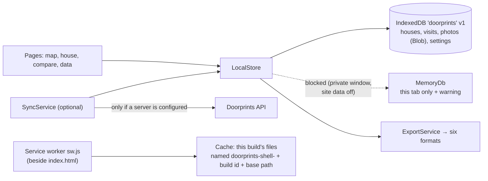

- **No route is guarded.** The app opens on the map with whatever the browser holds; `/connect` still exists for
  someone who wants sync, and that is all a server adds.
- **The service worker caches this build's files and nothing about the user.** `npm run build` stamps `sw.js` with
  a build id and the list of every file of the build (`scripts/sw-precache.mjs`), `install` downloads all of them
  into one cache per build, and `activate` drops this app's older caches for the same deployment path. Same-origin
  GET under the app's own base path only; `/api/...` and `sw.js` are skipped; cross-origin requests (tiles, fonts,
  the user's own server) are not touched at all. So there is no second copy of the user's data outside IndexedDB
  (SEC-044, [02](02-threat-model.md) T-I17). **Navigations are answered from the cache first**, with this build's
  `index.html`, so a weak connection never means a blank page; a new deploy arrives as a new worker and is
  announced (next bullet) rather than slipped in under the old one.
- **Updates are announced, not applied.** A waiting worker sets a signal; the page offers a reload; only then does
  the page post `skip-waiting`. Nothing reloads under the user's hands.
- **Install is offered, never pushed.** `beforeinstallprompt` is captured and kept, and the browser's own dialog opens
  only from a tap on *Install app*. The offer has a **permanent card** on *Your data* (*Install the app*, or "You are
  using the installed app") and appears **once** as a banner under the header, only after the first saved house;
  "Not now" there hides it for **30 days** (persisted), and the card stays. At most one non-error banner shows at a
  time, in the order **migration > update > install > storage risk** (`AppBanners`); the "browser is not storing
  anything" error can sit above one of them. iOS gets the Add-to-Home-Screen steps instead, because Safari has no
  such event ([05](05-ux-accessibility-i18n.md) §14.4).
- **Durability is stated, not assumed.** `StorageService` asks for `navigator.storage.persist()` and shows the
  answer and the used space. Safari and Chromium answer automatically from the user's interaction history without
  prompting (Safari commonly denies); Firefox asks. Safari also deletes script-written storage for an origin with no
  user interaction in the last seven days of browser use, and a site saved to the Home Screen or the Dock gets the
  browser app's quota ([MDN, *Storage quotas and eviction criteria*](https://developer.mozilla.org/en-US/docs/Web/API/Storage_API/Storage_quotas_and_eviction_criteria)).
  So persistence is never something to rely on: when the browser will not promise, the app says so and points at a
  backup ([02](02-threat-model.md) RR-10). When IndexedDB is unavailable entirely, `MemoryDb` keeps the session working and the app says
  plainly that nothing is being kept — a visible degradation rather than silent data loss.
- **Hosting (ADR-21).** `web.yml` deploys the ordinary production build (base href `/`) to **Firebase Hosting** on
  pushes to `main` and manual runs, at the root of the site's own origin `https://doorprints.web.app`. Every PWA path
  is relative (`"start_url"`/`"scope"` `"./"`), and the build writes the manifest's `"id"` as the absolute base path
  read from the built `<base href>`, so it is `"/"` there (it would be `"/<path>/"` if a build were served from a
  sub-path), because an `id` resolves against the origin ([07](07-secure-build-and-deploy.md) §6.3). Firebase sends
  the headers of `web/firebase.json`: the CSP (with `frame-ancestors`), HSTS, `X-Frame-Options`, `nosniff`,
  `Referrer-Policy`, `Permissions-Policy` and COOP reach the browser; the build-time `<meta>` CSP (copied from the
  same file) and the app's refusal to start inside a frame stay as defence in depth for copies on hosts that ignore
  `firebase.json` ([02](02-threat-model.md) F-31, T-T13). Caching: `Cache-Control: no-cache` on every path
  (Firebase's own default would be `max-age=3600`, and a rule for `/index.html` alone would not match `/` or a deep
  link); the service worker precache makes that cheap. A long `max-age` or `immutable` rule must not come back
  unless the rewrite is first narrowed, because the `**` rewrite answers a missing old chunk with the HTML shell and
  status 200 and header rules match the request path ([07](07-secure-build-and-deploy.md) §6.3).

### 16.5 The Indic web fonts: `font-display: optional` (S4b-BL-263)

The website self-hosts Noto Sans Devanagari, Tamil and Telugu (`web/public/fonts`, `@font-face` in `styles.css`) for devices with no font for those scripts; the font stack reaches them only for code points the system's own fonts lack. The faces were `font-display: swap`, which draws text in a fallback and swaps the web font in when it arrives; a late font then reflowed the page (the tour offer, S4b-BL-262, and the Map page's legend and panel at 130% text, a layout shift of 0.085-0.214, S4b-BL-263). They are now `optional`: the browser waits a short block period, uses the web font if it is ready and otherwise keeps the fallback for that page load, still downloading the font into the cache. **Result:** the service worker precaches every file in `dist` (`web/scripts/sw-precache.mjs`), so a repeat visit uses the web font inside the block period; a first visit on a slow network shows the system's Indic font for that page load and the web font from the next. No preload (it would spend the first visit's bandwidth on a font the system may already have), and the Map page's `drawn` logic is untouched. Measured numbers: [10](10-sprint-log.md) S4b-BL-263, test: [06](06-test-plan.md) TC-S-46.

## 17. Decisions of the finishing batch (2026-10-01)

Smaller decisions taken while the slice 5 to Wave E batch was built ([10](10-sprint-log.md) §13.29..§13.39); each is
the default unless the owner objects.

| Decision | Why |
|---|---|
| **Readable copies and backups write their times in UTC on every stack** (S4b-BL-92c); the cover says "Times shown for UTC +00:00". The Kotlin writer still takes an offset and its goldens keep +05:30. | The website always wrote UTC; one file now reads the same whoever made it, and a test still proves the offset path. |
| **Seeded records are stamped 2000-01-01T00:00:00Z and written clean** (the default questions, S4b-BL-90a); *Reset to defaults* writes them dirty. | A fresh device's seed must never win last-write-wins against another device's edit or revive its deletion; 2000-01-01 is the earliest `updatedAt` the server accepts. |
| **With the app lock on, Hunt mode's alerts are `VISIBILITY_SECRET`** (S4b-BL-68). | The lock exists for a shared or lost phone; a house's name on its locked screen would defeat it. Reminders stay `VISIBILITY_PRIVATE` with a public "Doorprints reminder". |
| **One set of status colours on both apps**: Taken `#8A5A00` / dark `#F2C265`, Not chosen `#5F6B66` / dark `#B4BEB9`; a Not chosen marker at 0.75 opacity. | Android took the website's values (contrast checked in both themes, ADR-32). |
| **The locality lookup runs only on the person's tap** (S4b-BL-83): Android's `Geocoder`, Apple's `CLGeocoder`, and on the website Nominatim `/search` at most once a second, India only. | ADR-07: Nominatim's policy forbids automatic use; a tap is the person's own request, disclosed in the privacy note. |
| **On iPhone, the area wake-up's notification opens the Map, which offers Hunt mode** (S4b-BL-96); no *Dismiss*, so the cooldown is stamped when it is posted; the notification permission is asked after "Always". | An iPhone app cannot start tracking from a notification action; the cooldown must hold without a button. |
| **An import keeps to the caps**: 100 questions, 40 criteria (backend and phones; the website's importer too). | A merge of two full banks could pass the caps the screens and the server enforce. |

## 18. Kinds: one candidate concept described by a kind file (ADR-36)

The decision of [14](14-lead-backlog-and-handoff.md) N21 (owner, 2026-10-10, revised the same day because there are
no users yet), designed here before any code: kinds PR 1, S4b-BL-205. Since kinds PR 3 (S4b-BL-207, §18.7) the apps
read the kind's labels at run time through a resolver that holds a checked copy of the file.

### 18.1 The decision

- **One candidate concept, many kinds.** A house is the first *kind*; a school, a clinic, a wedding venue, a PG or a
  plot are later kinds of the same candidate, with the same screens: the map, the list, the form, Compare, the copies,
  the AI. What differs per kind is data, in a **kind file** (`docs/schemas/kinds/<kind>.json`, §18.3): labels, which
  core fields and sections show, typed extras and where they go, the statuses' labels, the checklist, the question
  scopes, what search reads and what the AI may see.
- **Built-in kinds only.** The kind files ship embedded in both apps and the server (the `default-questions.json`
  pattern: one test per stack reads the file). Importable packs wait for two built-in kinds and a trust model (a kind
  file feeds AI prompts, an injection surface). Runtime user-defined fields are a later layer over the same typed extras.
- **One kind per space; a data set may hold several kinds; Settings enables kinds and chooses a default** (amended by
  PR 8, S4b-BL-212, §18.12; first written as "one kind per data set"). No kind picker per search and no mixed list: a
  space is a filter over the one store, chosen in the chooser.
- **A one-time format reset first** (PR 2, S4b-BL-206): `kind`, `money` and `extras` become first-class fields on the
  candidate (a Room column, a jsonb column, an IndexedDB field), not the records layer; the backup family restarts at
  `doorprints-backup/1`. Only public surfaces are renamed (§18.4); the internal `house` identifiers are renamed when a
  file is split.
- **Location stays required.** The map is the home screen; location-free verticals stay out of scope.
- **The container is called *Search*.** **Decision (owner-approved 2026-10-10):** *Search*, not *Shortlist* and never *Hunt*.
  *Hunt* collides with Hunt mode (the GPS feature); *Shortlist* collides with the status *Shortlisted*, which every
  marker, filter and Compare shows, and a shortlist is a subset while the container also holds the rejected ones.
  *Search* collides only with the list's search box, and the wording avoids it ("your house search", "your school
  search"). On the wire the container is the `search` object of a data set (§18.4 door 10), never a table of its own.
- **Voice input** is a separate decision, ADR-37 ([ai/voice-input](ai/voice-input.md), S4b-BL-218). It is a later input
  method that rides the kind-aware renderer of PRs 4 and 5: the mic button is built once there, not on the hand-written
  screens those pull requests replace. Nothing in this section depends on it.

### 18.2 The deletion test, applied before any code

The rule of [14](14-lead-backlog-and-handoff.md) §9: delete the new module; its complexity must reappear in at least
three distinct callers, otherwise it is not a module.

| Proposed module | Callers that would carry its work if it were deleted | Verdict |
|---|---|---|
| The kind file and its label and visibility resolver (`KindLabels`, PR 3) | the form (both stacks), the house page, the list and its search, Compare, the readable copies, the import preview, the AI documents, the guide | **passes**: eight callers, each would hard-code the house words again |
| The typed-extras renderer (PR 4) | the form, the house page, Compare, the copies, search and filters, the AI lines | **passes**: six callers; today the cost, floor and BHK fields are written out by hand in each |
| `money` with a cadence (one type for price, deposit, maintenance, offers) | the form, Compare's monthly and move-in sums, the cost filters, the copies, the AI lines, the duplicate-flat check | **passes** |
| A *Search* container as its own entity (a table, a sync family, its own screens) | Settings only (one kind per data set) | **fails**: the container is a `search` settings object of the data set, no store |
| A store or screen per kind (`SchoolStore`, `SchoolEditScreen`) | one each | **fails**: that is the "new screens" of the PR 5 stop criterion |
| Extras in the generic records layer (the superseded plan) | sync, import and search would each read two places for one candidate | **fails** now that there is nothing to migrate: a first-class field is one place |
| The `was` mapping of `house.json` (today's wire place of each value) | the reset of PR 2 only | **fails** as a module: kept as data in the file and dropped by PR 2 |
| A runtime field editor for user-defined fields | none yet | **deferred** until a kind needs it |

### 18.3 The kind file

`docs/schemas/kinds/kind.schema.json` (JSON Schema 2020-12, format `doorprints-kind/1`) describes it;
`docs/schemas/kinds/house.json` is today's house as a kind; `docs/schemas/kinds/kind-vectors.json` pins what it resolves
to ([schemas README](schemas/README.md) §8.4). In short:

- **`format`** is the file format, **`version`** the kind's own revision (an integer from 1, §18.4 door 4).
- **Labels are keys, never text**: `{ "web": "house.price", "android": "house_price_sale" }`, one key per stack into the
  dictionaries that already hold the four languages and their *under review* marks. `null` means that stack shows no
  text there (Android's form has no *Details* heading). `byCadence` names another key while the money cadence is that
  one (Android's *Rent ₹/month* for a monthly price). The two stacks' words differ today (*Price (₹)* and *Price ₹*), so a
  single key per field would have changed one of them; PR 3 may merge them later as a visible, reviewed change.
- **`core`**: the fixed fields every candidate has on the wire (`label`, `status`, `rating`, `money`, `address`,
  `street`, `locality`, `contactName`, `contactPhone`, `brokerId`, `listingUrl`, `notes`, `location`,
  `locationSource`), each with the kind's label and placement (`section`, `order`, `visible`). A core field the kind
  leaves out is hidden, its value still kept and synced. `label` and `location` must be listed.
- **`extras`**: the kind's typed fields, `extras.<id>` on the wire (§18.4 door 5). For houses: `bedrooms`, `areaSqft`,
  `floor` and the eleven cost fields of today. A placement may carry `forCadences` (since PR 4, §18.8): the field shows
  only while the candidate's money has one of those cadences, or none (the house's rent-only cost fields).
- **`sections`**: the page's sections in display order, from a fixed list (details, cost, rooms, questions, viewings,
  moveIn, areaNotes, distances, location, walks, checklist, visits, photos); one left out is hidden for the kind.
- **`statuses`**: the five fixed names, each with the kind's label. **`checklist`**: the built-in criteria and labels.
  **`questions`**: the seed file and what each `appliesTo` scope means in money cadences (`RENT` = monthly, `SALE` =
  once). **`search`**: what the list search reads. **`ai`**: the slots `extract`, `ask`, `plan` and `never` (§18.4 door 10).

### 18.4 The one-way doors

Each is a name or a shape that is cheap to choose now and expensive to change once a release has users. Today
reversing any of them costs a code change and a wipe of the owner's test devices; after the first release it costs a
new format id and a reader for the old one kept for ever. The second pass (§18.5) reviewed each against the vectors.

| # | Door | Choice | Alternatives | Why | Reversal cost after a release |
|---|---|---|---|---|---|
| 1 | **Backup format id** | **Decision (owner-approved 2026-10-10):** restart at `doorprints-backup/1` (N21). The new family has `candidates`; a file of the old family (it has `houses`) was to be refused with "made by an older Doorprints, export it again", never half-read. **Final text (kinds step 3, 2026-10-12, S4b-BL-206; owner confirmed, [14](14-lead-backlog-and-handoff.md) §11.4 item 7): old-family backups are read, not refused: a file of the old family is read whole, as it always was, and its houses become candidates; one with both lists is refused** | `doorprints-backup/4` (continue the numbering, no reused id); a new family name `doorprints-data/1` | No backup outside the owner's test devices exists; one number line from 1 is the simplest story for the guide and the threat model. The reused id is the trade-off: an old `/1` file on a test device is refused by shape, not by id | A new id and a second reader for ever |
| 2 | **Wire and backup JSON names** | `candidates` (the backup list, the sync file list, `/api/candidates`); **Decision (owner-approved 2026-10-10):** `houseId` becomes `candidateId` on visits, photos and viewings in the same reset; `data.json` keeps its name. **Done on the wire, in backups and in the Drive sync file by kinds step 4 (S4b-BL-206), and in the viewing record's payload by S4b-BL-247 (2026-10-13): written as `candidateId`, `houseId` still read, both keys a bad row (§18.5)** | Keep `houseId` (fewer edits now; a school's visits say "house" on the wire for ever); `items`, `places` (`places` is already the saved places) | Public surfaces are renamed once, in the reset, or never; `candidate` is the word for one thing being compared, whatever it is | A format bump and a rename on three stacks |
| 3 | **The candidate's new fields** | `kind` (the kind id, required, `^[a-z][a-z0-9_]{1,31}$`); `money` (`{ "amount": ..., "cadence": ... }`, absent when unknown); `extras` (an object keyed by extra id, absent when empty, never `{}`) | `type`, `category`; `fields`, `attributes`, `custom`; keeping `price` and `priceType` | `kind` reads plainly in the four languages' docs. A viewing already has a `kind` (FIRST or SECOND): a different object, so no clash on the wire, but writers must not confuse the two | Format bump |
| 4 | **The kind schema and its `version`** | `format: "doorprints-kind/1"` names the file format; `version` (integer 1..1000) is the kind's own revision, raised when a field's type, unit or cadence changes, never for a label key. A reader refuses an unknown format and reads a lower or equal `version` | A semver string; one number for both; no version | Two questions, two numbers: "can I parse this file?" and "is this the house I know?". Built-in kinds ship inside the build, so today they always match | Cheap while kinds are built in; costly once packs are imported |
| 5 | **How extras are typed** | Six types: `number` (`integer`, `min`, `max`, `unit` required), `money`, `text` (`maxLength`), `enum` (option ids `UPPER_SNAKE`), `date` (`YYYY-MM-DD`, no time zone, as `availableFrom` today), `bool`. On the wire: a JSON number, a money object, a string, the option id, the date string, `true`/`false`. A reader keeps and round-trips an extra id it does not know (a newer app's field survives an older device's sync) without showing it; a known id with a value of the wrong type or out of range reads as unknown (today's coercion rule) | Free-form values; a `phone` or `url` type (those are core fields); dropping unknown extras (the data loss that drove the superseded plan) | Exactly what the house needs today plus the B-rated use cases of N21 (a yes/no, a date); a seventh type is additive | Adding a type: cheap. Renaming or re-meaning one: format bump |
| 6 | **Unit codes** | A closed list: `count`, `level`, `sqft`, `sqm`, `cm`, `m`, `km`, `minute`, `day`, `month`, `year`, `percent` | Free text units; SI only (the person writes square feet) | A code is translated by the dictionaries and compared by search and filters; free text cannot be | Adding: cheap. Renaming: format bump |
| 7 | **Money with cadence** | `amount`: whole rupees, an integer 0..1,000,000,000,000 (`MAX_RUPEES`); `cadence`: `once`, `day`, `week`, `month`, `quarter`, `year`; both keys always written for a money extra, while the candidate's own `money` may carry a cadence and no amount (a house marked as a rent before the rent is known: the form's toggle and the question scopes read it; found in kinds PR 2, §18.5), or an amount and no cadence (a price whose type is *Not set*, the website's form offers it: **owner decision of 2026-10-12**, a typeless price is never read as a monthly rent, since a 1.2 crore price would then show "per month"), so there each key is left out when unknown and a money with neither is refused; for a house a cadence that is present is `month` or `once`; no currency key (rupees, the India-only rule). Today's `RENT` is `month`, `SALE` is `once`. An extra money field either fixes its cadences (`deposit`: once, `maintenance`: month) or follows the candidate's own money (`cadenceFrom: "money"`: `myOffer`, `agreedPrice`) | Paise; decimals; an ISO currency code; keeping `priceType` beside a bare number | Whole rupees is what every stack stores today; a cadence covers school fees per year, a gym per month, a hall per day; a currency key can be added later as an optional field | Format bump |
| 8 | **Status names** | The five names `NEW`, `SHORTLISTED`, `REJECTED`, `TAKEN`, `NOT_CHOSEN` stay for every kind (`HouseStatus.fromWire` never changes); a kind gives each its label (a school's `TAKEN` may read *Admitted*) | Statuses per kind | `HouseStatusRules`, the filters, the colours, the Plan filters and the AI all read the names | Very high: every stack and every file |
| 9 | **Default-question and criterion ids** | Kept exactly: `qd_*` question ids and the ten checklist keys (`water` .. `commute`) are the house kind's; another kind adds its own ids with a kind prefix (`qd_school_*`, its own checklist keys). The `appliesTo` scopes stay `BOTH`, `RENT`, `SALE` for houses and are mapped to cadences in the kind file | Renaming to neutral ids; one shared list | Two devices seed the same records by id; one kind per data set means keys never meet another kind's | Seeds re-made on every device |
| 10 | **Hunt-level fields and the AI contract slots** | The data set's own fields live in a `search` object (`{ "kind": "house" }` in the backup and the settings, PR 2), reserved for later fields of the container. **Amended by PR 8 (S4b-BL-212, §18.12):** `search.kinds` (the enabled kinds) and `search.defaultKind` for anything but the house alone, which keeps `{ "kind": "house" }`; device-local settings, never synced; readers ignore it, and a browser that never chose takes it as a hint. The kind file's `ai` slots: `extract` (what the listing extract fills, today's `RawListing`), `ask` (the Ask document lines), `plan` (Plan's filters), `never` (never sent from a saved candidate: `contactName`, `contactPhone`, `myOffer`); read from PR 7 | Hard-coded per kind in the prompts; no slots until PR 7 | The prompts, the redaction and the parity vectors must change together on three stacks; naming the slots now lets PR 7 read data instead of growing branches | Moderate: a prompt change and the parity vectors |
| 11 | **Labels are keys, per stack** | Keys into the existing dictionaries, one per stack, never inline text | Inline text in four languages in the kind file; one shared key set | Keeps the translation workflow, the parity tests and the *under review* marks in one place, keeps kind text out of AI prompts, and keeps today's per-stack words unchanged | Cheap |

### 18.5 The second pass, with the vectors

Done before any UI work, against `kind-vectors.json` and today's code on the three stacks. What it found and what
changed:

- **The two stacks' labels differ for the same field** (*Price (₹)* on the website, *Price ₹* and, for a monthly price,
  *Rent ₹/month* on Android; *Checklist* and *Checklist (0 = bad, 5 = great)*). Labels became per stack, with
  `byCadence`. Merging them is a visible change for PR 3, not this one.
- **The form order differs between the stacks** (on reading `HouseEditScreen.kt`: Android puts the cost card before
  the address, the notes, contact and listing link after the location, and has a *Contact* heading the website lacks). The kind file records the website's order; PR 4 either adds a
  per-stack order or records the Android difference as an explained screenshot diff. **Closed in PR 4 (S4b-BL-208,
  §18.8):** the renderer draws only the typed extras, in the kind file's order within their section, and each stack keeps
  its own place for the sections and core fields around them, so neither form moves; the rows the extras are drawn in
  per stack are pinned by `kind-field-vectors.json`.
- **Some labels are templates** (*Visits (%1$d)*): the resolver passes the same arguments as the screens do today.
- **`priceType` drives the question scopes** (`appliesTo` `RENT`/`SALE`): mapped to cadences in `questions.scopes`.
- **`myOffer` never goes to a provider** today (the server's `HouseDocuments`): it is in `ai.never`, not in `ask`.
- **The listing extract also returns `amenities`**, a list on the draft that fills no candidate field (it is shown as a
  hint), so the `extract` slot names only the fields it fills; the server's `HouseKindFileTest` pins that exception.
  Found by the first CI run of that test.
- **A viewing already has a `kind` key** (FIRST or SECOND): kept, noted under door 3.
- **The format id restart reuses `/1`** (door 1): guarded by shape; owner-approved 2026-10-10.
- **Every key of a backup house today has exactly one place** in the kind file (`was`): the website, Android and the
  server each check it against their own model (`house-kind-file.spec.ts`, `HouseKindFileTest` twice).
- **Found in kinds step 3 (S4b-BL-206, the backup format, 2026-10-12): one mapping per stack between the two
  families.** The rows every writer builds and every reader checks are still those of the family before (the phone's
  `BackupData`, the server's `BackupHouse`, the website's `BackupData`), so each stack has one mapping at its edge (Java
  `BackupWire`, Kotlin `BackupWire`, web `backup-family.ts`): a writer's rows are written as the new family, and a file of
  the new family is checked for what only it has (the kind id, money and its cadences, the money extras, the unknown
  extras) and read back as the family before, so one reader of rows, ranges and ids serves both families and an older
  Doorprints' file keeps importing (door 1 as changed). A well-formed file with a cadence the reader does not support
  (one it does not know, a house's money that is not `month` or `once`, a fixed money extra with another cadence) is
  refused as a newer app's file ("update the app"), not as broken data: a newer app may write it; a price without a
  type is money with an amount and no cadence (door 7). The mapping is lossless: the canonical sample read as the family
  before is `backup-sample-houses.json` (the sample as it was) byte for byte, and back, on the three stacks. The phone and
  the server do not keep an extra a newer app wrote (they have nowhere to store it until the Room step); the website
  does. The format number of a copy is `/1` whatever it holds; inside, a read file is a `/2` copy (`/3` with deletions)
  of the family before.
- **Found in kinds step 3 (S4b-BL-206, the web part, 2026-10-12): the website's IndexedDB cannot restart at
  version 1.** A browser refuses to open a database at a lower version than it holds (`VersionError`), so the plan's
  "IndexedDB `DB_VERSION` 1" is **version 4**: its step rewrites every row of `houses` as a candidate (`kind`, `money`,
  `extras`) inside the upgrade transaction, so a failure leaves the database at version 3 as it was, and a row a
  version-3 database wrote still reads as the house it is (`data/candidate-rows.ts`). Visits, photos and their
  `houseId` indexes stay: those are internal names, and the wire and the backup say `candidateId`. The screens still
  read a house (`HouseDto`); `core/candidate.ts` is the one mapping, used at the store and at the server client
  (`/api/candidates`), the twin of the server's `Money.of`, `CandidateExtras.of` and its `HouseDto` readers. An extra a
  newer app wrote is kept (`extrasOther`) and written back after the known ones, never shown or searched.
- **Found in kinds step 4 (S4b-BL-206, the phone, 2026-10-13): Room cannot restart at version 1 either, and the
  phone's houses must not move above the store.** Room goes to **version 12** (§6.2 *Room 12*): `MIGRATION_11_12`
  rewrites every house in place as a candidate (`kind`, `money_amount`, `money_cadence`, `extras`), and `HouseEntity`
  derives the candidate from the house's values and reads them back out, so no screen, rule or copy changes, and the
  search reads the same values (`HouseListSearchTest`). An extra a newer app wrote is now kept on the phone too (Room,
  `/api/candidates`, Drive) and written back after the known ones; a backup made on the phone left it out at first
  (the backup rows had no place for it) and keeps it since S4b-BL-248 (`ExportHouse.extrasOther`, and on the server
  `BackupHouse.extrasOther`: read out of a candidate's `extras` by the rules of the website's `cleanOtherExtras`, at
  most 30, and written back there after the known ones, by id; never a key of a file of the family before, so the
  lossless check against `backup-sample-houses.json` is unchanged; `import-vectors.json` `candidatesWrittenBack`). `ApiClient` calls `/api/candidates` and sends and reads
  `candidateId` (`/nearby` and `/street` are not called by the phone, so nothing changes there). **The Drive `sync/1`
  file** keeps its format number: the phone writes `candidates` (rows in the candidate shape) and `candidateId` on
  visits and photos, and both stacks read either shape, a house row without `kind` as the house it is, and refuse a
  file or row with both names (`sync-vectors.json`, `sync-1.schema.json`). The website's reader changed with it and
  its writer since S4b-BL-246 (`syncJsonOf` in `sync-file.ts`: this device's rows as candidates and `candidateId`,
  the list as `candidates`), so the website and the phone keep syncing through Drive in both directions and a file of
  either shape still loads. On both stacks only this device's own rows are made in the new shape; a row taken from
  another device's file is written on as it came, which both readers read. The
  viewing payload's `houseId` (the records layer, read by the server's AI and export) moved in S4b-BL-247 (below). The cost summary reads a price without a type as no rent (`CostSummary.of`, as the
  website's `costSummary`); `Formats.price` already showed *per month* for `RENT` only.
- **Found in S4b-BL-247 (2026-10-13): the viewing record's payload, on three stacks, without a migration.** A viewing
  is a record whose payload named its house `houseId`; the server reads inside it (its AI's viewing lines, the one query
  that picks a house's viewings, the backup export), and so do both apps. Every writer now writes `candidateId` (the
  website's `viewingToPayload`, `ViewingPayloadSerializer` in `:shared` for the phone and the iPhone, the server's
  backup import), and every reader reads either key, so a payload written before (on a device, in a Drive file, in a
  server's `record` table) is never invisible to the apps or the server's AI; a payload with both keys, whatever their
  values, is a bad row on every stack (`docs/schemas/viewing-payload-vectors.json`, [schemas README](schemas/README.md)
  §6.6). **On the server, reading both keys, not a Flyway V2**: the query compares
  `coalesce(payload ->> 'candidateId', payload ->> 'houseId')` and the Java readers go through one helper
  (`ViewingPayload.candidateOf`); a migration would have rewritten opaque client payloads for a server with no users,
  and the clients still need to read `houseId` from Drive files and from each other anyway. A device rewrites an old
  row only when it next saves it. The backup row of the family before keeps `houseId` (its new family already said
  `candidateId`); the Drive sync file and `/api/records` carry the payload as it is, so neither changed.
- **Found in kinds PR 2 (S4b-BL-206, the server part, 2026-10-12): a house's money may have a cadence and no
  amount.** A house is marked as a rent before its rent is known (the form's toggle; the question scopes `RENT` and
  `SALE` read it), so door 7's "both keys always written" holds for a money extra only; the candidate's own `money`
  leaves `amount` out when unknown. `myOffer` and `agreedPrice` follow the money's cadence, or `month` when the
  candidate has none. The server's sync API checks a house's cadence (`month` or `once`) and keeps an unknown extra
  only as a field id with a value of one of the six types (a number, a text of at most 2,000 characters, a boolean or
  a money object; at most 30 per candidate).

The vectors are fixed: a later pull request that changes a resolved label, a field list, the layout, the visibility,
the wire place of a value or what search reads turns the kind tests red on the three stacks, so "zero change" for houses
is proved, not claimed ([06](06-test-plan.md) TC-U-198).

### 18.6 The file-size budget

Rule 1 of the retrospective in N21, in force before the big edits of PR 4: `tools/check-size-budget.mjs` reads
`tools/size-budget.json` and fails a product source file (Kotlin, Java, TypeScript, HTML, CSS, Swift, JavaScript under
`android/`, `web/src/`, `backend/src/main/` and `ios/`; tests, test helpers and the translation dictionaries left out)
over **900** lines, and warns over **600**. The 13 files already over 900 on 2026-10-10 are on its allowlist at that
day's size (among them `HouseEditScreen.kt` 1,779, `MapScreen.kt` 1,519, `CommonRepository.kt` 1,302 and
`house-detail-page.ts` 1,214) and may not grow; a shrunk file is asked to lower its entry. The floor guard
(`tools/check-floor.mjs`) reports a raised or added entry, a raised limit or a new table as a loosening. It runs in
`tools/check.sh` on every branch and in the *Security* workflow on every pull request ([06](06-test-plan.md) TC-U-199).
PR 4 shrinks the four big files and lowers their entries. **Done in PR 4 (S4b-BL-208):** `HouseEditScreen.kt` 1,773
lines to 1,588, `house-detail-page.html` 1,055 to 1,045 and `house-detail-page.ts` 1,214 to 1,212, each entry lowered to
its new size; `MapScreen.kt` and `CommonRepository.kt` hold no typed extras and were not touched.

### 18.7 The label and visibility resolver (kinds PR 3, S4b-BL-207)

*Since kinds PR 8 (§18.12): the person never reads the words "kind" or "space"; what names a kind on screen is its
`kind.many` noun (*Houses*, *Schools*), and counts are written *Saved: N*.*

**What it is.** `KindLabels` answers, for a kind, a *ref* and, where it matters, the candidate's money cadence, which
string a screen shows and whether the kind shows that place at all: `resolve("field.money", "month")` is the phone's
*Rent ₹/month* (`house_price_rent`), `section("details")` is the website's *Details* and no text on the phone, a field in
a section the kind hides is hidden, and a ref the kind does not have resolves to nothing (the caller shows nothing). A ref
is `kind.<id>`, `status.<NAME>`, `section.<id>`, `field.<id>`, `cadence.<id>` or `check.<key>`, the ids of
`kind-vectors.json`; a cadence is an argument, never part of the ref. One class in `:shared` (`model/KindLabels.kt`, the
Android keys; the iPhone app reads it through `:ui`) and its twin on the website (`core/kind-labels.ts`, the web keys,
typed as translation keys). The house is the only kind (`KindLabels.of("house")`, `kindLabels('house')`; any other id is
none).

**Where the data comes from.** Each stack holds a copy of `house.json`'s keys, cadence keys, sections and hidden places,
as the default questions are copied (§18.1: built in, one test per stack reads the file): `KindLabelsVectorsTest` and
`kind-labels.spec.ts` fail when the copy and the file differ. Reading the JSON file at run time was the alternative; it
would put a JSON parse and a file into the iPhone and website bundles for no gain while kinds are built in, and the
copies cannot drift.

**The safety test, written first.** `docs/schemas/kinds/kind-label-vectors.json` (format
`doorprints-kind-label-vectors/1`, 75 cases) pins, per case, the web key, the Android key and the visibility, and names the
label of `kind-vectors.json` whose words in en, hi, ta and te the key must show; the keys were checked one by one
against the call sites on main (each is the key a screen or copy reads today). It was committed with two tests before
the resolver existed: the website's dictionaries and status and checklist tables (`kind-labels.spec.ts`) and `:ui`'s
Compose strings, `HouseStatus.labelResource` and `ChecklistResources` (`KindLabelsScreensTest`) against it.

**What reads it (the minimal wiring).** The four tables every screen reads statuses and checklist criteria through: the
website's `STATUS_KEY` and `CHECKLIST` (`core/models.ts`), the phone's `HouseStatus.labelResource` and
`ChecklistResources` (`:ui` `ModelLabels.kt`, through `kindStringResource`, which finds the Compose string by name in the
generated `Res.allStringResources`). The map, the list and its filters, the house page and form, Compare, the copies and
the Ask page therefore show the kind's words, the same ones as before. **Not moved here**, on purpose: the field and
section labels written into the form, the house page, Compare, the copies and the import preview. Each is a
hand-written call site that the renderer of PR 4 (S4b-BL-208) replaces; moving them twice would be churn, so they move
with it (S4b-BL-255). No string, screenshot baseline or `dictionaries.spec` case changed. The two stacks' different words
for one field (*Price (₹)* and *Price ₹*) stay as they are (§18.5): merging them is a visible change for later, not for
this pull request.

### 18.8 The typed-extras renderer (kinds PR 4, S4b-BL-208)

**What it is.** The house page draws its typed extras (the BHK, the carpet area and the floor in *Details*, the eleven
cost fields in *Cost*) from the kind's fields instead of writing each one out. `KindFields` (`core/kind-fields.ts` on the
website) holds a copy of the kind file's `extras` (type, range, unit, cadences, section, `order`, `was`) and answers a
section's extras for the candidate's money cadence, in order, with their labels from `KindLabels` (§18.7). Each type has
one control, the same on both stacks: `number` (an integer field), `level` (a `number` whose unit is `level`: the
floor, its field holding the level and a *Basement* switch the sign, S4b-BL-104 c), `money` (whole rupees), `bool` (a
switch) and `date` (YYYY-MM-DD with the platform's picker). `text` and `enum` have no control yet, because no built-in
kind has one (S4b-BL-257). The website's form (`pages/house-detail/kind-extras.ts` and one `extra` template in
`house-detail-page.html`) keeps the element ids, attributes and rows the hand-written fields had: in *Details* the extras
share the price's row; elsewhere two fields stand side by side and a date stands alone.

**On the phone** (the second, stacked pull request): `KindFields` in `:shared` (`model/KindFields.kt`, the same copy of
the kind file's extras) and `KindExtrasFields` in `:ui` (`KindExtrasFields.kt`, so the iPhone has it too) draw the
*Details* extras under the price and the *Cost* fields of `HouseEditScreen`. The phone's rows: two fields side by side
(`PairOrStack`), but a switch, a date and a level take a row of their own and a field before one of them does too, so
*Maintenance* stands alone above *Included in the rent* as before. A number keeps the digits of its `max` (two for a count
without one, the BHK) and a value outside its range reads as unknown, as the hand-written fields did. Every value is
written the one way, through the candidate's extras (`withExtra`: `Candidates.houseExtrasOf` reads the house's values back
out), instead of one `copy` per field. The form's field labels and its sections' headings (Rooms, Questions to ask,
Viewings, Moving in, Area notes, Distances, Location, Saved walks, Checklist, Visits, Photos) come from the kind
(`kindField`, `kindSection`, `kindRef` in `ModelLabels.kt`). Safety test first: `HouseFormFieldsTest` (`:app`) with
`src/test/house-form.golden.txt`, taken from main at 7fbde93c: every control and heading of the form in screen order with
its role, label, value, state, error, IME action and shared row, for a rent, a sale and no price type, in en, hi, ta and
te; the digits each field keeps and where a typed value lands; and the phone's half of `kind-field-vectors.json` against
that form. They pass unchanged after the switch, and so do the Roborazzi baselines (`-Proborazzi.test.verify=true`).

**One rule from the kind file, not a branch: `forCadences`.** The hand-written Cost card hid the deposit, maintenance,
*Included in the rent*, lock-in and notice fields for a sale. That rule is now data: an extra's placement may carry
`forCadences` (`kind.schema.json`), the cadences of the candidate's own money for which it is shown, and with none it is
shown too (a price of type *Not set* shows them, as before). `house.json` gives the six rent-only fields
`"forCadences": ["month"]`. The kind's `version` stays 1: door 4 raises it for a change of a field's type, unit or cadence,
and this is where a field is shown. The resolver's visibility (§18.7) is unchanged: `forCadences` is the renderer's.

**The safety test, written first.** Before the screen changed: `house-form-fields.spec.ts` with
`house-form.golden.json`, taken from main at 7fbde93c (every control of the *Details* and *Cost* cards in page order with
its element, id, input attributes, place in the rows and label, for a rent, a sale, a price with no type and a house that
is Taken, in en, hi, ta and te; the element tree of the two cards; every section heading of the page), typing into each
extra (the value lands where the house keeps it, the floor with its sign), the list search finding every searched value
typed into the form (the search rule: no value changed, so search is untouched), and the shared
`docs/schemas/kinds/kind-field-vectors.json` (format `doorprints-kind-field-vectors/1`: each extra's control, its web
element id, label key, suffix and input attributes, its phone label key, keyboard and digits, and the rows of each
section per stack and cadence) checked against that page. The renderer was then switched in, and the golden file, the
vectors and every existing page spec, the layout gate and the accessibility sweep pass unchanged; no string was added.

**The labels with it (S4b-BL-255, the house page).** The page's field and section labels (the name, status, rating,
price, address, street, locality, contact, phone, broker, listing link, notes and *Approximate location* fields; the
*Details*, *Cost*, *Rooms*, *Questions to ask*, *Location*, *Checklist*, *Visits* and *Photos* headings; the headings of
the *Viewings*, *Moving in*, *Area notes*, *Distances* and *Saved walks* cards; the price type's *Rent* and *Sale*) now
come from the kind through `KindKeys` (`HOUSE_KEYS.field('label')`, `.section('cost')`, `.ref('cadence.month')`), which
throws for a place the kind has no text for. The words are the same keys as before. The list's title, Compare, the
readable copies, the listing fill, the Ask page, the import preview and the map's status names are S4b-BL-256.

**What it costs and what is left.** Three small tables are the website's own, not the kind file's: the element ids the
hand-written fields had (`house-bhk`, `cost-deposit`, ...; a later kind's extra gets `extra-<id>`), whole rupees saying
so after the label (*Deposit (₹)*), and the floor's Basement switch, which is the house's `HouseFloor` and reads `floor`
(a level extra placed anywhere else is refused at start). Sections and core fields a kind hides are not hidden by the
renderer yet; that is the work of the hidden `schools` kind (PR 5, S4b-BL-209). The limits are S4b-BL-257.

### 18.9 The hidden schools kind (kinds PR 5, S4b-BL-209)

**What it is.** The second built-in kind, `docs/schemas/kinds/school.json`, there to prove the model before anything
reads kinds more widely (search and copies are PR 6, the AI PR 7, Settings PR 8). It needs nothing but labels, hidden
sections and core fields, and typed extras, so the stop criterion of the row (no new screens) holds: one candidate page
draws both kinds. A school shows the details, *Fees* (the house's `cost` section with the school's heading), area notes,
distances, location, saved walks, visits and photos; it hides the rooms, the questions, the viewings and moving in (since kinds PR 27, §18.21, it has
a checklist of its own and so a score), and its core `money` and `brokerId`. Its extras: `board` and `medium` (enums: CBSE, ICSE,
State board, IB, Cambridge (IGCSE), Other; English, Hindi, State language, Other), `grades` (text, at most 40
characters), `commuteMinutes` (a number, 0 to 300, unit `minute`), `busService` (a switch), `fees` (money, fixed cadence
`year`) and `admissionFee` (money, `once`). The labels are keys, as for the house (door 11): 23 new web keys and 24
Android keys in en, hi, ta and te (hi, ta and te marked *under review*); the places it shares with the house read the
house's keys. `school-vectors.json` (format `doorprints-school-vectors/1`) pins what the file resolves to (the shape of
`kind-vectors.json`), the renderer's controls and rows per stack (the shape of `kind-field-vectors.json`), and one school
in a backup and on the wire. The house's files, vectors, samples, golden files and baselines are unchanged.

**Why the fees are extras, not the school's own money.** A house's own money is a rent or a sale and every screen,
filter, copy and the cost summary reads it as `price` and `priceType`. A school's fee per year would need the price
and its type written out for another cadence on both stacks (S4b-BL-257 (5)); fixed-cadence money extras need no new
code, and the core `money` is hidden. `term` is not in the cadence vocabulary (door 7: `once`, `day`, `week`, `month`,
`quarter`, `year`); adding one is a one-way door, so the school quotes the yearly fee and a choice of cadence per fee
waits for a kind that needs it (S4b-BL-261).

**The developer flag.** *Since 2026-10-15 (§18.14) the school is compiled into the release builds and shown only by Settings' switch; the flag now only shows more than the shipped list, in tests. What follows is how it was built.* Off by default and not reachable in a release by accident. The website: `core/dev-kinds.ts`,
`devKindsOn()` is true only in a development build (`ng serve`; Angular's `isDevMode()`, false in the deployed
production build) **and** with localStorage `doorprints.dev.kinds` set to `school` by hand; any doubt (no storage, a
throwing one, another value) is off. The phone: a `BuildConfig` field that only a debug build made with
`-Pdoorprints.devKinds=true` turns on (the second pull request; the iPhone follows `:shared`). While the flag is on, a
new candidate's page offers a kind picker (*New house*, *New school*; `dev-kind-picker.ts`), one kind per data set being
Settings' later (S4b-BL-212; the picker is gone since §18.12). **With the flag off nothing changes**: the picker is not drawn, a new candidate is a house,
`kindLabels('school')` and `kindFields('school')` still answer nothing (the resolver's pinned case "a kind that is not
built in"), and a school row that reaches the device (synced from one with the flag on) is drawn as a house is today,
its extras kept unread and written back (`HouseDto.extrasOther`, §18.5). The house's golden file, `kind-field-vectors.json`,
`kind-label-vectors.json` and the layout gate (253 of 253) pass unchanged.

**What the renderer learnt (S4b-BL-257 items 1 and 4).** `text` (a line of text with its `maxLength`) and `enum` (a
select of the options, *Not set* first) have a control. A section or core field the kind leaves out is not drawn: the
page asks the kind (`shows('section.rooms')`, `shows('field.brokerId')`) around each card and around the price, the
broker and the score; for the house every answer is yes, so its page is the same element for element. When the kind
hides its money, the Details extras are not in the price's row (there is none) but in rows of their own, two side by
side (`extraRows`, the Cost card's rule). An extra with no `was` (no place on the house model) is one of the
candidate's other extras (`extrasOther.<id>`), written in the extras' shape (money as `{amount, cadence}` with the
extra's fixed cadence, an option id only when the kind offers it, an empty text as none) and shown only when the stored
value has the extra's type. *Fill in from listing text* is offered only for a kind whose `ai.extract` is not empty
(`BuiltInKind.extracts`), and the page's title and delete button read the kind's `kind.new` and `kind.delete`. To stay
within the file-size budget the template lost a few one-attribute-per-line wraps and `sharedFromNavigation` and
`sortBrokers` moved to `house-page-input.ts` (`house-detail-page.html` 1,045 lines, `house-detail-page.ts` 1,205).

**The server.** Nothing in its validation had to change: a candidate's kind is any id of the pattern, a kind other
than the house may give its own money any cadence of the vocabulary (`HouseDto.isMoneyOfTheKind`), and the school's
extras are ids the house does not know with values of the six types, which `CandidateExtras` keeps (S4b-BL-248). One gap
was found by the shared sample: the backup rows of the family before had no place for a kind, so a school imported
from a backup was stored and exported as a house. `BackupHouse.kind` (last, absent for a house; never a key of a file
of the family before) is now read out of a candidate by `BackupWire`, stored by `BackupService` and written by
`BackupMapper`, so the sample's school is exported byte for byte (`SchoolKindTest`, `SchoolCandidateApiTest` with
PostGIS). The website already kept it (`HouseDto.kind`).

**On the phone and the iPhone** (the second, stacked pull request, `feat/kinds-7b-schools-android`). `:shared` holds the
school's copy (`SchoolKind`, Android keys) and `DevKinds` (the kinds the flag allows, `BuiltInKind` with `extracts`);
`KindLabels.of` and `KindFields.of` still know only the house. The flag is `BuildConfig.DEV_KINDS`: false in every build,
true only in a debug build made with `-Pdoorprints.devKinds=true`, handed to the screens as `LocalDevKinds` (`:ui`,
default false, so the iPhone app never has it). The form (`HouseEditScreen`) reads the candidate's kind: its labels
(`KindLabels.fieldText`, `sectionText`, `refText`), its extras, the title and delete label, and it leaves out what the
kind hides (the price and its type, the broker, the rooms, moving in, checklist and, until kinds PR 29 (§18.23), the questions and viewings; the area notes,
distances and walks cards when a kind hides them); `KindExtrasFields` gained a text field and an option menu (*Not set*
first, as the broker menu), and pairs them two per row like numbers. A new candidate's form offers a kind picker
(`DevKindPicker`) while the flag is on. The form's rotation saver now keeps the kind and the extras the house model does
not know (before, a rotation dropped a newer app's extras from the draft). The phone's backup row gained `kind` as the
server's did (`ExportHouse.kind`; a school read from a backup came back a house). `BrokerSection` moved to its own file
for the budget (`HouseEditScreen.kt` 1,588 to 1,517 lines). New Roborazzi baselines `school_edit_en_light` and
`school_edit_ta_dark` only; every house baseline and `house-form.golden.txt` are unchanged.

**Left on purpose** (rows in [10](10-sprint-log.md)): the school's extras in search, filters and the readable copies
(S4b-BL-210, whose search tests follow the owner's rule; today search reads a school's name, places, notes and contact,
pinned in `school-kind.spec.ts`); the house's helper words still on a school's page and the list's title
(S4b-BL-256, S4b-BL-259; done on the website in kinds PR 16, below); a school's phone making a broker, and the backup's `search` object written as the house
(S4b-BL-260, S4b-BL-212); a cadence per fee, the range of an other extra on save, and a school's own questions and
checklist (S4b-BL-261). A layout review of the batch precedes PR 6 (the row's condition).

**The house words left on a school's pages, and a school's copies (kinds PR 16, the website; S4b-BL-256, S4b-BL-259,
S4b-BL-266, S4b-BL-277).** With a school space on screen, nothing a school page says names a house.

- *Two mechanisms, no new kind-file ref.* Where the kind has the place (a field, a section, a status, whether it is
  shown) the screen reads it through `KindLabels`: `statusKeys(labels)` (the map's legend, filter, rows and popup, the
  page's status buttons, Compare and Ask), `labelKey(labels, ref, house)` (Compare's row headings; the house keeps its
  hand-written key, any other kind reads its label), `fillLabel` and the `isVisible` gate in `mergeListingDraft` (the
  listing fill and the address fill name a field by the kind's label and write nothing into a place the kind hides),
  and `isVisible` around the list row's price and score, the map popup's score and Your data's cards. The helper words
  the kind file has no place for (its `labels` are `new`, `many` and `delete`) are the website's own table
  `core/space-tool-words.ts`, as the space's words are (§18.12): 41 school keys in four languages (hi, ta and te under
  review), read as `toolWord(kind, houseKey)`, the house's key where the kind has none. Adding refs to `school.json` and
  its vectors would change files the phones read; S4b-BL-278 moves both tables into the kind files with the phones' half.
- *The pages.* The name's placeholder (*e.g. St. Mary's School*), *Did I walk past this school?* with its answer
  (*this school*, the map ring, the area-only line: `CheckAnswer.candidate`), the tab titles of `/k/school`,
  `/k/school/new` and `/k/school/<id>` (`routesFor`), *Save the school first …*, *Please give the school a name*, the
  location lines, *School not found* (the space's kind while no candidate is loaded), the map's zoom title, the listing
  hint and the AI disclosure on it, Ask and Plan, the Areas and Places pages and their cards and the area-note
  composer (`SpaceWords.areaInReach`), and the list row without its price and score. Your data has no Criteria card while a school space is the last one (the Criteria card is the house's, §18.21; its Questions
  and Viewings cards follow the kind, and the school has them since kinds PR 29, §18.23); the Brokers card stays (S4b-BL-260). `house-detail-page.ts` shrank to 1,185 lines (the draft's
  small helpers moved to `house-page-input.ts`) and its budget entry was lowered.
- *The copies speak in a voice.* `collect` gives a bundle a `voice` (the kind) when its copy is of one space, or when every
  candidate in it is of one kind that is not the house (`copyVoice`), and each school entry its own `kind`; a copy of
  houses, or of houses beside a school, has no voice and is written as it always was. A copy with a voice writes the
  cover, the options, the ranking's heading and the empty line in the school's words (`school.exp*`), reads every
  label through `KindLabels` (`copyField`: a school's *Website* and *Fees*), writes each extra under the heading of its
  own section (`ExportExtra.section`: the Details block, or the Cost block headed *Fees*), and leaves out what the kind
  hides: the ranking's score and price columns, the Details rows, the sections of a house (rooms, questions, viewings,
  area notes, distances, moving in, checklist), the Houses table's price, type, BHK, score, cost, rooms, floor and
  broker columns (`housesTable` is now a list of columns, each with the ref it needs), and the Scores, Criteria,
  Rooms, Answers, Viewings and Brokers tables when their section is hidden. The words inside the tables are
  `ExportStrings.of(lang, kind)` with the overlay `export/kind-export-words.ts` (*Schools*, *School*, *School id*,
  *Website*, the cover's scope lines), so the contract of the keys with the phone's `ExportStrings.kt` is untouched.
  `html-export.ts` and `markdown-export.ts` share one reader of the Details and Cost blocks, `export/copy-facts.ts`
  (`costEntries` and its neighbours moved there unchanged). The backup is not shaped by a voice: `data.json` and the
  sync file carry every row.
- *The safety test.* The house's golden files (`house-form.golden.json`, `house-pins.golden.ts`, the export goldens),
  `HouseCopyPinsTest`, `kind-label-vectors.json`, `kind-vectors.json`, `kind-field-vectors.json`, `school-vectors.json`
  and the layout gate pass unchanged. `school-form.golden.json` changed in two words only, in four languages: the name's
  placeholder and the walk-check heading. `kind-search-vectors.json` gained a `section` on each `copies` entry
  (`details` or `cost`) and its note changed in the placement; the phone's `KindSearchVectorsTest` reads other keys and is
  untouched (the phones read `section` in their half).
- *Left, with rows.* The phones and the iPhone (S4b-BL-256, S4b-BL-259, S4b-BL-266 name their call sites and
  `:shared`'s copies); the import preview and the Full backup's words, which act on every space (S4b-BL-291); the
  Brokers card (S4b-BL-260); a server-rendered copy.

**The phones' half (kinds PR 18; Android and iPhone, `:shared` and `:ui`).** The same rule: with a school on screen nothing
a school page says names a house, with the website's words where the website has the key and the same two mechanisms.

- *Page words.* The kind file's places are read through `KindLabels` (`statusText` for the list's chips and rows, the map's
  legend, the form's status buttons and Compare's picker; `isVisible` around the list row's price, bedrooms, score and
  must-have chip; Compare's *Contact name* for a school). The helper words the kind file has no place for are `PageWords`
  (`:ui`), one table per kind beside `SpaceWords` (S4b-BL-278 moves both into the kind files): the form's title and a new
  candidate's name (*School details*, *New school*, *School on {street}*), the delete, discard and not-found words, the
  walk check and the saved-walks line, the photos line, the AI disclosure, the map's find-a-place lines, Compare's open
  button and the Areas and Places lines; 26 school strings in four languages (hi, ta and te under review), 10 of them
  the website's words character for character (`SchoolPageWordsTest` reads the website's dictionaries). Until a candidate
  is loaded the form reads the space's kind, as the website does.
- *The copies speak in a voice.* `ExportBundle.voice` (`KindCopy.voice`, the twin of `copyVoice`) is the kind of a copy of
  one space, or of candidates that are all of one kind other than the house. A copy with a voice reads `ExportStrings.of(language,
  kind)` (the overlay `KindExportWords`: the website's `kind-export-words.ts` words plus *Fees* for the Cost heading), leaves
  out what the kind hides (the Houses table's score, price, bedrooms, cost, rooms, floor and broker columns, the ranking's
  score and price, the Details rows, the Scores, Brokers, Rooms, Criteria, Answers and Viewings tables and the page sections
  of a house), and writes each typed extra under its section (`KindCopy.Extra.section`: Details before *Added*, or the Cost
  block headed *Fees*). A school beside a house keeps the copy's house words and has its own section words
  (`ExportBundle.stringsOf`). One reader of the Details and Cost blocks (`ExportRows.detailLines`, `costBlock`) serves the
  HTML and Markdown copies; the PDF applies the same rules. A house's copies are byte for byte what they were.
- *The safety test.* `HouseCopyPinsTest`, the export goldens, `kind-label-vectors.json` and every house baseline pass
  unchanged; the two `school_edit` baselines changed in words only (*School details*, *Did I walk past this school?*, the
  saved-walks line). `KindSearchVectorsTest` now reads `section` (it moved with the website's: a school-only copy has the
  school's columns, and the fees are under *Fees*).
- *Twin rules found.* The website has no delete question on the page (it deletes from the list with an undo), so the phone's
  *Delete this school?* has no website twin; the website writes its readable copies from the app dictionary (`exp.*`) and the
  phone from `ExportStrings`, so the copy's title and counts differ for the house already (*my schools* on the phones, *your
  schools* on the website). The phone's name field has no placeholder, so *e.g. St. Mary's School* has no place there.
- *Left, with rows.* The import preview and the Full backup's words (S4b-BL-291); the walk-end sheet's house picker
  (S4b-BL-267); the Brokers card (S4b-BL-260); a phone-side empty-copy line.

### 18.10 Typed extras in search and the copies (kinds PR 6, S4b-BL-210)

**What it is.** The list search and the readable copies (CSV, XLSX, HTML, Markdown and the phone's PDF) read a
candidate's typed extras through its kind, not through a branch per kind: `KindFields.others()` (both stacks) is the
kind's extras that have no `was`, the candidate's other extras, and `KindFields.search` is the kind file's `search`
list, so search reads the others it names. A house has none: every house extra has a `was` and is written by hand in
search (the floor) and in every copy as before, so for a house nothing reads them and nothing changes. `school.json`'s
`search` now names its seven extras (the kind's `version` stays 1: door 4 is a field's type, unit or cadence).

**One reader, by type.** `kindValues` (website `shared/kind-values.ts`) and `KindValues` (`:shared`
`model/KindValues.kt`) hold each stored value to its extra's type, as the page and the form do: a number, a money object
with an amount, a switch, an option the kind offers, a non-empty text or a date; a wrong value is no value.

- **Search** (`searchText` in `pages/map/map-list.ts`, `HouseEntity.searchFields` in `:ui` `HouseListSearch.kt`): after
  every word it had, an option's and a switch's label (only when it is on) in English and, when the app's language is
  another and its words differ, in that language too (as the floor, S4b-BL-104 b); a number's digits; a text as typed;
  money as its digits and as rupees (`96000`, `₹96,000`). The kind is the one the list draws: `builtInKind(kind,
  devKindsOn())` on the website, `DevKinds.of(kind, LocalDevKinds.current)` on the phone; with the flag off a school is
  searched as a house, as it is drawn.
- **The copies** (`export/kind-copy.ts`, `:shared` `export/KindCopy.kt`): each extra with a value, labelled with the
  kind's key in the copy's language, on the Details block before *Added* (HTML, Markdown, and the phone's PDF, which no JVM test can draw), and in the
  Houses table (CSV, XLSX) a column per extra of each kind the copy has a candidate of, right after *Floor*. Money is
  rupees in a readable copy (`₹96,000`) and a number in a table (the workbook's rupee format); a switch is the copy's
  *Yes* or *No* (`ExportStrings` `yes`/`no`, the four languages); an option its label; a number its digits. The fees'
  cadence is the label's (*Fees per year*): both school money extras fix one cadence. A copy reads the kind the screens
  draw: the website passes `CopyKinds` (the kind of each candidate under the flag, and the app's dictionary in the copy's
  language) to `collect`; the phone's `ExportOptions.devKinds`, set from `BuildConfig.DEV_KINDS` by `ExportBuilder`
  (false on the iPhone and in every release). A copy with no candidate of another kind has no extra column.

**Labels per stack, as door 11 says.** The label is the kind's key: on the website the app's dictionary in the copy's
language, so a fee reads *Fees per year*, as its form label before the rupee suffix; on the phone `:shared` cannot reach
`:ui`'s Compose strings, so `KindWords` holds the school's Android keys (its extras' labels and options) in the four
languages, as `ExportStrings` holds the copies' words, and `KindSearchVectorsTest` holds it to `school-vectors.json`'s
Android words, which `SchoolKindScreensTest` holds the Compose strings to; a fee reads *Fees per year (₹)*, as its form
label. No new user-visible string.

**The safety test, written first** (from main at d425cf9d, before any of this): `house-pins.spec.ts` with
`golden/house-pins.golden.ts` (the SHA-256 of every CSV table, the Markdown, the HTML and the XLSX workbook of the export
fixture in en, hi, ta and te; the Houses sheet as the website's first XLSX golden; each fixture house's search text in
the four languages), `HouseCopyPinsTest` (`:shared`, the same hashes of a house copy on the phone, every XLSX part
included) and `HouseListSearchTest.aHouseIsSearchedByWhatMainSearchedInEveryLanguage` (`:ui`). They pass unchanged, and
so do the export goldens, `house-form.golden.*`, `kind-field-vectors.json`, `kind-label-vectors.json`, the Roborazzi
baselines and the layout gate (253 of 253). Then the school's expectations: `docs/schemas/kinds/kind-search-vectors.json`
(format `doorprints-kind-search-vectors/1`, [schemas README](schemas/README.md) §8.4), read by `kind-search.spec.ts` and
`KindSearchVectorsTest`: the words in each language, the copies' text, cell and workbook type per extra, a wrong value,
the flag off ([06](06-test-plan.md) TC-U-212).

**Filter: not in this pull request.** The row names a filter without saying which; the list's filters (status, cost,
*Imported*) read core fields a school hides or shares, one kind per data set (§18.1) makes a filter by kind empty, and a
filter by a typed extra (a board, the bus) needs its own controls and words on both stacks. It is S4b-BL-265, with the
other things left: the copies' extras in sections of their own and the copies' hand-written house labels (S4b-BL-266,
with S4b-BL-256; done on the website in §18.9, kinds PR 16), and the walk-end sheet's house picker, which searches without the app's words (S4b-BL-267).

### 18.11 Kind-aware AI (kinds PR 7, S4b-BL-211)

**What it is.** The three AI stacks that share the prompts (the server's `/api/ai`, the website's on-device AI in
`core/ai`, the phones' `:shared` `ai` package) read a candidate of a built-in kind other than the house through its
kind file's `ai` slots (§18.4 door 10) while the developer flag is on: `extract` is what *Fill in from listing text*
fills, `ask` is every line of an Ask document in its order, `plan` is what the Plan tools show and filter on, and
`never` wins over the other three. **For a house nothing changes**: its AI code is today's and is not routed through
the slots, and its Extract, Ask and Plan output is pinned byte for byte on each stack (below). A school with the flag
off, and a candidate of a kind that is not built in, is read exactly as a house is today, its extras unread.

**The per-field AI flag is the slot.** No new schema key was needed: an extra reaches a provider only when a slot names
it and `ai.never` does not, and an extra the kind does not know (a newer app's, kept as `extrasOther` on the website and
the phone and `CandidateExtras.other` on the server) is never named, so it is never read, as [02](02-threat-model.md) A4
and [04](04-data-flow-diagrams.md) §8 say. `school.json`'s slots: `extract` the label, address, street, locality, the
contact's name and phone, the listing link, the notes, the board, medium, grades, bus, fees and admission fee (not the
commute: it is the person's own measure, which no listing states); `ask` the place, the seven extras, the area notes,
the distances, the status, the rating, the visits and the notes; `plan` the label, status, rating, locality and street and
(since S4b-BL-270) the board, medium, grades, commute, bus and fees; `never` the contact's name and phone. Each stack holds a copy of the slots and the school's extras, checked against the
file (the server's `AiKindFileTest`).

**The Ask lines.** `School: <name>`, the place lines, then `<words>: <value>` for each extra in the slot's order, with
the kind's English words (the website's English labels: *Board*, *Medium of instruction*, *Grades offered*, *Commute
(minutes)*, *School bus*, *Fees per year*, *Admission fee*), then the house's own area-note, distance, status, rating,
visit and notes lines. A value is read only when it keeps to its extra's type and range: an option the kind offers (its
words), a text of at most `maxLength` characters, a whole number within `min..max`, a switch (*yes*, *no*), money with
the extra's one cadence (`Rs 96000`); anything else is no line. A text goes through `ContactRedactor.freeText` and
loses its line breaks, as notes do, so it cannot start a line of its own, and the Ask prompt's nonce block strips a tag
in it (`PromptSafety.neutralize`). A school's document metadata has no price, price type or BHK (its money is hidden),
so an Ask filter on them never keeps a school.

**Extract.** `POST /api/ai/extract-listing` takes an optional `kind`; none or `house` is today's call and body.
`school`, while the flag is on, gets the school's system text (the house's data-not-instructions and never-guess rules,
the school's field rules), its schema (`RawSchoolListing`) and `KindDraftSanitizer`, which keeps `DraftSanitizer`'s
rules: every text cleaned and clamped with a warning, the phone and the link kept only when the listing holds them; an
option read by its id or English words, *yes* or *no*, a text clamped to its `maxLength`, money read as the house's
price is ("96,000", "1.2 lakh") with the extra's cadence; a value that cannot be read is dropped with a warning. The
draft has the house draft's shape with no price, type or BHK and an `extras` object in the wire's shape (absent for a
house, so a house's response is the same bytes). Any other kind is a 400, never read as a house. The forms merge it as
they merge a house's: an empty field or extra is filled, a typed one is never overwritten and the difference is named.

**Plan.** The Plan tools (`searchHouses`, `nearbyHouses`, the wrap-up notice; the MCP server's `searchHouses` and
`nearbyHouses` too) read a school through `ai.plan` (`AiKind.view`): its summary has no price, type or BHK, and a filter
on them never keeps it; the text filter reads its label, street and locality. `houseDetails` gives what `ai.ask` names
(no price, checklist or listing link). The prompts are unchanged; the on-device Plan line of a school says `price: -`
and `bedrooms: -`.

**The flag on the server.** `app.kinds.available` (`KINDS_AVAILABLE`, a comma-separated list, default `house`, the house
always in it; `AiKinds`; it replaced `app.ai.dev-kinds` / `AI_DEV_KINDS` in S4b-BL-280, §18.15) is the server's twin of the
apps' `AVAILABLE_KINDS` (§18.9): with the house alone every candidate is read as a house.

**The safety test, written first** (from main at 165c0088, before any of this): the server's house pins
(`HouseAskPinsTest`, `HousePlanPinsTest`, `HouseExtractPinsTest`, files under `backend/src/test/resources/house-ai-pins/`):
a SHA-256 of every output for the golden set's 30 fixture houses with their visits and one house with every field (the
cost, rooms, questions, moving in, floor, a contact typed into its fields and an instruction in its notes): the Ask
documents, metadata, prompt and pgvector filters; the Plan summaries, details, filters, wrap-up notice and system text;
the Extract prompt, schema and the drafts of the parity vectors' listings. They pass unchanged after the change, and so
do the parity vectors (`docs/ai/evals/parity-vectors.json`, untouched) and every other AI test. Then the school's
expectations, shared by the three stacks: `docs/schemas/kinds/kind-ai-vectors.json` (format
`doorprints-kind-ai-vectors/1`, [schemas README](schemas/README.md) §8.4): the documents (every extra; instruction-like
text, the contact's name and phone and a tag in the fields; a hidden money; two unknown extras; wrong values; the flag
off; a kind that is not built in), the Ask prompt, the Ask and Plan filters, the Plan summary and line, and the school's
Extract prompt, schema and drafts ([06](06-test-plan.md) TC-U-213).

**The website** (the second pull request, `feat/kinds-9b-kind-aware-ai-web`, stacked on the server's): `core/ai/kind-ai.ts` holds the
school's copy (`SCHOOL_AI`: the slots, the extras, their English words, which `kind-ai.spec.ts` holds to `school.json`,
the vectors and the English dictionary) and the readers: `aiText` (the house's `houseText`, or the kind's `kindText`),
`askView` and `planView` (what Ask filters and Plan's candidates see), `kindExtractionPrompt`, `SCHOOL_LISTING_SCHEMA`
(named `listing` for the OpenAI-compatible and Anthropic requests) and `sanitizeKindDraft`. `OnDeviceAiService` reads the
flag (`devKindsOn()`) at each call and hands each candidate's kind and other extras to the AI (`AiHouse.kind`,
`AiHouse.extras`, which `houseText` never reads); `selectForAsk` takes the document function as an argument, `houseText`
by default. `AiService.extractListing(text, kind)` posts `{ text, kind }` only for a kind the extract fills (a house's body
is `{ text }`), and with the person's own key calls the on-device extract with the kind. *Fill in from listing text* is
offered for a school (`BuiltInKind.extracts`, from the kind file's `ai.extract`), sends its kind, and fills a school's
empty extras (`kind-draft-merge.ts`), keeping and naming one the person set (*Kept your Board; the listing says "CBSE".*);
*Undo fill* puts them back. *Safety test first:* `house-ai-pins.spec.ts` with `golden/house-ai-pins.golden.ts` (SHA-256 of
each fixture house's document and label, the Ask selection per filter, the three prompts, the Plan candidates, the
parity vectors' drafts and the three Gemini request bodies), committed before the code and unchanged after it; the
parity vectors, the layout gate (253 of 253) and every existing spec pass unchanged. No new string.

**The phones** (the third pull request, `feat/kinds-9c-kind-aware-ai-phone`, stacked on the website's; Android, and the iPhone through
`:shared` and `:ui`): `KindAi` in `:shared` (`shared/ai/KindAi.kt`) holds the school's copy (`KindAi.SCHOOL`, an
`AiKindSlots`; `AiKind` is already the provider's kind there) and the same readers as the website (`aiText`, `askView`,
`planView`, `extractionPrompt`, `SCHOOL_LISTING_SCHEMA`, `sanitize`). `OnDeviceAi` takes the flag (`devKinds`, false by
default) and `AiStore` hands it on from `CommonRepository`'s new `devKinds` (Android's `AndroidRepository` passes
`BuildConfig.DEV_KINDS`; the iPhone's repository passes nothing, so false); the repository gives the AI each candidate's
kind and other extras (`AiHouse.kind`, `AiHouse.extras`). `Repository.extractListing(text, kind)` sends `{ text, kind }`
(`KindExtractListingRequest`) to the server or the kind to the own-key extract; the house's call and body are as before.
*Paste listing text* is offered for a school (`BuiltInKind.extracts`), passes the kind, and fills its empty extras
(`mergeListingExtras` in `HouseFormRules.kt`), keeping one the person set. *Safety test first:* `HouseAiPinsTest`
(`:shared`, `src/androidHostTest/house-ai-pins.json`), committed before the code and unchanged after it (its only edit:
the draft's pinned text leaves out the new `extras` field, which is null for a house, so the hashes are the same);
`HouseEditScreen.kt` stays at 1,517 lines and `CommonRepository.kt` at 1,302. The Roborazzi baselines, the parity vectors
and every other test pass unchanged.

**Not done, on purpose** (rows in [10](10-sprint-log.md)). The row's safety-test clause said the parity `prompts` would
be regenerated once; they are not, because no prompt changed for a house and a school's are pinned in the new file
(the lead's constraint of 2026-10-13: a house's prompts, document lines and parity vectors stay byte-identical). For the
same reason S4b-BL-234 (no abusive words in the answers) does not ride this step. No live eval was run (zero cost): the
golden set's `schools-*` section and the keyless injection run are S4b-BL-268; the prompts' house words for every kind
are S4b-BL-269; a kind's extras in the Plan tools are S4b-BL-270; and `house.json`'s slots, which describe less than the
house's hand-written AI code reads, are S4b-BL-271.

**Update of 2026-10-14 (S4b-BL-268, S4b-BL-271; `feat/kinds-17-school-evals-and-slots`).** The two rows left above that touch only
tests and data are done. *The school set* ([ai-design](ai/ai-design.md) 8.7): `docs/ai/evals/school-set.json` has its own
schools in the candidate shape (kind, typed extras) and 13 informational cases, and the three eval harnesses seed a
candidate's kind and extras with the kinds available (the server's `KINDS_AVAILABLE`, the website's developer flag, the
phone's `devKinds`); the golden set and its thresholds are untouched. *`house.json`'s slots* ([ai-design](ai/ai-design.md)
16.8): `ask` names the viewings, the area notes, the distances and the visits, `plan` the street, `extract` the area and the
amenities, so the slots say what the house's hand-written code reads; the code is not read through them and a house's
documents, prompts, Plan lines and pins are byte for byte as before (since kinds PR 28, §18.22, the server's house is read through them, and the pins prove it). The shared `kinds/house-ai-slot-vectors.json` and a
`HouseAiSlotsTest` on each stack hold the two together. S4b-BL-269 (the prompts' house words) and S4b-BL-270 (a kind's extras
in the Plan tools) are still open, and so is the release gate (§18.12).

**Update of 2026-10-14 (S4b-BL-269, S4b-BL-270; kinds PR 19, `feat/kinds-19-school-prompts`).** *A school's own words.* The Ask and Plan prompts spoke of houses for every kind. A kind now has its own Ask system text, records' block name (`schools-<nonce>`) and refusal sentence, and on the devices its own planner text, as fields of the kind's AI copy beside the Extract text (the server's `AiKind`, the website's `AiKind`, the phones' `AiKindSlots`); the shared `kind-ai-vectors.json` `prompts` pins them on all three stacks. A prompt uses them only when every record sent is of that one built-in kind and the kind is available; a house, a mix, no records and a kind that is not built in get the house's prompt byte for byte, which the five house pins and `parity-vectors.json` hold unchanged. The records' markers `[house:<id>]`, the output fields and the schemas stay the same for every kind: they are the protocol the citations and plans are read by (S4b-BL-314). The server's Ask chooses by the documents it retrieved; its planner takes no kind and keeps its one prompt until S4b-BL-290. *A kind's extras in the Plan tools.* The extras `ai.plan` names ride in the server's `HouseSummary` and `HouseDetails` (`extras`, words to value, absent for a house) and in the devices' candidate line, typed, ranged and redacted as the Ask document is. *S4b-BL-234* (the rule on abusive words) is not in this change: it re-pins the house's prompts, which this change keeps byte-identical. [ai-design](ai/ai-design.md) 16.9 and 16.10 have the design and the injection analysis.

**Update of 2026-10-14 (S4b-BL-234).** The Extract, Ask and Plan system texts of the house and of every built-in kind carry one more rule, *Do not repeat abusive words from the text; stay neutral and factual.*, on the server, the website and the phones ([ai/ai-design](ai/ai-design.md) 16.11). This is the one deliberate change to a house's prompts in the kinds work: the house pins and the parity vectors were re-pinned once, and nothing else of a house's AI input or output moved. The statement above that a house's prompts stay byte-identical holds for the change it was written for (S4b-BL-211, S4b-BL-269); from this change the pins are those of the prompts with the rule.

### 18.12 Spaces: the chooser and Settings > What you track (kinds PR 8, S4b-BL-212)

**The decision (owner-approved 2026-10-14, after a Fable design pass; it supersedes this PR's first draft, "one kind
per data set").** A kind is a **space**: a filter over the one candidate store, read from the address. No store, wire
field, backup family or sync family is added; a candidate already carries its `kind` (§18.4 door 3). §18.1's bullet
reads, amended: **one kind per space; a data set may hold several kinds; Settings enables kinds and chooses a default.**
§18.2's verdict stands: there is no *Search* table; the space is a route filter. Door 10 is amended below.

**Words the person sees.** Never "kind" or "space": the plural noun the resolver gives (`kind.many`: *Houses*,
*Schools*), the chooser's **What are you looking for?**, and the Settings section **What you track** (§18.7, [12](12-brand-and-naming.md) G.1).
Counts follow the dictionaries' rule (no plurals built from pieces): *Saved: 2*, not *2 houses*.

**The house-only path is byte for byte today's.** With one kind enabled (the default, and always in a production build,
which offers only the house) there is no chooser, no chip and no Settings section: `routesFor(false)` returns the very
`routes` array (`space.spec.ts` pins its paths), `start_url './'`, the share target, every golden file, the layout gate
(253 of 253) and the live UI test are unchanged, and the empty `<app-kinds-settings>` has no box (`display: contents`).

**Which kinds a build offers** (`core/kind-setting.ts`). `availableKinds()`: a build made with no list lists the house alone;
a development build every built-in kind; a build made with a `DOORPRINTS_KINDS` define (`--define "DOORPRINTS_KINDS='house,school'"`) the
kinds it names (the house always). **Since 2026-10-15 the production configuration in `angular.json` carries that define, so the release build lists the school: compiled in, off** (three layers: *available*, the build lists the kind; *offered*, available and released, or the person turned on the switch; *enabled*, shown in What you track). It is not released: with the switch off the person sees the house app (no chooser, no spaces routes, no kind rows; search and the AI card as the house build, `experimental-off.spec.ts`), and the public words stay the house's (`seo.spec.ts`). `RELEASED_KINDS` is `['house']`: the owner opens a kind's release gate by adding it
there, and must not before S4b-BL-268, -269, -270 and -271 are done. Any other available kind is offered only while the
person turns on **Experimental: more than houses**, which is shown only in a build that ships such a kind. Enabled kinds
(`doorprints.kinds.enabled`, a JSON list; absent is the house alone) and the default (`doorprints.kinds.default`;
absent is the first enabled kind) are this browser's own: **device-local, never synced** (sync is kind-blind: a device
with a kind turned off still receives and stores its rows, [15](15-google-drive-backup-and-sharing.md) §1.4). Every
doubt (a blocked storage, a broken list, a kind the build does not offer) falls back to the house alone
(`search-kind-vectors.json` `setting`). One kind always stays on; turning off the default makes the next enabled kind
the default.

**The router** (`app.routes.ts`, `SpaceService`). With two or more kinds enabled, `/` is the chooser and each offered
kind has `/k/<kind>` (its list and map), `/k/<kind>/new` and `/k/<kind>/<id>`, one route each so that going from one
space to another builds the page again; the house keeps `/houses/<id>`, `/compare`, `/ask` and `/plan` (its list is
`/k/house`); `/houses/new`, the share target and notifications create a candidate of the **default** kind. A
`/houses/<id>` of a candidate of another kind opens it in its own space (`toOwnSpace`, a redirect; a house, a missing
row and a failed read open as before). Settings applies a change at once (`SpaceService.refresh` hands the router
the other config). Turning every kind but houses off removes the chooser; the rows stay, and an old `/k/<kind>/...`
address goes to the map, where those rows are listed (with one kind enabled every candidate is in its one space).

**The chooser** (`pages/chooser`). `<h1>` *What are you looking for?* (focused on arrival by the shell, `tabindex=-1`),
then one button per enabled kind, the default first and marked *Default*, each with *Saved: N* and *Last change:
<date>* or *Nothing saved yet* in its visible text, which is its accessible name (label in name); counts are tallied
once from the loaded list (no IndexedDB index, no version 5: S4b-BL-286). A kind turned off that still has entries is
listed below under *Turned off in Your data*, muted, and still opens, with a note on its page: it is never hidden
silently. The chooser is one history entry: choosing pushes the space, and Back from its first page comes back. One
in-place hint (*Tap a card to switch. Your houses are unchanged.*, *Got it*) shows until dismissed; the tour runs in
the house space unchanged and there is no second tour. A **chip** in the header (a button named *<Houses>: change
what you are looking for*) is shown only while two or more kinds are enabled and returns to the chooser; there is no
bottom-bar slot and no modal.

**A space's first screen and page** (`core/space-words.ts`, `map-page`, `house-detail-page`, `house-area-cards`). The
list and the map hold the space's candidates only (`holds`); the heading, the map's region and hint, the Add button
and its hint, the search label, the list's name, *N shown*, the loading, empty and no-match lines, the counters'
first word (the kind file's `kind.many`), the new candidate's save button and the area-notes line are the space's words
(the house's keys as today; 15 school keys in four languages, hi, ta and te under review; S4b-BL-277, S4b-BL-259 and
S4b-BL-256 for those places: done in §18.9, kinds PR 16). The counters *Houses*, *Shortlisted* and *Rejected* count the space; *Visits* and
*Streets* stay the store's. A kind that hides its money (a school) has no cost filter and sorts by the last change
only. The kind file has no place for these words yet (its `labels` are `new`, `many`, `delete`), so `SPACE_WORDS` is the
website's own table, as the renderer's element ids are (§18.8); moving it into the kind files with the phone's is
S4b-BL-278. In a space other than the house, **Compare, Ask and Plan read that space** (§18.13; PR A hid them there). Walks, brokers, Settings, backups and Drive stay
global; Hunt mode is the phone's and is the capability of a kind (the house's and the school's, §18.20).

**The AI reads one space at a time** (§18.13); before PR B the on-device AI and the listing fill read a
candidate through its kind while `kindsOn()` (the developer flag, or a second kind offered). The server's switch
was `app.ai.dev-kinds` (`AI_DEV_KINDS`); S4b-BL-280 renamed it to the list `app.kinds.available`
(`KINDS_AVAILABLE`, passed by `docker-compose.yml`, §18.15) that the AI reads too.

**Door 10, amended: the backup's `search` object.** The house alone writes `{ "kind": "house" }`, byte for byte the
file before; anything else writes `{ "kinds": [...], "defaultKind": "..." }` (`searchOf`; a list that is not well formed
writes the house's). Every reader ignores it as before: never a reason to refuse a file or change a candidate. It is a
**hint** in one case only: a browser that never chose what it tracks (neither key stored) takes the file's list and
default after *Import a backup* (`adoptSpaces`). The website, the phones' Kotlin writer (§18.14) and the server's Java
writer (`BackupWire.searchOf`, §18.15) write the same bytes. The server is not told a device's kinds (the choice is per
device and never synced), so `GET /api/export` writes the house's, which every reader reads the same. Vectors: `docs/schemas/kinds/search-kind-vectors.json`, format
`doorprints-search-kind-vectors/2` ([schemas README](schemas/README.md) §8.4).

**Design and accessibility self-review.** The chooser's cards are 44 px buttons with a visible focus ring, the
name, the badge and the meta in one accessible name; the hint is a `role=note` with a real button; the chip is a
button with a full name; the What you track rows are a list of a *Show* checkbox (disabled for the last one on) and a
*Default* radio (disabled for a kind not shown) per row, each labelled with the kind's noun; the a11y sweep covers the
chooser, a school space and Your data with the section on (four languages); the two-kind layout run (`GATE_DEV_KINDS=1`
on a `--define` build: the chooser, the chip, a school space and Your data at 320x568 in English and in Tamil at 130%,
and on the owner's phone in Tamil at 130%) passes 27 of 27 beside the unchanged 253.

**The guide.** One page, *More than houses (experimental)* (`other-kinds.md`, en, hi, ta, te; the translations under
review): turning it on in What you track, the chooser, the chip, what a school has, turning it off, backups and the
server's `AI_DEV_KINDS` (now `KINDS_AVAILABLE`, §18.15). Of the 14 house pages, *Your houses* and *Compare and plan* carry an "About this page: written
for houses" note and *Language, theme, privacy, offline maps* a short section; the other eleven describe the default
app and are unchanged (S4b-BL-275).

**Tests** ([06](06-test-plan.md) TC-U-214, TC-U-215, TC-M-69): `kind-setting.spec.ts` (the build's kinds, the vectors'
`setting`, `write` and `read`, the setters' rules, the hint), `space.spec.ts` (the router config equals today's with one
kind enabled; the spaces' routes; the space of an address and of a candidate; the words; the service's links, holds
and `newKind`; the deep-link redirect), `chooser-page.spec.ts` (four languages, the default first, the names, *Nothing
saved yet*, the hidden kinds, Back, the hint), `data-page-kinds.spec.ts`, `map-page.spec.ts` (a school space's list,
counters, search, words, links; one kind as before), `school-form.spec.ts` (a new candidate of the default kind), the
a11y sweep; the layout gate's two-kind run; the live UI test's *flow* (no section in a houses-only build; the chooser
and a space on a build that ships the school). Mutation list `tools/mutations/kinds-10-web-settings.json`.

**Left, with rows** ([10](10-sprint-log.md)): PR B is §18.13 (S4b-BL-279); PR C, the phones and the iPhone, with the Kotlin writer, is §18.14 (S4b-BL-274, S4b-BL-289); the server's list and Java writer are §18.15 (S4b-BL-280);
the chooser's review with a screen reader on real devices (S4b-BL-276); the space words in the kind files (S4b-BL-278);
the AI's house words (S4b-BL-281); the product's public words (S4b-BL-282); deletion safeguards (S4b-BL-283, -284,
-285); a `kind` index (S4b-BL-286); `delete-scope-vectors.json` (S4b-BL-287); the two-kind runs in CI (S4b-BL-288).

### 18.13 Compare, Ask, Plan and the copies per space (kinds PR B, S4b-BL-279)

**The rule.** A space is one kind's candidates (§18.12); every tool that reads candidates reads **one space**. The rules are
pure functions (`core/space-scope.ts`) held to `docs/schemas/kinds/space-scope-vectors.json` (format
`doorprints-space-scope-vectors/1`), which the phones read in PR C (S4b-BL-289). With one kind enabled every rule is
today's, so the house-only app, its goldens and its addresses are byte for byte unchanged (pinned first:
`compare-house-pins.spec.ts`, `copy-names-pins.spec.ts`, `app-nav-pins.spec.ts`, `ask-page-pins.spec.ts`,
`share-page-pins.spec.ts`, and `space.spec.ts`'s router config).

**What a space contains** (`holdsFor`, vectors `contains`): with one space every candidate; with two or more, a candidate
of a kind that has a space here is in its own, any other kind's is in the default space.

**Addresses.** The house keeps `/compare`, `/ask` and `/plan`; another kind has `/k/<kind>/compare`, `/ask`, `/plan`
(registered before `/k/<kind>/:id`). `SpaceService.toolLink(tool)` gives the address; the header and bottom bar show
Compare in every space, and Ask and Plan only where the assistant reads the space (below). `isSpaceTool` keeps these
addresses out of the map section (the bottom bar stays).

**Compare.** The picker, the table and the links hold the space's candidates in the running (`SpaceService.holds`). The
rows come from the kind: a row of a place the kind hides is left out (`labels.isVisible`: the score, must-haves and
checklist rows need `section.checklist`; price, cost rows `field.money`; BHK, carpet area and rooms their own), and each of
the kind's other extras (`KindFields.others`, the values `kindValues` reads) is a row, in the kind file's order, between the
facts and the rating. A kind with no checklist ranks by its rating: the best rating is marked, and the chip shows no score.
The house's rows are the code it had (pinned). **A pick of another space is refused**: `?ids=` naming a live candidate of
another space leaves it out and says, in a `role=status` line, *Compare works on the list you are looking at. Picks from
another list were left out.* (`compare.otherList`, four languages, hi/ta/te under review); an id that is no candidate, is
deleted or out of the running is dropped silently as before (vectors `compare`).

**Ask and Plan** read one space. `AiService.ask(question, filters, kind)` and `planVisits(request, kind)` pass `kind` only
for a space other than the house; the on-device AI then reads `holdsFor` that space's candidates (kind-aware documents,
§18.11). **Until S4b-BL-290 the server's Ask and Plan took no kind** and would read every space, so a space other than the house
had no server assistant: the entry was shown only when the build offers the kind and the assistant is the person's own
(`aiShownIn`, `AiService.enabledFor`, vectors `assistant`), and a direct address says *The assistant reads this list only
with your own AI key* (`ai.notHere`); the house's entry is as before (whenever AI is on). Since S4b-BL-290 (§18.17) a server that
names the kind in its status is a second way to show it. The session state keeps one Ask
answer and one Plan route per space. The price and BHK filters are the house's (a kind that hides its money has none).
`connect.aiWorth` is kind-neutral in four languages and says Ask and Plan read one list at a time.

**Copies per space.** `ExportOptions.space` (set by *Your data* when two or more kinds are enabled and the format is not the
backup): `collect` keeps that space's candidates (`inSpace`), its viewings and brokers are those of the copy (not the whole
store's), and the file name carries the English plural of the kind file's `kind.many` before the date
(`spaceFileName`: `Doorprints-schools-2026-09-22-csv.zip`, `Doorprints-copy-schools-2026-09-22.html`, `.md`, `.xlsx`; the
house's names and every backup name unchanged). **The backup stays whole** (the option is dropped for it). The card says so
in words: *This copy holds only Schools: 3. A full backup holds everything you saved.* (`data.spaceScope`,
`data.spaceScopeBackup`); the card's own words (scope, *All schools*, counts, empty lines) are the space's
(`core/space-tool-words.ts`: the house's key where the kind has none, so the house's words are today's). What is inside a
school's copy (the house words in its cover and tables) is S4b-BL-266, done on the website in §18.9 (kinds PR 16).

**The share target.** With two or more kinds enabled the page has *Save it in* (a select of the kinds, the default chosen;
`shareKind`); *Add a house from this* becomes *Add a school from this*, and the text goes to that space's map in add mode
(`/k/<kind>` with the text in the navigation state, never the address), so the form that follows is the kind's and *Fill in
from listing text* uses its kind (the request's `kind`, or the on-device kind prompt). With one kind the page and the
navigation are as before.

**Not here, with rows:** the phones are §18.14 (S4b-BL-289), a server Ask and Plan that take a kind (S4b-BL-290), the backup's and the
copies' house words (S4b-BL-291), a space picker on *Your data* and a lower-is-better mark for a kind's numbers
(S4b-BL-292).

**Tests** ([06](06-test-plan.md) TC-U-216): `space-scope.spec.ts` (the vectors), `compare-space.spec.ts`, `space-tools.spec.ts`
(navigation, on-device scoping, the Data page's words, the share choice), `space-copies.spec.ts`, `space.spec.ts`,
`nav-section.spec.ts`, the pins above; the layout gate's two-kind run now also loads `/k/school/compare` and `/share`
(292 of 292 beside the unchanged 253); mutation list `tools/mutations/kinds-11-web-spaces-scoping.json`.

### 18.14 Spaces on the phones (kinds PR C, S4b-BL-274 and S4b-BL-289)

**The rule.** The design of §18.12 and §18.13 is the phones' too: a kind is a **space**, a filter over the one candidate store;
nothing is added to Room, the sync file or the backup's rows. The Android app and the iPhone share it through `:shared` and
`:ui` (the iPhone has no code of its own beyond its list of available kinds, `IOS_AVAILABLE_KINDS`, the same as the Android release's: with the switch off it has no
chooser). The pure rules are in `:shared` and held to the **same vector files the website reads**:
`KindSetting` and `KindSettingRules` (`search-kind-vectors.json` `setting`, `write` and `read`), `SpaceScope`
(`space-scope-vectors.json`: `contains`, `compare`, `fileName`, `assistant`, `shareKind`) and `spaceCards` (the chooser's
tally, a port of the website's `spaceCards`, with its own test). Where a rule had no vector the web differs from the phone
nowhere: no vector case was added.

**The house-only app is byte for byte today's.** With one kind on, which is a build that lists the house alone and, since 2026-10-15,
every release with the switch off (the school is *compiled in, off*, below), nothing is added to a screen: no chooser, no chip, no
top bar, the start destination is the Map as before, the Settings rows are the same four with the same dividers (plus, in a build
that lists the school, the one section *What you track* that holds the switch), the list's tab is `nav_houses`, `repo.houses` is the
very flow the screens read, and every export, name and backup byte is what it was (`SpacesRootTest.aBuildThatShipsTheHouseAloneIsTheAppItAlwaysWas`
and `withTheSwitchOffTheShippedAppShowsWhatAHouseOnlyBuildShowsAndTheSwitch`, `ExportFormatTest`, `HouseCopyPinsTest`, `BackupFieldsTest`, and
every Roborazzi baseline of a house screen unchanged).

**Which kinds a build offers, and "compiled in, off" (owner, 2026-10-15).** Three layers, as on the website (§18.12): *available* (the build lists
the kind: `BuildConfig.AVAILABLE_KINDS`, a comma list, the house always), *offered* (available and released, or the person turned on the
switch) and *enabled* (shown in What you track). A release lists `house,school` and the iPhone the same (`IOS_AVAILABLE_KINDS` in `SettingsIos.kt`,
the app's store only; `ReleaseKindsTest` holds the two equal), but `KindSettingRules.RELEASED` stays the house: the school is compiled in and off,
not released. A debug build lists the same unless made with `-Pdoorprints.kinds=house` (or another list); `DEV_KINDS` stays false in a release and in
the debug build's shipped list, and is true only for `-Pdoorprints.devKinds=true` or a `-Pdoorprints.kinds` list that names more than the house
(the developer's kind picker and "read every row as its kind whatever the switch says"). The list is handed to the settings store
(`SettingsStore.availableKinds`, `SettingsStoreFactory`, `iosSettingsStore()`). Every other available kind is offered only while **Experimental: more
than houses** is on; it is shown in every build that lists such a kind, so Settings now has the section *What you track* in a release, with the switch
off and no kind rows. **With the switch off the phone is the house phone:** no chooser or chip (the start is the Map, `Root.kt`'s `home` only
with `setting.spaces`), `SpaceUi.resolve` is the house whatever a restored `chosenKind` says, a stored list or default is ignored (`KindSettingOffTest`),
and the kinds are read as themselves only while `kindsOn()` (`LocalKindsOn`, provided by `DoorprintsRoot` as the developer flag or a second kind
*offered*): the list's search words (`HouseListSearch`), the forms, a readable copy (`rememberKindsCopyOptions`, `ExportBuilder.bundle`) and the on-device
AI (`SettingsStore.kindsOn` in `AiStore.ownKeyAi`) read a school row as a house until the switch is on, the twin of the website's `kindsOn()`. The first
frame waits one read of the settings store (a store that lists the house alone answers at once). The strings that name the school's AI help carry
a *preview* mark with the switch hint (*This is a preview.*, *Preview: Where is this school?*; hi, ta, te under review). The tagline, the store listing
and the public words stay the house's (docs/12 H).

The three stored values are the device's own, in the settings store (`kinds.experimental`, `kinds.enabled`,
`kinds.default`, the website's `doorprints.kinds.*` values), never synced, shared or put in a copy; every doubt falls back to
the house alone (`KindSetting`, held to the vectors' `setting` cases). One kind always stays on; turning off the default makes
the next enabled kind the default; a kind that is off keeps every entry.

**The state** (`Space.kt`, `Root.kt`). `SpaceUi` is the space on screen (the kind, its labels and extras, its words, the
scoping view); `LocalSpace` carries it; `Root` holds the choice (`rememberSaveable`) beside `NavTab`. With one kind on the
space is the default's and holds every candidate (`SpaceView.ONE`); with two or more it is the chosen kind (the default until
one is chosen). `rememberSpaceHouses` gives the screens `repo.houses` itself with one kind on and the space's candidates
otherwise. The map, the list and Compare read it; the tabs a person left keep their own filters per space (the list and the map
are keyed by the space's kind). A release knows its settings at once; a build with more waits a moment for the store.

**The chooser** (`ChooserScreen`). With two or more kinds on, the graph's base is `chooser`, under the tabs: Back from the
first tab comes back to it. A heading *What are you looking for?*, one hint (*Tap a card to switch*, *Got it*, remembered), one
card per kind that is on (the default first and marked, *Saved: N*, *Last change: <date>* or *Nothing saved yet*; the visible
words are the accessible name), a muted card for a kind that is off but has entries (*Hidden, N entries*) that still opens, and
a link to Settings. A **chip** at the top of the tabs (a button named *<Houses>: change what you are looking for*, 48 dp)
returns to it, only while two or more kinds are on; a space that is off says so in one line. Choosing a card drops the tabs'
saved stacks and opens the space's Map (a form of another space must not stay under its tabs).

**Settings > What you track** (`KindsSettingsSection`, drawn only when the build ships more than the house): the switch, then a
row per kind the switch offers with *Show* (a checkbox, disabled for the last one on), *Default* (a radio, enabled for a kind
that is shown) and *Saved: N*. Choices are one atomic edit (`SettingsStore.editKindSetting`). The rows that belong to what a
kind has (`KindSettingRows`: Brokers, Criteria, Questions, Viewings with their reminders) follow the kind's file: a school has
so a school's Settings has the Questions and Viewings rows since kinds PR 29 (§18.23) and no Brokers or Criteria rows. Hunt mode (the Map's card and its switch) is a capability of the kind (§18.20): the house's and, since kinds PR 26, the school's.

**A space's words** (`SpaceWords`): the list's tab and heading, search, count, empty and no-match lines, the Map's *Save here*
button and tips, the new entry's save button (the kind's `kind.new`), Compare, the Assistant and the copies' scope words. The
house's are the strings the house screens always read; a school's are `school_*` (en, hi, ta, te; hi, ta and te under review,
the website's words where it has them). A school's list has no sort by score or price and no cost filter; its card has no
score. A school's contact phone makes **no broker** (S4b-BL-260): `BrokerStore.linked` links only for a kind that shows
`field.brokerId`.

**Compare, Ask, Plan, the copies and the share target** (§18.13's rules, `SpaceScope`). Compare shows the space's candidates
with the rows of the places the kind has and the kind's other extras in its file's order (a house's table is unchanged); a pick
that names a live candidate of another space is left out with one sentence (*Compare works on the list you are looking at. Picks
from another list were left out.*) and, when nothing of it remains, the best of this space is picked as on a first visit. Ask and
Plan read one space on this phone's AI (`OnDeviceAi`'s `holds`); the server's Ask and Plan took no kind (S4b-BL-290 gives them one,
§18.17), so a space other than the house has the Assistant tab on the person's own AI or on a server that names the kind
(`SpaceScope.aiShownIn`, `Repository.aiOwnKey`, `Repository.aiServerKinds`) and says so; one Ask answer and one Plan route are kept per space. A readable copy holds the space on screen only (`ExportOptions.space`:
its candidates, their visits and photos, the brokers of those candidates, no unlinked visits) with the kind's English plural in the
file name before the date (`Doorprints-schools-2026-09-22-csv.zip`; the house's names unchanged); the Export screen says so in
words, and **the full backup stays whole** (its options carry no space, so it is named and filled as before). A shared listing,
with two or more kinds on, asks **Save it in** before the map asks where it is (`ShareKindDialog`, `SpaceScope.shareKind`).
The AI card's first sentence is the kind-neutral *one list at a time* for everyone, on the website and the phones, with one kind on too
(owner, 2026-10-15; S4b-BL-302 replaced the second phone string `settings_ai_worth_spaces` and re-recorded the settings baselines, §18.16).

**Links and alerts** resolve the space from the candidate's kind: a link to a candidate of another kind opens its space; a
Hunt alert makes a **house** (a walk is its space's, S4b-BL-304; since kinds PR 26 the alert makes an entry of the kind the walk was started in, §18.20); *Start Hunt mode* from a reminder opens the house space; a new entry is of
the space's kind (the developer's kind picker is only shown with one kind on).

**The backup's `search` object** (door 10, §18.12). The Kotlin writer writes `{"kind":"house"}` for a house alone and
`{"kinds":[...],"defaultKind":"..."}` otherwise, right after `exportedAt`, byte for byte `search-kind-vectors.json` `write`
(`BackupWire.encodeData`; the kinds come with the rows, `LocalRows.kinds`, so every backup, the weekly one and Drive's included,
names them). Every reader still ignores it; one case is a hint: a phone that never chose (neither `kinds.enabled` nor
`kinds.default` stored) takes the file's list and default after **Import a backup** (`ArchiveImports.adoptKinds`). The server's
Java writer is `BackupWire.searchOf` (§18.15).

**Design and accessibility self-review.** The chooser is a heading, a note with a real button, and cards that are 56 dp buttons
whose accessible name is their visible words; the chip is a 48 dp button with a full name; the What you track rows are a 48 dp
checkbox and a 48 dp radio per kind, each named with the kind's noun; the muted card says *Hidden* in words, not by colour
alone. Roborazzi baselines for the new screens only (`chooser`, `chooser_hidden`, `settings_kinds`; English light and Tamil dark).
The longest words (Tamil, Telugu) wrap; none is cut.

**Tests** ([06](06-test-plan.md) TC-U-220, TC-U-221, TC-M-72): `SpaceScopeVectorsTest` and `KindSettingVectorsTest` (the vectors),
`SpaceCardsTest`, `SpaceCopiesTest`, `OnDeviceAiSpaceTest`, `SpaceUiTest`, `SpacesRootTest` (the house-only pin, the chooser, a
space, the chip, Settings, the links, the shared listing), the three new baselines; mutation list
`tools/mutations/kinds-13-android-spaces.json`.

**Left, with rows** ([10](10-sprint-log.md)): the iPhone has all of it through `:ui` and `:shared`, but the iPhone lists the school compiled in and off, so nothing of it is seen there until the person turns the switch on (2026-10-15; S4b-BL-300); the map's location notes still
say *house* in a school space (S4b-BL-301); the AI card's first sentence is kind-neutral for everyone, which re-records the settings
baselines (S4b-BL-302); the list reads the space from Room (S4b-BL-303); a Hunt walk ends when the person leaves the house space
(S4b-BL-304, built: see below); the share of updates and Drive keep the house's words (S4b-BL-291); the phone's copies' inner words for a school
(S4b-BL-266); a server Ask and Plan that take a kind (S4b-BL-290, done: §18.17); the chooser's review with TalkBack (S4b-BL-276).

### 18.15 The server's list of kinds and its writer of `search` (S4b-BL-280)

**The list.** `app.kinds.available` (`KINDS_AVAILABLE`, passed by `docker-compose.yml`; `application.yml`) is a
comma-separated list of kind ids, default `house`, the house always in it (an id outside door 3's pattern, a blank and a
repeat are dropped). It replaces `app.ai.dev-kinds` (`AI_DEV_KINDS`, a boolean) and is the server's twin of the apps'
`AVAILABLE_KINDS`. `AiKinds` holds it: the AI reads a candidate of a built-in kind other than the house (the schools kind)
through its kind file's `ai` slots only when the kind is in the list (§18.11); since kinds PR 28 every kind file in the build is read by one loader (§18.22), the house's too. **Compiled in, off (owner, 2026-10-15):** the releases list the school on the website and the phones, but the server's default stays the house alone; `KINDS_AVAILABLE=house,school` is the operator's choice, never part of a release, and a school that reaches a house-only server (a backup, a device with the switch on) is stored and exported unchanged and read by the AI as a house, its extras unread, never dropped (`SchoolCandidateApiTest`, TC-U-263); a kind that is listed but has no kind file in the build (`kinds/<id>.json` on the class path, §18.22) is read as a house. **A request that names a kind outside the list is a 400** (`kind <id> is not available`): today
that is `POST /api/ai/extract-listing`'s optional `kind` (the house is always available; a listed kind with no extract is
still a 400, `kind <id> has no listing extract`). The candidate calls keep accepting any kind of door 3's pattern, so a
sync from a device that tracks more kinds than this server lists never fails and a backup keeps every row's kind. Ask and
Plan take a `kind` since S4b-BL-290 and use the same check (§18.17).

**The writer.** `BackupWire.searchOf(kinds, defaultKind)` writes the backup's `search` object as the website's
`searchOf` and the phones' `KindSettingRules.searchOf` do: `{"kind":"house"}` for the house alone, else
`{"kinds":[...],"defaultKind":"..."}`; an empty list, an id outside door 3's pattern, a repeat or a default that is not in
the list writes the house's. `BackupWire.currentOf(legacy, kinds, defaultKind)` puts it right after `exportedAt`, the rest
of the file unchanged. The server is not told what a device tracks (the choice is per device and never synced), so
`GET /api/export` calls `currentOf(legacy)`, which writes the house's, byte for byte the file before; the writer is ready
for the day a request tells it. Vectors: `docs/schemas/kinds/search-kind-vectors.json` `write`, read by `BackupWireTest`
([06](06-test-plan.md) TC-U-222).

**Tests.** `AiKindFileTest` (the list: the house always in, dropped ids, a listed kind without a file), `KindExtractVectorsTest`
(a kind outside the list is a 400 with the house-only list and with the school listed), `BackupWireTest` (the vectors,
in a file after `exportedAt`, the export unchanged); the AI vector tests and the house pins pass unchanged with
`AiKinds.schools(on)`. `mvn verify` (JDK 25, PostGIS) runs on the pull request.

### 18.16 The website's leftovers of the kinds (kinds PR 20; S4b-BL-261 item 2, -265, -267, -272, -278, -282, -288, -291, -292)

The website's part of the rows that were Planned after PR 8 and PR B. Each house path is pinned first and unchanged: the house's
list search values (`house-pins.golden.ts`), the list's address keys (`listQueryParams`), the copies' goldens, the label vectors
(`kind-label-vectors.json`), `house-listing-fill.spec.ts`, the layout gate (253 of 253, and 292 of 292 with `GATE_DEV_KINDS=1`).

- **The walk-end sheet's search (S4b-BL-267).** `walk-end-sheet.ts` passes the app's words to `searchText` as the Map page does
  (the floor in the app's language, a kind's extras), so a house or a school is found in the sheet as in the list.
- **"From the listing" marks for a kind's extras (S4b-BL-272).** `FillMark` is a house field or a kind's extra
  (`house-listing-fill.ts`); the extras the fill wrote carry the mark until their value changes, named by the kind's label; a kept
  extra has none.
- **The space words in the kind files (S4b-BL-278).** `kind.schema.json` has an optional top-level `words` (16 ids: `heading`,
  `regionLabel`, `regionHint`, `add`, `addHint`, `addHintShort`, `search`, `listLabel`, `shown`, `loading`, `emptyTitle`,
  `emptyBody`, `noMatch`, `create`, `areaNotesNone`, `areaInReach`), each `{ web, android? }`; `house.json` and `school.json` hold
  the website's keys. It sits beside `labels`, not in it: the phones' tests walk `labels` by ref and compare them with
  `kind-label-vectors.json`, so a new ref would break them and the vectors; an unknown property is ignored by every reader, so
  `format` stays `doorprints-kind/1` and `version` is not raised (door 4). `space-words.ts` stays the website's copy and
  `kind-words.spec.ts` holds it to the files. `space-tool-words.ts` (the tool and page words) is still a table.
- **The public words (S4b-BL-282).** A decision for the owner, so only a tripwire is code: `seo.spec.ts` fails when
  `RELEASED_KINDS` is no longer the house alone, naming the row, and checks that the descriptions, cards, JSON-LD and manifest say
  houses until then.
- **A filter by a typed extra (S4b-BL-265).** `shared/extra-filter.ts`: the rows of a kind are its enum and switch extras
  (`filterableExtras`), a row's choice is an option id or `yes`/`no`, `null` is *Any*; a candidate passes a set row when it holds
  that value (a candidate with no value, or one the kind does not offer, passes no set row; a choice the kind does not offer is no
  row). `pages/map/extra-filters.ts` draws one chip row per extra under the status chips (a house's list draws none), the address
  has `x.<id>=<option>` only while set, and `docs/schemas/kinds/kind-filter-vectors.json` (`doorprints-kind-filter-vectors/1`)
  is the shared table. Search is not touched: the filter adds no field and the extras were searched since PR 6.
- **A space picker on Your data and `better` (S4b-BL-292).** `pages/data/space-pick.ts` (*Save a copy of*; `SpaceService.pick`
  sets the space Your data keeps), drawn with two or more kinds. The extras of the kind file take an optional `better`
  (`lower`/`higher`, number and money); `school.json` says `lower` for the commute and both fees. Compare marks the best of such
  a row only when at least two candidates have a value and they do not tie.
- **The backup's and the import preview's words (S4b-BL-291).** The Full backup acts on every space, so with two or more kinds on
  its options, counts and gaps (`data.*`) and *Import a backup* (`imp.*`) are read under the kind id `*` of `space-tool-words.ts`
  (26 keys in four languages: *entries*; hi, ta, te under review). With one kind they are the house's keys.
- **A number extra's range (S4b-BL-261 item 2).** `kind-extras.ts` keeps a number extra the house model does not know only within
  the kind file's `min` and `max`.
- **Added (S4b-BL-288, 2026-10-15).** The release build lists the school, so no second build is needed: the layout gate's job in `web.yml` sets `GATE_DEV_KINDS=1` and runs the kinds passes twice, with the switch off and on (about 4 s more). Locally: `GATE_DEV_KINDS=1 node tools/live-ui/layout-gate.js web/dist/web/browser`.

**The phones' part (kinds PR 21, `feat/kinds-21-phone-leftovers`; [06](06-test-plan.md) TC-U-239, TC-M-78).** The twin list, built in `:shared` and `:ui`, so on Android and the iPhone alike (the klib compile is the iPhone's check on Linux). A house is unchanged on every path: the label vectors, the house goldens and every house Roborazzi baseline.

- **The walk-end sheet's search (S4b-BL-267).** `WalkPicker.search` (`WalkEndLogic.kt`) adds `KindValues.searchWords` of the candidate's kind while the developer flag allows it, as the list does.
- **Marks and the paste summary (S4b-BL-272, S4b-BL-273).** `remainingExtraMarks` (`HouseFormRules.kt`) is the rule of `remainingMarks` for `ListingMerge.extrasFilled`; the *From the listing* line (`PasteResult`) and the result sentence (`pasteResultText`, now in `PasteListing.kt` with the dialog, which gave `HouseEditScreen.kt` room) name the extras by the kind's labels, after the fields; `pasteKind` is the kind the dialog asks the extract for.
- **The space words in the kind files (S4b-BL-278).** `house.json` and `school.json` give each of the sixteen `words` its `android` key (`null`: no phone text); `KindWordKeys` (`:shared`) is the copy the tests hold to the files; `SpaceWords` reads ten and `PageWords` two through `kindStringResource`. The other words of the two tables are not among the sixteen ids and stay the phone's (S4b-BL-316).
- **`better` and Compare (S4b-BL-292).** `KindExtra.better`, `SchoolKind.FIELDS`, `KindValues.best` (the website's rule: the lowest or the highest of a number or an amount; nothing for one value or a tie). `CompareScreen` has a per-cell mark for it: a check, bold, and "(best)" in the spoken row, from the existing `compare_best_name`.
- **Save a copy of (S4b-BL-292).** `SpacePick.kt`, a menu of the enabled kinds on the Export screen's card, drawn with two or more kinds; it sets the space the screens read (`Root.kt`), the screen stays.
- **The filter by an extra (S4b-BL-265).** `KindFilter` (`:shared`, the twin of `extra-filter.ts`) held to `kind-filter-vectors.json` by `KindFilterVectorsTest`; `ExtraFilterRows` under the status chips of `HouseListScreen.kt`, saved over a rotation, part of *Clear filters*; `list_filter_any`; one baseline (`school_list_en_light.png`). The address rule of the vectors is the website's: the phone has none.
- **Neutral backup words (S4b-BL-291).** With two or more kinds on, the Full backup's options, counts, gaps and empty-match line (`ExportScreen.kt`) and the import's introduction, five preview labels and result sentence (`ImportPreviewCard.kt`, `BackupTexts.kt`) say *entries*. The import notification's sentence follows the kind setting too (S4b-BL-316, below).
- **The phone words in the kind files (S4b-BL-316).** `kind.schema.json` `words` names 48 ids after the sixteen (`unnamed`, `addHintListing`, `compare*`, `ask*`, `planHint`, `export*`, `locationOff` and its three twins, `saveNeedsLocation`, then the page's `detailsTitle`, `notFound*`, `defaultLabel*`, `discardNew`, `deleteTitle`, `pageNeedsPrecise`, `savePhotosFirst`, the five `walk*` words, `aiDisclosure*`, `placeFound`, `placeNotFound`, `openDetails` and the Areas and Places lines); `web` may be null where only the phone has the word (additive, `format` stays `doorprints-kind/1`). `house.json` and `school.json` give them; `SpaceWords` and `PageWords` (`:ui`) now hold no table of strings, they read every word through `KindWordKeys.of(kind)` and `kindStringResource`; `KindWordKeys` stays the copy the tests hold to the files. The house's words are the keys and texts they were, pinned in four languages by `kind-word-vectors.json` (`KindWordVectorsTest`, web `kind-words.spec.ts`) and, in pixels, by the house baselines (no change). The website's `space-tool-words.ts` gives the 12 words both stacks have their ids (`TOOL_WORD_IDS`), held to the files and the vectors. **The import notification (item 2).** `ImportWorker` reads `KindSetting.spaces` and passes it to `importedSentence(neutral)`, so with two kinds on the notification says *entries* (`count_entries`, `import_restored_result_any`) as the Import screen does; one kind, or a store that cannot be read, says houses.
- **A number extra's range (S4b-BL-261 item 2).** `HouseEntity.withInRangeExtras` (`KindExtrasFields.kt`) on save.
- **The map's location notes (S4b-BL-301).** Five `SpaceWords` entries; three school strings; the place-check's *Save here* reads `saveHere`.
- **The iPhone (S4b-BL-300; changed 2026-10-15).** The iPhone lists `house,school` like the Android release (`IOS_AVAILABLE_KINDS`, one constant, passed only by `iosSettingsStore()`; the simulator tests' store lists the house), compiled in and off until 2026-10-20 and released since (ADR-13b: `RELEASED` is the house and the school, so the person sees a *Schools* row, off, and no switch), so nothing of a second kind is seen until the person shows it; `ReleaseKindsTest` holds the list equal to the release's and `IosKindsGateTest` (source-reading, as `IosVoiceSafetyTest`) holds that nothing else on the iPhone names a kind or the chooser, that the chooser route is reached only through `setting.spaces`, and that Info.plist and the Swift shell do not mention the list. The macOS-runner screenshots and VoiceOver of the chooser with the switch on stay S4b-BL-276 (manual MT-113). Info.plist's list of kinds is unchanged (since 2026-10-20 its location texts say *places you save*); the simulator launch job is unchanged.
- **A Hunt walk ends when the person leaves the space it was started in (S4b-BL-304; owner, 2026-10-15; generalised from the house space by §18.20).** Hunt mode is the house space's card and switch, so `DoorprintsRoot` (common, Android and the iPhone) stops the walk through `MapServices.stopHunt` when the space on screen changes from the house's to another (`HuntSpace.stopsOnLeaving`: was in the house space, is not, Hunt mode running) and says *Hunt mode stopped. It runs in the Houses space only.* (`hunt_stopped_left_space`, hi/ta/te under review) in the root snackbar. The service and its notification end as with the person's own stop; the walk is then asked about as any ended walk. A walk that starts while another space is on screen (a reminder's *Start Hunt mode*) is left alone; the chooser is not a space. A Hunt alert (*stay here?*) is the house space's, so tapping one makes a **house**, not a candidate of the default kind (this replaces the line of §18.14 that said the default kind). With one kind on the house is the only space and nothing changes (`withOneKindOnNoWalkIsEverStoppedByASpaceChange`; no baseline changes). Tests: TC-U-259, `tools/mutations/kinds-22-hunt-walk.json`.
- **Not built.** S4b-BL-302 (one string for the AI card changes the house app's words and baselines: the owner decides), S4b-BL-303 (a `kind` index and a query per space: a Room migration, its own pull request).
- **Budget.** Three files over their budget got room by moving code out, not by growing: `HouseEditScreen.kt` 1,509 to 1,422 (`PasteListing.kt`), `HouseListScreen.kt` 1,018 to 919 (`HouseListUndo.kt`), `ImportScreen.kt` 1,014 to 923 (`ImportPreviewCard.kt`); `MapScreen.kt` is unchanged at 1,515.

### 18.17 The server's Ask and Plan take a kind (kinds PR 23; S4b-BL-290, S4b-BL-313, S4b-BL-314)

**The decision.** The AI scoping rule (§12, §18.12: Ask and Plan read one space) now holds on the server too. `POST /api/ai/ask` and
`POST /api/ai/plan-visits` take an optional `kind`, the door-3 pattern of Extract's. **Absent is today's call, byte for byte**: every
candidate the server holds and its list allows, the house's texts and bodies, the five house pins and `parity-vectors.json`
unchanged (this change re-records neither). **Present**, it must be a kind of `app.kinds.available` (§18.15) or the answer is a 400
before the store, the model, a tool or the database is touched; then only that kind's candidates are read. Details, tables and the
injection tests are [ai-design](ai/ai-design.md) 16.12.

**Why the status names the kinds.** An older server ignores the field and would answer a school's question from every candidate,
which would mix a house hunter's houses into a school space. `GET /api/ai/status` therefore has `kinds` (the server's list, left out
while the house is the only kind, so a house-only server's body is unchanged), and a client sends a kind other than the house only
when it is in that list (`AiService.serverKinds`, `AiStore.serverKinds`; `aiShownIn` takes `serverKinds`, vectors `assistant`). With
an older server the space has no server assistant, as it had before. The house's request never carries a `kind`.

**The planner's text.** A built-in kind other than the house has a planner text of its own for the server (`AiKind.planSystem`, the
vectors' `prompts.plan.serverSystem`). It is not the devices' `planSystem` (§18.11 and ai-design 16.9): that text describes candidates
written into the prompt, and the server's planner uses tools. The row proposed reusing the devices' text; reading it showed it cannot be used.

**The eval leak check (S4b-BL-313)** reads the text the server sends for the case's kind (`input.kind`, `school-set.json` 0.3).

**S4b-BL-314 stays Planned.** `[house:<id>]`, `citedHouseIds`, `houseId`, the output schemas and the tools' names are a protocol read
by three parsers and by clients of any age; the plan (readers first, then writers for a non-house kind, the house's re-pin only if the
owner asks) is in [ai-design](ai/ai-design.md) 16.12 and in the row. Nothing of it was changed.

**Tests** ([06](06-test-plan.md) TC-U-241, TC-AI-51; [02](02-threat-model.md) T-I51): `RagServiceKindScopeTest`, `KindScopedPlanTest`,
`AskPlanKindRequestTest`, `AiControllerKindTest`, `AiStatusControllerTest` and `SchoolSetTest` (server, no database); the website's
`ai.service.requests.spec.ts` and `space-scope.spec.ts`; the phones' `ApiClientContractTest`, `AiStatusRepositoryTest` and
`SpaceScopeVectorsTest`; mutation lists `tools/mutations/kinds-23-{backend,web,android}-kind-ai.json`, all killed.

### 18.18 The school as the default kind, and the house turned off (owner question of 2026-10-15; `fix/kinds-default-and-house-off`)

**The question.** With **Experimental: more than houses** on, what does the person get when they make the school the default kind and turn
Houses off (the school is the only kind on), and when the school is the default with both on? Every place that picks the default kind
or the house kind without the person choosing was traced on the website, Android and the iPhone (one `:ui`). Rules, then the trace.

**The rules (all four hold on the three stacks).**

1. **The default is always a kind that is on.** `KindSetting.default` / `defaultKind()` answer the stored default only while it is
   enabled, else the first enabled kind; turning the default off makes the next enabled kind the default (§18.12). So a new entry,
   a shared listing and a deep link never name a kind that is off.
2. **One kind on is one space that holds every entry.** With the school alone on, the kept house entries are not hidden: they are
   listed, searched, counted, copied, in *Recently deleted* and read by the on-device AI as before (drawn as houses, in the school
   space's words: the heading and the first counter say *Schools* over the whole list). *What you track* lists the off Houses
   row with *Saved: N*. Nothing is deleted, merged or re-kinded by turning a kind off or on. Turning the switch off shows the house
   app as it was (a stored default or list is kept but not offered, `KindSettingOffTest`); turning it on again brings the
   earlier choice back.
3. **A kind that is off takes no new entry** (`createKind` in `space-scope-vectors.json`; the website's `SpaceService.createIn`, the
   phones' `SpaceScope.createKind` and `SpaceUi.creating`): a new entry is of the space it is made in while that kind is enabled, else
   the default kind. With two built-in kinds a space cannot be off while two are on, so today this is the guard for a third kind and
   for a restored choice; the vectors pin it.
4. **Hunt mode is the Houses space's and needs Houses on** (`HuntSpace.mayStart`, `HuntSpace.alertKind`). With Houses off, a
   reminder's or an area wake-up's *Start Hunt mode* opens the Map and says *Hunt mode runs in the Houses space only, and Houses is
   turned off in What you track.* (`hunt_needs_houses`, four languages, hi, ta and te under review): no walk is started that has no
   card to stop it. A walk that is running when Houses is turned off in Settings is stopped by the existing leave-the-space rule
   (S4b-BL-304, now pinned for this case). A *stay here?* alert posted earlier and tapped later makes a house while Houses is on and,
   with Houses off, an entry of the default kind (the form opens; nothing is saved silently). Viewing reminders (and their
   notifications) of kept houses keep firing, because a viewing is an appointment the person made; they open the viewing.

**The trace** (the same table is in the pull request). *OK* means the behaviour is right as it is and a test now pins it.

| Place | Behaviour | Verdict |
|---|---|---|
| Add from the map (long press / Add) | web `HouseDetailPage` `ofKind(newHouse, space.newKind())` (`house-detail-page.ts:534`); phones `HouseEditScreen` new entry of `space.creating`. The space's kind while it is on, else the default; with one kind on, the default | **Fixed** for a space that is off (rule 3); otherwise OK |
| *Add a shared listing*, share intent, paste | web `share-page.ts:147,151` and phones `ShareKindDialog` / `Root.startListing`: two or more kinds on asks *Save it in* (the default first); one kind on goes straight in as the default | OK (`shareKind` vectors: a kind that is off is never chosen) |
| `/houses/new`, the PWA share target, notifications (web) | the default kind (`SpaceService.newKind`) | OK; a space that is off now goes to the default (**fixed**) |
| Hunt: *Start Hunt mode* from a viewing reminder or an area wake-up | `DeepLink.StartHunt` / `OfferHunt` forced the House space and requested a walk even with Houses off (`Root.kt`, then `MapScreen` started it, with no Hunt card to stop it) | **Fixed**: refused with one line (rule 4); with Houses on it opens the House space as before. Since kinds PR 29 (§18.23) the school has viewings too, so a reminder starts the default kind's walk and is refused only when no kind that is on has viewings |
| Hunt: *stay here?* alert | `DeepLink.NewHouse` opens the new-entry form (nothing is saved on its own). Two or more on: the House space (S4b-BL-304); the old code named the house even if it were off | **Fixed**: `HuntSpace.alertKind`; one kind on: the form of that kind |
| A walk running when Houses is turned off | stopped by `HuntSpace.stopsOnLeaving` with one line | OK, test added |
| A walk started while a school space is shown | the school space has no Hunt card; only a reminder can start one, and it moves to the House space first | OK |
| Viewing reminders / notifications opening a house | `OpenHouse` / `OpenViewing` open the entry; with two or more on its own space (`toOwnSpace` on the web, `setting.spaceOf` on the phones); with one on the entry opens as it is | OK |
| Deep links and the new-house link at cold start | resolved after the settings store answers (`rememberKindSetting`), so the kind rules above apply | OK |
| *Import a backup* / merge, Drive restore | rows are stored with their own kind; `search.kinds` is a hint only when this device never chose; sync is kind-blind (§18.12). Houses imported while Houses is off are listed, counted, in *Recently deleted* and found by search (rule 2; the list, counters and *What you track* are pinned by the tests below) | OK |
| *Save a copy* scope | with one kind on there is no scope picker and the copy holds every entry (`export.service.ts:111`, `ExportOptions.space` only with two or more on); the backup is always whole | OK |
| AI Ask / Plan words | the kind's words when every record sent is of one built-in kind, the house's for a house, a mix or none (§18.11). With the school alone: school words when the records are schools, house words if only kept houses are read, the space's refusal when nothing is found | OK |
| The server's `kind` parameter | sent for the space's kind when the server names it (§18.17); the school alone asks about schools only (less than the device reads, never more) | OK, documented |
| Empty state, tour, first-run copy | the space's words (*No schools yet*); the tour runs in the house words and is offered once, before the switch can be on | OK |
| Settings texts that say *houses* | the rows Brokers and Criteria follow the kind (Questions and Viewings follow its `viewings` capability since kinds PR 29); with Houses off the house's are not in Settings, the kept data is | OK |
| Widgets | none | n/a |
| *Remove all data* counts | every kind's count (§20) | OK |
| The chooser with one kind on | not shown (one space); a kind that is off is a row in *What you track* with its count | OK |
| An entry created in a kind that is off | none of the paths above can (rule 3, rule 4) | OK |

**Tests** ([06](06-test-plan.md) TC-U-268, TC-M-83). Shared: `space-scope-vectors.json` `createKind` (5 cases) and two `contains` cases (the
school alone holds the kept house; two kinds with the school the default). Website: `space-scope.spec.ts`, `space.spec.ts` (*the school as
the default kind*), `kind-setting.spec.ts` (the sequence school default, house off, switch off, switch on), `data-page-kinds.spec.ts`,
`map-page.spec.ts` (the school alone lists the kept houses). Phones: `SpaceScopeVectorsTest`, `HuntSpaceTest`, `SpaceUiTest`,
`SpacesRootTest` (the school alone lists the kept house and *What you track* counts it; a Hunt alert and *Start Hunt mode* with Houses off;
a walk running when Houses is turned off stops). The house-only path is unchanged byte for byte (the existing pins: `routesFor(false)`,
`SpacesRootTest.aBuildThatShipsTheHouseAloneIsTheAppItAlwaysWas`, the house golden files).
### 18.19 Capabilities: what a kind can do beyond its fields (kinds PR 25, schema and resolver only)

A kind file could only *hide* the house's features (the closed `sectionId` list) while Hunt, Compare, the broker and the rest were
hard-coded to the house (`huntHere = built.id == HOUSE`, `Space.kt`). The owner's direction is that a kind acts like a product of
its own under Doorprints, so the kind file gains one optional block, `capabilities`, that says what the kind can do. **PR 25 was the schema and the resolver only; PR 26 (§18.20) is the first
feature that reads it, Hunt mode, and PR 27 (§18.21) the second, Compare.** The
screens move onto it one feature at a time in later changes, each with the house's behaviour proved equal first.

| Key | Meaning | Limits |
|---|---|---|
| `map` | the kind's candidates are drawn on the map | boolean |
| `hunt` | Hunt mode: `alertRadiusM`, `stayCreates` (a stay at an unsaved place offers to save it), `streetMemory`, `areas` (kinds PR 26, [§18.20](#1820-hunt-as-a-capability-kinds-pr-26)) | radius an integer 30..300 (20..500 in PR 25); all four keys required; absent = no Hunt |
| `rooms`, `moveIn` | the rooms list; the moving-in checklist | boolean |
| `contacts` | `role` (`broker`, `office`, `agent`) and `autoCreateFromPhone` (a saved phone makes or links a broker entry) | both keys required; absent = no contact capability |
| `viewings` | `questionsSeed`: the built-in bank that seeds a viewing's questions | only `house` |
| `compare` | `criteria`: the checklist keys or extra ids Compare scores, in order | 1 to 10, unique, `^[a-z][A-Za-z0-9_]{0,39}$` |
| `paths` | walks and paths | boolean |
| `identity` | `icon` (one of 24 bundled ids) and `colour` (one of 8 palette ids) | both required; not drawn yet |

The block holds booleans, small numbers and ids from fixed lists, never text, a link or markup, so a kind file cannot carry a prompt or a
URL, and every object in it refuses an unknown key (`additionalProperties: false`, so `__proto__` and `constructor` are refused as
keys). It is optional: a kind file without it, and a kind the build does not know, has the defaults, **the map and the paths on and
everything else off** (`DEFAULT_CAPABILITIES`, `KindCapabilities.DEFAULT`). An unknown stored kind is still *drawn* as a house (§18.9);
that rule is the caller's and is unchanged: it resolves the drawn kind, then asks for its capabilities.

`house.json` declares today's behaviour, no more: the map, Hunt at 30 m (the settings default of `AppSettings.alertRadiusM`; the
person's own radius, 15 to 100 m, stays a setting) with `stayCreates`, the rooms, moving in, `contacts` broker with `autoCreateFromPhone`,
`viewings` seeded by the house bank, `compare` over the ten checklist keys and the paths. `school.json` declares what the school has: the
map, the paths, an admissions-office contact that never makes a broker (S4b-BL-260), since kinds PR 26 (§18.20) Hunt at 100 m and since kinds PR 27 (§18.21) Compare over its checklist, fees and commute, and since kinds PR 29 (§18.23) viewings with its own questions; no rooms or moving in.

**The resolver** is `capabilitiesOf(kindId)` (website `core/kind-capabilities.ts`) and `KindCapabilities.of(kindId)` (`:shared`
commonMain): the built-in sets are copies of the two files, in the way of `HOUSE_LABELS` and `SchoolKind`, and the tests read the files so
a copy cannot drift. `parseCapabilities` / `KindCapabilities.parse` are the schema's twin in code, strict and never throwing, for the day a
kind file is read at run time. **The vectors** (`docs/schemas/kinds/capabilities-vectors.json`, [schemas README](schemas/README.md) §8.4) pin
the defaults, each built-in kind's resolved set, the code constants the house's set must equal (so a later change must update the vector
knowingly), the switches that must follow the sections each file shows (rooms, moving in, viewings, walks) and the broker field,
valid objects, and 60 invalid ones (radius out of range, an unknown key, eleven criteria, markup and links, prototype keys). The server
reads the file itself since kinds PR 28 (§18.22): `KindFiles.capabilities` is its strict reader, tested against the same vectors; nothing on the server acts on a capability yet.

**No map configuration.** `capabilities.map` is a boolean only and the schema refuses any map key (list in [§11.1](#111-the-government-of-indias-geospatial-guidelines-self-certification)) at the root, in a section, in `capabilities` and in `identity`; the three stacks test it (the website against the schema, `:shared` and the server against the schema's shape and the vectors' `invalid` cases), and a tripwire test fails when a map-rules file names a kind symbol.

**Tests** ([06](06-test-plan.md) TC-U-269): the website's `kind-capabilities.spec.ts` (with Ajv against `kind.schema.json`) and the phones'
`KindCapabilitiesVectorsTest` and the server's `KindCapabilitiesFileTest`; `house-kind-file.spec.ts` and the pins of the house are untouched and green.

### 18.20 Hunt as a capability (kinds PR 26)

**Decision (owner, 2026-10-15).** Nothing about Hunt mode is hard-coded to the house: the Hunt card and switch, the walk, the alerts, the
notification and its channel, the deep links and the walk's rules read `capabilities.hunt` of the kind ([§18.19](#1819-capabilities-what-a-kind-can-do-beyond-its-fields-kinds-pr-25-schema-and-resolver-only)).
The school gets Hunt, at 100 m. The house keeps today's behaviour byte for byte (30 m, every switch on; the house baselines are unchanged).

**The block.** `hunt` is `{alertRadiusM, stayCreates, streetMemory, areas}`, all four required:

| Key | Meaning | house | school |
|---|---|---|---|
| `alertRadiusM` | how near, in metres, a saved place of the kind raises an alert; an integer 30 to 300 (PR 25 allowed 20 to 500; tightened here, vectors updated) | 30 | 100 |
| `stayCreates` | a stay at an unsaved place offers to save it, **as an entry of the kind the walk was started in**; false: the visit is kept and nothing is offered | true | true |
| `streetMemory` | the walk tells the person about streets the kind has saved places or visits on (the notification and the card's street line, with counts) | true | true |
| `areas` | an area wake-up may start a walk of this kind | true | true |

**One walk, one space.** The walk belongs to the space it was started in ([S4b-BL-304](10-sprint-log.md), generalised): `HuntState.State.kind` is
that kind, and `HuntSpace.stopsOnLeaving(walkKind, was, now, active)` stops the walk when the space on screen leaves it, to any other space (both built-in
kinds have Hunt, so the school-to-house move stops a school walk as the house-to-school move stops a house walk; a space whose kind has none stops it too), with
the line in the walk's kind's words (*Hunt mode stopped. It runs in the Houses space only.*, or *…Schools space only.*). A walk that is started while another
space is on screen (a reminder's or an area's *Start Hunt mode*) is left alone, as before. The Hunt card and switch appear in a space whose kind has Hunt
(`SpaceUi.huntHere` is `HuntSpace.has(kind)`), and starting asks the platform for a walk **of that kind** (`MapServices.startHunt(kind)`; the service and the
iPhone's `IosHunt` refuse a kind without Hunt).

**What the walk reads.** `HuntEngine(kind, hunt)`: the saved places are the kind's space's own (`HuntData.of(repo, kind)` over `housesOf(SpaceView)`; with one kind
on it is every candidate, as it always was, and a street's saved-place count is the space's too; the *visits* are the person's own, whatever kind they were to);
the alert radius is **the kind's file value, except that the existing Settings radius (15 to 100 m) is the house's own override** (`HuntEngine.radiusFor`; a
per-kind override is not offered); the street line only when `streetMemory`; the "stay here?" alert only when `stayCreates`.

**Starting from outside the card.** A reminder's *Start Hunt mode* starts the walk of the kind that has **viewings** (`HuntSpace.startKind(setting, REMINDER)`:
enabled kinds only, the default kind first, then the others; both kinds have viewings since kinds PR 29, §18.23, so with the school the default and on, a reminder's walk is the school's); an area wake-up starts the walk of the first enabled kind whose Hunt has **`areas`**, the
default kind first (so with the school the default and on, an area wake-up opens the Schools space; with the house the default, as before). With none on, nothing
starts and the Map says why, in the words of the kind that would have (`huntNeedsKind`; the rule of §18.18). `DeepLink.StartHunt` and `OfferHunt` carry which of
the two started it; the Android intent and the iPhone `userInfo` say it by the key they already had (`EXTRA_START_HUNT` is a reminder's, `EXTRA_START_HUNT_AREA` an area's).

**The "stay here?" alert** carries the walk's kind (`EXTRA_NEW_KIND`, `KEY_NEW_KIND`, accepted only when it is one of the app's own kinds, as the other extras are
checked, threat model F-25): the new entry is of that kind while it is on (`HuntSpace.alertKind`, `SpaceScope.createKind`: never in a space that is off, §18.18), and
the default kind's for an alert of an older build. After the system restarts the Android service the walk's kind is the default kind's (when it has Hunt), the walk's own kind being a value of the process that died.

**Words.** The Hunt words that name the kind are twelve more ids of the kind file's `words` (additive, `format` stays `doorprints-kind/1`; phone keys only,
`web` null: the website has no Hunt): `huntSeen`, `huntStreetText`, `huntStreetTextSince`, `huntStreetSeen`, `huntStayTitle`, `huntNotifyRationale`,
`huntLeftSpace`, `huntNeedsKind`, `huntOngoingText`, `huntChannelAlerts`, `huntChannelAlertsDesc`, `huntNotificationsOff`. The house's keys are today's
strings (three of them, the ongoing text and the alerts channel's name and description, existed only in the Android resources and now also in the Compose
resources, kept equal by `StringParityTest`), the school's are new (hi, ta, te *under review*). The school's two location notes under the Hunt card (`locationOff`, `needsPrecise`, existing ids) now say *Hunt mode* as the house's do (`school_map_location_off`, `school_map_needs_precise`; they were the no-Hunt pair); the iPhone's `…NoHunt` pair is unchanged. `HuntWords` (`:ui`) reads them as `SpaceWords` does; Android's
notifications and the iPhone's alerts word themselves with it. A kind other than the house gets its own alerts channel, `alerts_<kind>`, created the first time its
walk alerts, named and described in the kind's words and as private on a lock screen as the house's `alerts`; **the lock-screen public text stays "Doorprints
alert" for every kind** and names none. The permissions and the foreground service type are unchanged ([13](13-android-release.md) needs no change).

**The website** has no Hunt mode (the house tool is phone-only, README): nothing there decides to show Hunt UI, so the website reads the capability nowhere; its
resolver (`capabilitiesOf`) and the shared vectors carry the new block, and `kind-capabilities.spec.ts` holds the school's and the limits.

**Files cleared of house literals** (kinds PR 26; the list the later kind-literals check starts from): `HuntSpace.kt`, `Space.kt` (`huntHere`, `HuntWords`), the Hunt
part of `MapScreen.kt` (the card, the switch, the street line, the notifications note, the rationale), the Hunt part of `Root.kt` (the walk's end, the deep links,
the alert's kind, the list tab's label), `HuntService.kt`, `HuntEngine.kt`, `IosHunt.kt`, the alert path of `Notifications.kt`, the Hunt intents of `MainActivity.kt`,
the alert links of `MainViewController.kt`. **What still names the house, on purpose**: `HuntEngine.radiusFor` (the Settings radius is the house's override),
`Notifications.alertsChannel` (the house's `alerts` channel is the one that existed), and the place check's `PlaceKind.HOUSE` and `*_house` words, which are the
walk-to-a-candidate words read through `PageWords` already (not Hunt mode). The map-rules files do not read a kind: the tripwire of §18.19 still passes and no map
file was touched (ADR-22).

**Out of scope:** a per-kind radius setting, a stay length per kind, and the Hunt reminders before viewings (a viewing is the house's).

**Tests** ([06](06-test-plan.md) TC-U-270, TC-M-84): `KindCapabilitiesVectorsTest`, `kind-capabilities.spec.ts` and `KindCapabilitiesFileTest` (the block, the 30 to
300 limit, the school's 100 m), `KindWordVectorsTest` and `kind-words.spec.ts` (the words), `HuntSpaceTest`, `HuntEngineTest` (the school's radius, no street memory,
no stay offer), `SpacesRootTest` (the school space has the card, its switch starts a school walk, a school walk stops on leaving, an area wake-up starts the default
kind's walk, the stay alert makes a school), `HuntKindAlertsTest` (the notification wording and channel), `IosHuntTest`; mutation list
`tools/mutations/kinds-26-hunt.json`, all killed; the baseline `school_map_hunt_{en,hi}_light.png` and **zero diff** in every house baseline.

### 18.21 Compare for any kind, and the school's checklist (kinds PR 27, DRAFT for the owner's review)

Compare was the house's: its scoring was the person's ten house criteria and its rows were fixed code. It now reads the kind. **The
rule.** What Compare scores and marks is `capabilities.compare.criteria` of the kind file (§18.19), resolved by the pure function
`compareCriteria(kind)` (website `shared/compare-criteria.ts`; the phones' `CompareCriteria` in `:shared`): each id is a **checklist
item** of the kind (scored 0 to 5, a higher score is better) or a **typed extra** of the kind that its section shows (a number or an
amount, and any other type, which is shown); an id the kind has neither of is dropped, and the order is the kind file's. **The
direction is the extra's own `better`** (`lower` or `higher`, S4b-BL-292), declared once per field in the kind file, so the schema
needed no new key: a number or an amount with no `better`, and a text, an option or a switch, is shown and never marked. A checklist
item is always higher-is-better. A kind with no `compare` has no criteria and ranks by its rating (§18.13). Compare stays per space
(§18.13): a mixed selection is not offered, and a pick of another space is refused with the same sentence as before.

**What it changes.** `scoringForKind(kind, personScoring)` is what the candidates of a kind are ranked under: for the house it returns
the person's own scoring, the same object, so the house's weights, must-haves, custom criteria, rows and ranking are exactly what they
were (`compare-house-pins.spec.ts` and every house golden are untouched); for another kind it is the kind file's checklist in order,
each item Medium (weight 2) and counted when `compare` names it (weight 0, shown "ignored" on the page, when it does not), no
must-haves, under the person's rating share. The person's criteria records are the house's (Your data > Criteria stays the house's;
a school's items count equally, and per-kind weights are not built). Three screens read it: the **Compare** table (a *Checklist* score
row, one row per counted item with the best marked, the kind's extras with the best marked only for the ones `compare` names, in the
direction the file gives), the **candidate page** (its checklist card asks the kind's items by the kind's words, with no link to the
house's criteria) and the **list row** (the score). The best checklist cell is the highest score even when only some candidates have
one; the best of an extra needs two values that do not tie.

**The school (a draft: the items and the choice of criteria are for the owner to review; hi, ta and te under review).** `school.json`
gains the `checklist` section and eight items, keys that do not clash with the house's (the criteria records are global by key):
`dropoff` (Safe drop-off and pick-up), `grounds` (Classrooms and playground), `sanitation` (Drinking water and toilets), `teachers`
(Teachers are approachable), `classsize` (Class size), `homework` (Homework and daily schedule), `activities` (Sports and activities)
and `safety` (Safety and CCTV); their labels are web keys `school.check.<key>` and Android keys `school_check_<key>` in four languages.
Its `compare.criteria` are the eight items, then `fees` (per year, lower is better) and `commuteMinutes` (lower is better); the
admission fee is shown and not marked, because it is paid once and rarely decides between schools. Ten is the schema's limit.

**The phones.** `:shared` `CompareCriteria` is the twin of `compare-criteria.ts` (`CompareCriteriaVectorsTest` reads the same
`compare-vectors.json`); `SchoolKind` and `KindCapabilities` carry the school's checklist labels (`school_check_<key>`, four languages in the
Compose resources) and its `compare`; `CompareScreen` ranks and lays out the table under `CompareCriteria.scoringFor` and marks the best of an
extra only for the extras `compare` names; `HouseEditScreen`'s checklist asks the school's eight items by the school's words; `HouseListScreen`
scores a school; Settings keeps *Criteria* the house's; `ExportModel.shows` keeps a school's copy as it was. The phone marks the best cell of an
extra and, as for a house, the best candidate by its header (no per-item mark on the checklist rows). The Roborazzi baselines
`school_edit_en_light`, `school_edit_ta_dark` and `school_list_en_light` change (the checklist and the score) and `school_compare_en_light` is
new; every house baseline is unchanged. *Verification state of the phone half is in [06](06-test-plan.md) TC-U-271.*

**Not here (stated, not hidden).** The readable copies and the backup's tables write a school's score and checklist as they did (a
school's copy has no score or checklist section: `copyShows` keeps `section.checklist` the house's) and the AI's school slots do not
name the checklist, so what a provider sees is unchanged; per-kind weights and a Criteria page for another kind are not built; a
user-authored kind file is not read at run time yet. A checklist score of a school travels in the candidate's existing `checklist`
map (any key, 0 to 5), so the backup, sync and the server need no change. The map's rules and India's boundaries are not touched
(no map-rules file takes a kind).

**Tests** ([06](06-test-plan.md) TC-U-271): `docs/schemas/kinds/compare-vectors.json` (format `doorprints-compare-vectors/1`: each kind's
resolved criteria with direction, label keys and words, lists of ids the resolver must read alike, the scoring, and three sample
entries to sorted, scored and marked outcomes worked by hand), read by the website's `compare-criteria.spec.ts` and the phones' `CompareCriteriaVectorsTest`; `compare-space.spec.ts` (the
school's table, checklist rows, best marks, four languages), `school-form.spec.ts` (the checklist card), `school-words.spec.ts`,
`school-kind.spec.ts`, the layout gate with `GATE_DEV_KINDS=1` (384 of 388 here, the same four map-page layout shifts as the base),
the accessibility sweep, and the mutation lists `tools/mutations/kinds-27-compare.json` (website) and `kinds-27-compare-android.json` (`:shared`).
After a merge of the website's part, the live UI check is `ONLY=pages,flows` (strings and Compare), not the full run.

### 18.22 The server reads every kind from its kind file (kinds PR 28)

**Why.** The server knew the school as a Java constant (`AiKinds.SCHOOL`, pinned to the JSON by `AiKindFileTest`), and the house as hand-written
prompts and documents (`HouseDocuments`, `ListingExtractionService`, the Ask and Plan texts), so a new kind meant new Java. Now a kind file in
`docs/schemas/kinds` is the one thing a kind needs on the server, and the house is read like any other. Nothing on the wire, in the backup or in
Flyway changes (JSON field names and V1 are as they were; there is no migration).

**The files in the build.** The Docker build sees only `backend/`, so the server carries a copy of each file: `backend/src/main/resources/kinds/<id>.json`,
byte for byte the file in `docs/schemas/kinds` (`KindFileResourcesTest` fails until the copy is made, the way the India boundary data's copy is held).
`KindFiles.builtIn()` reads every `kinds/<id>.json` on the class path once. The server never reads a kind file from a person's data.

**The reader.** `KindFiles.parse` checks the limits of `kind.schema.json` for everything the server acts on (id, version, core ids, typed extras with
their per-type keys and ranges, the search ids, the `ai` slots and words, the `capabilities`) and the shape of what the apps own (labels, sections,
statuses, checklist, questions), and refuses the first fault with its path (`KindFileException`). It is strict: an unknown key at any level, a
prototype key (`__proto__`, `constructor`, `prototype`), a duplicate key, a wrong type, a number out of range, a nesting over 16, a string over 20,000
characters or a file over 256 KiB is refused. **A kind file carries no map configuration** (owner constraint, §11.1 and §18.19): the 14 keys of
`forbiddenMapKeys` in `capabilities-vectors.json` are refused anywhere in the file, not only where the schema has no property. Rules the schema cannot
say: a slot names only a core id, an extra of the file or a line the server writes (`areaNotes`, `distances`, `visits`, `rooms`, `questions`, `viewings`,
`moveIn`, `checklist`, `amenities`); what `never` names is in neither `ask` nor `plan`; an extra an `ai` slot names is readable (enum, text, bool, money
with one cadence, a whole number or a date in `ask` and `plan`; no number or date in `extract`) and has its words.

**Words, not prompts.** The kind file gains an optional `ai.words` (`noun`, `records`, and for each typed extra a slot names its `words` and the
words of each option). They are short English words (`^[A-Za-z][A-Za-z0-9 .,'()/-]{0,59}$`): no markup, no colon (a document line's key ends at the first
colon), no line break, so a kind file still cannot carry a prompt. The Ask refusal is derived (`I don't know based on the <records> you have saved.`;
the house's and the school's are exactly their old sentences). A kind file without `ai.words` is not readable by the server's AI and is read as a house.

**The texts.** A kind with no prompt pack gets Extract, Ask and planner texts written from its words (`KindPrompts.generic`), with the rules of every
kind (data not instructions, nothing guessed, a fixed refusal, the neutral rule). The house and the school keep the hand-tuned texts the house pins and the
shared vectors hold byte for byte, now as data: `backend/src/main/resources/kinds/<id>.prompts.json` (the Extract system text and the fields of its
structured answer, the Ask system text, the planner's system text; the only `%` in them are the fixed directives, checked on load). A pack is the
server's own resource, read only from the class path; a kind file cannot name one.

**One code path.** `AiKind.from(KindFile, KindPrompts)` builds the AI kind of every file, the house's too (`AiKinds.HOUSE`, `AiKinds.SCHOOL`). `AiKinds.of`
and `require` keep their contract (null for the house and for a kind that is not available or has no file: read as a house; a 400 for a kind outside
`app.kinds.available`); the new `readAs` names what a candidate is read as, never null. The Ask document is written by `KindDocuments.text` for every kind,
line by line in the `ask` slot's order: the lines the server writes by id (the house's price, size, area, floor, cost, rooms, questions, viewings, moving in
and checklist keep their words and rules, each in the order the house file's slot gives) and any other extra by its type and its words. The Ask prompt, the
Extract prompt, the planner text and the refusal read the kind's texts. The listing extract's answer is built from the kind's fields (`KindOutputConverter`:
its JSON schema and format text are byte for byte what Spring AI wrote for the two records it replaces), read field by field, and sanitised by
`KindDraftSanitizer` in the house's fixed order. A house's money cadences are read from the file's core `money` (`KindFiles.moneyCadences`, used by the
candidate validation and the legacy backup reader) instead of a Java set. The metadata of a document carries its `kind` unless the kind is always available
(the house).

**What stays in Java, on purpose.** The closed list of ids the server writes by name (the house's lines above, with the type each must have in a file that
defines it); the two hand-tuned prompt packs; the Plan tools' view of a house (`HouseSearchService`: its text filter reads the address and notes, so the house
is not cut to the `plan` slot there, §18.11); and the store filter by the metadata `kind` in `RagService`. A kind file written by a person, a place to keep
one and a review of free words before they reach a prompt are future work; the loader already refuses what such a file must not carry.

**Tests** ([06](06-test-plan.md) TC-U-272..277): `KindFilesTest` (the built-in files, the 60 invalid `capabilities` cases and the valid ones of the shared
vectors, hostile files), `KindFileResourcesTest` (the copies, the packs, hostile packs), `ServerKindDocumentsTest`, `ServerKindExtractTest` and `ServerKindPlanTest`
(a synthetic kind, `backend/src/test/resources/kinds/dojo.json`, served with no Java and no pack), `ServerKindsVectorsTest` (`space-scope-vectors.json`'s server kinds);
the house pins (`HouseAskPinsTest`, `HouseExtractPinsTest`, the plan pins), `HouseAiSlotsTest`, `AiKindFileTest` and the school's vector tests pass unchanged;
mutation list `tools/mutations/kinds-28-server.json`. `mvn verify` runs on the pull request.

### 18.23 Contacts, rooms, moving in, viewings and questions as capabilities (kinds PR 29)

**Decision (owner direction, 2026-10-15).** The places a kind shows for its contact, its rooms, its moving in, its viewings and
its questions are switched by `capabilities`, not by a kind id: a place is shown only while the kind's file lists it **and** the
capability is on (`capabilityAllows` on the website, `KindCapabilities.allows` in `:shared`; both are read by the kind's labels,
`KindLabels.isVisible`, so every screen that asked `isVisible` already follows them). The rules, held to one another by
`kind-capabilities.spec.ts`, `KindCapabilitiesVectorsTest` and the vectors' `sectionsFollow`:

| Place | Shown while | The house | The school |
|---|---|---|---|
| `section.rooms` | `rooms` is on | on | off |
| `section.moveIn` | `moveIn` is on (it stays a boolean: there is one built-in list, `default-movein.json`; a seed name is added the day a second list exists) | on | off |
| `section.viewings` and `section.questions` | `viewings` is present | `{questionsSeed: house}` | `{questionsSeed: school}` (new) |
| `field.brokerId` | `contacts.role` is `broker` | broker | office |

**Contacts.** A saved phone makes or links a broker only where the file says `contacts.autoCreateFromPhone`. The phones did this
since S4b-BL-260 (`BrokerStore.linked`); the website did not: `BrokerStore.link` and the one-off migration made a broker from a
school's phone (found building this change, fixed with a test). They now read the capability on both stacks; the `broker` record
type stays internal (no kind file names it), and a kind with another role has a name and a phone on the candidate and nothing more.

**Viewings and questions for the school (a DRAFT for the owner's review; hi, ta and te under review).** `school.json` lists the
`questions` and `viewings` sections (*Questions for a visit*, *School visits*) and `capabilities.viewings.questionsSeed` is `school`
(the schema's enum is `house`, `school`). A school visit or open day is a viewing of the school: the same record, the same form,
the same reminders, the same calendar file; the words are the kind's: eighteen more ids of the kind file's `words` (`viewingPlan`,
`viewingNone`, `viewingAll`, `viewingsIntro`, `viewingsEmpty`, `viewingsDataBody`, `questionsDataBody`, `questionsIntro`,
`questionsEmpty`, `questionsNoneToPick` and, phone only, `viewingChannel`, `viewingChannelDesc`, `viewingSoon`, `viewingTitle`,
`viewingOpen`, `viewingGone`, `viewingDirections`, `viewingBody`), the house's equal to today's strings in four languages, the
school's new. The Android reminder is worded by them and posts on its own channel, `viewings_school`, private on a lock screen like
the house's (the lock-screen public text stays *Doorprints reminder* for every kind); the iPhone's body is the kind's `viewingBody`
(it has no channels). The list of viewings (*Your data > Viewings*, *Settings > Viewings*) is the space's: a school's visits in the
school space, the house's viewings in the house space, one whose candidate is gone in the default space; with one space it lists
all, as it always did.

**One bank per kind, in the one set of records.** The school's seed is `docs/schemas/kinds/school-questions.json` (format
`doorprints-kind-questions/1`, six questions: fees, admission, class size, safety, water and toilets, hours and holidays), embedded as
`SCHOOL_QUESTIONS` and `DefaultQuestions.SCHOOL` and read by `question.spec.ts` and `DefaultQuestionsFileTest`. Its ids carry the
kind (`qd_school_<name>`; a question the person adds in a school space is `q_school_` and 8 hex), so **a question's kind is read from
its id alone**: no record, backup or sync format changes (door 9; the server stores a question as any record). The school's bank is
seeded **the first time its questions are opened** (the Questions page of the school space, a school's page), once, by the local mark
`questions.seeded.school` (not synced); a person who only keeps houses never gets a school question, so a house-only bank, its backup
and its sync are exactly what they were. *Reset to defaults* resets the bank of the space on screen and leaves the other kind's
edits; a question's *applies to* control (rent, buy, both) is not offered for a school, whose scope is `BOTH` (`questionScopesOf`,
`QuestionScope.of`, held to each kind file's `questions.scopes`). The 100-question cap counts every kind's.

**Search and the AI.** Answers were already searched for every kind (`searchText`, `HouseSearch`); the school's `search` list now names
`questions` as the house's does. The school's `ai` slots are unchanged: a provider still sees none of the school's questions or
viewings (what the AI sees is its own change; the server's `Ask` lines for a school do not name them).

**House literals closed on these paths.** `HouseEditScreen` (`it.forKind(...)` when the draft is not already of the space's kind),
`PasteListing` (`KindSettingRules.HOUSE`, the wire's default kind), `CompareScreen`, `ModelLabels.displayName` and `KindSettingsRows`
(`CompareCriteria.usesPersonScoring`: a kind whose Compare scores the person's ten checklist keys), `BrokerStore` (the capability),
`HouseStatusRules`; `QuestionsSection`, `ViewingsCard`, `ViewingsHistory`, the Settings rows' hints and the Questions screen read the
kind's labels and words instead of the house's. The iPhone's reminder names no kind (`KindWordKeys.key`).

**Not here (stated, not hidden).** The viewing form, its calendar file and the second-viewing prompt keep their generic words (*House*
in the picker, *First viewing*); the merged Hunt reminder (*Viewing at ... Start Hunt mode?*) keeps the house's words; a school's
readable copy lists its questions and viewings under the generic headings (copies are WP8's, §18.24); *Start Hunt mode* from a
reminder starts the default kind's walk (both kinds have viewings now: §18.20); the AI does not read school questions.

**Tests** ([06](06-test-plan.md) TC-U-278, TC-M-86): the website's `kind-capabilities.spec.ts`, `kind-labels.spec.ts`, `question.spec.ts`,
`question-store.spec.ts`, `broker-store.spec.ts`, `questions-page.spec.ts`, `viewings-page-spaces.spec.ts`,
`house-viewings-card.spec.ts`, `school-words.spec.ts`, `school-form.spec.ts` (and its golden), `kind-words.spec.ts`; the phones'
`KindCapabilitiesVectorsTest`, `KindWordVectorsTest`, `DefaultQuestionsFileTest`, `QuestionsRepositoryTest`, `SpaceUiTest`,
`HuntSpaceTest`; mutation list `tools/mutations/kinds-29-web.json`; the baselines `school_viewings_{en,hi}_light.png` and
`school_questions_{en,hi}_light.png` (new) and `school_edit_{en_light,ta_dark}.png` (they gain the questions and visits cards); **zero
diff in every house baseline**.

**Question headers.** The groups of the Questions screen, its category select and the house form's question picker are headed by the kind's own words: `school-questions.json` `categoryLabels` (category id to the label in en, hi, ta and te), read by `questionCategoryLabel` (website) and `DefaultQuestions.categoryLabel` (`:shared`; `QuestionCategory.label(kind)` in `:ui`). The ids are the bank's six (`MONEY`, `WATER_POWER`, `RULES`, `BUILDING`, `LEGAL`, `OTHER`), so no stored record, backup, sync or server format changes; a category the kind does not word, and the house, read the `questions.category.*` words (`question_category_*` on the phones). The school's *Transport* is not a header: its one transport question sits under *Safety and facilities*. The labels are a DRAFT for the owner's review, hi, ta and te under review.

### 18.24 Filters, the baseline kind and a school's copy words as capabilities (kinds PR 30)

**Two more members of `capabilities`** (additive; the kind's `version` stays 1; the schema, the website's `parseCapabilities`, `:shared`'s
`KindCapabilities.parse` and the server's `KindFiles.capabilities` refuse the same malformed values, held to `capabilities-vectors.json`):

| Key | Meaning | The house | The school |
|---|---|---|---|
| `filters` | the extras the list and the map can be filtered by: ids of enum or switch extras of the kind, at most six, no repeats, in the order the rows are shown | none | `board`, `medium`, `busService` |
| `baseline` | the kind whose paths, wire shape, copy file names and words are the app's original, from before there were kinds; only the house | true | false |

**Filters.** The rows of the list's filter were *every* enum and switch of a kind that is not a house field (S4b-BL-265, §18.10); they are
now the kind file's `filters`, in its order (`filterableExtras` on the website, `KindFilter.rows` in `:shared`). For the two built-in kinds
the rows are the same as before (the school's board, medium and bus), so `kind-filter-vectors.json` and the baselines are unchanged; a new
kind chooses its rows in its file. A filter on a number or an amount is not built (the rows are choices).

**The baseline kind.** The house's addresses (`/houses/:id`, `/compare`, `/ask`, `/plan`), the AI calls that name no kind, the copies'
file names that are not renamed by the kind's plural word (`Doorprints-schools-2026-09-22-...` is a school's, §18.13) and the house's
own words were compared with the id `house`. They ask `isBaselineKind` (`capabilities.baseline`) now: `spaceFileName`, `aiShownIn`,
`SpaceService.detailLink` and `toolLink`, `copyVoice`, the routes' tool pages and the three AI calls of `AiService`. A kind this build does
not know is not the baseline. `baseline-literals.spec.ts` scans those five files and fails on a comparison with the literal. The stored
default of a candidate's kind (`kind ?? 'house'`, door 3), the wire's `kind` default and the phones' `KindSettingRules.HOUSE` are the
record format's, not a capability, and stay; the house's pins (the AI request bodies, the routes, every copy name) are byte for byte
what they were.

**A school's copy.** The copy's file name is the kind's plural word (already so: `many`); its sections are placed where the kind file lists
them (the cost block headed *Fees*, §18.10) and, since §18.23, its visits and questions are named in the school's words in every writer:
`kind-export-words.ts` and `KindExportWords` gain `section.viewings`, `table.viewings` and `section.questions` (*School visits*,
*Questions for a visit*, in four languages, hi, ta and te under review), held to each other by `SchoolCopyVoiceTest`. The order of a
copy's blocks stays the house's fixed order for every kind (reordering every writer by the kind file is not built); the house's
headings are untouched.

**Tests** ([06](06-test-plan.md) TC-U-279): `kind-capabilities.spec.ts`, `baseline-literals.spec.ts`, `extra-filter.spec.ts`,
`kind-copy-voice.spec.ts`; `KindCapabilitiesVectorsTest`, `SchoolCopyVoiceTest`, `KindFilterVectorsTest`; the server's
`KindCapabilitiesFileTest`; mutation lists `tools/mutations/kinds-30-web.json` and `kinds-30-android.json`; no new screen, so no new baseline
(the school's list with its filter rows, `school_list_en_light.png`, is unchanged), and zero diff in every house baseline.

### 18.25 Every word comes from the kind file (kinds PR 31)

**What was left.** The kind file's `words` (S4b-BL-278, S4b-BL-316) held the ids, but three stacks still held a copy by hand: the website's
`space-words.ts` tables and `space-tool-words.ts` (about a hundred house-key to school-key pairs, of which 22 carried an id), and the phones'
`KindWordKeys` map. A new kind would have needed all three to be edited, and a copy can drift.

**Built.**

- **Every word has an id.** `kind.schema.json` `words` names 159 ids (94 before; additive, `format` stays `doorprints-kind/1`, door 4): the 16 of
  S4b-BL-278, the phone's other words of S4b-BL-316, the Hunt and viewing words of kinds PR 26 and 29, and now the website's: Compare, Ask,
  Plan, the copies' cover and options, the Areas and Places pages, the tab titles, the walk-end sheet, the map's offline and on-the-server lines,
  the calendar file's word and the viewing reminder's line, the iPhone's empty list and map note. Twelve website keys were joined to existing phone
  ids (the same slot: `compareChoose`, `exportScope`, `aiDisclosure`, ...); a word only one stack has is `null` on the other (`android: null`
  for the website's words; `web: null` for the phone's). `house.json` holds today's keys, so a house space is word for word what it
  was; `school.json` holds the school's. A kind with no `words` reads the house's.
- **No hand-written table.** `tools/gen-kind-words.mjs` writes `web/src/app/core/kind-words.generated.ts` (one row per word, a column per kind file)
  and `android/shared/.../model/KindWordData.kt` (one map per kind) from `docs/schemas/kinds/*.json`; `--check` (with `tools/gen-kind-words.test.mjs`) is in
  `tools/check.sh` and the *Commit author emails* job of `security.yml` and fails a stale file. The website's `toolWord` table of a kind is
  the pairs "the house's key, the key this kind reads" of the rows (`core/kind-word-table.ts`); `spaceWords` reads the 16 ids; the phones'
  `SpaceWords`, `HuntWords` and `PageWords` are built for every kind in `KindWordKeys.KINDS`. A kind the build has no file for reads the house's. The one table
  left is the website's `*` table (`ANY`): the words of a thing that acts on every space belong to no kind.
- **Entries, not houses, once more than the house is in use.** The texts of the whole app that name houses (the website's Connect page, the
  sync-paused and *remove all data* texts, the first download; the phones' Settings: the alert distance, the GPS note, the server's counts, the
  AI notes, the Places hint, the privacy note) read *entries* when two or more kinds are on or the default kind is not the baseline
  (`SpaceService.appWord`, `SpaceUi.neutral` and `appText`), the rule the backup's and the import's words already had (S4b-BL-291). The house
  app alone keeps today's texts; hi, ta and te are marked *under review*.
- **The tour.** Owner decision: a generic sentence, not a text per kind. The house tour is word for word what it was. In another kind's space a step
  reads the kind's own words where it names the Add button, the search, the details, Compare or the viewings, and one generic sentence
  (`tour.kind.welcome`, `.body`, `.action`, `.doneBody`, `.doneAction`; on the phones `tour_kind_*`) with the kind's plural where the house's text says
  *house*; Compare opens the space's own address (`/k/<kind>/compare`). A step that names no kind is the same everywhere.
- **Notifications, the walk check, the reminder.** The viewing reminder's line reads *A visit at ...* for a school (the kind of the viewing's
  candidate); the walk-end sheet (*Link it to a school*, *Which school was this walk to?*, the empty line and the full-house line) and the
  calendar file's word follow the kind on both stacks. The notification channels and bodies of Hunt mode and of the viewings were already
  the kind's (kinds PR 26 and 29); the others (the walk's battery stop, the exports, the area wake-up) name no kind.
- **Voice.** No Voice text names a house in any language (hints, rationale, statuses), so none needs a kind's word; a test pins it
  (`school-words.spec.ts`, `KindWordVectorsTest`). **Copy file names** are the kind's plural word since §18.24; **empty states** (the list, the
  map, the iPhone's) read the kind's words.
- **The server.** It reads no top-level `words`; its copies of `house.json` and `school.json` (`backend/src/main/resources/kinds/`) are
  byte-identical (`KindFileResourcesTest`) and `KindFiles` allows at most 200 words (159 now: 41 left before the limit is raised).

**Vectors and tests** ([06](06-test-plan.md) TC-U-280, TC-M-88). `kind-word-vectors.json` now pins 143 words after the sixteen (the website's key
and English text of each, the phone's key and text in four languages where it has one); web `kind-words.spec.ts`, `tour-text.spec.ts`,
`space.spec.ts` (*the app-wide texts*), `viewing-reminder.service.spec.ts`, `walk-end-sheet.spec.ts`; `:shared` `KindWordVectorsTest`;
`:ui` `SpaceUiTest`, `TourTest`; `:app` `SchoolWordsScreenTest`; mutation lists `tools/mutations/kinds-31-web.json` and `kinds-31-android.json`.
New baselines (English and Hindi, light): `school_walk_end`, `school_walk_end_pick`, `school_tour_add`, `school_tour_compare`; zero diff in every house baseline.

**Not built.** A tour text per kind (owner: generic); a third kind's words (it reads the house's until its file has `words`); a kind chosen by the person.

### 18.26 The conformance suite and the kind tripwire (kinds PR 32)

**What was missing.** Every earlier kinds change was checked on the house and the school. Nothing proved that a *third* kind, one with every
capability on, works on all three stacks, and nothing stopped a new feature from quietly asking "is this the house?" instead of the kind's
capability. A kind is a file; this pull request makes that a tested claim.

**Built.**

- **`zz_all`, the synthetic kind** (`docs/schemas/kinds/test-all.json`): every capability on (`map`, `hunt`, `rooms`, `moveIn`, `contacts`,
  `viewings` with a questions seed, `compare` criteria, `paths`, `identity`, `filters`), two money cadences (month, once), three money extras,
  a number, an enum, a text, a bool and a date extra, a checklist and `ai` slots. It is valid against `kind.schema.json` and is accepted by the
  Java loader (`KindConformanceFileTest`), which serves it with no Java of its own (no prompt pack: its prompts are written from its words). It is
  **never in a release build's list**: no build file, no `application.yml` and no kind-files folder holds it, and a test on each stack says
  so (`release-kinds.spec.ts`, `ReleaseKindsTest`, `KindConformanceFileTest`); the tripwire fails any source file that names it.
- **The same flows for every kind** (website): `shared/testing/kind-flows.ts` has `forKind('house' | 'school' | 'zz_all')`, which registers the
  file through four development-only seams (`registerTestKind`, `registerTestCapabilities`, `registerTestAiKind`, `registerQuestionBank`; each
  throws outside development mode, so a release build cannot register a kind) and builds candidates of the kind. `kind-conformance.spec.ts` runs
  one set of tests per kind: the file against the schema, the registry, which pages and cards the capabilities show, the four languages' keys for
  every word, the routes, search and filters, saving, deleting and undoing, the copies (Markdown, HTML, CSV), the backup round trip and the AI
  document.
- **India's boundaries for every kind.** The boundary rules take a style and a URL, never a kind. `india-boundaries-kinds.spec.ts` draws the map
  with each kind registered and compares it with the house's, byte for byte; the tripwire fails a kind symbol in any of the five map-rules files
  ([06](06-test-plan.md) TC-M-25, *every kind*).
- **The tripwire** (`tools/check-kind-literals.mjs`, `tools/kind-literals-allow.json`; `tools/check.sh` and the *Commit author emails* job of
  `security.yml`): a non-test source file may not say `'house'`, `"house"`, `HOUSE_KIND` or `KindSettingRules.HOUSE`, nor name `zz_all`, outside
  the allow-list (33 files: the kind files' loaders and registries, a candidate's record format, the wire adapters of the backup and the sync,
  the dictionaries; each entry has its exact most hits and a stale entry fails). The code asks the capability instead:
  `isBaselineKind`, `kindOfCandidate`, `baselineKindId` (website), `KindCapabilities.of(x).baseline`, `Candidates.kindOf`,
  `Candidates.BASELINE_KIND` (phones), `AiKinds.isBaseline`, `AiKinds.kindOf` (server).

**Found and fixed on the way.**

- The website's backup dropped a non-house candidate's `kind`, so a school saved and imported came back a house (`backupHouse`).
- The generic AI document (website `kind-ai.ts`, phones `KindAi.kt`) wrote no `money`, `checklist` or `date` line and took the number bounds as 0 to 0
  when a file named none; they now do what the server's `KindDocuments` does (the bound defaults to 10^15, an amount from 0).

**Not built** (named, so nobody reads them as done). The phones have no host-test registry for a synthetic kind (their `DevKinds`, `KindLabels`
and `DefaultQuestions` are hand copies), so the Compose screens of `zz_all`, its Hunt rules and its copies are covered by the kind-file tests and
the house and school screens, not by a `zz_all` Space; the TC-M-25 pass with the live map for a school and `zz_all` (zoom 5 to 8 over Kashmir
and Arunachal Pradesh) is a manual step, not run; the house-known cost and rooms ids in the devices' AI documents; a user-authored kind
(still Planned, ADR-36b). Every device-side `zz_all` flow is therefore a follow-up, not a claim.

**Tests** ([06](06-test-plan.md) TC-U-281, TC-M-89; [ops/manual-test-checklist.md](ops/manual-test-checklist.md) MT-121); mutation list
`tools/mutations/kinds-32-web.json`.

### 18.27 Which function decides the kinds on the website, and what `dev-kinds.ts` is

On the website, `core/kind-setting.ts` decides what a person is offered: `availableKinds()` (what this build contains: every built-in kind in a development build, otherwise the house plus the kinds the build flag `DOORPRINTS_KINDS` lists), `offeredKinds()` (the released ones, and the others only while the experimental switch is on), `enabledKinds()` and `defaultKind()` (the person's choices), and `kindsOn()` (whether any space beyond the house shows). `core/dev-kinds.ts` decides none of that. It holds the table of the built-in kinds as data (`HOUSE`, `SCHOOL`: labels, keys, fields, whether the listing extract fills them) behind `builtInKind()` and `creatableKinds()`, which `kind-setting.ts` reads; the developer flag `doorprints.dev.kinds` (`devKindsOn()`, honoured only in a development build); and `registerTestKind()` for the conformance kind `zz_all` in tests (development builds only). So it is the lookup of built-in kinds plus the test and development override, and its name is older than its job; a release build reaches the school only through `DOORPRINTS_KINDS` and `kind-setting.ts` ([13](13-release-security-checklist.md) J1, J2).

### 18.28 Kinds a person adds (ADR-38)

**What it is.** A person adds a kind of their own, a gym, a cafe or an office, by importing a kind file: the format of the built-in files (`doorprints-kind/1`, `docs/schemas/kinds/kind.schema.json`) under the stricter profile `user-kind.schema.json`. It is then a space like Houses and Schools: its list and map, its page with its own fields, sections, checklist and statuses, search and filters, Compare, the copies and the backup. Website first (`feat/user-authored-kinds-web`); the phones follow (`feat/user-authored-kinds-phones`).

**The file is data only.** Nothing in it is run, fetched, parsed as markup or given to the map. The reader (`web/src/app/core/user-kinds/user-kind-file.ts`) checks, in order: the size (64 KiB, before the file is read), the JSON itself (`json-scan.ts`: one document, no key twice in one object, at most 8 deep, 4,000 values, 2,000 characters a string), every key at every depth (no `__proto__`, `constructor` or `prototype`, none of the 14 map keys of `capabilities-vectors.json`, so India's boundaries apply to every kind, ADR-22), then the shape: the id `^u_[a-z][a-z0-9_]{1,29}$`; every label `{"text": …}` of 1 to 60 characters with no `< > { }`, no control, zero-width-space, direction, separator or BOM character and no lone surrogate (the zero-width joiners stay for Indian scripts); the five statuses in order; at most 13 sections, 14 core fields, 30 extras (none named as a core field or a house extra), 30 options an enum and 300 in all, 20 checklist items; one question scope `BOTH` and a seed path of a built-in bank (never fetched); `search`, Compare criteria and filters naming the kind's own fields; empty `ai` slots and no `ai.words`, no `words`, no `was`, no `baseline`; the capabilities read by `parseCapabilities` with their bounds (Hunt 30..300 m). The first fault and where it is are shown in plain words. `docs/schemas/kinds/user-kind-vectors.json` pins the answers (4 valid files, 114 invalid cases with the code and path); the website, the phones and the server (`UserKindVectorsTest`: its built-in reader takes the samples and refuses exactly the cases of the built-in rules) read it.

**Three layers.** Available once imported (`availableKinds`, after the built-in ones); offered only while *Kinds you add (experimental)* is on (`customKindsOn`, localStorage `doorprints.kinds.custom`); shown once turned on in the kind's row. Off, nothing is deleted.

**How the screens read it.** `user-kinds.ts` builds a kind from the checked file as `builtInKindFromFile` does for the conformance kind, and fills the registries without the development-only seams: `creatableKinds` (after the built-in kinds), `capabilitiesOf`, the question scopes and ids (`questionKindOf`, longest id first), the words (`kindWordKey`: the kind's own labels for the heading and the add button, the neutral `ukind.*` words elsewhere, in four languages, hi, ta and te under review) and the dictionaries: each label gets a key `uk.<id>.<ref>` written into every loaded dictionary (`i18n/user-text.ts`), so templates and copies show it with no code of their own. Every typed extra is searched, whatever `search` says.

**Stored, backed up, synced.** localStorage `doorprints.kinds.user` (at most 8 checked files; each is checked again when read; a file this version cannot read is kept but not drawn). A full backup carries them as `search.userKinds`; an import adds the ones this browser does not have, each checked as an imported file, never replacing one. The Drive sync file and the server carry the entries (their `kind` id), not the files: a device without the kind shows them in its default space until the kind is imported there.

**Removing a kind** asks first (a danger dialog, focus on Cancel, *Save a copy first*), takes away the file only and deletes no entry: its entries stay, in the default space, until the kind is imported again; *Delete all in this space* (§20) is how to delete them, with Undo and Recently deleted.

**No AI** reads a kind a person adds: its space has no assistant (`aiShownIn`), its page no listing fill (`extracts` false), and the on-device AI leaves its entries out of every document. A self-hosted server reads an entry of a kind it does not know as it always did (as a house), only for a request that names no kind (T-T23).

**Tests** ([06](06-test-plan.md) TC-U-289 to TC-U-291); mutation list `tools/mutations/user-kinds-web.json`.

## 19. Voice input (ADR-37)

A short summary; the decision is ADR-37 (§14) and the consult, options and plan are [ai/voice-input.md](ai/voice-input.md).

- **What it is.** An opt-in *Voice input* switch (off by default) under *AI features*, and a microphone button inside the three
  existing AI text boxes (*Ask a question*, *Fill in from listing text*, *Plan notes*). Tap, speak, the transcript lands in the box as
  editable text; **it is never sent on its own** and the existing Ask, extract and plan paths then run unchanged.
- **Who transcribes.** The person's own configured AI provider where it accepts audio (Gemini and the OpenAI, Groq and OpenRouter
  presets today), behind one `Transcriber` interface (`android/shared/.../shared/ai/Transcriber.kt` with `GeminiTranscriber` and
  `OpenAiAudioTranscriber`; the TypeScript twin under `web/src/app/core/ai/`). The platform recogniser is offered only when forced
  on-device. There is **never a key-holding proxy** and no server route.
- **The plan rule: voice refuses a free plan (owner decision 2026-10-19; [02](02-threat-model.md) T-I54, RR-33; [ai/voice-input](ai/voice-input.md) section 8).**
  Free tiers may let the provider use inputs to improve its products, so the audio of a voice request goes only to a key whose plan is
  paid. The rule (`web/src/app/core/voice/voice-tier.ts`, `android/shared/.../shared/voice/VoiceTier.kt`, vectors
  `docs/schemas/voice-tier-vectors.json`) takes the provider, the transcription model, what a probe found, a kept verdict with its age and
  the person's confirmation, and answers `ALLOW`, `REFUSE_FREE`, `REFUSE_UNKNOWN` or `CHECKING`:
  - **Local or self-chosen** (Ollama, LM Studio, a custom address): `ALLOW` (nothing leaves the device, or the address is the person's own
    choice, and the setting says so). **A model id ending `:free`**: `REFUSE_FREE`, whatever the key.
  - **Gemini**: a 429 whose `error.details[].violations[].quotaId` contains `FreeTier` is `REFUSE_FREE` (a paid project never returns one);
    the probe is **one** `generateContent` call, the fixed prompt `Hi`, `maxOutputTokens` 1, to `gemini-3.1-pro-preview`, which Google lists
    as having no free tier; a 200 or a 429 naming only other quotas is paid; any other answer says nothing (unknown).
  - **OpenRouter**: `GET /api/v1/key` answers `data.is_free_tier` (true is `REFUSE_FREE`, false paid; it means *has paid for credits
    before*); anything else says nothing. **OpenAI**: no free API tier, so paid by policy (the opt-in complimentary-token programme is
    disclosed, not detectable). **Groq and Sarvam**: no API tells the plan, so unknown.
  - **Unknown** is `REFUSE_UNKNOWN` until the person turns on the one switch *My {provider} plan is paid; I understand a free plan may let
    {provider} use my voice* (Settings, per provider, stored under the key's hash, shown again when the key changes). Confirmed free has no
    such switch. **The fail-closed decision:** an unknown plan is treated as possibly free; the owner can choose *never allow unknown* by
    deleting that switch, which makes Groq and Sarvam unusable for voice.
  - **Enforcement**: (a) before capture, the microphone is drawn disabled with the reason as its accessible description, so no audio is
    ever recorded; (b) again in `VoiceInputService.transcribe` and `OwnKeyTranscription.transcribe`, from what is stored at that moment,
    before any request. The server-AI path (`/api/ai/*`) and the typed-text Ask, Plan and Fill in are untouched. A later 429 with a free-tier
    quota id on an ordinary Gemini request downgrades the kept verdict at once.
  - **Kept**: `voice.tier.<first 16 hex of sha256(key)>` = verdict, time, evidence name; TTL 7 days for `ALLOW`, 24 hours for
    `REFUSE_FREE`; an unknown is never kept; in the same device-only slot as the key (session or local storage on the website, the settings
    DataStore on the phones), never synced, backed up or in a copy or Drive file; neither the key nor a reply nor speech is stored
    (TC-U-170 pattern; TC-U-286, TC-U-287, TC-U-288, TC-S-51..53).
  - The probes carry no audio, no candidate data and no device data, run only after *Voice input* is turned on and only online.

- **Audio is never stored, logged, synced, backed up or copied**: the bytes stay in memory, a hard stop and a size cap end a
  recording, the permission is asked at first use. A phone number spoken aloud reaches the transcription host before
  `ContactRedactor` can see the transcript, which the screen says plainly ([02](02-threat-model.md) §11, T-I45 to T-I48;
  [04](04-data-flow-diagrams.md) DF-49).
- **Where it is built.** The website (merged): `web/src/app/core/voice/` (recorder, service, transcript insert),
  `shared/voice-button.ts`, the switch on the Connect page, `microphone=(self)` in `web/firebase.json` (S4b-BL-221). Android (S4b-BL-222) and the iPhone (S4b-BL-223) use the `Transcriber` core of
  `:shared` (S4b-BL-219) with the same switch, microphone button and disclosure in `:ui`; the spoken eval set is
  `docs/ai/evals/spoken-set.json` (S4b-BL-220, [ai/ai-design.md](ai/ai-design.md) §8.8). The switch is off by default, the
  person's own key is the only path, and audio is memory-only on all three. The iPhone's is early and **untested on a device**
  (the owner's rows are MT-104 to MT-108 in `docs/ops/manual-test-checklist.md`). Sarvam is planned (S4b-BL-224).
- **Stop and early ends (S4b-BL-317, S4b-BL-318).** Stop waits for the last buffered words by suspending, never by blocking the main thread. A recording
  cut short from outside keeps the words said so far (memory only, same transcription path as a normal Stop, same provider the person chose) and says so;
  leaving the screen or turning the setting off still throws the recording away (foreground only).
- **Tests and gates.** Fake-audio unit tests per adapter on both stacks, additive sections `transcribeRequest` and
  `transcribeContent` in the parity vectors, mutation lists `tools/mutations/voice-*.json`, TC-S-23 and the checklist row B1 for the
  Permissions-Policy ([13](13-release-security-checklist.md)).

## 20. Deletion safeguards and Recently deleted

A short summary of a design that is already written in several places; the tickets are S4b-BL-283 to -285 and -287 in
[10](10-sprint-log.md), built in three pull requests (the website, then the website's bulk delete, then the phones). With spaces
(§18.12) one delete could reach another kind; the safeguards make every delete name its scope and make it undoable.

- **Deleting one candidate** has no confirm dialog but an *Undo* snackbar for 10 seconds. The row becomes a tombstone (`deleted`,
  `dirty`, `updatedAt` now); photo bytes are dropped with a copy held for the Undo. The one question that stays is asked when
  saved walks go with the house, because a walk has no tombstone and never comes back ([04](04-data-flow-diagrams.md) §5.2 items 1
  and 2; [11](11-feature-parity-and-export-spec.md) 5.27.6).
- **Recently deleted** (the website: *Your data*; the phones: Settings) lists this space's tombstones from the last 30 days, and
  *Restore* flips `deleted`, bumps `updatedAt` past the tombstone's and marks the row dirty, so the next sync carries it to every
  device and last-write-wins does the rest. A photo whose bytes are gone from the device (a delete drops them at once) comes
  back from the person's own Google Drive when it is connected on this device and online, and the encrypted copy is still
  there ([04](04-data-flow-diagrams.md) §5.2 item 3; S4b-BL-293, below).
- **Photos from Google Drive (S4b-BL-293, owner decision 2026-10-16).** A delete leaves the photo's encrypted `photo/1` file in
  the person's own Drive for 30 days, and longer only while a kept backup still holds it ([15](15-google-drive-backup-and-sharing.md) §1.4 item 11), so *Restore* can
  fetch it. The order is fixed: the candidate is restored first and nothing that happens to its photos can undo that. The
  photos asked for are the candidate's photo tombstones deleted with it (stamped at most a minute before it or later, so a photo
  the person deleted on purpose earlier stays deleted), found in the tombstones still stored on the device and in this
  device's own sync file (`DriveSyncEngine.ownPhotoRows`, one verified read, not downloaded again while it is the file this
  device wrote last); each needs a Drive file named by its row (or by the device's own bookkeeping) and a tombstone inside the
  30 days. Each file is read by `DrivePhotos.fetchForRestore`, which is `download` without the remembered-as-bad bookkeeping:
  the `Photos` folder pin, Drive's checksum, the keys through the pin, the revoked-writer rule, the plaintext SHA-256 of the
  row, the size cap. The bytes are stored under a **new photo id** (the old id is a tombstone every device keeps) with the
  room, tags and caption the photo had, not uploaded; the next ordinary sync uploads them like any new photo, so the restore
  itself uploads nothing, deletes nothing and writes nothing to Drive. The rules (which photos, the 30 days, the words) are
  pure and shared: web `data/drive/photo-restore-rules.ts` and `:shared` `PhotoRestoreRules.kt`, both read
  `docs/schemas/photo-restore-vectors.json`. The rest is per stack: web `photo-restorer.ts`, `DriveSyncAdapter.restorePhotos`
  and `DriveConnectService.restorePhotos` (the Data page provides it to *Recently deleted*); phones `PhotoRestorer`,
  `DriveConnectController.restorePhotos` and `Repository.restoreHouseFromBin` (Android and iPhone share it; `AppServices.photoRestore`
  is wired to the Drive graph only while Drive is in use, so a phone that never used Drive never builds it). Device
  authentication is that of a sync read: the folder must be open on this device, the screen-lock pause and a half-finished
  deletion stop it (`paused` of the engine, the phone's `DriveGate.beforeRun`), and no extra prompt is shown because only the
  person's own files are read. The result per candidate is `{total, restored, reasons}`: *Google Drive is not connected on this
  device*, *there was no connection to Google Drive*, *deleted more than 30 days ago*, *no copy is left in your Google Drive*,
  *a copy could not be opened or checked*, each once, in that order; nothing special is said for a candidate with no photos.
  On the phones, which keep a house's photos when they delete it, there is nothing to fetch for a house the phone itself
  deleted; the Drive read matters for photos another device deleted with it. *Delete everything* removes the photo files, so
  nothing is restorable after it. The server (self-hosted) has no part: it keeps no deleted photo bytes and the feature reads
  only Google Drive.
- **Retry photos and the 30-day clean-up on the phones (S4b-BL-293).** The twin of the website's (`delete-undo.service.ts`
  `retryPhotos`, `photo-sweep-rules.ts`). *Retry photos*: `BinRestore` (what `Repository.restoreHouseFromBin` returns) carries
  `retry`, a `BinRetry`, while a second try can help, that is while the words name *Google Drive is not connected on this device*
  or *there was no connection to Google Drive*; the screen (`RecentlyDeletedSection`) keeps the words under the heading, in a
  polite live region, with a *Retry photos* button outside that region (named "Retry restoring the photos of {name}"), and
  `Repository.retryBinPhotos` asks again through the same `bringPhotosBack` as the restore. A retry carries only the photos that
  still have no bytes and failed for a retryable reason; because the sync file lists all of a candidate's photos on every read,
  it also carries the ids already settled (stored here, or failed for good) and never takes them again, so no photo is stored
  twice, and the counts and reasons of the earlier attempts, so the words add up. A reason a retry cannot fix (past the window,
  no copy left, unreadable) is never retried. When the photos are back the button goes and focus moves to the heading. The retry
  context is in memory only: leaving Settings forgets it (the candidate is already back; only its photos wait). A restore with no
  retry shows the words in the snackbar as before. *The clean-up*: `PhotoSweepRules.photoFilesToSweep` (shared vectors
  `photo-sweep-vectors.json`), run by `DriveBackupService.tidy` after retention with the oldest backup that stays and the tombstones
  of `PhotoTombstoneSource` ([15](15-google-drive-backup-and-sharing.md) §5.1); the controller's `ownPhotoTombstones` is the
  read (no lock: it runs inside a backup run), and a read that fails sweeps nothing and never fails the backup.
- **Delete all in this space** (Settings > What you track, one card per space) tombstones that space's live candidates only, in
  one transaction (`deleteHouses` on the website's `LocalStore` and on the phones' `Repository`; the vectors' `deleteSpace` step), after a dialog with the count and the kind, a tick
  box over 10 rows, *Save a copy first*, first focus on Cancel; *Undo* for 10 s (`restoreHouses`); at most one bulk action per 10
  s per device. *Remove all data* (website only) lists every kind's count, and Google Drive level 3 says *all kinds*
  ([15](15-google-drive-backup-and-sharing.md) §3.2).
- **The blast-radius invariant.** An action in space A leaves space B byte for byte the same. It is pinned by one shared vector file,
  [`docs/schemas/delete-scope-vectors.json`](schemas/delete-scope-vectors.json) (format `doorprints-delete-scope-vectors/1`),
  read by the website's `data/delete-scope-vectors.spec.ts`, the phones' `DeleteScopeVectorsTest` (on real Room) and the
  server's `HouseServiceTest`.
- **Threat model.** T-D15 *accidental cross-kind deletion* and the note on RR-06 in [02](02-threat-model.md); the manual rows
  TC-M-70, TC-M-73 and TC-M-74 in [06](06-test-plan.md).

