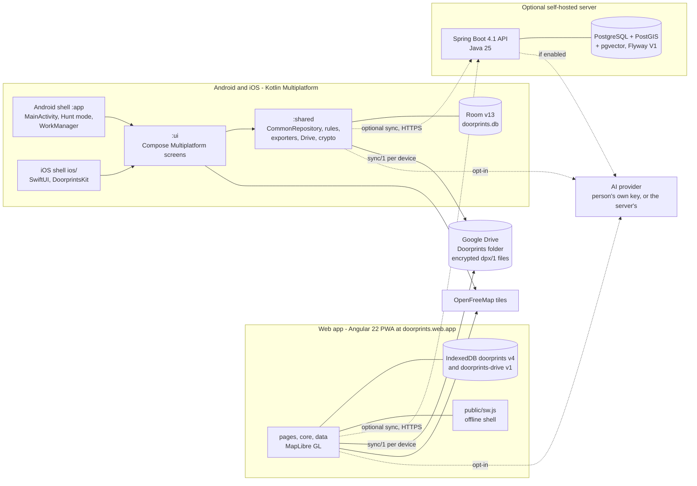

# 16: Architecture overview (the map)

| Field | Value |
|---|---|
| Document | Architecture overview: the one entry page for the high-level and low-level design |
| Version | 0.5 |
| Date | 2026-10-15 |
| Owner | Lead (Claude, Code); product owner: Sriram |
| Status | Draft |

This page is a **map, not a copy**. It says what the system is, draws it once, lists every store with its current version
and points at the document that holds the detail. Where it states a number (a Room version, an IndexedDB version) it
names the file the number comes from, so a reader can check it and a reviewer can see when it moved. The design itself
stays in [03](03-design.md) and the satellites named below.

## Change log

| Version | Date | Author | Change |
|---|---|---|---|
| 0.1 | 2026-10-15 | Claude (Code), engineer | First version: the ten-minute summary, the one component diagram, the per-stack table with each store's current version, the data contracts, the reading path, where the recent designs live and the rule that keeps this page current. Written from the code on `main` at `c2a36b84`. |
| 0.2 | 2026-10-15 | Claude (Code), docs | Voice stated as built on the web (merged), Android (#355) and iPhone (#354); the PR numbers are to be dropped once both are on `main`. |
| 0.3 | 2026-10-15 | Claude (Code), docs | Voice stated as built on the web, Android and the iPhone; the PR numbers dropped. |
| 0.4 | 2026-10-15 | Claude (Code), docs | The `school` kind is described as compiled in but off, offered after the switch (`docs/school-compiled-in-wording`). |
| 0.5 | 2026-10-15 | Claude (Code), docs | Kinds: capabilities, every word from the kind file and the generated word tables (kinds PR 25 to 31, [03](03-design.md) §18.19 to §18.25) in §6. |

## 1. Ten minutes

**What it is.** Doorprints remembers the houses a person visits while house-hunting in India: price, BHK, a checklist, a
rating, photos, contacts, notes, visits, and a map that shows them. It is not a listings site. Four languages (English,
Hindi, Tamil, Telugu; the last three ship marked *under review*). Zero cost is an owner rule ([CLAUDE.md](../CLAUDE.md)).

**Three stacks, one data model.**

| Stack | What | Where |
|---|---|---|
| Web app (PWA) | Angular 22, MapLibre GL, IndexedDB; installable, offline after the first visit; hosted on Firebase Hosting at `https://doorprints.web.app` ([03](03-design.md) ADR-21) | `web/` |
| Phones (Android and iOS) | Kotlin Multiplatform with Compose Multiplatform: `:shared` (rules, Room, API client, exporters, Drive, crypto), `:ui` (all screens), `:app` (the Android shell); iOS is a small SwiftUI shell around `:ui` ([03](03-design.md) ADR-14, ADR-23) | `android/`, `ios/` |
| Server (optional) | Spring Boot 4.1, Java 25, PostgreSQL with PostGIS and pgvector; self-hosted, never required | `backend/` |

**Local-first.** Every client keeps all of a person's data on the device (Room on the phones, IndexedDB in the browser) and
works with no account and no server. Sync is an add-on, in two forms: the optional server (last-write-wins by
`sync_version`, [03](03-design.md) §10) and **Google Drive as the sync hub**, in the person's own Drive, end to end
encrypted on the device (`dpx/1`, one snapshot file per device; [15](15-google-drive-backup-and-sharing.md), ADR-33).

**Kinds are spaces.** A *kind* describes one sort of candidate in a data file (`docs/schemas/kinds/<kind>.json`); a house
is the first kind. A *space* is a filter over the one candidate store, chosen in the chooser and in Settings > What you
track. The production build offers the house alone; the `school` kind is compiled in but off, offered only after *Experimental: more than houses* is turned on
(`RELEASED_KINDS` in `web/src/app/core/kind-setting.ts`; `android/ui/.../Space.kt`; [03](03-design.md) ADR-36, §18).

**AI is opt-in.** Nothing needs it. A person can use their own provider key on the device (Gemini, an OpenAI-compatible
endpoint or Anthropic; [03](03-design.md) ADR-26, ADR-35) or, with a server whose owner turned it on
(`APP_AI_ENABLED`), the server's own key ([ai/ai-design.md](ai/ai-design.md)). Contact names and phones are redacted
before text reaches a model.

**Voice input is opt-in**: a switch under *AI features*, off by default, and a microphone in the three AI text boxes. It uses
the person's own provider and key only; audio is held in memory, never stored, and the transcript is editable before anything
is sent ([03](03-design.md) ADR-37, §19). Built on the web, Android and the iPhone (the iPhone's is early and untested on a device; the owner's rows are MT-104 to MT-108 in `docs/ops/manual-test-checklist.md`).

**Release.** No Play Store and no public server until the release security gate passes ([14](14-lead-backlog-and-handoff.md),
[10](10-sprint-log.md) §12.5). A pushed tag `v*.*.*` runs `.github/workflows/release.yml`: it builds and signs the APK and
creates a **draft** GitHub Release (APK, `.sha256`, the signer fingerprint); the owner runs the gate ([13](13-release-security-checklist.md))
and publishes by hand ([07](07-secure-build-and-deploy.md) §1, §5). The web app deploys from `main` by `web.yml`.

## 2. The components

Solid lines are what a default install does; dotted lines are opt-in. The server never sees Drive, and Drive never sees
the server: each client reconciles with whichever hubs the person connected. The detailed C4 views are in
[03](03-design.md) §2 to §4; the deployment is [03](03-design.md) §5.

## 3. Per stack: modules, stores and entry points

Versions below are read from the named files on `main`; when one moves, this table moves in the same pull request (§7).

| Stack and module | Store and its current version | Sync role | Entry files | README and design |
|---|---|---|---|---|
| **Web** `web/` | IndexedDB `doorprints`, **version 4** (`DB_VERSION` in `web/src/app/data/local-db.ts`): stores `houses`, `visits`, `photos`, `settings`, `records` (compound key `[type, id]`, index `type`), `trace_points`, `saved_walks`; indexes `houseId` on visits, photos and saved walks, `walk` on trace points. Steps: 1 first, 2 `records` and the `houseId` indexes, 3 the path trace, 4 every house rewritten as a candidate (`kind`, `money`, `extras`). Second database `doorprints-drive` **version 1** (`data/drive/connect/stores/drive-db.ts`): Drive state, keys watermark, pending deletions, photo state, device key | Server: `data/sync.service.ts`, `data/sync-backend.ts`, `data/sync-rules.ts`. Drive: `data/drive/drive-sync-engine.ts`, `drive-merge.ts`. Crypto: `data/crypto/` | `web/src/main.ts`, `app.config.ts`, `app.routes.ts`, `public/sw.js`, `firebase.json` | [web/README.md](../web/README.md); [03](03-design.md) §4.3, §6.4, §16.4; file layout [14](14-lead-backlog-and-handoff.md) §9 |
| **`:shared`** `android/shared` (Kotlin Multiplatform: `commonMain`, `androidMain`, `iosMain`) | Room, **version 13** (`@Database(version = 13)` in `android/shared/src/commonMain/kotlin/app/doorprints/data/AppDatabase.kt`): tables `houses`, `visits`, `photos`, `track_points`, `saved_walks`, `records`; migrations `MIGRATION_1_2` to `MIGRATION_12_13`; exported schemas `android/shared/schemas/app.doorprints.data.AppDatabase/2.json` to `13.json`, pinned by `RoomSchemaTest` | The `SyncBackend` seam: `data/SyncBackend.kt`, `ServerSyncBackend.kt`, `drive/sync/DriveSyncBackend.kt`; `CommonRepository.kt` runs the loop; Drive client `drive/DriveClient.kt`; crypto `crypto/` | `data/CommonRepository.kt`, `data/AppDatabase.kt`, `iosMain/.../AppDatabaseIos.kt` | [android/shared/README.md](../android/shared/README.md); [03](03-design.md) §4.2.1, §6.2; file layout [14](14-lead-backlog-and-handoff.md) §10 |
| **`:ui`** `android/ui` | None (state lives in `:shared`) | None | `commonMain/.../ui/Root.kt`; spaces `Space.kt`, `KindsSettingsSection.kt`; iOS `iosMain/.../MainViewController.kt` | [android/ui/README.md](../android/ui/README.md); [03](03-design.md) ADR-23, §4.2.1 |
| **Android shell** `android/app` | Settings through `data/SettingsStoreFactory.kt`; the Room file is opened by `data/AppDatabaseFactory.kt` | `data/SyncWorker.kt` (WorkManager) | `MainActivity.kt`, `DoorprintsApp.kt`, `location/HuntService.kt` (Hunt mode) | [03](03-design.md) §4.2 |
| **iOS shell** `ios/` | The same Room schema through `AppDatabaseIos.kt`, in `Application Support/Doorprints` (`IosDataDirectory.kt`); API key in the Keychain | As `:shared` | `ios/Doorprints/DoorprintsApp.swift`, `ios/project.yml` (XcodeGen; the project is generated, not committed) | [ios/README.md](../ios/README.md); [03](03-design.md) ADR-23 |
| **Server** `backend/` | PostgreSQL with PostGIS and pgvector. Flyway has **one migration, `V1__init.sql`**: the earlier V1..V14 were squashed on 2026-10-12 (S4b-BL-206, [03](03-design.md) ADR-36), so a database made by those is dropped and created again; a change from here on is a new `V2__...sql`. Tables `house` (with `kind`, `money_amount`, `money_cadence`, `extras`), `house_checklist`, `visit`, `photo`, `record`, `device_key`, `pairing_request`, `pairing_invite`, `owner_token`, `server_secret`, `server_setting`, and, when the extension exists, `vector_store` | Authoritative copy for the clients that connect: `sync_seq` gives every write a `sync_version`, clients pull `since=` ([03](03-design.md) §9, §10) | `backend/src/main/java/app/doorprints/server/DoorprintsApplication.java`; controllers under `house/`, `visit/`, `photo/`, `record/`, `backup/`, `privacy/`, `device/`, `ai/web/`; filters in `config/` | [backend/README.md](../backend/README.md); [03](03-design.md) §4.1, §6.1, §9, §12.1; AI [ai/ai-design.md](ai/ai-design.md) |

Notes that save a reading: the server's wire names are `candidates` (`/api/candidates`), not houses, since the format
reset of 2026-10-12; a table keeps the name `house`. The phones and the website store the same rows in the shapes
[docs/schemas](schemas/README.md) pins; the three implementations are written separately and held together by shared
vector files (§4), not by shared code.

## 4. Data contracts

Anything that crosses a boundary (a file, a wire, a store another stack reads) has a written contract and, where two
stacks implement it, a vector file both test against. A rule that exists on three stacks gets a vector first
([14](14-lead-backlog-and-handoff.md) §7).

| Contract | Where it is pinned |
|---|---|
| The index of every format and vector file | [schemas/README.md](schemas/README.md) |
| Kind files (`house.json`, `school.json`, `kind.schema.json`) and their vectors (labels, fields, filters, search, scope, status, AI slots) | [`schemas/kinds/`](schemas/kinds/), schemas/README §8.4 |
| The backup and the update file: `doorprints-backup/<n>`, the family restarted at `/1` for candidates on 2026-10-12, older files still read | schemas/README §1 to §6, `backup-sample.json`, `import-vectors.json`, `backup-vectors.json` |
| The Drive sync file `sync/1` | [`schemas/sync-1.schema.json`](schemas/sync-1.schema.json), `sync-vectors.json`, schemas/README §6.5 |
| The Drive envelope `dpx/1`, HPKE and the folder layout | [15](15-google-drive-backup-and-sharing.md) §5.1, §9.6; `dpx-vectors.json`, `hpke-vectors.json`, `drive-vectors.json`, `drive-sync-scenarios.json` |
| The server's REST API | [03](03-design.md) §9; the OpenAPI file `backend.yml` uploads as an artifact |
| The AI request and answer shapes, prompts and the eval sets | [ai/ai-design.md](ai/ai-design.md) §6, §13, `ai/evals/` |
| Path trace and place check | `schemas/trace-repeat-vectors.json`, schemas/README §6.4 |
| Deletion blast radius (one space never changes another) | `schemas/delete-scope-vectors.json` |
| The shared default questions and moving-in list | `schemas/default-questions.json`, `default-movein.json` |

## 5. Reading path

1. This page (10 minutes).
2. [03](03-design.md) §1 to §5: overview, C4 levels 1 to 3, components, deployment.
3. [15](15-google-drive-backup-and-sharing.md): the Drive hub (§1, §5, §9), because it changes how sync is thought about.
4. [schemas/README.md](schemas/README.md): what is pinned between stacks.
5. [14](14-lead-backlog-and-handoff.md) §1 (state now) and §7 (how a session works here).
6. The satellites, by need: [04](04-data-flow-diagrams.md) data flows, [02](02-threat-model.md) threats, [06](06-test-plan.md)
   tests, [07](07-secure-build-and-deploy.md) pipeline, [08](08-operations-runbook.md) operations, [ai/ai-design.md](ai/ai-design.md),
   [ai/voice-input.md](ai/voice-input.md), the module READMEs, and [10](10-sprint-log.md) for ticket history.

## 6. Where the recent designs live

| Design | Decision | Detail |
|---|---|---|
| Kinds and spaces (chooser, What you track, per-space Compare, Ask, Plan and copies, phones, the server's list of kinds) | [03](03-design.md) ADR-36 | [03](03-design.md) §18.12 to §18.15 (§18.1 to §18.11 the kind file and its doors); `app.kinds.available` / `KINDS_AVAILABLE` on the server |
| Kind capabilities (Hunt, Compare, contacts, rooms, viewings, filters) and a kind's words (`words` ids, generated from the files by `tools/gen-kind-words.mjs`) | [03](03-design.md) ADR-36 | [03](03-design.md) §18.19 to §18.25; [schemas/README.md](schemas/README.md) §8.4 |
| Kind-aware AI | ADR-36, ADR-35 | [03](03-design.md) §18.11, §18.17; [ai/ai-design.md](ai/ai-design.md) §16.1 to §16.12 |
| Own-key AI on the device, and the server's AI | ADR-26, ADR-35 | [03](03-design.md) §13, §13.1, §13.2; [ai/ai-design.md](ai/ai-design.md) |
| Deletion safeguards (Undo, Recently deleted, Delete all in this space) | S4b-BL-283 to -285, -287 | [03](03-design.md) §20; [04](04-data-flow-diagrams.md) §5.2 |
| Voice input | ADR-37 | [03](03-design.md) §19; [ai/voice-input.md](ai/voice-input.md); [ai/ai-design.md](ai/ai-design.md) §13.3, §8.8 |
| Google Drive backup, sync, deletion and device keys | ADR-33 | [15](15-google-drive-backup-and-sharing.md); [03](03-design.md) §12.1 for the server's device keys |
| Path trace and the place check | ADR-34 | [03](03-design.md) §6.2, §7.2a, §7.2b; [11](11-feature-parity-and-export-spec.md) 5.27 |
| Release (tag, signed draft release) | C-02 | `.github/workflows/release.yml`; [07](07-secure-build-and-deploy.md) §1, §5; [13](13-release-security-checklist.md) |
| Threat model (STRIDE, findings, residual risks) | | [02](02-threat-model.md) |
| India's boundaries | ADR-22 | [03](03-design.md) §11.1; `web/src/app/shared/india-boundaries.ts` |

## 7. How to keep this page current

The rule is in [14](14-lead-backlog-and-handoff.md) §7 (*Per change*): **a new store version, module, workflow, ADR or stack
entry point updates this page in the same pull request.** In practice:

- A Room version bump, an IndexedDB `DB_VERSION` bump or a new Flyway file changes the store cell of §3.
- A new Gradle module, a new top-level directory, a new workflow or a new stack entry file changes §3 or §1.
- A new ADR, or a design section in [03](03-design.md) or a satellite, adds a row to §6.
- A new format or vector file adds a row to §4 (and to schemas/README, which stays the full index).
- The diagram in §2 changes when a box or an arrow of the default or the opt-in paths changes.

Raise the version here and add a change-log row; `node tools/check-docs-versions.mjs` checks that the header equals the top
row. Keep it a map: put detail in [03](03-design.md) or the satellite and link to it. When this page and the code disagree,
the code wins; fix this page.
